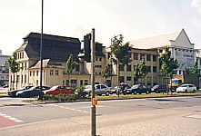
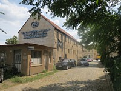

* * *

* * *

**Werbeprospekt der Firma aus den**

**1930er Jahren**

Das Unternehmen wurde am 1. Oktober 1904 auf der Zwickauer Straße 42 von Franz Joseph Koch und Kurt August Sterzel als Spezialfabrik wissenschaftlicher Apparate und Instrumente gegründet. Innerhalb weniger Jahre gelang es beiden, ihre Firma zu einem der führenden Hersteller elektrotechnischer Anlagen in Deutschland zu machen. In enger Zusammenarbeit mit der damaligen Technischen Hochschule spezialisierten sie sich auf Prüf- und Hochspannungstechnik sowie auf die Herstellung von Röntgengeräten. Zu den herausragenden Leistungen gehörte die Entwicklung des ersten 1-MV-Prüftransformators Europas für die Hochspannungshalle der TH (1921).

Da die Räumlichkeiten an der Zwickauer Straße bald nicht mehr ausreichten, erwarb das Unternehmen 1922 einen Großteil des früheren [Kaditzer Flugplatzes](../../../../nordwest/kaditz/flugplatz_kaditz/) mit der ehemaligen Luftschiffhalle. Hier entstanden moderne Produktionsstätten für die Transformatorenherstellung. Schwere Verluste verzeichnete die Firma durch die Folgen des Zweiten Weltkrieges. Während das Röntgenwerk auf der Zwickauer Straße beim Luftangriff 1945 völlig zerstört wurde, blieb der Übigauer Betriebsteil von den Bomben verschont, wurde jedoch kurz nach Kriegsende von der Sowjetunion demontiert.

Nach Aufhebung der sowjetischen Zwangsverwaltung 1948 wurde die Firma Koch & Sterzel in einen volkseigenen Betrieb umgewandelt und unter dem Namen VEB Transformatoren- und Röntgenwerk Dresden (TuR) zu einem der wichtigsten Exportbetriebe der DDR ausgebaut. Mit über 4300 Angestellten gehörte der Betrieb bis 1990 zu den größten Arbeitgebern in Dresden. Bereits in den 1950er Jahren entstanden umfangreiche Erweiterungsbauten zwischen Kaditz, Mickten und Übigau, darunter 1951-53 die große Montagehalle an der Overbeckstraße 48 nach Entwürfen des Architekten Paul Michael. Der moderne Stahlbetonbau mit über 30 Metern Höhe gehört zu den wichtigsten Industriebauten der Nachkriegszeit in Dresden.

Nach Vereinigung mit einigen weiteren Dresdner Betrieben, unter anderem einem Nachfolgebetrieb der früheren Übigauer Schiffswerft (Werk II - _Foto_) stellte die Firma verschiedene elektrotechnische Großanlagen, Transformatoren, Spannungsprüfanlagen und Medizintechnik her. Für die Arbeiter wurden in den angrenzenden Stadtteilen Wohnblocks und Sozialeinrichtungen errichtet, so u. a. an der Kötzschenbroder und im Bereich Lommatzscher Straße. Zu Verbesserung der Verkehrsanbindung des Areals wurde 1953 die [Kaditzer Industriebahn](../../../../nordwest/kaditz/industriebahn_kaditz/), 1967 die Verlängerung der Straßenbahnlinie von der Stern- bis zur Washingtonstraße in Betrieb genommen. 1971 erhielt der Betrieb den Namen “Hermann Matern”.

Nach 1990 endete auch die Geschichte dieses traditionsreichen Dresdner Unternehmens. Nachdem eine Übernahme des Bereichs Medizintechnik durch die Firma GE Medical Systems trotz Bestandsgarantie für 10 Jahre und 560 Arbeitsplätze durch die Treuhandgesellschaft abgelehnt worden war, wurde der gesamte Betrieb 1991 an Siemens übertragen, der Transformatorenbau jedoch zwei Jahre später eingestellt bzw. an andere Standorte verlegt. Heute nutzen verschiedene Betriebe und Großmärkte das als Technopark bezeichnete Gelände. Einige Gebäude, darunter die große Transformatorenhalle an der Washingtonstraße, stehen unter Denkmalschutz.

* * *

 \[ [Home](../../../../index.html)\] \[ [Nord](../../../../nord/)\] \[ [Nordwest](../../../../nordwest/)\] \[ [Neustadt](../../../../neustadt/)\] \[ [Nordost](../../../../nordost/)\] \[ [West](../../../../west/)\] \[ [Zentrum](../../../../zentrum/)\] \[ [Südwest](../../../../sudwest/)\] \[ [Süd](../../../../sud/)\] \[ [Südost](../../../../sudost/)\] \[ [Ost](../../../../ost/)\] \[ [Register](../../../../Register/register.html)\] \[ [Kontakt](../../../../Kontakt/kontakt.html)\] \[ [Impressum](../../../../impressum/)\]
