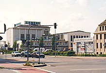
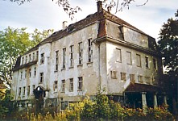
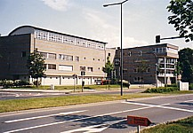

Die Washingtonstraße bildete einst die östliche Grenze des [Kaditzer Flugplatzes](../../../../nordwest/kaditz/flugplatz_kaditz/) und wurde deshalb auch Am Flugplatz genannt. Erst im Zuge des Baus der [Flügelwegbrücke](../../../../nordwest/kaditz/strassen_kaditz/flugelwegbrucke/) wurde sie 1930/31 ausgebaut und aus Anlass des 200.
Geburtstages von George Washington am 22. Februar 1932 in Washingtonstraße umbenannt. Washington war ab 1775 Oberbefehlshaber der amerikanischen Unabhängigkeitstruppen und wurde 1789 zum ersten Präsidenten der USA
gewählt.

Ursprünglich war geplant, die neue Straße bis zur Rankestraße weiterführen und als Teilabschnitt in die vorgesehene
Fernstraße Berlin - Dresden - Prag einzubinden. Diese Planungen wurden jedoch ebenso wenig umgesetzt wie der Bau
einer Schnellstraßenbahn zwischen Meißen und Pirna, welche ebenfalls über die Washingtonstraße geführt werden sollte.
Erst nach 1990 erfolgte ein vierspuriger Ausbau bis zur Autobahnauffahrt Dresden-Neustadt und in diesem Zusammenhang
der Bau einer 160 Meter langen Brücke über die Flutrinne, so dass die Washingtonstraße heute auch bei Hochwasser
uneingeschränkt befahrbar ist. Mit den Arbeiten wurde am 4. März 1997 begonnen, die Übergabe erfolgte am 14. August 1998.

Das Straßenbild prägen heute vor allem gewerbliche Ansiedlungen. Auf dem Gelände des früheren Flugplatzes entstanden
nach dessen Stillegung Kleingärten, ein Sportplatz sowie Industriebetriebe. Bis 1990 war das zwischen Kaditz und Mickten/Übigau gelegene Transformatoren- und Röntgenwerk (ehemals [Koch & Sterzel](../../../../nordwest/ubigau/strassen_ubigau/koch___sterzel/)) größtes Unternehmen in Dresden. Heute werden die Gebäude als Siemens-Technologiepark genutzt _(Foto)_.

Luftschifferkaserne:

Die Gebäude entstanden im Zusammenhang mit dem Bau des Kaditzer Flugplatzes
kurz vor Beginn des Ersten Weltkrieges. Mit der Bauausführung waren die Dresdner Firmen Wilhelm Seifert und Gerstenberger & Döhler beauftragt. Bereits
1914 bezogen die ersten Luftschiffer sowie Nachrichtensoldaten des Telegraphen-Bataillons Nr. 7 den Komplex, der aus zwei Kasernen- und Familienwohngebäuden, Reit- und Turnhalle, Offizierskasino, Ställen und weiteren
Nebengebäuden bestand. Die Übigauer Kaserne war bis 1945 Unterkunft der Nachrichtenabteilung Nr. 4 und erhielt in den 1920er Jahren den Namen Hindenburg-Kaserne.

Nach dem Einzug der Roten Armee
belegten sowjetische Soldaten den Komplex, der bis zum Abzug im Frühjahr 1993 von einer Nachrichten- und einer Pioniereinheit genutzt wurde. Die stark verfallenen Gebäude konnten jedoch trotz
intensiver Bemühungen nicht wieder vermietet bzw. verkauft werden. Pläne zur Einrichtung eines Aussiedlerwohnheimes,
einer Wohnanlage für Senioren bzw. eines Gewerbeparkes scheiterten an den hohen Sanierungskosten. Die völlig verwahrlosten Gebäude wurden deshalb 2002-04 teilweise abgerissen. Auf dem Areal befindet sich heute ein
Gartenmarkt. Außerdem nutzen seit 1998 die Dresdner Hauptfeuerwache und das DRK einen Teil des früheren
Kasernengeländes  Die übrigen Gebäude erwarb 2012 ein Leipziger Investor, der hier eine Wohnanlage einrichten will.

**_Fotos:_** _Der Übigauer Kasernenkomplex kurz vor dem Abbruch im Herbst 2004_

Hauptfeuerwache:

Der moderne Gebäudekomplex wurde 1997-98 auf einem Teil des ehemaligen
Kasernengeländes an der Ecke zur Scharfenberger Straße errichtet. Die modernen Bauten beherbergen auch die Umweltschutzwache der Berufsfeuerwehr, das Feuerwehrtechnische Zentrum sowie Aus- und
Fortbildungeinrichtungen. Hinzu kommen mehrere Fahrzeughallen zur Unterbringung der Löschzüge und sonstiger Feuerwehrtechnik. Ein Verwaltungs-
und Sozialgebäude, Sporthalle und verschiedene Trainingsanlagen komplettieren das Areal.

Video: Ausrücken der Dresdner Feuerwehr aus der Hauptfeuerwache Übigau

* * *

 \[ [Home](../../../../index.html)\] \[ [Nord](../../../../nord/)\] \[ [Nordwest](../../../../nordwest/)\] \[ [Neustadt](../../../../neustadt/)\] \[ [Nordost](../../../../nordost/)\] \[ [West](../../../../west/)\] \[ [Zentrum](../../../../zentrum/)\] \[ [Südwest](../../../../sudwest/)\] \[ [Süd](../../../../sud/)\] \[ [Südost](../../../../sudost/)\] \[ [Ost](../../../../ost/)\] \[ [Register](../../../../Register/register.html)\] \[ [Kontakt](../../../../Kontakt/kontakt.html)\] \[ [Impressum](../../../../impressum/)\]
