* * *

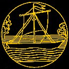

**Gemeindesiegel von Blasewitz**

* * *

**Blasewitzer Stadtteilseiten:**

* * *

**Bildungseinrichtungen**

**in Blasewitz**

[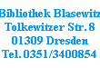](http://www.bibo-dresden.de)

[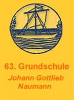](http://www.63-grundschule-dresden.de)

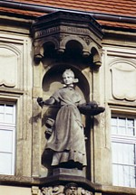Blasewitz wurde als slawischer Rundweiler auf einer kleinen Rodungsfläche am Elbufer
gegründet und 1349 erstmals als Blasenwicz erwähnt. Der aus dem altsorbischen stammende Name bedeutet Leute des Blazen (“der Glückliche”) und weist auf den Ortsgründer bzw.
Sippenältesten hin. 1384 erhielt der aus einer wohlhabenden Dresdner Bürgerfamilie stammende Peter Münzmeister Blasewitz zum Lehen. Abgaben mussten auch an die
Burggrafen von Dohna geleistet werden, nach deren Entmachtung 1302 an die Markgrafen von Meißen. 1480 gehörte das Dorf  in den Verantwortungsbereich der Dresdner
Kreuzkirche, deren Zinsrechte später vom Religionsamt bzw. vom Brückenamt zur Unterhaltung der Dresdner Elbbrücke verwendet wurden. 1666 wurden acht Höfe des Ortes
durch einen Großbrand vernichtet, jedoch schnell wiederaufgebaut. Schwere Verwüstungen richteten auch die häufigen Elbehochwasser und Eisfluten an. 1683 ließ Kurfürst Johann
Georg III. im Blasewitzer Tännicht sein Heer zusammen stellen, mit dem er später die Türken vor Wien in die Flucht schlug.

Wichtigster Wirtschaftszweig des Dorfes, welches im 17. Jahrhundert 16 Bauernstellen besaß, war die Landwirtschaft. Hinzu kamen Garten- und Weinbau. Ein Großteil der Ortsflur wurde jedoch vom Waldgebiet des [Blasewitzer Tännichts](../../ost/) eingenommen. Aus diesem Grund war Blasewitz ab 1697 wichtiges Jagdrevier der Wettiner. Aus einem früheren
Forsthaus am alten Dorfplatz (heute Schillerplatz) entwickelte sich der [Gasthof](../../ost/blasewitz/strassen_blasewitz/schillerplatz/schillergarten/), der durch Schillers “Gustel von
Blasewitz” in die Geschichte einging **_(Foto oben:_** _Plastik am ehemaligen Rathaus)_. Bereits zu diesem Zeitpunkt war
das romantisch am Elbufer gelegene kleine Dorf beliebte Sommerfrische der Dresdner, die hier die ersten Landhäuser errichteten. 1855 entstand die 1898 nach Laubegast verlegte Blasewitzer [Schiffswerft](../../ost/laubegast/schiffswerft_laubegast/).

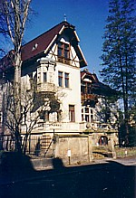Im 19. Jahrhundert nahm die Anzahl dieser Villen immer mehr zu. Zunächst entstanden die Gebäude weitgehend planlos auf verschiedenen Parzellen, die von den Bauern an ihre neuen
Besitzer verkauft worden waren. Die ältesten dieser Häuser blieben bis heute an der Brucknerstraße erhalten. 1863 erließ die Gemeinde eine Bauordnung, die Vorschriften über
die künftige bauliche Entwicklung des Ortes festlegte. Maßgeblichen Einfluß hatte der Regierungsrat Arthur Willibald Königsheim, der 1867 den [Waldparkverein](../../ost/blasewitz/waldpark_blasewitz/) gründete. Seinen
Bemühungen ist die Erhaltung der Reste des Blasewitzer Tännichts zu verdanken, die er in die architektonische Gestaltung der neuen Villenviertel einbezog. Das Foto zeigt die um 1894 erbaute Villa Vogesenweg 4.

Nach Erlass eines weiteren Bebauungsplanes im Jahr 1874 wuchs Blasewitz endgültig zum wohlhabenden Villenvorort, in dem zahlreiche Fabrikbesitzer, Kommerzienräte und
Staatsbeamte, aber auch Künstler und Wissenschaftler ihren Wohnsitz nahmen. Die Baupläne für die neuen Häuser
stammten teilweise von bedeutenden Architekten wie Julius Gräbner und Johannes Schilling (Schilling & Gräbner),
Konstantin Lipsius, Emil Scherz, Martin Pietzsch und Karl Diestel. Bereits 1879 waren die letzten Bauerngüter zugunsten neuer Wohngebäude verschwunden. Als Ortszentrum entstand ab 1890 am ehemaligen Dorfplatz die
großstädtisch- geschlossene Bebauung des [Schillerplatzes](../../ost/blasewitz/strassen_blasewitz/schillerplatz/). 1893 folgte die bekannte Elbbrücke [“Blaues Wunder”](../../nordost/loschwitz/blaues_wunder/), womit der Platz endgültig sein ländliches Bild verlor _(Foto)_.

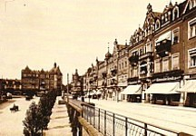

Um die Bedürfnisse der reichen Blasewitzer Neubürger immer besser befriedigen zu können, errichtete die Gemeinde
eine Reihe kommunaler Einrichtungen. So entstanden ein modernes Rathaus an der Naumannstraße, mehrere Schulen sowie die 1893 eingeweihte [Heilig-Geist-Kirche](../../ost/blasewitz/heilig-geist-kirche/). Bereits 1872 hatte Blasewitz Anschluss an die erste Dresdner
Straßenbahnlinie erhalten. Um die Jahrhundertwende gehörte der Ort mit einem durchschnittlichen Steueraufkommen
von fast 38 Mark (Dresden: 18,54 Mark) zu den reichsten Gemeinden in Sachsen. Dieser Wohlstand des Ortes war auch der Grund, dass sich Blasewitz allen Einverleibungsversuchen der Stadt entgegenstellte. Sogar ein eigenes
Gymnasium wurde eingerichtet, nachdem die Stadt Dresden 1903 die Aufnahme Blasewitzer Schüler an städtische
Schulen verweigert hatte. Erst am 1. April 1921 wurde der Ort gegen den Widerstand eines Großteils der Bevölkerung per Zwangsverordnung des Innenministeriums Stadtteil von Dresden.

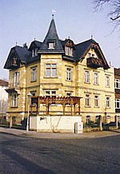Trotz des Verlustes der Selbstständigkeit blieb Blasewitz auch nach dem Ersten Weltkrieg
ein beliebter Wohnort der “höheren Kreise”. 1945 fielen einige Gebäude um den Schillerplatz und im westlichen Teil den Bomben zum Opfer. Neben Wohnhäusern und
öffentlichen Gebäuden wurden auch mehrere Gaststätten  und die Bootshäuser der Rudervereine zerstört. Als Ersatz entstand für letztere ein moderner Neubau in der Nähe der
Reinhold-Becker-Straße. Neben den Wassersportlern nutzten auch die Dresdner Segelflugvereine die Elbwiesen als Start- und Landeplatz. Pläne für eine komplette
Umgestaltung des Blasewitzer Ortskerns, die 1967 völlig neue Straßenführungen, den Abriss des “Blauen Wunders” und zahlreicher Villen vorsahen, kamen glücklicherweise nicht
zustande. Nach 1990 wurden die noch verbliebenen Bombenlücken durch moderne Wohn- und Geschäftshäuser geschlossen. Hauptanziehungspunkt ist die 2000 eingeweihte
Schillergalerie auf dem Grundstück des früheren Naumann-Palais. Dennoch behielt Blasewitz bis zur Gegenwart sein Flair als großbürgerlicher Wohnvorort, in dem vor allem Villen und Landhäuser das Straßenbild
dominieren. Das Foto zeigt ein typisches Haus aus der Zeit um 1880 (Ecke Preller-/Wägnerstraße).

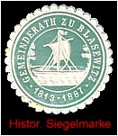

Rathaus:

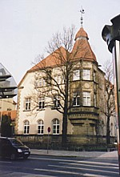Das Blasewitzer Rathaus entstand in mehreren Bauetappen ab 1850 auf einem Grundstück
in der Nähe der Elbe. Ältester Teil ist das 1851 eingeweihte alte Schulhaus, welches nach Plänen von Gottfried Semper entworfen wurde. 1876 zog in diese Räume die
Gemeindeverwaltung und das Standesamt ein. 1890 wurde das Rathaus vom Architekten Wägner umgebaut und 1904 von Karl Emil Scherz nochmals erweitert. In diesem
Zusammenhang wurden drei Relieftafeln mit Bildnissen sächsischer Könige an der Fassade angebracht, die jedoch der “Bilderstürmerei” nach dem Zweiten Weltkrieg zum Opfer fielen.
Eine weitere, ebenfalls von Martin Engelke geschaffene Plastik, erinnert an die berühmteste Einwohnerin des Ortes, die “Gustel von Blasewitz”. Heute hat hier das Ortsamt Blasewitz seinen Sitz.

Seit 1902 befindet sich am Rathaus eine Gedenktafel für den Komponisten Johann Gottlieb Naumann (Enthüllung am  23. Oktober 1902). Diese Tafel wurde von Prof. Kurt Diestel
entworfen und von Bruno Fischer angefertigt, der sein Atelier auf der Tolkewitzer Straße hatte. Im Zweiten Weltkrieg
für Rüstungszwecke eingeschmolzen wurde diese 1991 als Kopie wieder am Gebäude angebracht.  Zwei weitere Tafeln wurden 2007 bei Sanierungsarbeiten entdeckt. Diese stammen aus dem Jahr 1841 und erinnern an das
ehemalige “Naumannstift” in Blasewitz.

Postamt:

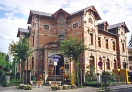Die erste Blasewitzer Poststelle befand sich in einem Bauernhaus auf der Tolkewitzer Straße 7. Später diente dieses Gebäude als Restaurant “Zur alten Post” und wurde nach seinem Besitzer auch “Böttgers Restaurant” genannt. Als neue Postdienststelle entstand 1892 ein repräsentativer Neubau im Landhausstil an der Justinenstraße 1/ Ecke Berggartenstraße. Leider ging der ursprünglich vorhandene Dachreiter bei einem späteren Umbau verloren. Das Postamt wurde am 26. Mai 1999 geschlossen und wird heute als Weinhandlung genutzt.

Schulen in Blasewitz:

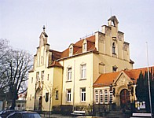Alte Schule (Naumannstift): Das erste Blasewitzer Schulhaus entstand 1850/51 auf einem Grundstück an der heutigen Naumannstraße. Der später etwas veränderte Entwurf für das Gebäude stammt von Gottfried Semper. Die finanziellen Mittel für den Schulbau wurden zum Großteil durch die 1841 ins Leben gerufene Naumann-Stiftung zur Verfügung gestellt, wobei sich sogar der Komponist Franz Liszt durch ein Benefiz-Konzert 1844 an den Kosten beteiligte. Am 14. November 1851 erfolgte die feierliche Einweihung dieser Schule. Das Haus ist bis heute erhalten geblieben und gehört jetzt zum Komplex des Blasewitzer Rathauses _(Foto)_. 1876 wurde diese Schule in einen Neubau an der Kretschmerstraße verlegt.

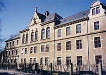Bürgerschule: Nachdem die alte Schule nicht mehr den Anforderungen genügte, entstand 1875/76 ein Neubau an der Kretschmerstraße. Entworfen wurde dieses Gebäude von Ernst Giese und Paul Weidner. Die Schuluhr stiftete der Blasewitzer Gemeindevorstadt Tauscher. Am 16. Juni 1876 konnte das Haus als einfache Volksschule eingeweiht werden. Neben dem eigentlichen Schulhaus gehörte auch eine Turnhalle dazu, die sonntags zugleich als Kirchsaal diente. Außerdem gab es hinter dem Gebäude einen kleinen botanischer Garten. Mit wachsender Schülerzahl wurde diese Schule 1894 in eine Mittlere, 1898 in eine Höhere Volksschule (Bürgerschule) umgewandelt. Ein Erweiterungsbau mit zusätzlichen Klassenräumen und einem großen Saal folgte nach Plänen von Karl Emil Scherz 1900.

Nach der Eingemeindung übernahm die Stadt Dresden diese Schule, die nun als 63. Volksschule bezeichnet wurde. Heute wird das Haus von der 63. Grundschule genutzt _(Foto)_. Im Hof entdeckten Schüler 1995 ein Denkmal, welches in Erinnerung an drei im Ersten Weltkrieg gefallene Blasewitzer Lehrer aufgestellt worden war. Seit Oktober 2006 trägt die Schule den Namen des Komponisten Johann Gottlieb Naumann.

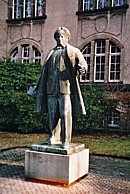
Gymnasium: Erste Pläne zur Schaffung eines eigenen Gymnasiums kamen in der wohlhabenden Gemeinde bereits 1901 auf, wurden vom Kultusministerium jedoch zunächst nicht genehmigt.
Erst nachdem sich die Stadt Dresden 1903 geweigert hatte, Blasewitzer Kinder an städtische Schulen aufzunehmen, um so die Eingemeindung des Ortes zu erzwingen, entstand in Blasewitz
ein eigenes Gymnasium. Zunächst befand sich dieses in Form einer Gymnasialklasse in den Räumen der Bürgerschule, später im Haus der Thürmerschen Lehranstalt auf der Loschwitzer
Straße. 1906/08 konnte schließlich von Karl Emil Scherz ein Neubau an der Kretschmerstraße 27 errichtet werden. Die feierliche Eröffnung erfolgte am 30. April 1908. Ursprünglich
Realgymnasium Blasewitz, ab 1938 Schillerschule genannt, trug die Schule nach ihrer Zusammenlegung mit dem früheren [König-Georg-Gymnasiums](../../zentrum/johannstadt/strassen_johannstadt/konig-georg-gymnasium/) ab 1946 den Namen Oberschule Dresden-Ost.

Im November 1954 wurde diese Schule in Erinnerung an den am 1. Juni 1954 verstorbenen Schriftsteller und Ehrenbürger Dresdens in “Martin-Andersen-Nexö-Oberschule” umbenannt. In den 1960er Jahren fungierte diese als
Spezialschule für Funkmechanik und elektronische Industrie, später als Erweiterte Oberschule mit mathematisch- technischem Profil. Nachdem die Namensgebung 1991 im Zusammenhang mit der Angliederung an das neue
Blasewitzer Gymnasium in den Gebäuden der ehemaligen 94. POS vorübergehend aufgehoben wurde, erfolgte im Juni
2001 die Rückbenennung als “Martin-Andersen-Nexö-Gymnasium Dresden-Blasewitz”. An den Schriftsteller erinnerte seit 1969 ein von Rudolf Löhner geschaffenes Denkmal _(Foto)_
vor der Schule. 2008 wurden die Einrichtung und auch das Denkmal zur [Haydnstraße](../../ost/striesen/) verlegt.

Privatschulen: Neben den von der Gemeinde finanzierten Bildungseinrichtungen existierten im wohlhabenden Villenvorort in der zweiten Hälfte des 19. Jahrhunderts auch mehrere Privatschulen. 1865 gründete der Altphilologe Dr. Richard Pietzsch, Vater des Architekten Martin Pietzsch, auf der Loschwitzer Straße 34 das Ländliche Knaben-Lehr- und Erziehungsinstitut, an welches noch eine Inschrift an der Fassade erinnert. Eine Höhere Töchterschule entstand wenig später auf der Kretschmerstraße.

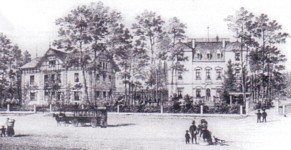

**_Bild:_** _Ländliche Lehr- und Erziehungsanstalt Blasewitz um 1870 (Zeichnung von August Reinhardt)_

Höhere Töchterschule Friedel: Die Bildungseinrichtung entstand 1870 als erste Blasewitzer Privatschule für Mädchen durch Arthur Willibald Königsheim. Leiterin der an der Loschwitzer Straße / Ecke Justinenstraße ansässigen Schule war die erst 19-jährige Selma Leiter. Zunächst wurden hier 14 Mädchen unterrichtet. 1893 entstand ein Neubau an der Kretschmerstraße 13 _(Foto)_, womit die Schulplätze auf 54 erhöht und weitere Lehrer und Lehrerinnen eingestellt werden konnten. Architekt des Gebäudes war der Blasewitzer Baumeister Karl Emil Scherz.

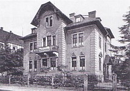Nach dem Suizid der Leiterin übernahm Helene Antonie Friedel die Aufgabe der Schulvorsteherin, was der Privatschule umgangssprachlich den Namen "Friedel-Schule" einbrachte. 1908 erfolgte der Kauf des Schulgebäudes, 1912 die Errichtung eines Erweiterungsanbaus und einer Turnhalle. Die Schule bot nun Platz für 10 Klassen und bis zu 300 Schülerinnen. Finanziert wurde sie aus dem Schulgeld der Eltern und Zuschüssen der Gemeinde. Deshalb besuchten meist Kinder wohlhabender Unternehmer, Militärs, höherer Beamte und Künstler die Friedel-Schule. Nach dem ersten Weltkrieg führten finanzielle Probleme zur Entscheidung, künftig auch Knaben aufzunehmen. Nach dem Machtantritt der Nazis und der folgenden Gleichschaltung des Bildungswesens durften ab 1935 keine neuen Schüler aufgenommen werden. Am 25. März 1939 endete mit einer Abschiedsfeier und dem Verkauf des Hauses an die Nationalsozialistische Volkswohlfahrt die Geschichte der Schule. Helene Friedel verzog in die in Villa Paradiesstraße 20 in Zschertnitz. Das ehemalige Schulhaus diente nun als Kindergärtnerinnenschule, nach 1945 als Domizil der FDJ. Nach 1990 wurde es saniert und heute von einer Fahrschule genutzt.

Höhere Mädchenschule:
Die Schule ging aus der Blasewitzer Bürgerschule und der zehnstufigen Mädchenschule zu Blasewitz hervor und befand sich ursprünglich auf der Schulstraße 9. Später gehörte sie als spezielle Mädchenabteilung
zur Blasewitzer Volksschule und wurde 1925 in Städtische Höhere Mädchenschule umbenannt. Ab 1933 nutze sie bis zu ihrer Umwandlung in eine normale Oberschule 1939 das Gebäude der ehemaligen 52. Volksschule auf der
Markgraf-Heinrich-Straße (Rosa-Menzer-Straße).

Kinderbewahranstalt: Die Einrichtung entstand 1879 auf Anregung des zwei Jahre zuvor gegründeten “Frauenvereins für
Blasewitz” und befand sich zunächst in den Räumen der Blasewitzer Volksschule. 1882 erwarb der Verein ein Grundstück an der damaligen Striesener Straße (heute Hüblerstraße), wobei die Finanzierung durch den Medizinalrat
Dr. Günz erfolgte. Da auch dieses Gebäude schon bald nicht mehr den Anforderungen genügte, entschloss man sich
1894 zum Bau eines neuen Kindergartens an der Voglerstraße 2. Der von Karl Emil Scherz errichtete Neubau konnte am 24. Juni 1895 eingeweiht werden.

Der vorrangig mit Spenden und Elternbeiträgen finanzierte Kindergarten existierte bis nach dem Ersten Weltkrieg, musste jedoch 1923
mangels Kinderzahl vorerst geschlossen werden. Zeitweise befand sich in den Räumen eine Armenküche, bevor 1925 ein Neubeginn in Angriff genommen werden konnte. Nach Vereinigung des Frauenvereins zu
Blasewitz mit einer kirchlichen Frauengruppe erfolgte 1927 die Umbenennung der Einrichtung in “Kinderheim”.
Während der NS-Zeit musste die Kinderbetreuung der nationalsozialistischen “Volkswohlfahrt” überlassen werden. Seit
1945 wird das Gebäude wieder als Kindergarten der evangelischen Kirche genutzt. Eine umfassende Sanierung erfolgte nach 1990.

Wasserwerk:

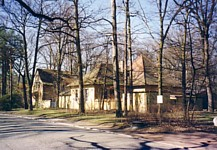Das Blasewitzer Wasserwerk entstand 1893 am heutigen Vogesenweg, nachdem Verhandlungen mit der Stadt Dresden zur Sicherung der Trinkwasserversorgung zuvor gescheitert waren. Für das Werk entstand ein Brunnen in der Nähe des Waldparkes, über den das durch die Kiesschichten des Untergrundes gereinigte Elbwasser an die Oberfläche befördert wurde. Um Spitzenbelastungen abzufangen, wurde das über den momentanen Bedarf hinaus gewonnene Wasser in einen Wasserturm an der Bahnhofstraße (jetzt Heinrich-Schütz-Straße 17/19) gepumpt und dort gesammelt. Im August 1885 konnte die gesamte Anlage in Betrieb genommen werden. Mit der Eingemeindung des Ortes wurde das Wasserwerk stillgelegt, später jedoch zeitweise wieder reaktiviert. Die vom Architektenbüro Schilling & Gräbner entworfenen Gebäude sind noch erhalten und dienen heute als Sporthalle. Beseitigt wurde hingegen der Wasserturm, in dem zuletzt die Geschäftsräume einer Waschanstalt untergebracht waren.

Blasewitzer Elbfähre:

Die Blasewitzer Elbfähre verband schon im 13. Jahrhundert den Ort mit dem benachbarten Loschwitz und gehört somit
zu den ältesten nachgewiesenen Fährverbindungen überhaupt. Während die Fuhrleute und Händler ihre Überfahrt regelmäßig bezahlen mussten, hatten die Bewohner von Blasewitz, Loschwitz und einigen weiteren Gemeinden früher
das Privileg, kostenlos übersetzen zu dürfen. Allerdings mussten diese Dörfer jährlich einen festgelegten Lohn an den
Fährmeister zahlen. Am 5. Januar 1722 ereignete sich ein tragisches Unglück, als beim Kentern eines überladenen Fährbootes 19 Fahrgäste ums Leben kamen.

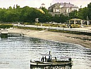Im 19. Jahrhundert beförderte die Blasewitzer Fähre, begünstigt durch die Eröffnung der
Straßenbahn, bis zu 6000 Personen am Tag. Hinzu kamen Fuhrwagen, Lastkarren und verschiedene Güter. 1863 übernahm die Sächsisch-Böhmische Dampfschiffahrts-
Gesellschaft den Fährbetrieb und setzte erstmals auch dampfbetriebene Fährschiffe ein. Zu diesen gehörte das 1888 gebaute Fährschiff  “Pfeil”, welches noch heute unter dem Namen
“Fröhliche Dörte” als Ausflugsdampfer auf der Unstrut bei Naumburg zum Einsatz kommt.

Da diese Form der Flussquerung kaum noch dem gewachsenen Verkehrsaufkommen entsprach, wurde 1891-93 das
“Blaue Wunder” als Verbindung zwischen Blasewitz und Loschwitz eröffnet. Mit Fertigstellung der Brücke stellte die
Wagenfähre ihren Betrieb ein. Während des Ersten Weltkrieges endete auch die Personenbeförderung an dieser Stelle.
Heute erinnert noch das Fährgässchen in der Nähe des Schillerplatzes an die alte Blasewitzer Elbfähre. Allerdings gab
es zwischen 1927 und 1955 noch eine weitere Überfahrt, deren Anlegestelle sich in Höhe der Oehmestraße befand.

Elbebäder:

Blasewitz besaß seit Ende des 19. Jahrhunderts an wechselnden Standorten Badestellen am Elbufer. Ältestes war das
von Paul Starke gepachtete “Schwimmbad für Frauen”, welches er mit geschickten Werbeaktionen (“Kaffeeklatsch bei
Wellengang”) zum Treffpunkt junger Damen aus den angrenzenden Stadtteilen machte. Das Bad bestand aus einem mit
hölzernen Blickschutzwänden umgebenen Bassin und mehreren Umkleidekabinen und hatte seinen Standort unterhalb
des Blauen Wunders. Wirtschaftliche Gründe und der Holzmangel infolge des Ersten Weltkrieges führten letztlich zur Schließung der Badeanstalt.

Eine weiteres Elbebad wurde 1876 erstmals erwähnt und anfangs als  “Kießlingsche Badeanstalt” bezeichnet. Später
befand es sich in städtischem Besitz. Dieses Bad erfreute sich als Kinderbad (“Schnippelbad”) großer Beliebtheit und
wurde auch für den Schwimmunterricht genutzt. Das Stadtbad Blasewitz schloß in den Jahren nach dem Ersten Weltkrieg aus wirtschaftlichen Gründen.

[_Weiterführende Literatur und Quellen_](../../impressum/quellenverzeichnis/)

 \[ [Home](../../index.html)\] \[ [Nord](../../nord/)\] \[ [Nordwest](../../nordwest/)\] \[ [Neustadt](../../neustadt/)\] \[ [Nordost](../../nordost/)\] \[ [West](../../west/)\] \[ [Zentrum](../../zentrum/)\] \[ [Südwest](../../sudwest/)\] \[ [Süd](../../sud/)\]
 \[ [Südost](../../sudost/)\] \[ [Ost](../../ost/)\] \[ [Register](../../Register/register.html)\] \[ [Kontakt](../../Kontakt/kontakt.html)\] \[ [Impressum](../../impressum/)\]
