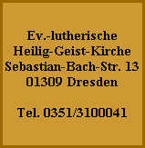
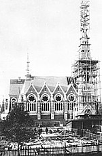
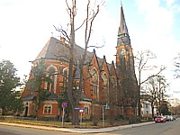
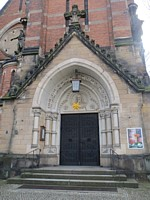
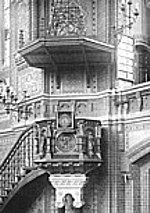

* * *

**Zur Homepage der Kirchgemeinde:**

* * *

**Die Heilig-Geist-Kirche im Bau**

Die Blasewitzer Heilig-Geist-Kirche entstand 1891/93 als neues Gotteshaus des
aufstrebenden Villenortes. Bereits seit 1887 bildeten Blasewitz und Neugruna eine selbstständige Parochie, nachdem diese Orte zuvor zur Dresdner Kreuzkirche
gehört hatten. Um den weiten Weg in die Innenstadt zu vermeiden, fanden die Gottesdienste zunächst in Scheunen oder den Stuben der Bauernhäuser, später in
der Schulturnhalle statt. Um diesem Zustand abzuhelfen, bildete sich ein Kirchenbaufond, der die Vorplanungen und die Finanzierung des Baus übernahm.
Maßgeblich beteiligt war der Kaufmann Oskar Richter, der in St. Petersburg durch den Handel mit optischen Geräten und Messinstrumenten zu erheblichem
Wohlstand gekommen war.  Richter und seine Frau Hulda, welche sich 1878 in Blasewitz niedergelassen hatten,
stifteten 1880 13.000 Mark für den Erwerb des Grundstückes und trugen auch später durch großzügige Schenkungen zu Bau und Ausstattung der Kirche bei. Am 12. Oktober 1891 erfolgte die feierliche Grundsteinlegung.

Der neogotische Kirchenbau mit Klinkerfassade wurde nach Plänen von Karl Emil Scherz
errichtet und am 15. Oktober 1893 feierlich eingeweiht. Im Turm wurden vier von der Dresdner Kunstgießerei Bierling gefertigte Bronzeglocken aufgehängt. Das Hauptportal _(Foto)_
zieren die von Friedrich Hecht geschaffenen Statuen des Elias, Johannes des Täufers und ein Christusrelief über der Tür. Finanziert hatte diese der damalige Kronprinz Georg.
Außerdem besitzt die Kirche eine Christusfigur des Bildhauers Heinrich Epler. Die Inneneinrichtung und der Altar wurde von Oskar Rassau geschaffen. Die Glasfenster
gestaltete der Maler Bruno Carl Urban nach Entwürfen von Alfred Diethe und Arthur Thomas. Szenen aus der biblischen Geschichte, die das Wirken des Heiligen Geistes zum
Inhalt hatten, stellten eine Beziehung zum Namen des Gotteshauses her. Leider gingen die meisten dieser Fenster beim Umbau 1969 verloren. 1894 erhielt die Kirche eine Orgel der
Firma Jehmlich. 1917 musste diese jedoch ausgebaut und teilweise zum Einschmelzen abgegeben werden. Als Ersatz
bekam die Kirche 1977 ein Instrument der Firma Eule, welches aus der abgerissenen Leipziger Markuskirche stammt.

Beim Luftangriff von 1945 blieb der neogotische Bau weitgehend unbeschädigt und stand
schon bald wieder für Gottesdienste zur Verfügung. In den Nachkriegsjahren diente die Heilig-Geist- Kirche auch als Aufführungsort für kirchenmusikalische Veranstaltungen und
war zeitweise Gastspielort des Kreuzchores. 1965 wurde das Gotteshaus umfassend saniert und bis 1969 nach Plänen von Fritz Steudtner im Inneren komplett erneuert. Leider
ging dabei ein Großteil der historischen Innenausstattung **_(Foto:_** _Kanzel)_, insbesondere die mit Ornamenten bemalte Gewölbedecke verloren. Der ursprüngliche Altar aus der
Werkstatt Oskar Rassaus ist seitdem in der Brauthalle zu sehen. Ein Relief aus Kalkstein zeigt die Grablegung Christi. Seit 2006 bildet die Heilig-Geist-Kirche mit der Striesener [Versöhnungskirche](../../../ost/striesen/versohnungskirche/) und der [Bethlehemkirche](../../../ost/tolkewitz/bethlehemkirche/) in Tolkewitz eine gemeinsame Parochie.

Gegenüber der Kirche erinnert ein Denkmal an die im Ersten Weltkrieg gefallenen Blasewitzer Einwohner. Die von Hermann Ilgen gestiftete Plastik “Der verlorene Sohn” wurde von Hans Hartmann-MacLean geschaffen und 1928 eingeweiht. Während das 1895 ebenfalls von Karl Emil Scherz entworfene Pfarrhaus 1945 den Bomben zum Opfer fiel, blieb das 1913 eingeweihtes Gemeindehaus an der Sebastian-Bach-Str. 13 bis heute erhalten und wird noch immer von der Gemeinde für Veranstaltungen, Jugendarbeit und die Verwaltung genutzt. An der Fassade des 2016 sanierten Gebäudes ist eine Figur "Christus als guter Hirte" zu sehen.

* * *

 \[ [Home](../../../index.html)\] \[ [Nord](../../../nord/)\] \[ [Nordwest](../../../nordwest/)\] \[ [Neustadt](../../../neustadt/)\] \[ [Nordost](../../../nordost/)\] \[ [West](../../../west/)\] \[ [Zentrum](../../../zentrum/)\] \[ [Südwest](../../../sudwest/)\] \[ [Süd](../../../sud/)\] \[ [Südost](../../../sudost/)\] \[ [Ost](../../../ost/)\] \[ [Register](../../../Register/register.html)\] \[ [Kontakt](../../../Kontakt/kontakt.html)\] \[ [Impressum](../../../impressum/)\]
