Der kleine Weg führt von der Naumannstraße in der Nähe des Schillerplatzes hinunter zur Elbe. Da er früher von zahlreichen Anglern genutzt wurde, erhielt er 1870 offiziell den Namen Angelsteg. Im Eckhaus zum Schillerplatz (Nr. 5) befindet sich seit 1936 das traditionsreiche Geschäft "Schirm-Dunger". Zuvor wurden die Räume von einer Buchhandlung genutzt. Der Laden wurde 1924 von Kurt Dunger gegründet und befindet sich bis heute im Familienbesitz.

Der Barteldesplatz entstand Ende des 19. Jahrhunderts an der Kreuzung von Goetheallee, Reger- und Waldparkstraße. Seinen Namen verdankt er dem früheren Blasewitzer Gemeinderatsmitglied Karl Louis Barteldes (1821–1880), welcher auch als Stifter in seinem Heimatort in Erscheinung trat. 1882 ist er erstmals im Adressbuch erwähnt.

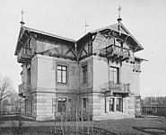Nr. 1: Das Gebäude entstand 1877/79 für den Namensgeber des Platzes und wurde von Ernst Giese und Paul Weidner errichtet _(Foto rechts)_. 1945/46 lebte hier der Dresdner Schriftsteller Hans Löscher (1881-1946), an den eine Gedenktafel erinnert. Löscher war bis 1933 als Lehrer und Stadtschulrat in verschiedenen Orten tätig, wurde dann jedoch wegen seiner Mitgliedschaft in der SPD aus dem Schuldienst entlassen. Ab 1935 wohnte er wieder in Dresden und verfasste hier einige Romane mit lokalhistorischem Hintergrund.

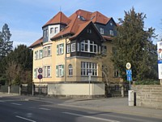Nr. 2: Das Haus entstand 1893 nach Plänen des renommierten Architekturbüro Schilling & Gräbner in “altdeutscher Tradition”. Heute hat hier die Bürgerstiftung Dresden ihren Sitz.

Nr. 4: Historisch interessant ist auch die Villa Ostermeyer (Barteldesplatz 4), an deren Eingang eine kleine geschmiedete Laterne angebracht ist. Diese stammt von der alten Augustusbrücke und wurde nach deren Abbruch 1907 vom damaligen Besitzer des Hauses erworben. Architekt des Gebäudes war der Blasewitzer Baumeister Karl Emil Scherz _(Foto links)_.

Die Berggartenstraße entstand 1870 beim Ausbau der Blasewitzer Villenviertel. Ihren Namen erhielt sie nach einer Flurstücksbezeichnung in diesem Gebiet. Ursprünglich gehörte auch in Neugruna ein kurzer Straßenabschnitt dazu. Da der für eine durchgehende Straßenführung notwendige Durchbruch jedoch nicht erfolgte, wurde dieser Teil am 1. Januar 1907 in Simrockstraße umbenannt.

Im Eckhaus zur Oehmestraße gab es früher eine Bäckerei und ein Schuhmachergeschäft. 1997 wurde das Mietshaus abgetragen und durch einen modernen Neubau ersetzt. Architektonisch interessant ist die 1892 vom Blasewitzer Baumeister Karl Emil Scherz errichtete Villa Berggartenstraße 18.

Der heute nicht mehr vorhandene Bogenweg wurde als bogenförmige Sackgasse angelegt und zweigte von der damaligen Striesener Straße (heute Hüblerstraße) ab. Er diente zur Erschließung einiger Grundstücke im Bereich Hübler-, Bruckner- und Berggartenstraße und erhielt 1870 offiziell seinen Namen. Zwanzig Jahre später wurden die Häuser der Striesener Straße zugeordnet und der Name 1890 eingezogen, der Weg wenig später überbaut.

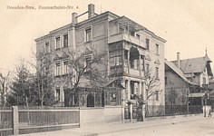Die Brucknerstraße wurde Mitte des 19. Jahrhunderts als Baumschulenstraße angelegt. Um 1850 entstanden hier die ersten einfachen Landhäuser, mit denen die Wandlung des Ortes vom Bauerndorf zum Villenvorort begann. 1883 wurden die Eckhäuser zum [Schillerplatz](../../../ost/blasewitz/strassen_blasewitz/schillerplatz/) gebaut, in denen später u.a. die bekannte Blasewitzer Drogerie Weigelt und die Schillerapotheke ihr Domizil hatten. Zehn Jahre später bezog man auch den auf Striesener Flur gelegenen Abschnitt (Straße 11a) in die Baumschulenstraße ein. Ihren heutigen Namen erhielt die Brucknerstraße 1937 nach dem österreichischen Komponisten Anton Bruckner (1824-1896). Bis heute blieben hier einige Gebäude aus der Frühzeit des Blasewitzer Villenviertels erhalten. Das historische Foto zeigt das Landhaus Brucknerstraße 34 um ca. 1910.

Im Haus Nr. 18 (ehem. Nr. 20) lebte Ende des 19. Jahrhunderts die Malerin und Lithografin Marianne Fiedler (1864-1904), die als Begründerin einer neuen Epoche von Künstlerlithographien in Deutschland gilt und ihre Ausbildung gemeinsam mit Käthe Kollwitz absolviert hatte. Ab 1900 war sie mit dem ebenfalls aus Dresden stammenden Theologen und Philosophen Johannes Müller verheiratet. 1902 verzog das Paar nach Mainberg, wo Müller seine "Freistatt persönlichen Lebens" einrichtete und sich mit philosophischen und lebensreformerischen Fragen befasste. Müller war später Bauherr des Schlosses Elmau in Bayern. Einige Werke Marianne Fiedlers befinden sich im Dresdner Kupferstichkabinett.

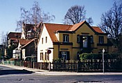

**_Foto:_** _Wohnhäuser aus der Zeit um 1850 an der Ecke Bruckner-/Berggartenstraße_

Die Ende des 19. Jahrhunderts angelegte Verbindungsstraße zwischen Niederwaldplatz und Tolkewitzer Straße trug ursprünglich den Namen Dobritzer Straße und ist erstmals im Adressbuch von 1879 verzeichnet. Da es mit der Eingemeindung von Blasewitz eine weitere Straße dieses Namens in Dresden gab, wurde sie am 1. Juni 1926 in Draesekestraße umbenannt. Mit der Namensgebung wird an den Komponisten und Musikschriftsteller Felix Draeseke (1835–1913) erinnert. Draeseke lebte ab 1876 in Dresden und war ab 1884 als Professor am Konservatorium tätig. Sein Grab befindet sich im Urnenhain des Tolkewitzer Friedhofs.

Die Eichstraße entstand 1870 und wurde nach den hier befindlichen Eichgärten, einer alten Flurbezeichnung, benannt. Nach der Eingemeindung von Blasewitz wurden 1926 auch einige auf Striesener Flur gelegene Gebäude der Eichstraße zugeordnet. Um 1930 entstand auf dem Grundstück Eichstraße 2 eine Villa nach einem Entwurf des bekannten Architekten Oskar Menzel. Hier wohnten viele Jahre Mitarbeiter der Staatskapelle. 1996 wurde das Gebäude zugunsten eines Mietshaus-Neubaus abgerissen. Das gleiche Schicksal erlitt die landhausartige Villa Nr. 1 aus der Zeit um 1870, die 2016 ebenfalls dem Abriss zum Opfer fiel.

Das kurze Fährgäßchen in der Nähe des “Blauen Wunders” erinnert an die einstige Blasewitzer Fähre, die bereits im 15. Jahrhundert existierte und nach dem Bau der Elbbrücke eingestellt wurde. Ursprünglich als Fährgasse bezeichnet erhielt die Straße 1870 offiziell ihren heutigen Namen. Ab 1893 wurde die Anlegestelle auf Blasewitzer Seite in Höhe des Schillergartens verlegt, wo es noch bis 1915 die Möglichkeit zur Überfahrt nach Loschwitz gab.

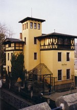Villa Marie: Das markante Landhaus im toscanischen Stil wurde1860 nach Plänen von S. Pätz für eine ungarische Adelsfamilie errichtet. Zunächst wurde die romantisch am Elbufer gelegene Villa von ihrem Besitzer “Mon Bijou” (“Mein Juwel”) genannt. Nach mehrfachem Besitzerwechsel entstand um 1930 der heutige Name “Villa Marie”. Eigentümerin war seinerzeit Marie Bieger, die sich mit der Namensgebung selbst ein Denkmal setzen wollte. Nach 1945 verfiel die Villa so sehr, das zeitweise sogar der Abriss geplant war. In den 1970er Jahren diente das Haus als Künstleratelier. 1982 Jahren zog hier die Künstlerin Claudia Reichardt (“Wanda”) ein, die das Haus zu einem halblegalen Treffpunkt der alternativen Kunstszene machte. Regelmäßig fanden in der 1986 eröffneten Galerie “fotogen” Ausstellungen und Veranstaltungen außerhalb des offiziellen DDR-Kunstbetriebes statt. Ihr Einsatz und Proteste von Denkmalschützern und Blasewitzer Bürgern verhinderte schließlich auch die Sprengung des Gebäudes. 1990 mussten die Künstler jedoch ausziehen, nicht ohne eine spektakuläre Aktion, bei der die Villa Marie im wörtlichen Sinne “geteert und gefedert” wurde. Nach erfolgter Sanierung wurde hier 1994 ein italienisches Restaurant eröffnet. Die beim Hochwasser im August 2002 schwer in Mitleidenschaft gezogene Gaststätte konnte im März 2003 wieder eröffnet werden und ist bis heute nicht zuletzt wegen ihrer Lage am Elbufer beliebt.

Die von der Tolkewitzer Straße zum Elbufer führende Ferdinand-Avenarius-Straße entstand Ende des 19.Jahrhunderts und ist 1897 erstmals als Wachwitzer Straße im Adressbuch verzeichnet. 1926 erhielt sie ihren heutigen Namen nach dem Dichter und Kulturpädagogen Ferdinand Avenarius (1856-1923), der ab 1882 in Dresden wohnte. Avenarius war Herausgeber der Zeitschrift “Kunstwart” und gründete 1902 den “Dürerbund” zur Förderung des kulturellen Lebens in Deutschland. Ursprünglich bewohnte er eine Villa auf der benachbarten Heinrich-Schütz-Straße 2 und verzog später zur Avenariusstraße. Beide Gebäude sind heute nicht mehr erhalten.

Nach dem Zweiten Weltkrieg wurde die Avenariustraße als Abstellplatz des Blasewitzer Busbahnhofs genutzt und stand somit dem öffentlichen Verkehr nicht mehr zur Verfügung. Aus diesem Grund beschloss der Stadtrat am 12. August 1982 die Einziehung der Avenariusstraße. Erst 1993 wurde der Platz aufgegeben und in der Folgezeit mit Wohnhäusern bebaut. Ein Jahr später erfolgte am 2. Juni die offizielle Wiederbenennung als Ferdinand-Avenarius-Straße.

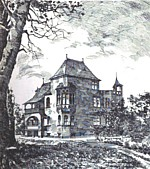Avenarius-Villa (Nr. 4, ehem. Wachwitzer Straße 3): Das nach seinem früheren Besitzer auch als Avenarius-Villa bekannte Gebäude entstand 1894 nach Plänen des Architektenbüros Schilling & Graebner für Ferdinand Avenarius und Paul Theodor Schumann. Avenarius und Schumann waren befreundet und gaben bis 1894 gemeinsam die Zeitschrift “Der Kunstwart” heraus. Nach der Scheidung von Schumann heiratete Ferdinand Avenarius dessen Frau Else und lebte mit ihr, Paul Schumann und dem gemeinsamen Sohn des Paares in der Villa. Nachdem Schumann erneut geheiratet und 1908 wieder Vater geworden war, überließ Avenarius ihm die Villa und bezog 1910 das neugebaute Dürerbundhaus an der heutigen Heinrich-Schütz-Straße. Paul Schumann wohnte zeitweise ebenfalls im Dürerbundhaus, kehrte jedoch später auf die Wachwitzer Straße 3 zurück. Nach seinem Tod verkaufte die Familie das Haus, welches 1945 den Bomben zum Opfer fiel _**(Bild rechts:** Stadtwiki Dresden)_.

Nr. 6: Das 1945 zerstörte Wohnhaus war ab 1929 Wohnsitz des Ethnographen und Forschungsreisenden Walther Stötzner (1882-1965). Stötzner lebte ab 1895 in Dresden und studierte zunächst an der Kunstakademie Architektur. 1907 unternahm er seine erste Forschungsreise nach Turkestan und Persien. Später folgten weitere Expeditionen, u.a. nach Tibet. Die dort von ihm erworbenen Gegenstände befinden sich heute im Völkerkundemuseum. Nach seiner endgültigen Rückkehr nach Europa bezog Stötzner die Villa Avenariusstraße 6. Seine letzten Lebensjahre verbrachte er in seiner Heimatstadt Gera.

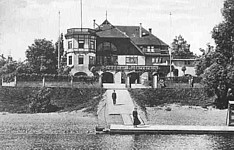Dresdner Ruderverein: Der Dresdner Ruderverein (DRV) entstand 1890 durch den Zusammenschluss der zwischen 1872 und 1879 gegründeten Vereine Albis, Germania und Triton. Zunächst nutzte er ein Areal in Dresden, verlegte 1898 jedoch seinen Sitz in den Vorort Blasewitz. Hier ließ er sich nach Entwürfen des Architekten Richard Schleinitz ein repräsentatives Vereinshaus direkt am Elbufer errichten _(Foto)_. Im Inneren befanden sich Umkleide-, Versammlungs- und Lagerräume. Markanter Schmuck war ein von Sascha Schneider geschaffenes Monumentalbild mit Ruderern in ihrem Boot. Um 1910 erlernten im Verein auch die beiden ältesten Söhne des sächsischen Königs, Georg und Friedrich Christian, das Rudern. Zu den großen sportlichen Erfolgen des DRV gehörte die Teilnahme eines Bootes an den Olympischen Spielen 1928 und der Olympiasieg des Deutschen Meisters und Europameisters Gustav Schäfer 1936. Für die 1917 gegründete Frauensektion wurde 1930 ein eigenes Bootshaus gebaut. 1945 fiel das Vereinshaus dem Bombenangriff zum Opfer _(Fotos)_.

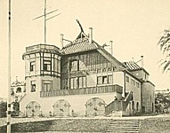Nach dem Verbot aller bestehenden Sportvereine mussten sich auch die Dresdner Ruderer neu organisieren. 1946 bildete sich in Blasewitz die FDJ-Wassersportgemeinschaft, welche das unzerstörte Bootshaus des Frauen-Rudervereins nutzte. 1950 folgte die Betriebssportgemeinschaft HO Dresden, welche sich 1951 in BSG Empor, 1953 in BSG Einheit Dresden-Mitte umbenannte. Ab 1957 war die BSG Motor Dresden-Niedersedlitz Nutzer des Bootshauses, ab 1977 die BSG Sachsenwerk Dresden. Zahlreiche Ruderer der Sportgemeinschaft nahmen an DDR-Meisterschaften teil und gewannen mehrere Titel.

1990 wurde der Dresdner Ruderverein neu gegründet und konnte schnell an seine alten Erfolge anknüpfen. Zahlreiche Deutsche Meistertitel, Welt- und Europameisterschaftsmedaillen gingen an Dresdner Sportler. Zu den erfolgreichsten Ruderern gehörten Claudia Blasberg mit elf Deutschen Meistertiteln, zwei Olympia-Silbermedaillen sowie mehreren WM-Titeln, André Slavik, Anne-Katrin Kochan, Anika Kniest und Michael Keschka, die ebenfalls zahlreiche nationale und internationale Medaillen erringen konnten. 2012 erhielt der Verein an Stelle des zerstörten Vorgängergebäudes einen modernen Neubau.

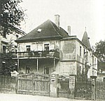Die Forsthausstraße erinnert an das frühere Blasewitzer Forsthaus, welches 1697 von Kurfürstin Magdalena Sybille im ehemaligen Vorwerk von Nikolaus Karasz eingerichtet wurde. Bis 1704 hatte hier der Hegereiter des Blasewitzer Reviers seinen Dienstsitz, bevor August der Starke das Haus seinem Stubenheizer schenkte. Später entstand in diesem Gebäude der [Blasewitzer Gasthof](../../../ost/blasewitz/strassen_blasewitz/schillerplatz/schillergarten/), ab 1859 “Schillergarten” genannt.

Als Ersatz ließ der Kurfürst 1717 im Westen des Ortes einen Neubau errichten, für den der Architekt Matthäus Daniel Pöppelmann verantwortlich zeichnete. Das schlichte Gebäude beherbergte nun die Wohn- und Diensträume des Revierförsters, der für die Pflege des Tännichts und dessen Nutzung als Jagdrevier verantwortlich war. Erst im Zuge der zunehmenden Bebauung wurde das Revier 1876 aufgelöst und das Forsthaus in ein Wohnhaus _(Foto)_ mit Gaststätte umgewandelt. In einem Nebengebäude (Nr. 3) befand sich bis zur Schließung 1942 die Likörfabrik Karl Keil (vorm. Heinrich Bohr Nachf.), die hier ihren "Forsthaus-Qualitäts-Likör" produzierte. Am 13. Februar 1945 wurde das Forsthaus durch Bomben zerstört.

Die Frankenstraße entstand um 1870 und wurde ab dem 1. April 1873 Franken-Allee genannt. Zeitgleich erhielten auch die [Sachsen-Allee](../../../zentrum/johannstadt/strassen_johannstadt/sachsenplatz/) in der Johannstadt und die [Alemannen-Allee](../../../ost/striesen/strassen_striesen/) (heute Alemannenstraße) in Striesen ihre Namen. Mit den Bezeichnungen sollte an die vereinten deutschen Volksstämme und zugleich an die zwei Jahre zuvor vollzogene Reichsgründung erinnert werden. Der angrenzende Straßenabschnitt auf Striesener Flur trug ab 1893 den Namen Frankenstraße. Im Zusammenhang mit der Eingemeindung von Blasewitz wurden beide Straßen am 1. Juni 1926 unter dem Namen Frankenstraße vereinigt.

Der Friedensplatz wurde nach 1870 als Mittelpunkt eines neuen Villenviertels angelegt und in den Folgejahren mit repräsentativen Wohnhäusern bebaut. Mit der Namensgebung am 1. April 1873 sollte, ebenso wie beim gleichzeitig benannten Siegesplatz, an den Sieg Deutschlands im Deutsch-Französischen Krieg 1870/71erinnert werden. Da über den Platz die Flurgrenze zwischen Blasewitz und Striesen verläuft, ersuchte der Gemeinderat von Blasewitz 1881 die Nachbargemeinde, sich an der gärtnerischen Gestaltung des Platzes zu beteiligen, was auch geschah. Die parkartige Anlage blieb bis heute erhalten.

Bemerkenswert ist das Wohnhaus Friedensplatz 2. Dieses entstand erst 1927 auf dem letzten freien Baugrundstück des Platzes für den Arzt Dr. Theodor Arndt. Architektonisch orientierte sich der Architekt des Gebäudes Robert Lehrecke an englischen Vorbildern der künstlerischen Schule von William Morris, die traditionellen Handwerkstechniken im Gegensatz zur industriellen Massenproduktion den Vorzug gab. 2007-09 wurde das auch im Inneren noch teilweise im Originalzustand befindliche Gebäude denkmalgerecht saniert.

Die kurze Fuchsstraße führt von der Tolkewitzer Straße hinunter zum Elbufer und war bis 1945 Standort des renommierten Blasewitzer Dampfschiffhotels. Deshalb wurde sie zunächst ab 1882 Dampfschiffstraße genannt. Am 3. August 1938 erhielt sie aus Anlass des 80. Geburtstags von Albert Fuchs (1858–1910) den Namen Fuchsstraße. Albert Fuchs war Komponist und Gesangslehrer am Dresdner Konservatorium und starb am 15. Februar 1910 in Dresden.

Dampfschiffhotel: Das Hotel an der Fuchsstraße entstand 1903 an Stelle eines kleineren Vorgängerbaus und gehörte mit seinen Sälen, Gartenpavillons und dem markanten Aussichtsturm zu den größten und bekanntesten Blasewitzer Einkehrstätten. Vor allem an den Wochenenden besuchten zahlreiche Dresdner das reizvoll am Elbufer gelegene Haus, in dem auch Konzerte, Theateraufführungen und andere Veranstaltungen stattfanden. Allein im Gästegarten am Elbufer fanden bis zu 1000 Personen Platz. 1945 fiel das zuletzt als Lazarett genutzte Dampfschiffhotel ebenso wie das benachbarte Hotel “Bellevue” und das Vereinshaus des Blasewitzer Rudersportvereins den Bomben zum Opfer.

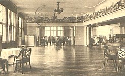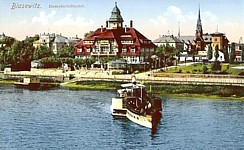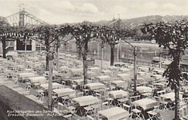

**_Fotos:_** _Das 1945 zerstörte Dampfschiffhotel mit großem Saal und Gästegarten_

Der Gautschweg, eine kurze Stichstraße zum Elbufer in der Nähe des Schillerplatzes, verdankt seinem Namen Carl Friedrich Constantin Gautsch (1810-1879), der in Dresden als Rechtsanwalt tätig war und sich außerdem mit Heimatgeschichte befasste. Bis zur Eingemeindung von Blasewitz wurde er Wiesenstraße genannt. Im Wohnhaus Gautschweg 1 wohnte viele Jahre der Bildhauer Georg Wrba, der als Schöpfer zahlreicher Brunnenanlagen bekannt wurde. Wrba gestaltete u. a. den Europabrunnen am [Königsheimplatz](../../../ost/blasewitz/strassen_blasewitz/konigsheimplatz/) sowie den Gänsediebbrunnen in der Innenstadt. Heute dient das Gebäude als Ärztehaus.

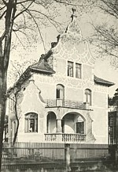Die Händelallee wurde um 1870 im Zusammenhang mit der Anlage des Waldparks angelegt und hieß ursprünglich Marschall-Allee. Mit der Namensgebung sollte an den sächsischen Oberforstmeister Graf von Marschall erinnert werden, der 1863 durch Abtretung von Forstflächen die Anlage der Straße ermöglicht hatte. In Unkenntnis dieser Zusammenhänge entschied sich man sich nach dem Zweiten Weltkrieg zur Aufhebung des "militaristischen" Namens zum 1. Juli 1946. Mit der veränderten Namensgebung der Straße wird der Komponist Georg Friedrich Händel (1685-1759) geehrt, der neben Johann Sebastian Bach zu den bedeutendsten Musikern seiner Zeit gehört. In diesem Zusammenhang wurden die auch Hausnummern verändert.

Zu den markantesten Bauwerken der Marschall-Allee gehörte bis zur Zerstörung 1945 das Elb-Sanatorium. Auch einige Villen der Straße fielen den Bomben zum Opfer und wurden später durch Wohnhausneubauten ersetzt. Zu den erhaltenen Bauten gehören die Villen Händelallee 5, 1905 für den Buchhändler und Verleger R. von Grumkow erbaut, Nr. 8 (Villa Kraft - Foto links) und Nr. 10 (Villa Königsheim). Im Grundstück letzterer hatten Blasewitzer Forstleute 1827 eine kleine Ehrenstätte angelegt. Hier fand 1861 auch eine Jagdsäule zur Erinnerung an eine Parforcejagd Friedrich August des Gerechten 1818 Aufstellung. Erhalten blieb auch die repräsentative Villa Händelallee 14, die um 1870 vom Architekten Franz Albert Stock im französischen Renaissancestil errichtet wurde und deshalb Landhaus Stock genannt wird.

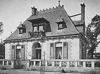

**_Foto:_** _Das Landhaus Stock (Händelallee 14) um 1930_

Marschall-Allee 6: In diesem heute nicht mehr vorhandenen Gebäude gründete Ende des 19. Jahrhunderts Ernst Eduard Förster seine
"Anstalt für geistig zurückgebliebene und schwachsinninge Kinder". Das sächsische Schulgesetz vom 26. April 1873 hatte die Grundlage gelegt, "verwahrloste, nicht vollsinnige, schwach- und blödsinnige Kinder ... in hierzu bestimmten öffentlichen oder Privat-Anstalten unterzubringen." Försters Anstalt gehörte somit zu den ersten in Sachsen überhaupt und bot für bis zu zehn geistig behinderte Kinder eine fachkundige familiäre Betreuung.

Die Straße entstand Ende des 19. Jahrhunderts und trug zunächst ab 1870 den Namen Weinbergstraße. Dieser nahm vermutlich Bezug auf die unmittelbar gegenüber der Elbe liegenden Loschwitzer Weinberge. Um Verwechslungen mit der Trachenberger Weinbergstraße zu vermeiden, erfolgte am 1. Juni 1926 die Umbenennung in Nicodéstraße. Jean Louis Nicodé war als Komponist und Dirigent am Dresdner Konservatorium tätig und wohnte bis zu seinem Tod 1919 in Langebrück.

Mit der Eingemeindung von Langebrück gab es jedoch auch diesen Straßennamen zweimal in Dresden. Deshalb wurde die Nicodéstraße in Blasewitz im Juli 2004 in Hans-Böhm-Straße umbenannt. Der Musikwissenschaftler Hans Böhm (1909-1999) arbeitete als Musikkritiker und galt bis zu seinem Tod als kritischer Begleiter des Dresdner Kulturlebens.

Die heutige Heinrich-Schütz-Straße im Osten von Blasewitz wurde Ende des 19. Jahrhunderts angelegt und zunächst Bahnhofstraße genannt, da sich hier der Straßenbahnhof der 1872 eröffneten Pferdebahn befand. Nach der Eingemeindung des Ortes wurde sie 1926 in Wasserturmstraße umbenannt. Namensgeber war ein heute nicht mehr vorhandener Wasserturm des gemeindeeigenen [Wasserwerkes](../../../ost/blasewitz/). Anlässlich des 260. Todestages des Komponisten Heinrich Schütz erhielt die Straße 1932 den Namen des Komponisten Heinrich Schütz (1585-1672). Schütz kam 1615 nach Dresden und wirkte hier bis zu seinem Tod als Hofkapellmeister. Er gilt als einer der bedeutendsten Komponisten der deutschen Musikgeschichte und verhalf der sächsischen Hofkapelle (heute Staatskapelle) zu ihrem internationalen Ruf.

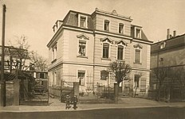Von den zahlreichen Villen und Landhäusern der Straße stehen mehrere unter Denkmalschutz. Zu diesen gehört die Villa Nr. 1, in den 1920er Jahren Wohnhaus des Unternehmers Franz Meyer, mit einem aus Sandstein gestalteten Eckpavillon. Bis Mitte der 1920er Jahre befand sich hier eine Niederlassung der Deutschen Präzisions-Uhrenfabrik Glashütte. Seit ca. 1940 lebte der Pathologe Heinrich Kalbfleisch, Direktor des Krankenhauses Dresden-Friedrichstadt, in diesem Gebäude. Im Haus Nr. 8 wohnte einige Jahre der Physiker Max Sende (\* 1891). Sende veröffentlichte nach dem Zweiten Weltkrieg zahlreiche Lehrbücher zur Elektrotechnik und Werkstoffkunde und lehrte von 1960 bis 1962 als Professor für Allgemeine Elektrotechnik an der Hochschule für Verkehrswesen. Zu den Bewohnern der Heinrich-Schütz-Straße gehörten auch der Kunstmaler Rudolf Petzold, der Elfenbeinbildhauer Oskar Meier und der Architekt Paul Kretzschmar (Nr. 9).

Zwischen Draesekestraße und Heinrich-Schütz-Straße liegt ein für Blasewitz eigentlich untypisches kleines Wohnviertel mit Mietshäusern in geschlossener Bauweise. Im Haus Nr. 10 gab es ab ca. 1910 die Schankwirtschaft zur Goldenen Krone. Ein weiteres Lokal existierte unter dem Namen "Restaurant Mohrenkopf" bereits Ende des 19. Jahrhunderts im Grundstück Nr. 3.

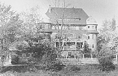Dürerbundhaus (Nr. 2): Das burgartige Gebäude entstand 1910/11 am Elbufer und war Wohnhaus der Familie des Kunstexperten Dr. Ferdinand Avenarius. Die Planungen für die Villa stammten von Heinrich Tscharmann. Avenarius hatte zuvor gemeinsam mit dem mit ihm befreundeten Professor Dr. Paul Theodor Schumann auf der Wachwitzer Straße 3 (heute Ferdinand-Avenarius-Straße) gewohnt. Beide gaben bis 1894 gemeinsam die Zeitschrift “Der Kunstwart” heraus und veröffentlichten verschiedene kunst- und kulturhistorische Abhandlungen. Den weiträumigen Garten um das Haus ließ der Bauherr parkartig gestalten und mit Putten und Repliken antiker Kunstwerke versehen. Unter den Blasewitzern war die Villa als “Grünes Haus” bzw. als Dürerbundhaus bekannt, da Ferdinand Avenarius 1902 in Dresden den “Dürerbund” zur Förderung des kulturellen Lebens gegründet hatte. Nach Fertigstellung des Gebäudes waren hier auch die Arbeits- und Archivräume des Dürerbundes sowie Avenarius´ umfangreiche Bibliothek untergebracht.

Nach der Fertigstellung der Villa bezog neben Ferdinand Avenarius auch Paul Schumann, der erste Ehemann seiner Frau, und deren gemeinsamer Sohn Wolfgang das Haus. Paul Schumann verzog jedoch wenig später wieder zur Wachwitzer Straße. Zwischen 1923 und 1925 nutzte der Verleger Friedrich Wilhelm Bruchhaus einige Räume im Haus. Aus seinem Unternehmen ging später der noch heute für seine Ratgeberliteratur bekannte Falken-Verlag hervor. In den Dreißiger Jahren wohnten der Architekt Edmund Schuchardt und der Maler und Werbegrafiker Kurt Fiedler in der Villa. Fiedler hatte bereits 1923 den zum Haus gehörigen Gartenpavillon als Atelier eingerichtet und bezog wenig später eine Wohnung im Dürerbundhaus. Die seit den 1930er Jahren ausschließlich als Mietshaus genutzte Villa fiel 1945 den Bomben zum Opfer und wurde in der Nachkriegszeit abgerissen. Auch die noch gut erhaltene Gartenanlage mit ihren Plastiken und Skulpturen ging dabei verloren. Heute befinden sich hier Anlagen der Ruderabteilung des Universitätssportvereins der TU Dresden e. V.

Nr. 4: Historisch verbunden mit dem Dürerbundhaus war das Grundstück Heinrich-Schütz-Straße 4. Im Zusammenhang mit der Aufteilung des Erbes von Ferdinand Avenarius teilte man dieses nach 1930 ab und veräußerte es an Schumanns Sohn Wolfgang, der sich hier 1932 zusammen mit seiner Frau Eva ein Wohnhaus baute. Schumann arbeitete als Schriftsteller und Journalist und war Redakteur der sozialdemokratischen Dresdner Volkszeitung. Da die Familie nach dem Machtantritt der Nationalsozialisten Deutschland verlassen mussten, lebte im Haus ab 1933 der Kammermusiker Oskar Geier, Bratschenvirtuose der Dresdner Staatskapelle.

Die Hüblerstraße verbindet die Stadtteile Blasewitz und Striesen und erinnert an den früheren Dresdner Bürgermeister Balthasar Hübler (1788-1866), der von 1832 bis 1848 im Amt war. 1861 wird sie in den Blasewitzer Gemeindeakten erstmals als "Striesenergasse" erwähnt und ein Jahr später am 17. Oktober 1862 offiziell in Striesener Straße umbenannt. Der auf Striesener Flur gelegene Abschnitt jenseits der Kyffhäuserstraße hieß zunächst Straße 7a und erhielt 1893 amtlich den Namen Hüblerstraße. Nach der Eingemeindung von Blasewitz wurde die bisherige Striesener Straße ab 1. Juni 1926 in die Hüblerstraße einbezogen.

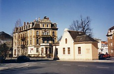Die Gebäude, meist repräsentative Villen und Landhäuser entstanden ab 1860 und zeigen unterschiedlichste Architekturformen. Zu den ältesten Häusern gehört die Villa Hüblerstraße 43, die sich einst im Besitz eines königlichen Hofbuchhalters befand und heute das Naturheilzentrum “Monade” beherbergt. Bemerkenswert sind auch die 1877 fertiggestellten “sieben Raben”, sieben nach Plänen des Baumeisters Raabe entstandene Villenbauten zwischen Hübler- und Lene-Glatzer-Straße. In der Nähe des Schillerplatzes dominierten hingegen repräsentative Geschäftshäuser. Hier gab es u.a. in den Eckgebäuden zum Platz eine Filiale des Waaren-Einkaufs-Verein zu Görlitz (Nr. 1) sowie eine Niederlassung der Allgemeinen Deutsche Credit-Anstalt (Nr. 2). Im hinteren Teil des Grundstücks lud ab 1894 der "Hüblerhof", später "Hübler-Garten" genannt, zum Besuch ein.

Einige Häuser, vor allem in der Nähe des Schillerplatzes, wurden 1945 durch Bomben zerstört. Unter ihnen befand sich das nach einer an der Fassade angebrachten Büste “Kleine Bismarck-Villa” genannte Gebäude Hüblerstraße 29 (Ecke Wägnerstraße). An seiner Stelle entstand in den 1960er Jahren ein Wohnhaus. Eine weitere Baulücke wurde 2008 mit einem modernen Wohn- und Geschäftshaus mit Ladengalerie geschlossen (Nr. 7-13). Auch an Stelle des zerstörten Gebäudes an der Ecke zur Frankenstraße mit der Adler-Drogerie entstand nach 1990 ein Neubau.

An der Einmündung Hüblerstraße/ Kyffhäuserstraße /Niederwaldstraße ist noch ein altes Einnehmerhaus erhalten geblieben. Das in der Mitte des Platzes stehende kleine Gebäude diente früher als Akzisehaus der Steuererhebung an der Stadtgrenze zu Dresden und wurde mit der Eingemeindung des Ortes überflüssig. Später entstand hier eine Lebensmittelverkaufsstelle. Heute wird das unter Denkmalschutz stehende Haus gewerblich genutzt _(Foto oben - Bildmitte)_.

Die Jüngststraße im südöstlichen Teil der Blasewitzer Flur erhielt ihren Namen 1926 nach dem Komponisten und Dirigenten Hugo Richard Jüngst (1853-1923). Bis zur Eingemeindung des Stadtteils wurde sie ab 1870 nach ihrer Lage Südstraße genannt. Hugo Jüngst war Gründer und Leiter des Dresdner Männergesangsvereins, arbeitete und komponierte jedoch auch für andere Chöre. Sein Grab befindet sich auf dem Tolkewitzer Johannisfriedhof.

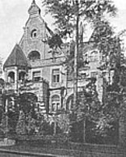Die Justinenstraße (1870-1926 Hainstraße) wurde nach Johanne Justine Renner (1763-1856) benannt. Als Tochter des Blasewitzer Wirtsehepaars Segedin lernte sie 1785 den Dichter Friedrich Schiller kennen, der sie später in seinem “Wallenstein” verewigte. Als “Gustel von Blasewitz” ging sie in die Ortsgeschichte ein. Neben der Justinenstraße erinnert auch eine Skulptur am früheren Rathaus an sie. Markantestes Gebäude der Justinenstraße ist das frühere Postamt (Nr. 1), welches 1892 errichtet wurde, heute jedoch für gewerbliche Zwecke genutzt wird.

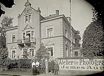Ab 1891 lebte der Striesener Kameraproduzent Heinrich Ernemann mit seiner Familie in Blasewitz. Nach seinem Tod übernahm Sohn Alexander die Betriebsleitung des Werkes. Die Villa "Luisenhöfchen" der Familie auf der Justinenstraße 8 _(Foto rechts)_ fiel am 13. Februar 1945 dem Luftangriff zum Opfer und wurde in der Nachkriegszeit abgerissen. An ihrer Stelle befindet sich heute ein Wohnblock. Für einige Jahre hatte auch der Kunstmaler Hans Schultze-Görlitz (1872-1952) im Haus gelebt, der meist Porträts, Alltagsdarstellungen und Illustrationen schuf.

Ein weiteres Gebäude (Nr. 2) befand sich im Besitz des sächsischen Hoffotografen James Aurig (1857-1935). Aurig, welcher zuvor bereits ein kleines Atelier auf der Residenzstraße (heute Loschwitzer Straße 8) besaß, hatte sich die Villa "Almas Heim" 1894/95 von Karl Emil Scherz errichten lassen und lebte hier bis zu seinem Tod 1935. Ab 1915 war das Haus zugleich Sitz des noch bis 1991 bestehenden Kirchlichen Kunstverlages, welcher von Sohn Ronald Aurig, später noch bis 1964 von seiner Frau Charlotte geführt wurde _(Foto links)_.

Die Karasstraße erhielt ihren Namen am 8. Juni 1898 nach Nicolaus Karas, der 1349 von Markgraf Friedrich dem Strengen für tapfere und treue Kriegsdienste ein Gut in Blasewitz zum Lehen erhielt. Karas ist somit ältester namentlich bekannter Einwohner des Ortes. 2017/18 entstand auf einem seit 1945 brachliegenden Grundstück an der Ecke zur Naumannstraße die Seniorenwohnanlage "Karasvillen".

Die bis zur Eingemeindung von Blasewitz 1921 Prohliser Straße genannte Kretschmerstraße erinnert an den Komponisten und
Dirigenten Edmund Kretschmer (1830-1908), welcher 1846 nach Dresden kam. Später war er als Volksschullehrer tätig, widmete sich jedoch nebenbei dem Orgelspiel und der Komposition kirchenmusikalischer Werke. Edmund Kretschmer wurde
1863 zum Hoforganisten, 1872 zum Instruktor des Kapellknabeninstitutes ernannt. Sein Grab befindet sich auf dem Inneren Katholischen Friedhof. An der Kretschmerstraße steht seit 1876 das neue Blasewitzer [Schulhaus](../../../ost/blasewitz/).

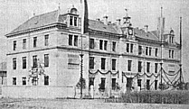

_Das Blasewitzer Schulhaus um 1880_

Im Zuge der Bebauung des Waldparkgebietes entstanden um 1870 mehrere neue Straßen und Plätze. Unter Bezugnahme auf den Sieg im Deutsch-Französischen Krieg und die Reichsgründung 1871 erhielten diese Straßen Bezeichnungen wie Siegesplatz, Deutsche-Kaiser-Allee und Marschall-Allee. Mit der Eingliederung der zuvor französischen Regionen Elsaß und Lothringen in das Deutsche Reich wurden zwei neue Straßen Elsasser bzw. Lothringer Weg genannt. Der als Mittelachse des [Waldparks](../../../ost/blasewitz/waldpark_blasewitz/) angelegte Lothringer Weg wurde Ende des 19. Jahrhunderts mit repräsentativen Villen, eingebettet in den vorhandenen Waldbestand, bebaut.

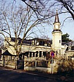Nr. 1: Architektonisch bemerkenswert ist die Villa Lothringer Weg 1, die 1874/75 im Stil der französischen Renaissance von Hübner & Frieße errichtet wurde. Das Haus entstand als repräsentativer Landsitz eines Dresdner Industriellen und besitzt eine großzügige Parkanlage im Anschluss an den Waldpark _(Foto rechts)_. 1945 beschädigten Bomben die Villa schwer. Erst 1995/97 konnte die Ruine nach historischem Vorbild wiederaufgebaut werden.

Nr. 2: In diesem Haus, entworfen vom renommierten Büro Giese & Weidner, hatte der jüdische Hofgoldschmied Julius Jacoby seine Wohnung. Jacobi ließ sich die im Landhausstil gestaltete Villa 1893/94 auf dem Eckgrundstück zur Emser Allee (ehem. Nr. 12, heute 14a) errichte. Wegen seiner Herkunft wurde sein Haus in der Nazizeit beschlagnahmt und in eines der berüchtigten "Judenhäuser" umgewandelt, in denen auf engstem Raum Dresdner Juden zwangsweise eingewiesen wurden.

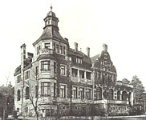Nach der Deportation der letzten Bewohner nutzten die SS und der Auslandsgeheimdienst die Villa ab 1944 als "Mullah-Schule". Unter Regie der Arbeitsgemeinschaft "Turkestan e.V." wurden hier muslimische Geistliche, überwiegend aus der UdSSR, untergebracht und unterrichtet. Ziel war die Ausbildung islamischer "Feld-Mullahs" zur religiösen Betreuung islamischer Kämpfer, die auf Seiten der deutschen Wehrmacht kämpften. Für diesen Zweck erhielten die Innenräume eine künstlerische Ausgestaltung nach dem Vorbild vorderasiatischer Moscheen und wurden mit islamischen Kultgegenständen ausgestattet. In den oberen Etagen befanden sich die Wohn- und Schlafräume der Internatsschüler. Außerdem gab es einen Betsaal, Unterrichts- und Gemeinschaftsräume. Am 13. Februar 1945 fiel die Villa den Bomben zum Opfer _(Foto)_. An gleicher Stelle entstanden 1996 zwei neue Wohnhäuser.

Die Mendelssohnallee wurde nach 1870 als Deutsche-Kaiser-Allee angelegt und in der Folgezeit mit repräsentativen Villen bebaut. Im Bebauungsplan war sie zuvor wegen ihrer bogenförmigen Straßenführung als Curvenstraße eingetragen. Mit der offiziellen Namensgebung der Straße im April 1873 sollte, wie auch bei den benachbarten Straßen, an den Sieg Deutschlands im Deutsch-Französischen Krieg und die Reichsgründung 1871 erinnert werden. Im September 1945 wurde die Straße nach dem Philosophen Moses Mendelssohn (1729-1786) in Mendelssohnallee umbenannt.

An der Mendelssohnallee haben sich noch einige Villen der Entstehungszeit des Viertels erhalten, die teilweise von bekannten Dresdner Künstlern bewohnt wurden. So lebte in der von ihm selbst entworfenen Villa Nr. 1 viele Jahre der Architekt Martin Pietzsch, der neben dem Loschwitzer [Künstlerhaus](../../../nordost/loschwitz/strassen_loschwitz/pillnitzer_landstrasse/kunstlerhaus/) auch viele Dresdner Kinobauten schuf. Nr. 10 war Wohnsitz des Grafikers Bruno Gimpel, der als Vorsitzender des Dresdner Grafikervereins tätig war. Wegen seiner jüdischen Herkunft wurde Gimpel während der NS-Zeit drangsaliert und nahm sich 1943 in seinem Haus das Leben. Zwischen 1896 und 1911 lebte der Kunstmaler August Leonhardi jun. auf der Drei-Kaiser-Allee 40. Leonhardi, Sohn des Tintenfabrikanten und Malers Eduard Leonhardi übernahm nach dem Tod seiner Eltern das Werk in Loschwitz und verkaufte die Blasewitzer Villa. Im Haus Nr. 12 wohnte ab 1898 der Kammersänger Karl Perron.

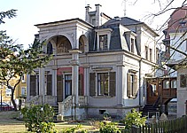Nr. 24: Die Villa im Stil der Neorenaissance wurde zwischen 1874 und 1876 nach Plänen des renommierten Dresdner Architektenbüros Giese & Weidner errichtet. Das eingeschossige Gebäude mit ausgebautem Walmdach entstand im Zuge des weiteren Ausbaus des Blasewitzer Villenviertels. Neben der eigentlichen Villa gehört auch ein zweigeschossiges Kutscherhaus zum Komplex. Bauherr der Villa war vermutlich der Loschwitzer [Tintenfabrikant](../../../nordost/loschwitz/strassen_loschwitz/grundstrasse/tintenfabrik_leonhardi/) und Landschaftsmaler Eduard Leonhardi.

Nachdem in der Nachbarschaft größere Wohnhäuser entstanden waren, entschieden sich die Besitzer nach 1890 zur Umgestaltung des Grundstücks, wobei u.a. an der Nordseite eine Terrasse mit Freitreppe und einer großen Loggia angebaut wurde. Nach 1945 erfolgte der Ausbau des Dachgeschosses zu einer zusätzlichen Wohnung. Ab 1970 wohnte die Grafikerin und Architektin Krista Grunicke im Haus, die u.a. an der Ausgestaltung des Friedrichschlösschens in Großsedlitz und dem Palast der Republik in Berlin beteiligt war. Zu ihren Bauten in Dresden gehören Teile der Freilichtbühne Junge Garde und das Sonnenhäusel im Großen Garten. 2013 wurde die Villa denkmalgerecht saniert.

Nr. 26: Bemerkenswert ist auch die um 1910 entstandene neoklassizistische Villa Mendelssohnallee 26, die als Novum im Keller sogar ein eigenes Schwimmbad besaß. Das Wohnhaus entstand als eine der letzten Blasewitzer Villen für einen türkischen Besitzer und orientierte sich an internationalen Architekturtrends seiner Zeit. Nach 1945 nutzte die bekannte Dresdner Krankengymnastin Charlotte Kehling das Gebäude als private Praxis, die sie erst im hohen Alter von 89 Jahren aufgab.

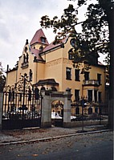Villa Rothermundt: Die Villa auf der Mendelssohnallee 34 entstand 1895 für den Industriellen Adolf Rothermundt (1846-1930), der als Besitzer einer Zuckerraffinerie in Rußland zu Wohlstand gekommen war. So wie viele Unternehmer ließ er sich im Ruhestand in Blasewitz nieder und hier vom Architekten Karl Emil Scherz eine repräsentative Villa erbauen. Regelmäßig fanden in den Räumen Konzerte statt, in denen außerdem eine wertvolle Gemäldesammlung von Adolf Menzel bis Claude Monet die Kunstinteressenten anzog. Eine freundschaftliche Beziehung verband ihn auch mit dem Maler Max Liebermann. Nachdem Rothermundts Nachkommen durch die Weltwirtschaftskrise ihren Besitz verkaufen mussten, stand das Haus zunächst leer und wurde 1937 von der Stadt Dresden übernommen.

Da die Villa den Luftangriff auf Blasewitz ohne größere Schäden überstanden hatte, wurde hier in der Nachkriegszeit eine Notverpflegungsstelle für Flüchtlinge eingerichtet. Bereits im Juni 1945 bezog jedoch das Städtische Konservatorium das Gebäude. Mit Unterstützung der sowjetischen Besatzer wurde dieses zur Akademie für Musik und Theater ausgebaut und im Herbst 1952 zur [Hochschule für Musik](../../../Zentrum/Pirnaische_Vorstadt/Musikhochschule/musikhochschule.html) erhoben. Heute nutzt das Sächsische Landesgymnasium “Carl Maria von Weber” als Spezialschule für Musik das Areal. 2007/08 erfolgte eine umfassende Sanierung der Villa sowie der Neubau zweier moderner Internatshäuser im Park. Vor der Villa befindet sich ein kleiner Brunnen, welcher ursprünglich eine Figur des Ritters St. Georg trug. Die verschollene Plastik wurde 2010 durch die moderne Metallskulptur “Wassermusik” von Hans-Volker Mixsa ersetzt.

[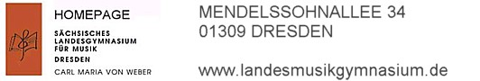](http://www.landesmusikgymnasium.de)

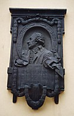Die heutige Naumannstraße war bereits im 16. Jahrhundert vorhanden und wurde von den Bewohnern des Dorfes Viehtreibe genannt, da sie den Weg zu den Weideflächen am Elbufer bildete. Im 19. Jahrhundert zeitweise auch Auenstraße genannt, erhielt 1864 sie den Namen des Komponisten Johann Gottlieb Naumann, der 1741 in einem heute nicht mehr vorhandenen Häuschen an der Loschwitzer Straße geboren wurde. Naumann war viele Jahre Hofkapellmeister und gehörte zu den bedeutendsten Musikern seiner Zeit. Von seinem Einkommen erwarb er später eine repräsentative Villa an der Loschwitzer Straße. Dieses Haus wurde 1945 beim Bombenangriff zerstört. An ihn erinnert jedoch eine Gedenktafel am ehemaligen Blasewitzer Rathaus _(Foto)_.

Ursprünglich begann die Nummerierung der einzelnen Grundstücke an der Prellerstraße und erfolgte aufsteigend in Richtung Schillerplatz. Erst im Zuge der Eingemeindung von Blasewitz wurde das System umgestellt und in diesem Zusammenhang auch ein kurzer Abschnitt der Emser Allee in die Naumannstraße einbezogen. Zu den markantesten Gebäuden gehört das frühere [Rathaus](../../../ost/blasewitz/), welches ursprünglich als Schule des Ortes errichtet wurde. Die Pläne für diesen Bau stammen von Gottfried Semper.

Nr. 3: Historisch interessant ist die benachbarte sogenannte “Präsidentenvilla” Naumannstraße 3. Bereits um 1849 für den damaligen Besitzer der Löwenapotheke Otto Schneider als bescheidenes Sommerhaus (“Villa Marienlust”) erbaut, ließ dessen Schwiegersohn Leopold Schieck das Gebäude 1907/08 vom bekannten Architekturbüro Schilling & Gräbner zu einer Villa erweitern. Dessen Sohn Walter Schieck (1874-1947) war zwischen 1930-33 letzter freigewählter Ministerpräsident Sachsens. Nach dessen Entlassung diente das Haus u. a. ab 1941 als Polizeidienststelle, Lazarett und Sowjetische Ortskommandantur.

Am 1. Juli 1948 eröffnete hier die Poliklinik Blasewitz als dritte in Dresden. Zunächst gab es nur eine Innere und eine Chirurgische Abteilung, bevor ab 1950 ein Labor und insgesamt 13 medizinische Fachabteilungen folgten, die die Einrichtung zur größten Poliklinik in Dresden machten. 1974/76 und 1998 entstanden moderne Ergänzungsbauten auf dem Grundstück. Heute nutzen eine Apotheke und die Verwaltung des Ärztehauses "Am Blauen Wunder" die Villa.

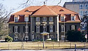

**_Foto:_** _Die frühere “Präsidentenvilla” an der Naumannstraße 3_

Nr. 4: Gegenüber steht die sogenannte ”Bismarck-Villa” Naumannstraße 4. Das Haus entstand 1873 und wurde 1885 an den sächsischen General Hans Felix Eduard von Trebra-Lindenau verkauft, an den noch heute das Familienwappen über der Tür erinnert. Seine Frau Marie Sophie war eine Cousine des Reichskanzlers Bismarck, der mehrfach als Gast im Haus weilte. Die Ehefrau seines Sohnes, Ursula von Trebra-Lindenau betätigte sich als Schriftstellerin und war Autorin der bekannten “Deutschen Romanzeitung”. Nach dem Tod des Paares übernahm 1910 Bruder Hans von Trebra die Villa. Später befand sich auf dem Grundstück eine Autowerkstatt. Zu DDR-Zeiten nutzte man das Haus als Wohnheim für polnische Gastarbeiter. Nach dem Auszug 1990 verschwanden zahlreiche bis dahin noch erhaltene Ausstattungsstücke des Hauses auf ungeklärte Weise und das Gebäude verfiel zur Ruine. Eine Sanierung ist geplant. 2017 wurden im hinteren Teil des Areals an der Ecke zur Karasstraße die Seniorenwohnanlage "Karasvillen" gebaut.

Die Oehmestraße führt in Verlängerung der Voglerstraße von der alten Blasewitzer Ortsgrenze zur Tolkewitzer Straße und von
dort zum Elbufer. Bis zur Eingemeindung des Ortes wurde sie Seidnitzer Straße genannt. Ihren jetzigen Namen verdankt sie dem
Kunstmaler Ernst Oehme (1797-1855), der zur Dresdner Montagsgesellschaft gehörte und mit Ludwig Richter befreundet war.
Oehme schuf zahlreiche romantische Gemälde und arbeitete zeitweise auch als Zeichenlehrer am Blochmannschen Institut. Sein Sohn Erwin war an der Ausmalung der Semperoper beteiligt.

Neben Villen und Landhäusern entstand Ende des 19. Jahrhunderts unmittelbar am Elbufer das Hotel “Bellevue”, welches jedoch
1945 den Bomben zum Opfer fiel. Auf dem Grundstück wurde 1970/72 das architektonisch bemerkenswerte Ruderzentrum
Blasewitz errichtet. Der von Ingo Schönrock und Ulrich Müther entworfene Stahlbeton-Schalenbau mit seinem charakteristischen
Dach gehört zu den Höhepunkten der DDR-Architektur der 70er Jahre und dient bis heute als Trainingsstätte für Ruderer,
Kanuten und Segler. 2005/06 wurde das Gebäude umfassend saniert. Unweit davon befand sich bis 1955 die Anlegestelle der zum Loschwitzer Wasserweg verkehrenden Personenfähre.

Im Wohnhaus Polenzstraße 23 lebte bis zu seinem Tod 1928 der Ehrenobermeister der Dresdner Köcheinnung E. Lößnitzer.
Lößnitzer war Begründer der ersten deutschen Gastronomieschule und wirkte viele Jahre als Lehrer an dieser Einrichtung.

Nach der Eingemeindung von Blasewitz erhielt die ehemalige Friedrich-August-Straße nach ihrem berühmtesten Bewohner den Namen Prellerstraße. Friedrich Preller d. J. (1838-1901) war ab 1880 Professor für Landschaftsmalerei an der Dresdner Kunstakademie und wohnte ab 1884 in dem von ihm selbst entworfenen Wohnhaus Friedrich-August-Straße 6c (jetzt Nr. 32). Zu den Bewohnern der hier stehenden Villen gehörte in den Zwanziger Jahren auch der TH-Professor James Breit, der nach 1933 von den Nazis von seinem Lehrstuhl vertrieben wurde (Nr. 20). Das bis 1990 als Bezirksverwaltung der Staatlichen Versicherung der DDR genutzte Haus ist heute Sitz des Honorarkonsulats von Malta. Bemerkenswert sind auch die Wohnhäuser Prellerstraße 9 (Villa Zangenberg, um 1890 erbaut) und Nr. 10. Letzteres entstand bereits um 1850 und ist eines der ältesten Landhäuser im Ort. Die benachbarte Villa Nr. 12, ein landhausartiges Gebäude mit zahlreichen Balkons und Gartenterrasse, wurde 1999 zugunsten eines modernen Mehrfamilienhauses abgerissen.

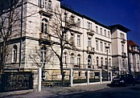Waldparkhotel: Das Gebäude entstand 1869 im italienischen Renaissancestil und diente nach einem Umbau ab 1893 als Sanatorium der Deutschen Reichsbahn. 1922 übernahm die Heilstätten-Gesellschaft für sächsische Betriebskrankenkassen m.b.H. das Gebäude und wandelte es in ein Krankenhaus mit 120 Betten um. Behandelt wurden Mitglieder der sächsischen BKK, wofür im Gebäude moderne Operationsräume und Fachabteilungen für Innere Medizin, Chirurgie, Frauenleiden und Hautkrankheiten entstanden. Während des Zweiten Weltkrieges wurde hier ein Lazarett eingerichtet.

Da es in der Nachkriegszeit im zerstörten Dresden an Bettenkapazität mangelte, wurde das Gebäude Anfang der 1950er Jahre zum Hotel mit öffentlicher Gaststätte umgebaut.  Schnell entwickelte sich das Waldparkhotel mit seiner Bar und seinem großen Saal zu einer der beliebtesten Tanzgaststätten der Stadt und war bevorzugter Treffpunkt der Prominenz, vor allem für in Dresden gastierende Künstler. 1990 erlebte das Hotel einen seiner letzten großen Höhepunkte, als hier Kurt Biedenkopf auf einer Parteikonferenz zum Spitzenkandidaten der sächsischen CDU gewählt wurde. 1996 wurde das Waldparkhotel geschlossen. Nachdem der bereits vorgesehene Abriss des denkmalgeschützten Gebäudes durch Proteste zahlreicher Einwohner verhindert werden konnte, begann 1999 der Umbau zu einer Seniorenresidenz.

Nr. 11 (Villa Sphinx): Die Villa wurde 1884 für Otto Staudinger erbaut. Der international bekannte Schmetterlingsforscher und Insektenkundler betrieb hier seine Naturalienhandlung, die sich zuvor auf der Loschwitzer Str. 43 befunden hatte. Neben dem Verkauf von exotischer Insekten an Sammler in aller Welt gab Staudinger auch verschiedene Kataloge und Fachschriften zum Thema heraus. 1879 trat der Däne Andreas Bang-Haas in die Firma ein und heiratete 1880 Staudingers Tochter Carmen Dolores. 1945 wurde das Haus beschädigt,wobei die Fassade jedoch erhalten blieb. Die Firma existierte noch bis 1948. Staudingers Sammlungen befinden sich heute im Museum für Naturkunde Berlin und im Senckenberg-Museum für Naturkunde in Dresden.

Nr. 17:
In diesem Haus wohnte und arbeitete nach 1945 der Kunstmaler Richard Birnstengel (1881-1968). Birnstengel schuf
zahlreiche Landschaftsbilder seiner zeitweiligen Wahlheimat auf der Kurischen Nehrung und verlor 1945 einen Großteil seines
Werkes bei der Zerstörung seines Ateliers auf der Ostbahnstraße 29 in der Nähe des Hauptbahnhofes. 1959 verzog Birnstengel zur Regerstraße 12.

Die Regerstraße, benannt nach dem deutschen Komponisten Max Reger (1873-1916) führt von der Ortsgrenze zu Striesen bis zum Elbufer unterhalb des Blauen Wunders Bis in die Zwanziger Jahre befand sich hier eines der beiden Blasewitzer Elbebäder. Als Kinderbadeanstalt diente es vorrangig den Jungen und Mädchen des Ortes, die in zwei getrennten Bereichen das Schwimmen erlernen konnten. Ein zweites Elbebad lag einige hundert Meter elbabwärts gegenüber den Albrechtsschlössern.

Ursprünglich wurde diese Straße Johannstraße genannt. Die meisten Gebäude entstanden im letzten Drittel des 19. Jahrhunderts und zeigen verschiedene Stilformen. Bewohner waren wohlhabende Dresdner Unternehmer, Adlige und Offiziere.Verbunden ist die Blasewitzer Regerstraße aber auch mit Persönlichkeiten aus dem Bereich der Kunst. So wohnte die berühmte Opernsängerin Eva von der Osten einige Jahre gemeinsam mit ihrem Mann in diesem Teil von Blasewitz (Nr. 3).

Im Wohnhaus Regerstraße 8 lebte von 1906 bis 1941 der Maler Franz Rowland, der zahlreiche Bilder der Dresdner Gegend malte und auch als Buchillustrator tätig war. 1959 bezog der Kunstmaler Richard Birnstengel eine Wohnung auf der Regerstraße 12 und wohnte hier bis zu seinem Tod 1968. Zu den Bewohnern der Straße gehörte auch Maria Elisabeth Haag, Tante des bekannten Schriftstellers Thomas Mann (1838-1917). Ihr Lebensweg war Vorbild für Manns Romanheldin Toni Buddenbrock im Roman “Die Buddenbrocks - Verfall einer Familie”. Der Architekt Fritz Steudtner, zu dessen Arbeiten u.a. die nach 1945 erfolgten Innenraumgestaltungen der Kreuzkirche und der Heilig-Geist-Kirche gehören, wohnte ab 1939 bis zu seinem Tod 1986 auf der Regerstraße 10.

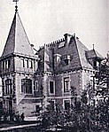Villa Elbheim (Nr. 1): Bemerkenswerte Wandmalereien mit Märchenmotiven weist das Haus Regerstraße 1 auf, welches 1873 als “Villa Elbheim” nach Plänen von Theodor Lehnert im Stil der Neorenaissance entstand _(Foto)_. Eigentümer der Villa war ab 1878 der Privatier Oskar Richter, der sich als Stifter große Verdienste um den Bau der Blasewitzer Heilig-Geist-Kirche erwarb. Um 1890 ließ Richter einen Wintergarten anbauen und mit Darstellungen von "Aschenputtel", "Dornröschen" und "Schneewittchen" ausgestalten. Auch weitere Details der Entstehungszeit wie Stuckdecken und hölzerne Wandverkleidungen blieben bis zur Gegenwart erhalten.

Villa Moltke (Nr. 2): Die Villa entstand ursprünglich für den Premierleutnant Werner Freiherr von Reitzenstein und gehörte zeitweise Henry von Burt, dem Neffen und persönlichen Adjutanten des preußischen Generalfeldmarschalls Helmuth Graf von Moltke, der seinen berühmten Onkel mit einer Relieftafel am Haus ehrte. 1910/11 erwarb der Unternehmer Max Dudek das Haus und ließ es unter Leitung des Architektenbüros Schilling & Weidner umbauen. Dudek war Inhaber einer Zinkweißhütte in Bernsdorf/OL und verlegte 1911 den Firmensitz nach Blasewitz, obwohl die eigentliche Fabrik weiter in Bernsdorf blieb. Im Garten der Blasewitzer Villa gab es eine 1918 vom Robert-Diez-Schüler Arthur Ernst Berger geschaffene Plastik mit Darstellung eines Hirsches, welche seit 2000 verschollen ist.

Nr. 24: An der Villa Regerstraße 24 erinnert eine Bronzebüste Bismarcks an die Verehrung des “Eisernen Kanzlers” durch den ersten Besitzer des Hauses, den preußischen Generalmajor Ludwig von Kusserow. Schöpfer der Büste war Reinhold Begas. Das nach 1945 entfernte Kunstwerk konnte nach 1990 auf Initiative der Bewohner restauriert und wieder an seinen Platz verbracht werden.

Die Reinhold-Becker-Straße am Rande des früheren Dorfkerns erinnert an den heute weitgehend vergessenen Musiker
Reinhold-Becker (1842 -1924), der seinen Wohnsitz in Blasewitz auf der Sachsenallee hatte. Becker war zeitweise Leiter der
Dresdner Liedertafel und verfasste einige Opern. Leider fielen die meisten Bauernhäuser mittlerweile dem Abriss zum Opfer.
Erhalten blieben einige Villen. Die frühere Villa “Marienheim” war zeitweise Domizil des Technischen Museums und wird heute
von der deutsch-böhmischen Brücke/Most-Stiftung genutzt (Nr. 5). Im Wohnhaus Reinhold-Becker-Straße 8 lebte der Architekt
und Denkmalpfleger Hubert Ermisch, der 1924-1936 die große Zwingerrestaurierung leitete und sich auch nach 1945 für die
Rettung des Bauwerkes engagierte. Das Wohnhaus Nr. 7, nach einer Inschrift über dem Eingang auch “Villa Salve” genannt, brannte in den 1990er Jahren aus und wurde im Juli 1999 abgerissen.

Die heutige Sebastian-Bach-Straße wurde bis zur Eingemeindung von Blasewitz Sommerstraße genannt. Im Wohnhaus Nr. 7
(heute 22) lebte zwischen April 1883 bis zum Mai 1884 der Abenteuerschriftsteller Karl May mit seiner Ehefrau, der später in die
Dresdner Innenstadt, dann nach Radebeul verzog. May verfasste im Haus seinen Roman “Das Waldröschen” und Teile des Buches “Die Liebe des Ulanen”. Seit 1991 erinnert an ihn eine Gedenktafel.

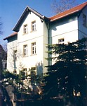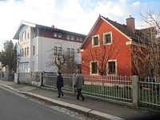

**_Foto:_** _Das ehemalige Wohnhaus von Karl May auf der Sebastian-Bach-Straße 22 (links)_

_und die Wohnhäuser Nr. 6 und Nr. 10 (rechts)_

Bemerkenswert ist auch die vom Blasewitzer Baumeister Karl Emil Scherz als Wohnhaus genutzte Villa Sebastian-Bach-Straße
17\. 1911 ließ der bekannte Architekt das 1875 von seinem Vater erbaute Gebäude umbauen und erweitern. Hier brachte er auch
seine große “Ortsgeschichtliche Sammlung Blasewitz und Umgegend” mit zahlreichen Sachzeugen und Dokumenten zur Geschichte seines Heimatortes unter. Von Scherz´ Vater stammen die Planungen der benachbarten Gebäude Nr. 15, 17 und 19.

Der Siegesplatz wurde nach 1870 an der Einmündung des Lothringer Wegs in die Loschwitzer Straße angelegt und in Erinnerung
an Deutschlands Sieg über Frankreich 1870/71 so benannt. Wegen dieses “militaristischen” Hintergrundes wurde die Benennung nach 1945 aufgehoben. Der Platz als Anlage ist jedoch noch erhalten.

Die Thielaustraße befiundet sich an der Flurgrenze zwischen Blasewitz und Striesen, wobei der nördliche Teil (Nr. 1-7) zu
Blasewitz, der südliche Abschnitt zu Striesen gehört. Ihren Namen erhielt sie nach Ernst Florian von Thielau, der von 1890 bis
1897 als Amtshauptmann tätig war und seinen Heimatort Blasewitz mit verschiedenen Stiftungen unterstützte.

Der Vogesenweg, benannt nach einem Gebirgszug im Elsass, bildet die östliche Grenze des Blasewitzer Waldparks. Bis 1926 trug diese Straße den Namen Elsasser Weg. Die Villen entstanden gegen Ende des 19. Jahrhunderts. Bemerkenswert ist die von Max Poscharsky im altdeutschen Stil 1894 erbaute Villa Vogesenweg 4. Im Nachbarhaus Nr. 2 hatte nach 1945 der erste Leiter der Hochschule für Kirchenmusik und spätere Kreuzkantor Martin Flämig seinen Wohnsitz. Heute wird das Haus als Bibliothek dieser Hochschule genutzt.

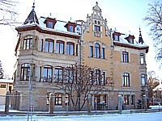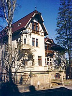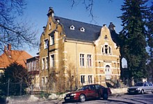

**_Fotos:_** _Villen am Vogesenweg: links Nr. 1, Mitte Nr. 4,_

_rechts Nr. 2 (heute Notenbibliothek der Hochschule für Kirchenmusik)_

Die heutige Wägnerstraße bestand ursprünglich aus zwei Straßenabschnitten westlich und östlich des Paulusplatzes. Der östliche Teil führte dabei an der Blasewitzer Schule (heute 63. Grundschule) vorbei und trug deshalb ab 1897 bis zur Eingemeindung den Namen Schulstraße. Der ältere, westliche Abschnitt hatte schon um 1870 den Namen Oststraße erhalten, wohl als "Gegenstück" zur Weststraße (heute Löscherstraße). Um Verwechslungen zu vermeiden erfolgte 1921 die Zusammenlegung beider Straßen unter dem gemeinsamen Namen Oststraße. Nach dem Tod des Baumeisters Emil Wägner (1853-1927) erhielt sie am 30. Dezember 1927 die Benennung Wägnerstraße. Der Baurat Emil Wägner war als Architekt gemeinsam mit Emil Scherz an zahlreichen Villenbauten im Ort beteiligt und gehörte viele Jahre dem Blasewitzer Gemeinderat an.

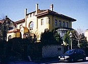Nr. 10 (Villa Barthel): Das Gebäude auf der Wägnerstraße 8 wurde 1904 vom “Kino-Architekten” Martin Pietzsch erbaut, der sein Büro auf der damaligen Deutschen-Kaiser-Allee 1 hatte. Die Villa gehört zu den wenigen Jugendstilbauten in Blasewitz. In den 1930er Jahren erwarb der Fabrikant Egbert Günther das Haus. Günther war bis zur Enteigung 1945 Inhaber der [“Eg-Gü”-Werke](../../../ost/striesen/strassen_striesen/augsburger_strasse/) auf der Augsburger Straße 1/ Ecke Fiedlerstraße, die auch nach 1945 als Schuhcreme-Hersteller bekannt war. In den 1950er Jahren nutzten die Angestellten des Betriebes die Villa als Kulturhaus. Später zog hier eine Außenstelle der Staatssicherheit ein. Das 1994 rekonstruierte Gebäude wird heute für Büros und Wohnungen genutzt.

Nr. 14 (Villa Elisabeth): Die Villa entstand vermutlich um 1895 an der damaligen Oststraße auf früherem Gärtnereigelände. Im ersten Blasewitzer Adressbuch von 1879 ist unter dieser Anschrift (damals Oststraße 9) noch die Kunst- und Handelsgärtnerei von Moritz Rotter genannt. 1885 gehörte das Grundstück dem Gärtnermeister Johannes Nicolai. Erst nach 1890 wird hier ein Wohnhaus genannt. Der Name "Villa Elisabeth" lässt sich erstmals 1897 im Adressbuch nachweisen. Mehrfach wechselten dann die Besitzer, zu denen 1898/99 der Rechtsanwalt Dr. iur Carl Paul Schmidt und ab 1904 der Kunstmaler und Restaurator Gustav Löhr gehörte, der zu diesem Zeitpunkt jedoch in München wohnte. Löhr lebte später zeitweise auch in Dresden und war u.a. ab 1912 an der Restaurierung der Wand- und Deckenbilder im Schloß Hoflößnitz beteiligt.

Nr. 18: Ebenfalls von Martin Pietzsch stammen die Entwürfe für das Mietshaus Wägnerstraße 18. Obwohl dieses Gebäude zu den größten Blasewitzer Häusern gehörte und von mehreren Familien bewohnt wurde, erhielt es ebenfalls typische Stilelemente des Villenbaus. Das Haus entstand 1905 im Jugendstil und wurde nach 1990 saniert. Bemerkenswert ist ferner die 1914 fertig gestellte Villa Nr. 3 in Anlehnung an die Bauten Hans Erlweins.

[Blasewitz auf OpenStreetMap](https://www.openstreetmap.org/search?query=Dresden+Blasewitz)

* * *

 \[ [Home](../../../index.html)\] \[ [Nord](../../../nord/)\] \[ [Nordwest](../../../nordwest/)\] \[ [Neustadt](../../../neustadt/)\] \[ [Nordost](../../../nordost/)\] \[ [West](../../../west/)\] \[ [Zentrum](../../../zentrum/)\] \[ [Südwest](../../../sudwest/)\] \[ [Süd](../../../sud/)\] \[ [Südost](../../../sudost/)\] \[ [Ost](../../../ost/)\] \[ [Register](../../../Register/register.html)\] \[ [Kontakt](../../../Kontakt/kontakt.html)\] \[ [Impressum](../../../impressum/)\]
