* * *

* * *

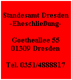

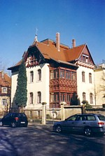Die Goetheallee wurde im letzten Drittel des 19. Jahrhunderts als Wohnstraße angelegt und hieß bis 1949 Emser Allee. Mit diesem am 1. April 1873 amtlich eingeführten Namen sollte an die Ereignisse des Deutsch-Französischen Krieges 1870/71 erinnert werden. Die von Bismarck politisch geschickt ausgenutzte "Emser Depesche" war Auslöser der Kämpfe zwischen beiden Ländern. Nicht zuletzt die hohen Reparationszahlungen Frankreichs nach Kriegsende trugen zum wirtschaftlichen Aufschwung und der Entstehung der Blasewitzer Villenviertel bei.

Die Emser Allee entwickelte sich bis zur Jahrhundertwende zu einer der vornehmsten Straßen in Blasewitz. Noch heute lassen die zum Großteil erhaltenen Villen den einstigen Reichtum der hier ansässigen Hauseigentümer erkennen. Ursprünglich führte sie nur bis zur Einmündung des [Käthe-Kollwitz-Ufers](../../../../zentrum/johannstadt/strassen_johannstadt/kathe-kollwitz-ufer/), während der übrige Abschnitt bis zum Barteldesplatz zu Naumannstraße gehörte. Erst nach der Eingemeindung von Blasewitz wurde dieses Straßenstück 1926 der Emser Allee zugeschlagen und die Gebäude dabei neu nummeriert. Bis 1945 verkehrte auch die Straßenbahn von Johannstadt kommend durch die Emser Allee bis zum [Schillerplatz](../../../../ost/blasewitz/strassen_blasewitz/schillerplatz/).

Aus Anlass des 200. Geburtstages des Dichters Johann Wolfgang von Goethe wurde die Straße am 28. August 1949 in Goetheallee umbenannt. Das Foto zeigt das Landhaus Goetheallee Nr. 49.

**Einzelne Gebäude:**

Nr. 2: Das heute nicht mehr vorhandene Gebäude an der Ecke zur Schubertstraße entstand Ende des 19. Jahrhunderts im neogotischen Tudorstil und gehörte als Pensionshaus "Gotthardsburg" zum "Weißen Schloss" am [Königsheimplatz](../../../../ost/blasewitz/strassen_blasewitz/konigsheimplatz/). 1945 fiel es den Bomben zum Opfer. Heute befindet sich auf dem Grundstück ein in den 1950er Jahren entstandener Neubau, der heute von der Kinder- und Jugendpsychiatrie des Uniklinikums genutzt wird.

Nr. 4 (Villa Königswald): Das Gebäude entstand 1863 nach Plänen von Theodor Lehnert für den Regierungsrat Arthur Willibald Königsheim. Dieser gehörte als Gründer des Waldparkvereins zu den engagiertesten Blasewitzer Bürgern und setzte sich für eine planmäßige Entwicklung des Ortes unter Wahrung künstlerischer Belange ein. Den Garten des Hauses gestaltete der preußische Hofgärtner Neumann, der auch die gärtnerische Gestaltung des Waldparkes übernahm. Neumanns Ideen waren Anregung für zahlreiche Blasewitzer Villengärten, die das Vorbild der Königsheim-Villa aufgriffen. Im Juni 2003 wurde am Haus eine Gedenktafel angebracht.

Nr. 6: Das Haus an der Einmündung der Händelallee entstand 1886 im Landhausstil und wurde vom Blasewitzer Architekten Emil Scherz entworfen. Der schlichte eingeschossige Bau, auch "Villa Waldeck" genannt, weist typische Formen der Entstehungszeit dieses Villenviertels auf, gehört jedoch zu den eher bescheideneren Wohnhäusern der Goetheallee. Besitzer war zeitweise Ernst Robert Böhme, Inhaber der Zigarettenfabrik "Kios".

Nr. 8: Die Villa entstand 1896 für den großbürgerlichen Besitzer und Kammerrat Franz Adolph Lange. Nach 1945 hatte hier die [Christengemeinschaft](../../../../zentrum/sudvorstadt/strassen_sudvorstadt/christengemeinschaft/) ihre Versammlungsräume, bevor diese einen Neubau auf der Reichenbachstraße beziehen konnte.

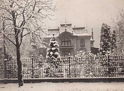Nr. 10: Der um 1900 entstandene neobarocke Villenbau war ab 1910 Wohnsitz des Arztes Dr. Rudolf Steiner. Später befand sich im Haus das Pensionat Dyckerhoff. 1937 lebte hier der Oberassistenzarzt des Johannstädter Rudolf-Hess-Krankenhauses Dr. Rudolf Leutiger, der mehrere wissenschaftliche Arbeiten u.a. zur Diabetes-Krankheit verfasste. Die Villa wurde nach 1990 saniert und anschließend als Wohn- und Bürohaus genutzt. Zeitweise befand sich im Haus der erste jüdische Kindergarten Ostdeutschlands.

Nr. 12: Die Villa wurde 1898 durch den Blasewitzer Baumeister Emil Wägner errichtet und gehört zu den für diese Zeit typischen Wohnbauten am Rande des Waldparks. Das Haus besitzt eine Klinkerfassade und wurde mit verschiedenen Balkons, Holzverkleidungen und einem kleinen Dachtürmchen landhausartig gestaltet. Während die Innenausstattung fast völlig verloren ging, haben sich Fenster und Ornamentverglasungen bis heute erhalten. Nach 1945 nutzte die Medizinische Akademie (Universitätsklinik) das Haus bis 2011 als Kinder- und Jugendpsychiatrie. Im Anschluss erfolgte eine umfassende Sanierung und der Umbau zu einer Kindertagesstätte.

Nr. 13: Auch diese Villa entstand im letzten Drittel des 19. Jahrhunderts für einen wohlahabenden Kaufmann. Der Bau ist im Neorenaissancestil gestaltet und wurde nach 1990 denkmalgerecht saniert. Seit 2003 nutzt der Förderkreis für krebskranke Kinder e. V. das Haus unter dem Namen “Villa Sonnenstrahl” als Begegnungsstätte für betroffene Eltern und Kinder. Dafür wurden einige Gästewohnungen eingerichtet, in denen Angehörige während des Klinikaufenthalts ihrer Kinder übernachten können.

Nr. 14:Das repräsentative Wohnhaus entstand 1910 in der Tradition der großbürgerlichen Villenarchitektur, weist jedoch bereits Elemente einer moderneren Bauauffassung auf. In den 1930er Jahren befand sich im Haus ein Heim des christlichen Wohltätigkeitsvereins "Idea".

Nr. 18 (Villa Schmitz): Die landhausartige Villa wurde 1901/02 vom Blasewitzer Baumeister Karl Emil Scherz für Ernst Schmitz-Havre errichtet. Ab 1903 wohnte hier der Textilfabrikant Oscar Schmitz, der sich einen guten Ruf als Kunstsammler erwarb und in seinem Haus eine der bedeutendsten privaten Sammlungen moderner Kunst zusammentrug. U.a. gehörten Bilder der französischen Impressionisten Cèzanne, Courbet, Delacroix und Manet, aber auch von Max Liebermann, Max Slevogt, Wilhelm Trübner und Fritz Uhde zum Bestand. Außerdem war Schmitz seit 1913 Mitglied der Ankaufskommission der Staatlichen Kunstsammlungen und gehörte dem Vorstand der Kulturstiftung des Landes Sachsen an. 1931 verlegte er seinen Wohnsitz nach Zürich und verstarb dort 1933.

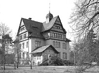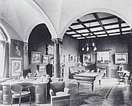

_**Fotos:** Die Villa Goetheallee 18 in den 1930er Jahren_

Die in Dresden verbliebenen jüdischen Nachkommen wurden während der Nazizeit enteignet und mussten fast alle Bilder verkaufen. Einige wenige gelangten bereits zu Schmitz´ Lebzeiten in die Dresdner Galerie. Bis zum Ende des Zweiten Weltkrieges diente das Haus nun als NS-Schwesternheim. In der Nachkriegszeit blieb die Villa Bürohaus. Später hatte hier die Dresden International School, eine Schule mit englischer Unterrichtssprache, ihr Domizil. Nach deren Auszug 2008 wird das Gebäude als Kindereinrichtung genutzt.

Nr. 23: Die Villa wurde 1901 von Heinrich Watzlawik im Jugendstil erbaut und gehört zu den jüngeren Blasewitzer Wohnhäusern. Um 1911 befand sich hier das Konsulat von Siam. In den 1930er Jahren betrieb der Arzt Dr. med Adolf Hußmann im Haus eine ärztliche Fortbildungsschule. Ursprünglich als Zweifamilienhaus konzipiert, wurde das Haus später in Etagenwohnungen aufgeteilt. Nach erfolgter Sanierung 1998/99 wird die Villa heute als Bürohaus genutzt.

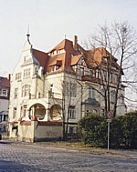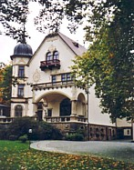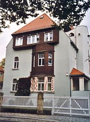

**_Fotos:_** _Villen an der Goetheallee: Nr. 23 (links), Nr. 24 (Mitte), Nr. 29 (rechts)_

Nr. 24 (Villa Muttersegen): Der schlossartige Neorenaissancebau entstand 1891/94 nach Plänen des Architektenbüros Schilling & Gräbner. Nach dem ersten Besitzer, dem Dramatiker Franz von Schönthan Edler von Pernwald, wurde das Haus auch Pernwaldhaus genannt. Schönthan, der als Autor des Theaterstücks “Der Raub der Sabinerinnen” bekannt wurde, verkaufte seinen Besitz jedoch bereits 1896 an neue Eigentümer. Zeitweise hatte hier das königlich-niederländische Generalkonsulat seinen Sitz. Später befand sich in der Villa eine von der schweizerischen Pädagogin Anna Paulini geleitete Bildungsanstalt für höhere Töchter. Seit 1992 nutzt das Europäische Institut für postgraduale Bildung (EIPOS) das Haus.

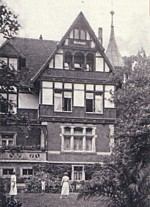Nr. 26 (Villa Fliederhof): Die Villa wurde 1892/93 von Schilling & Gräbner für den Schauspieler Sigward Johannes Friedmann, Mitbegründer des Deutschen Theaters in Berlin, errichtet. Friedmann war mit der Schriftstellerin Henriette von Dönnings verheiratet. Deren erster Ehemann erschoss 1864 in einem Duell den bekannten Arbeiterführer Ferdinand Lasalle. Nach dem Ersten Weltkrieg kam das Haus 1918 in den Besitz der Familie Schuncke. Wilhelm Schuncke war als Generaldirektor der Filz- und Kratzentuchfabrik Dittersdorf (bei Chemnitz) zu Wohlstand gekommen und hatte das Haus als Altersruhesitz gekauft. Zudem war er ein begeisterter Kunst- und Musikliebhaber und besaß einen großen Kreis von Künstlerfreunden. Zu diesem gehörte auch die ebenfalls in Blasewitz lebende Exil-Russin Warwara Satina, deren Tochter Natalja 1902 den Komponisten Sergej Rachmaninow geheiratet hatte. Diese freundschaflich-verwandtschaftlichen Beziehungen veranlassten Rachmaninow, ab 1922 regelmäßig im "Fliederhof" sein Sommerquartier zu nehmen und hier eine Reihe seiner Partituren zu schreiben. Zu den Bewohnern und Gästen der Villa gehörten auch der Hofkapellmeister Hermann Kutzschbach mit seiner Tochter Senta, der expressionistische Maler Ludwig Meidner, der Romantiker Ernst Hermann Walther und der Philosoph Graf Hermann Keyserling.

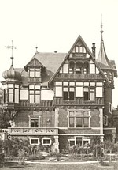1938 fand im Haus die jüdische Familie Hepner Unterschlupf, nachdem sie ihre Wohnung in der Südvorstadt aufgeben mussten. Unter großen persönlichen Einsatz gelang es den Hausbesitzern, die drei Personen vor Repressalien der Gestapo zu schützen. Erst im Oktober 1944 wurde Richard Hepner verhaftet und in das KZ Sachsenhausen verbracht. Mit Glück überlebte er die NS-Zeit und lebte bis zu seinem Tod 1950 im “Fliederhof”. Seine Witwe emigrierte später mit ihrem Sohn in die USA. An das Schicksal der Hepners erinnern seit 2014 drei Stolpersteine vor dem Grundstück.

Bis 1945 blieb die Villa des musikinteressierten Besitzers Wilhelm Schuncke regelmäßiger Treffpunkt Dresdner Künstlerkreise und beherbergte zudem eine reichhaltige Sammlung von Erinnerungsstücken an Rachmaninow sowie Richard Strauss, der eng mit Hermann Kutzschbach und dessen Tochter, der Gesangspädagogin Senta Kutzschbach befreundet war. Am 28. Mai 1945 wurde vor dem Haus Baron Paul von Seiller von betrunkenen Sowjetsoldaten ermordet und kurz darauf im Garten des Grundstücks begraben. Später ließ ihn die Familie ins Familiengrab in Dittersdorf umbetten.

Der “Fliederhof” blieb auch nach dem Zweiten Weltkrieg zunächst in Privatbesitz. Neben Wohnungen gab es hier ab 1960 eine Druckwerkstatt, welche vor allem bei Dresdner Künstlern wie Lea Grundig beliebt war und bis heute unter dem Namen Grafikwerkstatt Dresden existiert. Da die hohen Unterhaltskosten des Hauses die Besitzer jedoch überforderten, war 1970 eine Schenkung an die Dresdner Musikhochschule geplant. Aus politischen Gründen wurde diese jedoch verhindert. Stattdessen erwarb 1974 der Arzt Dr. Flach das traditionsreiche Haus. Bei einem Familiendrama 1979 setzte Flachs Ehefrau die Villa absichtlich in Brand, wobei beide Eheleute ums Leben kamen. Die wertvolle Innenausstattung sowie unersetzliche Strauss-Partituren aus dem Besitz der im Haus lebenden Künstlerin Senta Kutzschbach wurden dabei vernichtet. Die Brandruine wurde wenig später abgerissen und nach 1990 durch einen modernen Neubau ersetzt. Seit April 2010 befindet sich an der Einfassung des Grundstücks eine Gedenktafel, welche über die Geschichte des Hauses und den Aufenthalt Sergej Rachmaninows informiert.

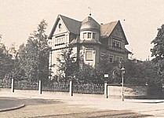Nr. 28: Das Gebäude an der Einmündung des Vogesenweges (ehem. Elsasser Weg 4) entstand 1895 als Villa Lürmann. Das landhausartige Gebäude steht einschließlich der noch weitgehend im Ursprungszustand erhaltenen Gartenanlage unter Denkmalschutz _(Foto um 1920)_.

Nr. 29 (Villa Doehn): Das Gebäude wurde 1903 nach Plänen des Dresdner Architektenbüros Schilling & Gräbner für den Rechtsanwalt Bruno Doehn (1866-1924) erbaut. Doehn war der Sohn des deutsch-amerikanischen Schriftstellers und Politikers Rudolf Doehn, der nach seiner Auswanderung in die USA zu den Mitbegründern der Republikaner gehörte und ab 1866 nach seiner Rückkehr nach Dresden literarisch tätig war.

Nr. 32 (Haus Helene): Die Villa wurde 1890 im Schweizer Landhausstil errichtet und befand sich ab 1892 im Besitz des Königlich-sächsischen Hofapothekers Dr. Oskar Emil Julius Giesecke. Er war Inhaber der Hofapotheke an der Schlossstrasse im Zentrum. Seine Tochter Martha, Ehefrau des Kurdirektors des Weißen Hirschs, lebte noch bis 1945 in der Villa, die beim Luftangriff nur leicht beschädigt wurde. 2015 erfolgte eine Sanierung des Gebäudes.

Nr. 35: In diesem Haus wohnte um 1912 der jüdische Fabrikant Richard Hammer, Inhaber der Schuhfabrik Hammer an der [Augsburger Straße](../../../../ost/striesen/strassen_striesen/augsburger_strasse/) 1 (später “eg-gü”). Hammer gehörte zu den reichsten Männern Dresdens und war auch Konsul des Königreichs Siam (Thailand) in Sachsen. Nach dem Ersten Weltkrieg verzog die Familie in die Villa Goetheallee 47.

Nr. 37: Das Gebäude entstand 1928/29 nach Plänen des Architekten Bruno Paul als Wohnhaus des Dresdner Zigarettenfabrikanten Carl Bergmann. Bergmann hatte 1923 die “Haus Bergmann Zigarettenfabrik AG” gegründet, die ihre Produkte unter dem Markennamen “HB” vertrieb. Das Gebäude erhielt eine heute nur noch in Teilen vorhandene Innenausstattung und gehört zu den qualitätvollsten Villenbauten seiner Zeit im Dresdner Raum. Seit 1991 hat hier die Architektenkammer Sachsen ihren Sitz. Zwischen 1995 und 1997 erfolgte eine umfassende Sanierung des unter Denkmalschutz stehenden Gebäudes. 2013 wurde das Haus im Inneren erneut modernisiert. Regelmäßig finden hier Fortbildungsveranstaltungen für Architekten und Städteplaner, aber auch Beratungsabende für Bauwillige statt.

Nr. 43: Die zweigeschossige Villa entstand 1894 als Gärtnerwohnhaus nach Plänen des Architektenbüros Schilling & Gräbner. Ursprünglich gehörte sie zum gegenüberliegenden “Pernwaldhaus” (Goetheallee 24) Der auf unregelmäßigem Grundriss errichtete Bau weist verschiedene Stilformen auf, deren Hauptblickpunkt der dreigeschossige Treppenturm ist. An Stelle des früheren Wintergartens wurde bei der Sanierung ein moderner Anbau errichtet _(Foto)_.

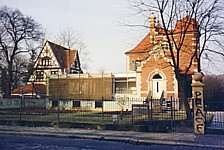

Nr. 51: Die Villa entstand zwischen 1899 und 1900 als dreigeschossiges Wohnhaus für den Rentier Theodor Grimme. Am Bau beteiligt waren neben Baumeister Oskar Menzel verschiedene Blasewitzer Firmen, die dem Haus sein repräsentatives Äußeres gaben. Stilistisch gehört diese Villa der Übergangszeit vom Historismus zum Jugendstil an. Bemerkenswert ist an der Fassade eine Holzschnitzerei mit dem Motiv “Adam und Eva”.

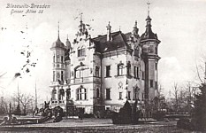Nr. 55 (Villa Weigang): Die prächtige Villa wurde unter Verwendung verschiedener Stilformen 1894/95 für den Architekten Max Poscharsky unter Mitwirkung der Architekten Schilling & Gräbner als eigenes Wohnhaus entworfen. Späterer Besitzer war der Bautzner Industrielle Karl Ernst Otto Weigang, dem das Haus seinen Namen verdankt. 1930 übernahm die Freitaler Kreditbank AG, 1947 die Sächsische Landesbank das Grundstück. Nach 1945 befanden sich hier u. a. die Betriebsräume der Firma Seidenschneider, ab 1964 eine Meldestelle der Volkspolizei sowie ein Standesamt. 1991-94 wurde das Gebäude nach historischem Vorbild komplett saniert und beherbergt heute das Dresdner Standesamt. Bemerkenswert ist die weitgehend erhaltene Innenausstattung der Entstehungszeit.

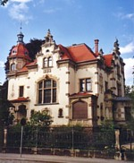Im Garten befindet sich ein interessanter Brunnen, der bereits beim Bau der Villa angelegt wurde. Der in einer kleinen Senke liegende Brunnen besteht aus einem Sandsteinbecken und einer darauf stehenden gußeisernen Plastik. Leider ging die ursprünglich vorhandene Figur in der Nachkriegszeit verloren. An ihrer Stelle steht heute eine Puttengruppe mit Blumenkelch, der zugleich als Wasserspeier dient. Diese Plastik stand ursprünglich im Garten des Palais Oppenheim auf der Bürgerwiese, konnte dort nach 1945 aus den Trümmern geborgen werden und kam 1999 nach Blasewitz.

Nr. 57 (Villa Baumann): Das Haus entstand im Kern bereits 1865 und gehört so zu den ältesten Blasewitzer Villen. 1883 wurde die Villa im Stil der Nicolai-Schule umgebaut und erweitert, wobei sie auch den markanten zweigeschossigen Turm erhielt. Die Innenausstattung des 2000 sanierten Gebäudes ist bis heute weitgehend erhalten geblieben. Zum Komplex gehören neben der Villa zwei kleinere Nebengebäude, die früher als Wohnung der Hausangestellten dienten. Um das Haus entstand ein Park mit einem noch erhaltenen Gartenhäuschen, Teich mit Grotte sowie einer Aussichtsterrasse zur Elbe. Im Garten erinnert ein Findling mit Inschrift an das 50. Amtsjubiläum und den 70. Geburtstag des Reichskanzlers Otto von Bismarck am 1. April 1885. Stifter war der Dresdner Hotelier Ehregott Richard Baumann. Ursprünglich war der Stein auf dem Areal Käthe-Kollwitz-Ufer 101 zu finden.

* * *

 \[ [Home](../../../../index.html)\] \[ [Nord](../../../../nord/)\] \[ [Nordwest](../../../../nordwest/)\] \[ [Neustadt](../../../../neustadt/)\] \[ [Nordost](../../../../nordost/)\] \[ [West](../../../../west/)\] \[ [Zentrum](../../../../zentrum/)\] \[ [Südwest](../../../../sudwest/)\] \[ [Süd](../../../../sud/)\] \[ [Südost](../../../../sudost/)\] \[ [Ost](../../../../ost/)\] \[ [Register](../../../../Register/register.html)\] \[ [Kontakt](../../../../Kontakt/kontakt.html)\] \[ [Impressum](../../../../impressum/)\]
