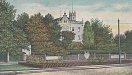
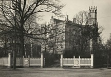
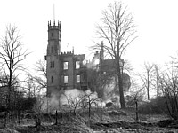
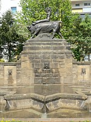
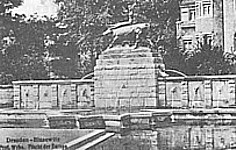
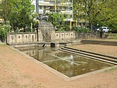

* * *

* * *

Der Königsheimplatz entstand im Zusammenhang mit der Entwicklung des Blasewitzer Villenviertels. Seinen Namen erhielt er am 5. Mai 1921 nach dem sächsischen Regierungsrat Arthur Willibald Königsheim (1816-1886), der 1867 den [Waldparkverein](../../../../ost/blasewitz/waldpark_blasewitz/) gründete und sich für den planmäßigen Ausbau der umgebenden Straßen einsetzte. Königsheim selbst besaß eine Villa auf der Goetheallee mit einem parkartigen Garten, dessen Gestaltung zum Vorbild für weitere Blasewitzer Villengrundstücke wurde. Auf ihn gehen auch die 1870 im Ort eingeführten Straßennamen nach Schauplätzen des Deutsch-französischen Krieges 1870/71 und der folgenden patriotischen Bewegung zurück.

"Während hundert und aber hundert deutsche Gemeinden sich daran genügen lassen müssen, ihre patriotische Dankbarkeit und Freude über die große Errungenschaft des deutsch-französischen Krieges ganz im Allgemeinen durch ein vereinzeltes äußeres Zeichen, vielleicht nur durch die Namenswahl einer zufällig fertig gewordenen Straße oder durch einen eigens hierzu gepflanzten Baum Ausdruck zu geben, sind wir in der begünstigten Lage, durch die würdige Bezeichnung eines vollständigen Systems neuer Straßen und eines förmlichen Labyrinths von Baumgängen eine ganze Kette lebendiger Erinnerungszeichen an eine ganze Kette verneigungswürdiger Momente schaffen, oder beide, je in ihrer Gesammtwirkung aufgefaßt, der deutschen Großthat von 1870 in unserem Wald- und Villenpark auch ein Monument en groß gegenüber stellen zu können."

**Schreiben von Königsheim an den Blasewitzer Gemeindevorstand Tauscher vom 14. Dezember 1872.**

Während ein Großteil der zwischen 1870 und 1900 erbauten Gebäude bis heute erhalten geblieben ist, fielen die Häuser um den Königsheimplatz 1945 zum größten Teil den Bomben zum Opfer. Erhalten blieb jedoch die nach der Eingemeindung geschaffene Brunnenanlage Georg Wrbas sowie die Grundkonzeption des Platzes. In den 1970er und 80er Jahren wurden am Königsheimplatz neue Wohnblocks in der DDR-typischen Plattenbauweise errichtet. Nach 1990 erfolgte eine Wiederherstellung der Grünflächen nach historischem Vorbild.

Weißes Schloss:

Die schlossartige Villa am Königsheimplatz, Ecke Händelallee entstand 1860/62 nach Plänen von Theodor Lehnert und war bedeutendster Wohnbau im Ort. Bauherr war der Unternehmer Carl August Spiegelthal, der das dreigeschossige Gebäude mit Treppenturm zunächst selbst nutzte. Lehnert wählte für die architektonische Gestaltung den neogotischen Tudorstil mit Zinnen, Flach-, Spitz- und Korbbogenfenstern, aufwendigen Balkonen und Dekors in Anlehnung an gotische Herrenhäuser. Auch die Inneneinrichtung folgte höchsten Ansprüchen und besaß geschnitzte Wandverkleidungen aus Eichenholz, Balkendecken und eine auf Säulen gelagerte Arkade in der Diele. Die einzelnen Räume waren über eine Prachttreppe erreichbar, die offen vom Erdgeschoss bis ins dritte Obergeschoss führte. Jeder Türdurchgang war individuell gestaltet und mit aufwendigen Verzierungen und Beschlägen geschmückt. Für die Ausstattung zeichnete die Dresdner Innenausstattungsfirma Udluft und Hartmann verantwortlich. Wegen ihres Aussehens und der hellen Fassade wurde die Villa im Volksmund “Weißes Schloss” genannt. Als Nebengebäude entstand die “St. Gotthardsburg” an der Emser Allee, Ecke Schubertstraße. Außerdem gehörte ein Bedienstetenhaus sowie eine ausgedehnte parkartige Gartenanlage zum Areal.

1880 erwarb der Besitzer des “Weißen Adlers” Carl Friedrich August Lorenz das Gebäude und wandelte es in eine internationale Hotelpension um, zu der schon bald weitere Häuser in der Nachbarschaft kamen. Die Eröffnung erfolgte am 24. Mai 1890. Fortan standen hier bis zu 150 Ferienwohnungen in exklusiv ausgestatteten Zimmern zur Verfügung. Zudem gab es einen großen Gesellschaftssaal, mehrere kleine Säle und einen gut ausgestatteten Fuhrpark mit Kutschen und Automobilen. Allerdings geriet das Unternehmen unter seinem neuen Besitzer Carl Hermann Wunderlich kurz vor dem Ersten Weltkrieg in Zahlungsschwierigkeiten. Immobilienspekulationen und hohe Kredite führten zur Überschuldung. Im Februar 1914 wurde Wunderlich verhaftet, wegen Hochstapelei, Meineids und betrügerischen Bankrotts angeklagt und später zu 12 Jahren Haft verurteilt. Das Hotel musste daraufhin seinen Betrieb einstellen und verfiel. 1916 beschädigte zudem ein Blitzschlag Teile des "Weißen Schlosses".

Erst der Verkauf der neogotischen Villa an den Zahnarzt Willy Alfred Mauksch beendete den Verfall. 1920 ließ der neue Eigentümer das Haus sanieren und nutzte es fortan als Wohnhaus und Praxis. Im hinteren Teil entstand 1930 das Haus der Ärzteschaft. 1945 wurde das “Weiße Schloss” von mehreren Brand- und Sprengbomben getroffen und brannte komplett aus. Die zunächst für einen möglichen Wiederaufbau beräumte Ruine wurde 1952 gesprengt und die Reste abgetragen _(Foto: Wikipedia)_. 1988 entstanden an gleicher Stelle Wohnblocks.

Europabrunnen:

Der Brunnen mit einer Plastik von Georg Wrba wurde 1922 auf dem Königsheimplatz aufgestellt. Die Plastik zeigt einen Bullen mit einer auf ihm sitzenden nackten Frau und stellt
“Europa mit dem Stier”, eine Gestalt der griechischen Mythologie dar. In dieser Sage wird die phönizische Königstochter Europa vom Göttervater Zeus nach Kreta entführt, der dabei in
Form eines Stieres auftritt. Da das bei seiner Aufstellung umstrittene Kunstwerk 1922, ein Jahr nach der erzwungenen Eingemeindung von Blasewitz, seinen Standort erhielt, wurde die Figur
von den Einwohnern auch spöttisch als die vom Dresdner Oberbürgermeister Blüher entführte Gustel von Blasewitz interpretiert. Mit über 14 Metern Länge gehört der Europabrunnen zu den
größten Anlagen Dresdens. Das Brunnenbecken zeigt expressionistische Gestaltungselemente und wurde unter der Leitung von Amtsbaurat Borrmann von der Firma Gebrüder Eberlein
hergestellt, den Guß der Bronzefigur übernahm die Kunstgießerei Oswald Zinke.

Während des Zweiten Weltkrieges wurde die Plastik von ihrem Sockel entfernt und war 1944 zum Einschmelzen für die
Rüstungsproduktion vorgesehen. Obwohl sie die Kriegsjahre letztlich überlebte, war sie dennoch so schwer beschädigt,
das eine Rekonstruktion unmöglich war. Die Brunnenanlage selbst überstand den Krieg unbeschadet und wurde nach
jahrzehntelanger Vernachlässigung 1985/86 saniert. 1995 konnte der Europabrunnen mit einer Kopie des Kunstwerkes,
finanziert von der Dussmann-Stiftung, vervollständigt werden. Schöpfer der neuen Plastik war der Bildhauer Lothar Janus.

**_Fotos:_** _Der Europabrunnen auf einer historischen Postkarte um 1910 und 2014_

* * *

 \[ [Home](../../../../index.html)\] \[ [Nord](../../../../nord/)\] \[ [Nordwest](../../../../nordwest/)\] \[ [Neustadt](../../../../neustadt/)\] \[ [Nordost](../../../../nordost/)\] \[ [West](../../../../west/)\] \[ [Zentrum](../../../../zentrum/)\] \[ [Südwest](../../../../sudwest/)\] \[ [Süd](../../../../sud/)\] \[ [Südost](../../../../sudost/)\] \[ [Ost](../../../../ost/)\] \[ [Register](../../../../Register/register.html)\] \[ [Kontakt](../../../../Kontakt/kontakt.html)\] \[ [Impressum](../../../../impressum/)\]
