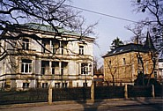
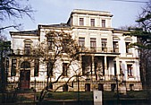
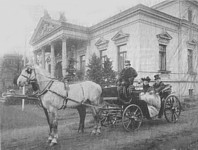
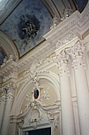
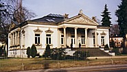
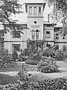
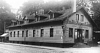

* * *

* * *

Die Loschwitzer Straße bildete bereits vor ihrem Ausbau im 19. Jahrhundert die
wichtigste Verbindung zwischen Blasewitz und der Innenstadt. Jedoch erst mit der “Entdeckung” des Dorfes als Sommerfrische und Wohnvorort erhielt sie eine größere
Verkehrsbedeutung und wurde 1863 verbreitert und ausgebaut. In den Folgejahren entstanden hier repräsentative Villen unterschiedlichster Stilrichtungen, die zum Großteil
bis heute erhalten blieben und in den letzten Jahren liebevoll saniert wurden. Am 26. September 1872 fuhr die erste Pferdebahn über die damalige Residenzstraße zu ihrem vorläufigen Endpunkt am [Schillerplatz](../../../../ost/blasewitz/strassen_blasewitz/schillerplatz/). Mit ihrer Einweihung begann die Geschichte der
Dresdner Straßenbahn. 1891 wurde die Strecke elektrifiziert und zwei Jahre später bis Pillnitz verlängert. Bis heute wird
diese Linie von den Bahnen der Dresdner Verkehrsbetriebe bedient, auch wenn der Abzweig über das Blaue Wunder nach Pillnitz 1985 stillgelegt werden musste.

Beim Luftangriff auf Dresden am 13./14. Februar 1945 wurden auch einige Gebäude an der Loschwitzer Straße zerstört. Zu den schmerzlichsten Verlusten gehören das Naumann-Palais sowie das “Weiße Schloss” am [Königsheimplatz](../../../../ost/blasewitz/strassen_blasewitz/konigsheimplatz/). Nach Abbruch der Ruinen blieben die betroffenen Grundstücke zumeist ungenutzt. Erst nach 1990
konnten die meisten Baulücken geschlossen werden. Markantester Neubau an der Loschwitzer Straße ist das im Dezember 2000 eröffnete Einkaufszentrum “Schiller-Galerie” mit Ladenpassage und Großkino “CINEMAXX”. In der
Nachbarschaft eröffnete 1992 das Hotel “Am Blauen Wunder”, entworfen vom damaligen Dresdner Baudezernenten Gunter Just. 2011 folgte der Neubau eines Wohn- und Geschäftshauses mit einer Mc-Donalds-Filiale.

**Einzelne Gebäude:**

Nr. 4: Die zweigeschossige Villa entstand 1902 und wurde vom Architekten Heino Otto entworfen. Obwohl sich das
Äußere noch am Neobarock orientiert, weist diese Villa auch erste Jugendstilformen auf. 1999 wurde das Haus saniert und heute gewerblich genutzt.

Nr. 9 (Haus Friedland):
Das in der Gründerzeit entstandene “Haus Friedland” gehörte zu den schlichteren Blasewitzer Villenbauten. Obwohl das Gebäude Krieg und Nachkriegszeit relativ gut überstand, wurde es 1993 trotz
Bürgerprotesten abgebrochen. An gleicher Stelle entstand ein Wohnhaus mit mehreren Eigentumswohnungen. Der Abriss
der nicht unter Schutz stehenden Villa war charakteristisch für die nach 1990 entstandenen Gefahren für historische Gebäude, sofern diese nicht dem Vermarktungswillen der neuen Eigentümer entsprachen.

Nr. 19 (Villa Freisleben): Die Villa wurde 1916 von Hans Paulick im neoklassizistischen Stil mit Jugendstilelementen erbaut und blieb auch zu DDR-Zeiten im Privatbesitz der Familie Freisleben. Diese betrieb hier eine kleine Firma für Elektroartikel. Zeitweise hatte auf dem Grundstück auch die einzige Blattgoldschlägerei der DDR ihren Firmensitz. Das Unternehmen war 1830 als Blattgold- und Prägefolienfabrik Ferdinand Müller gegründet worden und produzierte auf der Dürerstraße 104, während die Villa Sitz der Verwaltung war. Ab 1973 befand es sich als VEB Blattgold Dresden in staatlichem Besitz. Nach 1990 wurde das Haus saniert und 1994 als Aparthotel Villa Freisleben eröffnet. Im Inneren sind noch Teile der früheren Ausstattung erhalten, u.a. ein Wandbrunnen aus Meißner Porzellan.

Nr. 21 (Villa St. Petersburg): Das Haus wurde 1872 im Stil des Historismus errichtet und gehört zu den qualitätsvollsten
Bauten in Blasewitz. Bauherr war der frühere Hofgärtner des russischen Zaren, Robert Henry Lüdicke, der hier seinen
Alterswohnsitz nahm. Von 2008 bis 2012 nutzte die private Ganztagsschule des Institutes für Bildung und Beratung (IBB) das 1995 sanierte Gebäude _(Foto)_
. 2013 verzog die Bildungseinrichtung in einen Neubau nach Striesen.

Nr. 22: Das Gebäude wurde um 1870 erbaut und gehörte zu den eher schlichteren Blasewitzer Villenbauten. Zuletzt
gehörte es der Stadt Dresden und wurde als Mietshaus genutzt. Nach dem Verkauf an einen privaten Investor erfolgte,
trotz erheblicher Proteste, 2014 der Abriss, da das Haus nicht unter Denkmalschutz stand. An seiner Stelle sind zwei moderne Stadtvillen geplant.

Nr. 23:
In der Villa befindet sich seit September 2009 der private Kindergarten “Villa für Kinder”. Die Einrichtung bietet
berufstätigen Eltern eine Rundumbetreuung für ihre Kinder an und setzt die Tradition der zuvor geschlossenen “Kindervilla” am Großen Garten fort.

Nr. 31 (Villa Kemmer):
Das Gebäude entstand 1889 im Stil der italienischen Renaissance und wird heute als Bürohaus genutzt. Die zweigeschossige Villa weist neben Renaissanceformen im Stil der Nicolai-Schule auch einige
Neobarockelemente auf.

Nr. 33 (Villa Seidlitz): Die Villa wurde um 1890 im Stil des Historismus für Woldemar von Seidlitz errichtet. Seidlitz war
Doktor der Philosophie und gehörte viele Jahre der Direktion der Dresdner Kunstsammlungen an. Auch privat war er
eifriger Kunstsammler. Zu seinem Freundeskreis gehörten die Maler Oskar Zwintscher, Sascha Schneider, Robert Sterl und Max Liebermann, die ihn gelegentlich in seinem Blasewitzer Haus besuchten.

Nr. 34: Das Gebäude entstand 1864 als Ländliche Lehr- und Erziehungsanstalt für Knaben. Gründer dieser Privatschule war Dr. Richard Pietzsch, Vater des bekannten Dresdner Kino-Architekten Martin Pietzsch, welcher u.a. die Schauburg und den 1945 zerstörten UFA-Palast an der Prager Straße entwarf. Am Haus erinnert noch eine lateinische Inschrift mit einem Zitat von Cicero an die einstige Nutzung: _Quod munus rei publicae afferre maius meliusque possumus, quam si docemus atque erudimus iuventutem_ ("Welch größeren und besseren Dienst können wir dem Staat erweisen, als die Jugend zu unterrichten und zu erziehen"). Ab 1876 wohnte hier der Porträtmaler Emil von Hartitzsch. Heute dient die Villa als Wohnhaus.

Nr. 37 (Villa Ilgen):
Das Haus entstand um 1890 nach Plänen von Martin Pietzsch für einen Offizier der sächsischen Armee, der seinen Wohnsitz “Tusculum” (Lieblingsaufenthalt) nannte. 1899 kaufte der durch die Erfindung eines Mäusegiftes zu
Reichtum gekommene Apotheker Hermann Ilgen das Haus. Ilgen war Besitzer eines repräsentativen Geschäftshauses am Pirnaischen Platz und wählte nun das ruhigere
Blasewitz als Wohnort. Bekannt wurde er als Mäzen des entstehenden Dresdner Sportlebens. Auf eine Stiftung Hermann Ilgens geht u. a. die Anlage des heutigen [Rudolf- Harbig- Stadions](../../../../Zentrum/Pirnaische_Vorstadt/Rudolf-Harbig-Stadion/rudolf-harbig-stadion.html) zurück.

Das Gebäude besitzt nur ein Stockwerk und ist mit einer Säulenvorhalle sowie weiteren
Schmuckelementen im klassizistischen Stil gestaltet. Allegorische Darstellungen über den Giebelfenstern zeigen u.a. die Götter der Landwirtschaft (Demeter) und des Handels (Merkur), die
Saxonia als Verkörperung Sachsens und Personifizierungen von Industrie, Handel, Kunst und Wissenschaft. Trotz Nutzung als Firmensitz einer Baufirma in der Nachkriegszeit und verschiedenen
Umbauten blieb im Inneren ein Großteil der historischen Ausgestaltung erhalten _(Foto)_. 1991 wurde die Villa an die Nachkommen Ilgens rückübertragen und 1994/96 denkmalgerecht saniert. Seit
November 2007 erinnert eine von der Bürgerstiftung finanzierte Gedenktafel an den Unternehmer.

**_Foto:_** _Die Straßenseite der Villa Ilgen_

Nr. 42 (Villa Sidonienhof): Die Villa Sidonienhof wurde 1875 im toscanischen Landhausstil erbaut. Bauherr und erster Besitzer war der preußische Hofgartendirektor Hermann Sigismund Neumann (1829-1980), der u.a. an der Gestaltung der ausgedehnten Parkanlagen von [Schloss Albrechtsberg](../../../../nordost/loschwitz/albrechtsschlosser/) beteiligt war. In Blasewitz gestaltete Neumann mehrere Villengärten und Teile des [Waldparks](../../../../ost/blasewitz/waldpark_blasewitz/) und besaß eine Baumschule. Benannt ist das Haus nach seiner Ehefrau Sidonie Preißler, einer Tochter des Weinbergsbesitzers Johann Preißler (Gut Weißer Hirsch). Heute befinden sich in der 1993 sanierten Villa Wohnungen und Geschäftsräume.

Nr. 43: Das "Villa Diana" genannte Gebäude war ab 1874 Sitz der Naturalienhandlung des Insektenkundlers Otto Staudinger, der als Schmetterlingsexperte international bekannt war. Gemeinsam mit seinem Schwiegersohn Andreas Bang-Haas verkaufte er von hier aus exotische Schmetterlinge und Insekten an Sammler in aller Welt. 1884 verlegte Staudinger sein Unternehmen aus Platzgründen zur [Prellerstraße 11](../../../../ost/blasewitz/strassen_blasewitz/). Die bis heute erhaltene und zu DDR-Zeiten um einen Anbau erweiterte Villa ist heute Sitz des Polizeireviers Blasewitz.

Hotel “Am Blauen Wunder” (Nr. 48): Das moderne Hotel entstand 1992 nach Plänen des Architekten und damaligen Dresdner Baudezernenten Gunter Just. Neben Restaurant und Bar stehen den Besuchern auch Konferenzräume sowie 40 Zimmer zur Verfügung.

Nr. 50: Auf diesem Grundstück in der Nähe des Schillerplatzes ist seit Anfang 2016 die Glocke "Hannah" der Dresdner Frauenkirche aufgestellt. Dabei handelt es sich um einen ersten Fehlguß, der wegen der falschen Tonlage nicht verwendet werden konnte. Ursprünglich war diese Glocke im Militärhistorischen Museum ausgestellt, bevor die George-Bähr-Stiftung sie zur Erinnerung an ihren Gründer Fritz Büttner (+2003), einen Förderer des Wiederaufbaus, nach Blasewitz verbrachte. Hier kann sie durch Münzeinwurf zum Klingen gebracht werden.

Naumanns Palais:
Das Gebäude entstand Ende des 18. Jahrhunderts auf einem Grundstück an der heutigen Loschwitzer Straße 56 für den Hofkapellmeister und Komponisten Johann Gottlieb Naumann. In unmittelbarer Nachbarschaft war
der zu den bedeutendsten Musikern seiner Zeit gehörende Naumann am 17. April 1741 in ärmlichen Verhältnissen
geboren worden. Sein Vater verdiente sich seinen Lebensunterhalt als Gärtner und Dorfmusikant. Zeitweise betrieb die Familie hier auch eine kleine Gartenwirtschaft. Das eigentliche Geburtshaus wurde 1901 abgerissen.

Die zweistöckige Villa stand in einem großzügigen Park und wurde von den Blasewitzern Naumanns Palais genannt.
1890 erfolgte ein umfassender Um- und Ausbau des Hauses sowie der Anbau eines imposanten Turmes. 1945 fiel das Gebäude einem Luftangriff zum Opfer und wurde später abgetragen. An gleicher Stelle befindet sich heute das
Einkaufszentrum “Schiller-Galerie”.

Schiller-Galerie: Der moderne Gebäudekomplex zwischen Loschwitzer, Berggarten- und Hüblerstraße wurde zwischen
1997 und 2000 erbaut und beherbergt im Erd- und im Untergeschoss ein Einkaufszentrum mit Tiefgarage. Außerdem befindet sich hier das am 1. Dezember 2000 eröffnete Kino “CinemaxX” mit acht Kinosälen und ca. 2000 Plätzen.

Im Oktober 2001 wurde auf dem Vorplatz der Schillergalerie eine vom Loschwitzer Künstler Detlef Schweiger
entworfene Gedenkstele für Johann Gottlieb Naumann eingeweiht. Das schlichte, aus Sandstein und Glas angefertigte
Denkmal erinnert an Naumanns bedeutendste Werke, zu denen auch zahlreiche Kompositionen für die zu seiner Zeit
neuartige Glasharmonika gehören. Außerdem trägt die Säule den Namenszug sowie Geburts- und Sterbejahr (1801) des Künstlers.

“Potz Blitz”:
Die volkstümliche Gaststätte entstand Mitte des 19. Jahrhunderts in der Nähe des Schillerplatzes. Ihren Namen verdankte die Schänke, zu der neben Kaffeegarten, Wein- und Bierschank auch ein Fahrradverleih gehörte, dem
bekannten Schiller-Zitat über die “Gustel von Blasewitz”. Die Gaststätte mit angeschlossener Bäckerei existierte bis 1939. Anschließend wurde das einstöckige Gebäude gewerblich genutzt und 1975 abgerissen.

**_Foto:_** _Die Alt-Blasewitzer Gastwirtschaft “Potz Blitz” um 1920_
