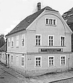
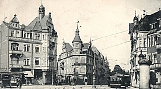
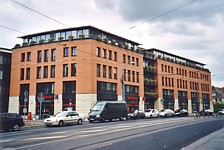
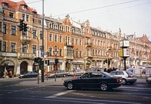
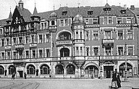
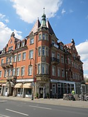
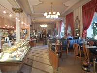

* * *

* * *

Der Schillerplatz entstand im 19. Jahrhundert an Stelle des früheren Blasewitzer Dorfplatzes. Noch um 1850 lagen hier die Gehöfte der Bewohner, umgeben von Gärten und Feldern. In einem dieser Güter kam am 20. August 1802 der Maler Woldemar Hottenroth (1802-1894) zur Welt, dessen Vater das Anwesen 1798 erworben hatte, 1810 jedoch wieder verkaufte. Als eines der wenigen Gebäude der dörflichen Vergangenheit ist dieses Haus unmittelbar neben dem Schillergarten (Schillerplatz 10) bis heute erhalten geblieben _(Foto)_. Zwischen 2006 bis 2017 befand sich hier die kleine Pension "Nebenan". 2010 wurde am Gebäude eine von Elke und Peter Ressel gestaltete Gedenktafel zu Ehren des Künstlers und seines Bruders Edmund Hottenroth (1804-1889) angebracht.

Nachdem viele Bauern durch den Verkauf ihrer Parzellen an Bauinteressenten zu Wohlstand gekommen waren, errichteten sie an Stelle der früheren Gehöfte neue Wohnhäuser mit Läden, kleinen Handwerksbetrieben und Gaststätten. Bereits 1875 gab es nur noch ein einziges Bauerngut im Ort. Um 1860 hatte der Platz den Namen des Dichters Friedrich Schiller erhalten, womit an dessen häufige Besuche im [Gasthof Blasewitz](../../../../ost/blasewitz/strassen_blasewitz/schillerplatz/schillergarten/) erinnert werden sollte.

Nach Erlass einer veränderten Bauvorschrift erlaubte die Gemeinde am Schillerplatz die Errichtung geschlossener Häuserzeilen, während im übrigen Gemeindegebiet lediglich Villen und Landhäuser zulässig waren. Die Pläne für die Umgestaltung des Platzes stammen zum Großteil vom Blasewitzer Baumeister Emil Scherz, der auch die Gebäude des Körnerplatzes am gegenüberliegenden Brückenkopf entwarf. Um 1890 entstanden hier mehrgeschossige Wohn- und Geschäftshäuser mit reich verzierten Fassaden im Stil des Historismus. Lediglich an der Ostseite des Platzes blieben der alte Gasthof und einige kleinere Wohnhäuser erhalten. An Stelle des letzten Blasewitzer Bauerngutes wurde 1896 das Café Toscana errichtet, welches seinen Namen der Heimat der letzten sächsischen Kronprinzessin Luise verdankt. Ein weiteres Lokal bestand bis in die Dreißiger Jahre als “Goethegarten” in den späteren Räumen der Stadtsparkasse _(Foto)_. Von den zahlreichen Traditionsgeschäften rund um den Platz ist heute keines mehr vorhanden. 2016 schlossen als letzte das Modehaus Borrmann als auch das 1924 von Kurt Dunger gegründete stadtweit bekannte Schirmhaus Dunger.

Mit der Eröffnung des [Blauen Wunders](../../../../nordost/loschwitz/blaues_wunder/) 1893 erhielt der Schillerplatz endgültig sein heutiges Bild. Leider wurde dieses 1945 durch die Zerstörung des Eckhauses an der Nordostseite (Tolkewitzer Straße 1) beeinträchtigt. Das repräsentative Geschäftshaus, wegen seiner Reliefs auch als “Schillerhaus” bezeichnet, wurde kurz nach 1900 von Edmund Scholze entworfen und beherbergte u. a. eine Filiale der Deutschen Bank. Plastiken am Eckerker zeigten Szenen aus den bekanntesten Werken des Dichters. Eine 1909 aus Anlass des 150. Geburtstages des Dichters angebrachte Gedenktafel befindet sich heute am Nachfolgebau.

In der Nachkriegszeit wurde die Fläche beräumt und u. a. von einem Kiosk und dem "Vitamin-Basar" genutzt. Zeitweise war hier der Bau eines Festspielhauses vorgesehen - ein Projekt, welches jedoch schon bald wieder in der Schublade verschwand. Auch die Vorstellungen für eine völlige Umgestaltung des Platzes, für die neben zahlreichen Wohnhäusern auch das “Blaue Wunder” abgerissen werden sollte, kamen glücklicherweise nicht zustande. 2003/04 entstand auf dem Areal an der Tolkewitzer Straße ein neues Wohn- und Geschäftshaus mit Filiale der Stadtsparkasse, dem Vitanas Senioren Centrum und weiteren Geschäften _(Foto)_.

Von Bedeutung war und ist der Schillerplatz als Verkehrsknotenpunkt. Hier treffen die bereits früher für Blasewitz wichtigen Verbindungsstraßen nach Osten (Tolkewitzer Straße), Westen (Loschwitzer Straße) und Süden (Hüblerstraße) zusammen, außerdem die zum Elbufer führende Naumannstraße. Am 26. September 1872 fuhr zum ersten Mal eine Pferdestraßenbahn vom Schlossplatz zum Schillerplatz, womit die Geschichte der Dresdner Straßenbahn begann. Weitere Linien verkehrten bis 1945 auf der [Goetheallee](../../../../ost/blasewitz/strassen_blasewitz/goetheallee/) (Emser Allee) und der Hüblerstraße. 1891 wurde die Bahn elektrifiziert und 1893 um einen Abzweig nach Pillnitz über das Blaue Wunder ergänzt. Infolge der eingeschränkten Tragfähigkeit der Brücke musste dieser Abschnitt 1985 stillgelegt und durch Busse ersetzt werden. In den letzten Jahren wurden die Verkehrsanlagen und Haltestellen am Schillerplatz umgestaltet. Mit Einweihung der Ampelanlage verschwand 1994 auch der stadtweit bekannte Verkehrspolizist Günter Jacob von der Kreuzung, der als “Karajan vom Schillerplatz” zu den Dresdner Originalen der 1960er und 70er Jahre gehörte.

Einzelne Gebäude:

Mauleselschänke: Diese kleine, heute längst verschwundene Kneipe am Schillerplatz verdankte ihren Namen einem
kuriosen Kapitel der Dresdner Straßenbahngeschichte. Nachdem 1872 die erste Pferdebahnlinie zwischen der Innenstadt und Blasewitz eröffnet worden war, kamen 1873 auch Maulesel als Zugtiere zum Einsatz. Während ihrer
Ruhepausen kehrten die Kutscher und Kondukteure der Bahn gern in der kleinen Schänke ein, die sich offiziell
“Restauration zur Wartehalle” nannte. Nachdem das Experiment mit den Mauleseln mangels Erfolg abgebrochen werden
musste, entstand der spöttische Name “Mauleselschänke”. Um 1900 wurde die Gaststätte geschlossen und zugunsten
des Wohn- und Geschäftshauses Schillerplatz 15 abgebrochen. Später nutzten die Dresdner Bank und das Modehaus Borrmann diese Räume.

Goethegarten:
Die ehemalige Gaststätte “Goethegarten” ging ursprünglich aus dem früheren Reiheschank im Ort hervor. Mitte des 19. Jahrhunderts wurde dieser, gegen den Willen des Blasewitzer Gasthofsbesitzers, verpachtet und
entwickelte sich zu einer neuen Restauration im Ort. Ab 1862 durften auch heiße Getränke und Speisen verkauft werden. Zu den mehrfach wechselnden Pächtern gehörte u.a. Carl Christian Donath, welcher später gemeinsam mit
seinem Bruder Hermann [“Donaths Neue Welt”](../../../../ost/tolkewitz/strassen_tolkewitz/alttolkewitz/donaths_neue_welt/) in Tolkewitz gründete.

1881 übernahm David Wilhelm Wolff das nach dem Vorbesitzer “Heinemann´s
Restauration” genannte Lokal und ließ es umbauen und erweitern. In Anlehnung an den Schillergarten auf der gegenüberliegenden Platzseite nannt Wolff sein
Restaurant “Goethegarten” und lockte seine Gäste mit “vorzüglichen Speisen und feinen, reinen Weinen” sowie regelmäßigen Konzerten an. 1889 kamen einige Fremdenzimmer hinzu. Die nach Wolffs Tod noch
kurze Zeit von seiner Witwe weitergeführte Gastwirtschaft ging 1893 in den Besitz von Emil Ehrler über, welcher das Gebäude abreißen und durch einen repräsentativen Neubau _(Foto)_
ersetzen ließ (Schillerplatz 1-3). Im Erdgeschoss zog wieder eine Gastwirtschaft gleichen Namens ein, im ersten Stock befanden sich mehrere Hotelzimmer.

Die gastronomische Tradition des “Goethegartens” wurde auch nach der Zwangsversteigerung des Hauses 1909 fortgesetzt. Obwohl öffentliche Tanzveranstaltungen nicht erlaubt waren, gelang es den Pächtern immer wieder, im
Rahmen geschlossener Vereinsfeiern oder Familienfesten dieses behördliche Verbot zu umgehen. Nach dem Ersten
Weltkrieg endete der Hotelbetrieb des Goethegartens, die Gaststätte selbst existierte noch bis 1938. Später nutzte viele Jahre die Dresdner Stadtsparkasse die Restaurationsräume.

Café Toscana: Das Lokal wurde 1897 vom früheren Besitzer des “Schillergartens” Friedrich Louis Köhler im neu errichteten Geschäftshaus Schillerplatz 7 unmittelbar am Brückenkopf des “Blauen Wunders” eingerichtet und zunächst nur als Kaffeerösterei mit Ausschank bezeichnet. 1901 ist es erstmals als “Café Toscana” in den Adressbüchern eingetragen. Mit der Namensgebung wollten die Inhaber an die sächsische Kronprinzessin Luise von Toscana erinnern, die sich 1904 von ihrem Ehemann Friedrich August III. trennte und mit dem Sprachlehrer ihrer Kinder vom Hof floh. Trotz des Skandals blieb Luise im Volk sehr beliebt und hielt auch später brieflichen Kontakt zu den Cafébetreibern, die ihr alljährlich einen Baumkuchen aus eigener Produktion ins Exil schickten.

1905 übernahm mit Hugo Zimmermann ein Verwandter Köhlers das Café und ließ es wenig später umbauen und erweitern. Unter ihm erwarb sich das “Café Toscana” seinen legendären Ruf für Torten und Süßspeisen und galt schon bald als ein Höhepunkt der Dresdner Kaffeehauskultur. Nicht zuletzt wegen des schönen Ausblicks auf die Elbhänge besuchten zahlreiche Gäste das Haus. Trotz mehrfacher Eigentümerwechsel überstand das Café alle Wirren der Zeit und gehört bis heute zu den beliebtesten Blasewitzer Einkehrstätten. 1945 übernahm Konditormeister Werner Anders, zuvor Inhaber des bekannten Cafés Beyer auf der Wilsdruffer Straße, das “Toscana”, bevor er 1959 in einem inszenierten Prozess wegen angeblicher Unterschlagung von Eiern verurteilt und aus dem Gaststättenbetrieb gedrängt wurde. Fortan führte bis 1989 die HO die Kaffeehaustradition fort. 1992/93 erfolgte eine umfassende Renovierung des Gebäudes und die Wiedereröffnung der Terrasse zum Elbufer. 2016 wurden die Gasträume erneut behutsam umgestaltet.

Schillerapotheke:
Die Schillerapotheke wurde am 15. August 1896 im Eckhaus Tolkewitzer-/ Reinhold-Becker-Straße eröffnet, 1904 jedoch zur Brucknerstraße 1 verlegt. Erster Besitzer war der Apotheker Robert Paul Wolf, der sie 1937
an seinen Sohn Johannes übergab. Neben dem Arzneimittelverkauf gehörte früher auch ein eigenes pharmazeutisches
Laboratorium dazu. Trotz Zerstörung des Gebäudes 1945 konnte der Betrieb auch in der Nachkriegszeit fortgesetzt werden.

Am 9. Dezember 1949 wurde die Schillerapotheke als erste Dresdner Apotheke verstaatlicht und in eine Poliklinik- Apotheke umgewandelt. Dr. Johannes Wolf behielt jedoch die Leitung. Nach seinem Tod 1952 übernahm der
Apotheker Herbst die Geschäftsführung. Zweigstellen entstanden im Ärztehaus Naumannstraße (ehem. Präsidentenvilla)
und in Pillnitz. Im Dezember 1960 erhielt die Schiller-Apotheke neue Geschäftsräume an der Tolkewitzer Straße 2. Ein
geplanter Neubau in den 1970er Jahren scheiterte, so dass man sich 1985/86 zu einer Sanierung des Gebäudes und
umfassenden Moderniserungsarbeiten entschloss. 1990 kam die Schillerapotheke wieder in Privatbesitz. Seit Ende Januar 2004 hat sie in der Schillergalerie ihr Domizil.

* * *

 \[ [Home](../../../../index.html)\] \[ [Nord](../../../../nord/)\] \[ [Nordwest](../../../../nordwest/)\] \[ [Neustadt](../../../../neustadt/)\] \[ [Nordost](../../../../nordost/)\] \[ [West](../../../../west/)\] \[ [Zentrum](../../../../zentrum/)\] \[ [Südwest](../../../../sudwest/)\] \[ [Süd](../../../../sud/)\] \[ [Südost](../../../../sudost/)\] \[ [Ost](../../../../ost/)\] \[ [Register](../../../../Register/register.html)\] \[ [Kontakt](../../../../Kontakt/kontakt.html)\] \[ [Impressum](../../../../impressum/)\]
