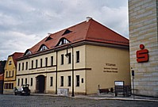
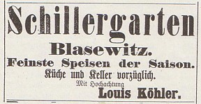
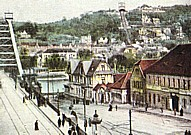

* * *

* * *

* * *

* * *

* * *

* * *

Der 1683 erstmals erwähnte Gasthof Blasewitz ging aus einem früheren Jagdhaus des sächsischen Kurfürsten hervor, welches im Vorwerk des Nikolaus Karasz eingerichtet wurde. Für wenige Jahre hatte hier der Hegereiter des Blasewitzer Reviers seinen Sitz. Doch bereits 1704 schenkte August der Starke das baufällige Gebäude seinem Stubenheizer Matthie und verlieh diesem die Schankgerechtigkeit. 1730 kam noch ein als Fähr- und Sommerschenke Blasewitz bezeichnetes Gartenlokal hinzu. Dieses befand sich ab 15. Juni 1764 im Besitz der Witwe Johanna Dorothea Segedin, die das Lokal aus einer Zwangsversteigerung erwarb und gemeinsam mit ihrem späteren Ehemann Carl Friedrich Fleischer als “Fleischersches Schankgut” bewirtschafte.

Wegen ihrer reizvollen Lage am Elbufer entwickelte sich die Gaststätte zu einem beliebten Ausflugsziel für Sommergäste. Zu diesen gehörte 1785/87 der Dichter Friedrich Schiller, der im Sommerhaus der Familie Körner in Loschwitz wohnte und regelmäßig den Blasewitzer Gasthof besuchte. Hier lernte er die Wirtstochter Johanne Justine Segedin kennen, die er zehn Jahre später als Marketenderin in seinem Drama “Wallenstein” mit den Worten “Was? Der Blitz! Das ist ja die Gustel aus Blasewitz.” verewigte. Die seit 1784 mit dem Advokaten Christian Friedrich Renner verheiratete Senatorengattin nahm ihm diese Anspielung sehr übel, versöhnte sich jedoch später mit ihrem Dichterfreund.

Aus Anlass des 100. Geburtstages von Schiller erhielt das Gartenlokal 1859 den Namen “Schillergarten”. Dafür wurde im großzügigen Gästegarten am Elbufer ein später mehrfach erweiterter Neubau errichtet. Außerdem pflanzten Verehrer des Dichters im Garten eine heute nicht mehr vorhandene Schillerlinde. In ihrem Schatten wurde ein
Gedenkstein aufgestellt, den der Berliner Buchdrucker Ernst Litfaß stiftete. Dieser ist als Erfinder der Litfaß-Säulen zur Plakatwerbung bekannt und weilte zu dieser Zeit als Kurgast in Blasewitz. Den durch den Verkauf der Eintrittskarten für das Schillerfest eingenommenen Erlös von 502 Talern stiftete Litfaß der Blasewitzer Armenkasse und für brandgeschädigte Einwohner im Vogtland.

Mehrfach wechselten nun die Besitzer des Schillergartens, zu denen ab 1874 auch der spätere Gründer des “Café Toscana” Louis Köhler gehörte. Unter seinem Nachfolger, dem Gastwirt Hermann Albin Lauterbach, entstand um 1895 der noch heute vorhandene Fachwerkbau nach Plänen des Architekten Karl Emil Scherz.

Sowohl Gasthof Blasewitz als auch der benachbarte Schillergarten erfreuten sich als Ausflugslokale im Osten der Stadt
großer Beliebtheit, begünstigt durch die nahegelegene Dampferanlegestelle und die reizvolle Lage. Häufig fanden hier
Konzerte, Bälle und andere Vergnügungen statt. 1911 wurde ein ehemaliger Eiskeller zum Filmtheater “Elite-Reform-
Kino-Salon” umgebaut und am 2. April 1912 eröffnet. Fortan konnten hier bis zu 200 Besucher Filmvorführungen erleben, in den Sommermonaten sogar “Open Air” im Gästegarten. Ab 1920 nach einem Umbau als Schillergarten-
Lichtspiele bezeichnet, hatte das kleine Kino noch bis in die Nachkriegszeit geöffnet und diente dann viele Jahre als Lager des Progress-Filmverleihs.

**_Foto:_** _Der Gasthof Blasewitz (ganz rechts) und der Schillergarten um 1910_

Auch nach 1945 wurden beide Gebäude weiterhin zu gastronomischen Zwecken genutzt. Im alten Gasthof fanden noch bis um 1960 Tanzveranstaltungen statt, bevor der Saal im Obergeschoss aus statischen Gründen gesperrt werden
musste. Nach Einstellung des Betriebs bezog ein Stoffhandel den früheren Tanzsaal. Die Räume im Erdgeschoss dienten
bis 1990 als Gaststätte “Goldbroiler” und Milchbar. An der Giebelfassade warb noch bis 1990 eine Leuchtwerbung für die Säfte der in Lockwitz ansässigen [Kelterei Lockwitzgrund](../../../../../sudost/lockwitz/strassen_lockwitz/kelterei_lockwitzgrund/). Nach Abbruch des Gebäudes entstand 2004 ein Neubau,
in den die erhalten gebliebene Fassade integriert wurde, so dass das Haus heute äußerlich wieder weitgehend dem Original entspricht. Nutzer ist das Senioren Centrum “Am Blauen Wunder” der Vitanas GmbH.

Seit Oktober 2007 erinnert an der Fassade des Gasthofes eine Bronzetafel an den Komponisten Richard Wagner und
die Dresdner Uraufführung seiner Oper “Rienzi” am 20. Oktober 1842. Wagner hatte 1837 gemeinsam mit seiner ersten
Frau Minna im Gasthof Quartier bezogen, um hier auf den Antritt seiner Stelle als Kapellmeister in Riga zu warten. In
Blasewitz befasste er sich erstmals mit dem Stoff des “Rienzi”, den er wenig später musikalisch verarbeitete.

Ebenso wie der Gasthof Blasewitz blieb auch der Schillergarten nach 1945 beliebtes Vergnügungslokal. Die hier
veranstalteten Bälle, Konzerte und ähnliche Veranstaltungen waren in der Nachkriegszeit Anziehungspunkt der Dresdner,
nachdem die zerstörten Lokalitäten der Innenstadt nicht mehr zur Verfügung standen. 1986 wurde der “Schillergarten”
zum Bedauern vieler Stammgäste geschlossen. Erst zehn Jahre später gelang es, das Objekt nach erfolgter Sanierung
wieder zu eröffnen. Leider gab es erhebliche Schäden durch das Elbehochwasser vom August 2002, die eine zweijährige
Schließung zur Folge hatten. Seit November 2004 beherbergen die Räume ein gutbürgerliches Restaurant mit Kaffeehauscharakter. Im ehemaligen Kino entstand eine Speisenausgabe für den sommerlichen Biergartenbetrieb. Zwei
Gipsmedaillons im Garten, 2006 nach historischen Vorlagen von Ulrich Eißner nachgebildet, erinnern an Friedrich Schiller und seine “Gustel von Blasewitz”.

* * *

 \[ [Home](../../../../../index.html)\] \[ [Nord](../../../../../nord/)\] \[ [Nordwest](../../../../../nordwest/)\] \[ [Neustadt](../../../../../neustadt/)\]
 \[ [Nordost](../../../../../nordost/)\] \[ [West](../../../../../west/)\] \[ [Zentrum](../../../../../zentrum/)\] \[ [Südwest](../../../../../sudwest/)\]
 \[ [Süd](../../../../../sud/)\] \[ [Südost](../../../../../sudost/)\] \[ [Ost](../../../../../ost/)\] \[ [Register](../../../../../Register/register.html)\] \[ [Kontakt](../../../../../Kontakt/kontakt.html)\] \[ [Impressum](../../../../../impressum/)\]
