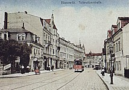
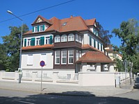
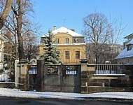
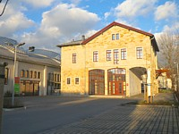
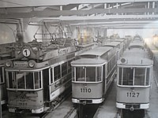
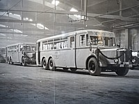

Die Tolkewitzer Straße verband den früheren Blasewitzer Dorfkern mit den östlich
gelegenen Nachbargemeinden Tolkewitz und Laubegast. Auf Tolkewitzer Flur trug sie deshalb bis zur Eingemeindung des Ortes 1912 den Namen Blasewitzer Straße.
Ab Mitte des 19. Jahrhunderts wurden auch hier repräsentative Villen, später Wohn- und Geschäftshäuser errichtet. So befand sich im Haus Tolkewitzer Straße 53 zeitweise der Sitz der renommierten [Pianofortefabrik Rosenkranz](../../../../zentrum/johannstadt/strassen_johannstadt/klavierbaufirma_rosenkranz/), bevor das
Unternehmen in die Johannstadt umzog. Später erwarb der Sohn des bekannten Glashütter Uhrenfabrikanten Lange die Villa als Wohnhaus.

Zu den Bauherren der zahlreichen Villen im östlichen Teil der Tolkewitzer Straße gehörte der Komponist und Musikkritiker Ludwig Hartmann, an den eine Straße in [Neugruna](../../../../ost/gruna/neugruna/) erinnert. Hartmann war ein Schüler von Franz Liszt
und wirkte als Pianist und Komponist, später vor allem als Musikkritiker. Durch seine geschickte Geschäftstätigkeit
erwarb er mehrere Grundstücke in dieser Gegend und war Eigentümer der Wohnhäuser Tolkewitzer Straße 31 und 34. Er selbst bewohnte bis zu seinem Tod 1910 das Haus Nr. 59, besaß jedoch auch eine Stadtwohnung am
Ferdinandplatz.

Die Grundstücke in der Nähe des Schillerplatzes wurden ab 1880 im Gegensatz zu den meisten Blasewitzer Straßen mit
geschlossenen Häuserfronten bebaut. Bemerkenswert war das Eckhaus Tolkewitzer Straße 1, welches wegen seiner
Relieftafeln als “Schillerhaus” bezeichnet wurde, 1945 jedoch den Bomben zum Opfer fiel. Das gleiche Schicksal traf die gegenüberliegende Gebäudegruppe Nr. 8-10, in der u. a. der Bildhauer Bruno Fischer sein Atelier
besaß. Fischer ist Schöpfer des Nymphenbrunnens in der Bürgerwiese und weiterer Plastiken und fertigte 1902 auch die Gedenktafel für
Johann Gottlieb Naumann am Blasewitzer Rathaus an. Erst nach 1990 wurden die entstandenen Baulücken mit modernen Neubauten geschlossen. Heute befinden sich hier u.a. eine Sparkassenfiliale und ein Seniorenheim.

Auf Tolkewitzer Flur sind noch Reste des einstigen Tännichts, eines ausgedehnten Kiefern- und Birkenwäldchens, zu sehen. Ab 1880 wurde das Tännicht für den Bau neuer Wohnsiedlungen und die Anlage des [Johannisfriedhofes](../../../../ost/tolkewitz/johannisfriedhof/) gerodet. Am Ausgang dieses Friedhofes erinnert heute noch das frühere Forsthaus Tolkewitz an diese Zusammenhänge.

Einzelne Gebäude:

Nr. 47: Zu den bemerkenswerten Wohnhäusern an der Tolkewitzer Straße gehört die 1895 von Karl Emil Scherz für die
pommersche Adelsfamilie von Borcken gebaute Villa Nr. 47. Zeitweise wohnte hier der bekannte Dresdner Galerist Heinrich Kühl.

Nr. 49: Die Villa an der Ecke zur Helfenberger Straße ist seit 2014 Logenhaus der Dresdner Freimaurerlogen “Zu den drei Schwertern und Asträa zur grünenden Raute“ und “Zum Goldenen Apfel”. Beide entstanden im 18. Jahrhundert und gehören zu den ältesten noch existierenden Logen in Deutschland. Bis zum Verbot 1933 besaßen die Freimaurer ihr Logenhaus an der Ostra-Allee. Das Gebäude wurde 1944 beim ersten Bombenangriff auf Dresden zerstört und nach 1945 abgerissen. 2014 entdeckte man bei Bauarbeiten zwei in der Nachkriegszeit vergrabene Sphinx-Figuren, die nach ihrer Restaurierung künftig vor der Villa aufgestellt werden sollen. Der Erwerb des neuen Stammhauses konnte durch den Verkaufserlös des früheren Logengrundstücks ermöglicht werden. Die in griechischer Sprache verfasste Inschrift am Portal bedeutet „Erkenne dich selbst“, Leitspruch der Freimaurer.

Nr. 57:
Ursprünglich befand sich dieses Grundstück im Besitz des sächsischen Kabinettsministers und Geheimen Rats Adolf Magnus von Hoym, dem Ehemann der
als Gräfin Cosel bekannt gewordenen Anna Constantia von Brockdorff. Um 1902 entstand hier die Villa Romana, Wohnsitz der Geheimen Rechnungsrats Wilhelm E.
Kostrzewski. Nach dem Ersten Weltkrieg wurde das Gebäude von seinen neuen Besitzern umgebaut und erhielt dabei sein späteres Aussehen. Das Haus stellte wegen
seiner architektonischen Ausführung ein wichtiges Zeugnis der künstlerischen Entwicklung zwischen Neobarock, Art deco und Neuer Sachlichkeit dar und stand
deshalb ab 1990 unter Denkmalschutz. Bemerkenswert war auch die Innenausstattung mit versenkbarer Wand im Wohnzimmer, einer Sandsteintreppe zur Elbseite sowie einem Marmorrelief von Robert Diez
im Treppenhaus. Bis zum Ende des Zweiten Weltkriegs bewohnte der Verleger Fritz Schettler, Chefredakteur der
“Dresdner Nachrichten” in der Villa. Schettler wurde 1946 in ein sowjetisches Straflager interniert und kam dort ums Leben.

1977 mussten die Besitzer ihr Haus wegen ihrer Ausreise in die Bundesrepublik verkaufen. Neuer Eigentümer war die
katholische Kirche, die hier eine Förderwerkstatt der Caritas für behinderte Jugendliche einrichtete. Im Obergeschoss
befanden sich Wohnungen für Mitarbeiter des Bistums Dresden-Meißen. 1997 wurde die Villa an den früheren Eigentümer zurückgegeben, der das Haus trotz Denkmalschutzes und Anordnung der Bauaufsicht 2014 illegal abreißen
ließ. Zuvor hatte es mehrere ungeklärte Brände im Haus gegeben. Per Gerichtsbeschluss soll die Villa jedoch nach erhaltenen Bauunterlagen im originalen Stil wiederaufgebaut werden.

Nr. 92:
Ab 1912 hatte der Elfenbeinbildhauer Otto Ernst Richter sein Atelier in diesem Haus. Richter schuf vor allem Blumen- und figürliche Motive und gilt als einer der letzten bedeutenden Meister dieser Kunst.

Straßenbahnhof Blasewitz: Der Betriebshof Neugruna (Tolkewitzer Straße 38) wurde 1872 als erster in Dresden im Zusammenhang mit der Eröffnung der Pferdebahnlinie Schlossplatz - Blasewitz am 25. September 1872 eröffnet. Bis zur Einstellung des Pferdebahnbetriebes waren hier über 100 Pferde sowie die zugehörigen Fahrzeuge der Continental - Pferdeeisenbahn - Gesellschaft untergebracht. Mit Elektrifizierung der Bahn wurde der Betriebshof 1893 zum Depot der “Elektrischen” umgewandelt. 1925 entstanden nach Plänen des Stadtbaurates Paul Wolf die noch heute vorhandenen denkmalgeschützten Hallen, welche ab 1936 als zentrales Busdepot der Dresdner Verkehrsbetriebe dienten. Zwischen 1947 und 1975 wurden hier die Fahrzeuge der einzigen Dresdner [O-Bus-Linie](../../../../sudwest/lobtau/strassen_lobtau/ebertplatz/o-bus/) gewartet und abgestellt. Erst 1997 wurde der Betriebshof geschlossen. Später fanden zeitweise noch Trödelmärkte statt. 2009/10 erfolgte der Umbau der unter Denkmalschutz stehenden Fahrzeughalle zum Einkaufszentrum mit einem Lebensmittelmarkt und kleineren Läden. Außerdem entstanden auf dem Areal einige Stadtvillen. Erhalten blieb auch das villenartige ehemalige Verwaltungsgebäude, welches heute Wohnzwecken dient.

**_Fotos:_** _Blick in den Blasewitzer Straßenbahnhof vor und nach 1936_

* * *

 \[ [Home](../../../../index.html)\] \[ [Nord](../../../../nord/)\] \[ [Nordwest](../../../../nordwest/)\] \[ [Neustadt](../../../../neustadt/)\] \[ [Nordost](../../../../nordost/)\] \[ [West](../../../../west/)\] \[ [Zentrum](../../../../zentrum/)\] \[ [Südwest](../../../../sudwest/)\] \[ [Süd](../../../../sud/)\] \[ [Südost](../../../../sudost/)\] \[ [Ost](../../../../ost/)\] \[ [Register](../../../../Register/register.html)\] \[ [Kontakt](../../../../Kontakt/kontakt.html)\] \[ [Impressum](../../../../impressum/)\]
