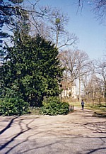
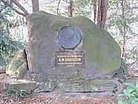

* * *

* * *

* * *

Der Waldpark Blasewitz geht auf das frühere [Blasewitzer Tännicht](../../../ost/) zurück und ist letzter Rest eines einst ausgedehnten Waldgebietes. Die vorrangig von Kiefern bestandene Fläche
nahm noch um 1800 einen Großteil der Blasewitzer Gemeindefluren ein. Im Zuge der städtischen Entwicklung Dresdens entdeckten Mitte des 19. Jahrhunderts immer mehr
Menschen die Reize des kleinen Ortes am Elbufer und ließen sich hier Sommer- und Landhäuser errichten. Zu diesen gehörte auch der sächsische Regierungsrat Arthur
Willibald Königsheim, der 1863 eine Villa an der Goetheallee 4 bezog. Um den durch die fortschreitende Bebauung bedrohten Wald zu retten, gründete Königsheim am 10. März
1869 den Waldparkverein und erwarb 100 Hektar des Blasewitzer Tännichts.

Bereits ein Jahr später wurde der erste Bebauungsplan für das Areal vorgelegt. Dieser sah
eine aufgelockerte Villenbebauung an den Rändern der Fläche vor, während der innere Teil von jeglicher Bebauung verschont und als Parkanlage gestaltet werden sollte. Die gärtnerische Ausführung übernahm
der Hofgärtner Hermann Sigismund Neumann. Geschickt wurde der vorhandene Baumbestand einbezogen. Für seine Arbeit erhielt der Waldparkverein auf der Internationalen Gartenbauausstellung 1870 eine Auszeichnung für die
schönste, bestdurchdachteste und -ausgeführte Gartenanlage.

Durch Königsheims Geschick und den Beitritt zahlreicher wohlhabender Zuzügler
konnte der Verein sein Vermögen schnell vergrößern. 1874 wurde er aufgelöst und übergab das verbliebene Geld und den Waldpark an die Gemeinde Blasewitz.
Die daraus resultierende Stiftung existierte noch bis 1945. Ihr oblag die Pflege und weitere Ausgestaltung des Parkes. Das von einem Zaun umgebene Parkgebiet
umfasste ca. 24 Hektar und wurde von einem eigens angestellten Parkwächter bewacht. Zu den Bauwerken inmitten des Parkes gehörte eine Schutzhütte für
Besucher, Rasenplätze mit Bänken sowie ein hölzernes Gerüst für eine Rodelbahn. Ein ursprünglich vorhandener Teich wurde 1889 zugunsten von Tennisplätzen
verfüllt, die im Winter vereist wurden und als Eislauffläche dienten. Heute nutzt der Tennisverein Blau-Weiß Blasewitz dieses Areal. 1893 errichtete die Gemeinde Blasewitz im Waldpark ihr [Wasserwerk](../../../ost/blasewitz/).

Trotz mangelnder Pflege zu DDR-Zeiten und einiger Veränderungen konnte der Blasewitzer Waldpark sein
ursprüngliches Bild weitgehend bewahren und steht mit den angrenzenden Gebäuden als künstlerisches Zeugnis der Gründerzeit des Ortes unter Schutz. 1992 begann die schrittweise Sanierung der Anlage. An Arthur Königsheim
erinnert neben dem Königsheimplatz ein 1888 aufgestellter Gedenkstein am östlichen Parkeingang _(Foto)_. Ein
weiteres Denkmal weist auf den Hofgärtner Sigismund Neumann (1829-1880) hin. Ursprünglich war der Findling als Bismarck-Denkmal aufgestellt worden und trug bis 1946 ein Bronzemedaillon des “Eisernen Kanzlers”. Ende der
1990 Jahre wurde das leere Feld durch ein Medaillon des Parkgestalters Sigismund Neumann ersetzt.

* * *

 \[ [Nord](../../../nord/)\] \[ [Nordwest](../../../nordwest/)\] \[ [Neustadt](../../../neustadt/)\] \[ [Nordost](../../../nordost/)\]
 \[ [West](../../../west/)\] \[ [Zentrum](../../../zentrum/)\] \[ [Südwest](../../../sudwest/)\] \[ [Süd](../../../sud/)\] \[ [Südost](../../../sudost/)\] \[ [Ost](../../../ost/)\] \[ [Register](../../../Register/register.html)\] \[ [Kontakt](../../../Kontakt/kontakt.html)\] \[ [Impressum](../../../impressum/)\]
