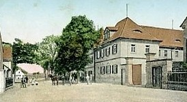
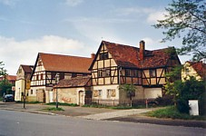
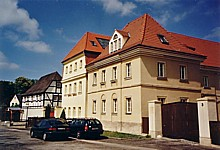
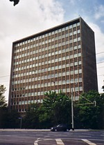
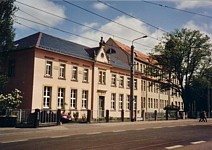
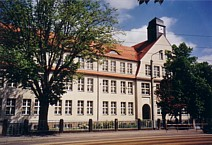

* * *

**Gemeindesiegel von Dobritz**

* * *

**Schulen in Dobritz:**

Das Gebiet zwischen Dobritz, Laubegast und Leuben war bereits in ur- und frühgeschichtlicher Zeit besiedelt, wie Funde auf dem Gelände einer ehemaligen Kiesgrube an der Salzburger Straße beweisen. Bei Ausgrabungen wurden hier Gräber, Keramikscherben und andere Siedlungsspuren von der jüngeren Steinzeit bis zur Bronzezeit gefunden. Aufgrund der Fülle der entdeckten Bronzegegenstände gehen Wissenschaftler davon aus, das sich an dieser Stelle vor ca. 3000 Jahren eine Stätte der Metallverarbeitung befand, die weit über den Dresdner Raum hinaus von Bedeutung war. Außerdem konnten Reste von Wohngebäuden, eine Webstube und verschiedene Gebrauchsgegenstände freigelegt werden. Weitere Funde weisen auf die Besiedlung durch germanische Stämme (4. Jahrhundert.) und slawische Bewohner hin.

Dobritz selbst wurde 1378 erstmals als Doberwicz urkundlich erwähnt. Der aus dem altsorbischen stammende Name weist auf eine entsprechende Gründung durch einen Dobr hin (Doberwicz = Leute des Dobr). Dobritz bestand einst aus drei Ortsteilen: dem älteren Gassendorf Großdobritz, dem Bauernweiler Kleindobritz sowie der im 14. Jahrhundert zur Wüstung gewordenen Siedlung Lippen, die ganz im Süden der heutigen Ortsflur lag. Sowohl Groß- als auch Kleindobritz unterstanden verschiedenen, mehrfach wechselnden Lehnsherren. So besaßen die Herren von Bärenstein, von Rottwerndorf und von Borthen zeitweise Anteile an den Dörfern. 1582 erwarb die auf Schloss Weesenstein ansässige Adelsfamilie Bünau die Erbgerichtsbarkeit über Großdobritz, während Kleindobritz bis ins 19. Jahrhundert zum Dresdner Religionsamt gehörte. Kirchlich war Dobritz zunächst nach Leubnitz, ab 1674 nach Leuben eingepfarrt.

Die Bewohner der beiden Orte, die sich erst 1839 zu einer Gemeinde zusammenschlossen, lebten vorrangig von der Landwirtschaft. Noch heute sind im Dorfkern einige Bauerngüter erhalten geblieben _(Fotos)_. Größtes war das bis 1827 im Besitz des Rittmeisters Bose befindliche Freigut an der Pirnaer Landstraße. Neben diesen Gütern gab es bereits im 18. Jahrhundert zahlreiche Häusleranwesen in Altdobritz und an der [Pirnaer Landstraße](../../ost/dobritz/strassen_dobritz/pirnaer_landstrasse/), deren Bewohner ihren Lebensunterhalt mit Spinnen, Zwirnen und der in Heimarbeit betriebenen Strohflechterei verdienten. Erst nach 1880 wandelte sich Dobritz vom Bauerndorf zum Arbeiterwohnort, nachdem im benachbarten Niedersedlitz zahlreiche Industrieunternehmen gegründet worden waren. Hinzu kamen bis 1895 sieben große Gärtnereien, die zuvor in Striesen der zunehmenden Bebauung weichen mussten.

Bis 1910 war die Bevölkerung auf über 1500 Einwohner gewachsen, von denen fast zwei Drittel Arbeiter waren. In Dobritz selbst war als bedeutendstes Unternehmen 1884 eine Gardinenfabrik eröffnet worden, die zumeist Frauen beschäftigte. 1912 übernahm die Dresdner Gardinen- und Spitzenmanufaktur AG den Betrieb. Um die langen Arbeitswege der aus zahlreichen Orten der Umgebung stammenden Arbeiterinnen zu verkürzen, entstanden nördlich der heutigen [Breitscheidstraße](../../ost/dobritz/strassen_dobritz/) vor und nach dem Ersten Weltkrieg neue Wohnsiedlungen. Am 1. April 1921 kam Dobritz als Stadtteil zu Dresden.

Auch nach 1945 blieb Dobritz in erster Linie Industrievorort. Die Gardinenfabrik wurde als Betriebsteil in den VEB Plauener Spitze eingegliedert und 1991 privatisiert. Außerdem entstanden an der Breitscheidstraße weitere gewerbliche Ansiedlungen, u. a. Neubauten für den VEB Verpackungsmaschinenbau Dresden. Dominierender Blickfang ist ein zwölfgeschossiges Bürohochhaus, welches 1957/63 nach einem Entwurf von J. Junghanns entstand _(Foto)_. Im Zusammenhang mit dieser Entwicklung erhielt Dobritz auch einen eigenen Eisenbahnhaltepunkt an der S-Bahn-Strecke Dresden - Pirna. Ende der 1960er Jahre wurden auf Freiflächen um den Ort einige Neubauten errichtet. Der zu DDR-Zeiten stark verfallene und zum Abriss vorgesehene alte Dorfkern konnte in den letzten Jahren größtenteils saniert werden. Seit 1990 steht das Areal unter Denkmalschutz.

Schulen in Dobritz:

Dobritz erhielt sein erstes Schulhaus 1883 an der Pirnaer Landstraße. Zuvor mussten die wenigen Kinder des Ortes die Leubener Schule besuchen. Infolge des Bevölkerungswachstums machte sich 1908 ein Erweiterungsbau erforderlich, der 1923 nochmals um einen Anbau erweitert wurde. Die zu DDR-Zeiten nach dem kommunistischen Lehrer und Reichstagsabgeordneten Ernst Schneller benannte 67. POS dient heute als Kindergarten bzw. als Förderschule “Am Landgraben” für Kinder mit Konzentrations- und Merkschwächen. Ab 1950 befand sich in diesem Gebäude auch die Volksmusikschule, Verläuferin der Landesmusikschule und des heutigen Heinrich-Schütz-Konservatoriums. Ein weiteres Schulgebäude aus den 1970er Jahren wird von der 93. Grundschule genutzt.

**_Fotos:_** _Die beiden Dobritzer Schulhäuser an der Pirnaer Landstraße_

## [Dobritzer Straßen](../../ost/dobritz/strassen_dobritz/)

 \[ [Home](../../index.html)\] \[ [Nord](../../nord/)\] \[ [Nordwest](../../nordwest/)\] \[ [Neustadt](../../neustadt/)\] \[ [Nordost](../../nordost/)\] \[ [West](../../west/)\] \[ [Zentrum](../../zentrum/)\] \[ [Südwest](../../sudwest/)\] \[ [Süd](../../sud/)\]
 \[ [Südost](../../sudost/)\] \[ [Ost](../../ost/)\] \[ [Register](../../Register/register.html)\] \[ [Kontakt](../../Kontakt/kontakt.html)\] \[ [Impressum](../../impressum/)\]
