* * *

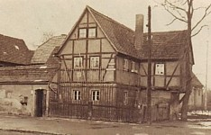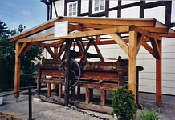Der frühere Dorfplatz von Großdobritz wird seit der Eingemeindung des Ortes als Altdobritz bezeichnet. Die amtliche Umbenennung erfolgte am 1. Juni 1926. Hier blieben bis heute einige Gutshöfe und Wohnhäuser der Landbevölkerung erhalten. Deutlich lässt die Anordnung der Häuser noch die Form des Sackgassendorfes erkennen. Bemerkenswerteste Gebäude sind die Bauernhöfe Altdobritz Nr. 2 und 3 sowie das Anwesen Nr. 14/15 _(Foto links)_. Der Fachwerkbau (Nr. 15) diente einst als Dorfmühle und war später Sitz des Dobritzer Gemeindeamtes und der örtlichen Poststelle. Nach ihrem Besitzer wurde sie seit 1845 Hummelsmühle genannt.

Der zu DDR-Zeiten zum Abriss zugunsten von Plattenbauten vorgesehene Dorfkern wurde in den letzten Jahren saniert und gehört zu den besterhaltensten im Dresdner Osten. Interessant ist auch eine vor dem Grundstück Altdobritz 2 aufgestellte historische Wäschemangel _(Foto rechts)_. In einem der Bauernhäuser (Nr. 13) wurde am 23. Juni 1867 der Maler Robert Sterl geboren. Sterl gehörte zu den Gründern der “Dresdner Sezession” und wurde 1906 als Professor an die Dresdner Kunstakademie berufen.

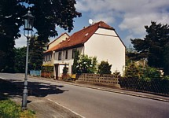Die Breitscheidstraße ist Teil eines alten Verbindungsweges, der den Ort in südöstlicher Richtung mit seinen Nachbardörfern verband und zugleich auf die hier gelegenen Felder führte. An seinem Ende lag in der Nähe des heutigen Haltepunktes Dobritz das später wüst gewordene Dorf Lippen. In der Nähe des Dorfkerns Altdobritz sind noch einige wenige Häuser von Kleindobritz erhalten geblieben _(Breitscheidstraße 1 - Foto)_.

In der zweiten Hälfte des 19. Jahrhunderts begann die Bebauung der Freiflächen zu beiden Seiten der Breitscheidstraße mit gewerblichen Unternehmungen. 1884 wurde als bedeutendster Industriebetrieb auf Dobritzer Flur eine Gardinenfabrik gegründet (Nr. 78/84). Dieser folgte der Bau einiger Wohnsiedlungen zur Unterbringung der hier und im nahegelegenen Niedersedlitz beschäftigten Angestellten. Ab 1896 wurde die Straße offiziell als Niedersedlitzer Weg, später als Niedersedlitzer Straße bzw. Lockwitzer Straße bezeichnet. Zu dieser Zeit erfolgte auch der etappenweise Ausbau des alten Kommunikationsweges und seine Verlängerung nach Niedersedlitz.

Nach der Eingemeindung von Dobritz wurde die heutige Breitscheidstraße ab 1926 zunächst Bebelstraße genannt, womit an den bedeutenden deutschen Arbeiterführer August Bebel (1840-1913) erinnert werden sollte. 1933 wechselte der Straßenname zu Rickmersstraße. Johann Rickmers kam am 9. November 1923 beim Marsch an der Feldherrenhalle in München ums Leben und galt deshalb bei den Nationalsozialisten als „Märtyrer der Bewegung“. Am 24. Juli 1945 erhielt die Straße ihren heutigen Namen nach dem SPD-Politiker Rudolf Breitscheid (geb. 1874), der 1944 im KZ Buchenwald ermordet wurde. Als markantester Neubau der Nachkriegszeit wurde 1957/64 ein Hochhaus für den VEB Schokopack errichtet. Heute haben an der Breitscheidstraße verschiedene Unternehmen und Großmärkte ihren Sitz.

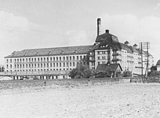Dresdner Gardinen- und Spitzenmanufaktur (Nr. 78): Das Unternehmen wurde 1882 als Bleicherei- und Appretur-Anstalt durch die beiden Kaufleute Georg Marwitz und Carl H. Siegel gegründet. Der Firmensitz befand sich zunächst auf der [Arnold- und Blumenstraße](../../../zentrum/johannstadt/strassen_johannstadt/) in der Johannstadt. Bereits zwei Jahre später erfolgte am 10. Juni 1884 der Eintrag ins Handelsregister als "Dresdner Gardinen- und Spitzenmanufaktur Actien-Gesellschaft". In verschiedenen Produktionsstufen konnten hier Gardinen, Tüllstoffe und Spitzen gewebt, gebleicht, appretiert und gespannt werden. Da der vorhandene Platz jedoch nicht ausreichte, entschlossen sich die beiden Unternehmer 1896 zur Verlegung des Betriebes nach Dobritz. Zunächst noch als Zweigwerk genutzt, endete die Produktion in Johannstadt drei Jahre später.

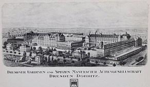

**_Bild:_** _Rechnungskopf mit Ansicht der Dobritzer Gardinen- und Spitzenmanufaktur aus den 1920er Jahren_

In den Folgejahren erwarben Marwitz und Siegel weitere Unternehmen, u.a. in 1898 in Warschau, 1909 in Norwalk (USA), 1905 in Falkenstein/Vogtland und 1915 in Mittweida. Mit über 3000 Angestellten gehörte die Dresdner Gardinen- und Spitzenmanufaktur AG (DREGUS) zeitweise zu den größten Unternehmen der Branche in Europa. Große Aktienanteile besaß bis 1935 das jüdische Bankhaus Gebrüder Arnhold, bevor es seinen Besitz unter Druck an die Dresdner Bank verkaufen musste. Während des Zweiten Weltkrieges wurde die Produktion zeitweise eingestellt, konnte jedoch dank geringer Kriegsschäden schon kurz nach Kriegsende wieder beginnen.

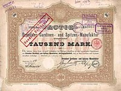1946 fielen große Teile des Maschinenparkes den Reparationsbestimmungen zum Opfer und wurden von den russischen Besatzern demontiert. Nur mühsam gelang es den verbliebenen 35 Mitarbeitern im mittlerweile verstaatlichten Unternehmen die Herstellung von Spitze und Tüll 1946 wiederaufzunehmen. Die Produktion erfolgte mit Hilfe von aus vogtländischen Textilbetrieben stammenden Maschinen, so dass bereits ein Jahr später wieder 1000 Angestellte beschäftigt werden konnten. Ab 1953 gehörte der Betrieb zur Vereinigung Volkseigener Betriebe Deko und wurde 1970 dem Kombinat VEB Plauener Spitze angegliedert. 1990 fiel das Unternehmen an die Treuhand, die nach starkem Personalabbau die Firma 1995 an einen privaten Investor verkaufte. Heute stellt der Betrieb unter dem Namen Dresdner Gardinen- und Spitzen-Manufaktur M. & S. Schröder GmbH & Co. KG vor allem Spitzenstoffe für hochwertige Designermode her und ist international aktiv.

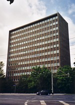Kombinat NAGEMA: Am 1. Januar 1970 entstand das Kombinat NAGEMA (Abkürzung für Nahrungsmittel, Genussmittel und Maschinenbau) als Zusammenschluss von zwölf Betrieben des DDR-Verpackungs- und Schokoladenmaschinenbaus. Der Stammsitz befand sich in einem 1957/64 im Stil der Internationalen Moderne errichteten zwölfgeschossigen Bürohochhaus an der Breitscheidstraße 46. Architekt des Bauwerks war Johannes Junghanns. Das Gebäude war erstes in Skelettbauweise errichtetes Hochhaus der DDR. Zum Komplex gehörte ursprünglich noch eine heute nicht mehr vorhandene Kantine, die mit dem Haupthaus durch einen unterirdischen Gang verbunden war.

Zunächst diente das Gebäude als Verwaltungssitz des VEB Schokopack, später als Sitz des Gesamtkombinates. Hinzu kamen mehrere Werkhallen und Nebengebäude. Hergestellt wurden hauptsächlich Bonboneinschlagmaschinen, Abfüllmaschinen für die Getränkeindustrie, für Mehl und Reis sowie Verpackungsmaschinen für Schokolade und Margarine. Der Betrieb war bis 1989 Leitbetrieb für den Verpackungsmaschinenbau im gesamten RGW und wurde nach der Wende in eine Aktiengesellschaft umgewandelt. Bis 1997 erfolgte deren Zerschlagung und Aufteilung in mehrere Einzelunternehmen. In dem seit 2008 unter Denkmalschutz stehenden Verwaltungsgebäude sind künftig Büroräume einer IT-Firma geplant.

Kühlanlagenbau Dresden: Das Unternehmen wurde 1953 aus den früheren Dresdner Privatbetrieben D.K.W. Elektrokälte
Werner Kratsch GmbH (bis 1945 Sitz auf der Ringstraße 15) und Kälteanlagen Rauch gebildet. Der Firmensitz befand sich ab
1956 auf der Breitscheidstraße 80. Zweck des Unternehmens war die Projektierung und der Bau von Kühlanlagen für die
Lebensmittelindustrie und den Einzelhandel. Außerdem oblag dem Betrieb die Reparatur von Kleinkälteanlagen in der gesamten DDR. Ab 1961 wurden zudem Kühlhäuser für die Lagerung von Obst und Gemüse gebaut.

1970 erfolgte die Eingliederung der Firma in das neu gebildete Kombinat ILKA Luft - und Kältetechnik. Neben dem VEB Kühlanlagenbau gehörten auch der [VEB Lufttechnische Anlagen Dresden](../../../sudwest/lobtau/strassen_lobtau/tharandter_strasse/), das Institut für Luft- und Kältetechnik sowie
zahlreiche weitere Unternehmen in der gesamten DDR dazu. Zeitweise hatte der Betrieb bis zu 1800 Beschäftigte, davon ca.
400 in Dresden. Bis 1990 war der VEB Kühlanlagenbau einziger Hersteller von Kühlanlagen in der DDR und Marktführer im RGW. Exportiert wurden die Anlagen aber auch nach Kolumbien, Ägypten, Mocambique und Angola.

Das 1990 zunächst von der Treuhand übernommene Unternehmen wurde 1992 aus der früheren Kombinatsstruktur herausgelöst und privatisiert. Heute hat die Firma ca. 440 Mitarbeiter und besitzt Niederlassungen und Tochterfirmen in
Deutschland, Polen und Russland. Hauptsächlich werden Kühl- und Kältetechnische Anlagen für gewerbliche Nutzer gebaut und gewartet.

Der Dobritzer Weg bildet die östliche Verlängerung der Kadenstraße und wurde erst am 8. Mai 2003 offiziell benannt. Bereits
um 1900 war der Ausbau dieses Verbindungsweges nach Leuben geplant, was jedoch nicht zustande kam.

Die Franz-Mehring-Straße wurde in den Zwanziger Jahren angelegt und am 20. Oktober 1927 nach dem marxistischen Publizisten, Historiker und Politiker Franz Mehring (1846-1919) benannt. Mehring gehörte zu den führenden Köpfen der SPD-Linken und war Mitbegründer der Spartakusgruppe und der KPD. 1933 erhielt die Franz-Mehring-Straße den Namen des 1923 beim nationalsozialistischen Putschversuch gefallenen Karl Laforce, eine Namensgebung, die mit Ende der NS-Herrschaft bereits am 24. Juli 1945 wieder rückgängig gemacht wurde. Neben Wohnhäusern der Vorkriegszeit prägen heute einige nach 1960 entstandene Wohnblocks das Straßenbild.

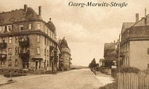Die Georg-Marwitz-Straße wurde 1907 im Zusammenhang mit dem Bau einer Wohnanlage für die Beschäftigten der Dobritzer Gardinenfabrik angelegt (Nr. 20-30). Ausbau und Finanzierung der „Planstraße VI“ übernahm dabei die Firma. Ihren Namen erhielt sie nach dem Generaldirektor des Unternehmens, dem Dresdner Textilfabrikanten Georg Marwitz (1854-1923), der auch als Stifter sozialer Einrichtungen in Erscheinung trat. Weitere Wohngebäude entstanden ab 1911 für den Dobritzer Spar- und Bauverein (Nr. 25-33). Die früheren Werkswohnungen wurden in den letzten Jahren saniert und stehen unter Denkmalschutz.

Mit Beschluss vom 22. Oktober 1935 wurde die Georg-Marwitz-Straße in Brüder-Reinhard-Straße umbenannt. Namensgeber waren die Brüder Bruno und Friedrich Reinhard, die beide eng mit der nationalsozialistischen Bewegung verbunden waren. Der aus Dresden stammende SA-Mann Bruno Reinhard war 1932 in Greifswald bei einer Auseinandersetzung mit Kommunisten ums Leben gekommen. Sein Bruder starb im gleichen Jahr beim Untergang des Schiffes „Niobe“. Unmittelbar nach Kriegsende wurde diese Straßenbenennung am 24. Juli 1945 rückgängig gemacht.

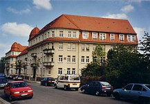

**_Foto:_** _Wohnanlage der Dobritzer Gardinenfabrik an der Georg-Marwitz-Straße_

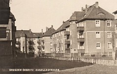Die Hanns-Rothbarth-Straße wurde in den Zwanziger Jahren als Friedrich-Engels-Straße angelegt. Die amtliche Namensgebung für die vorherige Planstraße M erfolgte am 1. Oktober 1925. Nach Machtübernahme der Nationalsozialisten wurde sie am 15. Mai 1933 in Casellastraße umbenannt. Theodor Casella gehörte zu den Vorkämpfern des NS-Regimes und starb am 9. November 1923 beim Putschversuch vor der Feldherrenhalle in München.

Bereits unmittelbar nach Ende des Zweiten Weltkriegs erhielt die Straße zunächst ihren früheren Namen Engelsstraße zurück. Nachdem man sich jedoch entschied, eine zentraler gelegene Straße in der Inneren Neustadt (heute Königstraße) nach Friedrich Engels zu benennen, wechselte der Name erneut. Seit dem 2. Februar 1946 trägt sie den Namen des antifaschistischen Widerstandskämpfers Hanns Rothbart (1904-1944). Rothbarth gehörte ab 1922 der Vereinigten Kletterabteilung im Touristenverein “Die Naturfreunde” an und war Mitglied der KPD-Stadtleitung Dresden. Zwischen 1927 und 1933 wirkte er als Funktionär seiner Partei in der Dresdner Gardinen- und Spitzenmanufaktur AG in Dobritz. Der später im illegalen Widerstand aktive Arbeiterfunktionär wurde 1944 von der Gestapo inhaftiert und im KZ Sachsenhausen ermordet.

Zwischen 1922 und 1927 errichtete der 1911 gegründete Dobritzer Spar- und Bauverein zwischen Hanns-Rothbarth- und Bodenbacher Straße eine kleine Wohnanlage _(Foto um 1930)_. Die mehrgeschossigen Wohnhäuser wurden von Max Herfurth entworfen und gehören heute zur Wohnungsbaugenossenschaft Dresden-Ost.

Die Josef-Moll-Straße wurde in den 1930er Jahren im Zusammenhang mit einer kleinen Wohnanlage gebaut. Mit Beschluss vom 13. Januar 1937 erhielt die Planstraße 11S zunächst den Namen Hausmannstraße. Kurt Hausmann war Angehöriger der SA und starb bei politischen Auseinandersetzungen mit dem "Reichsbanner Schwarz Rot Gold" am 5. März 1933 in Schönebeck an der Elbe.

Bereits kurz nach Kriegsende erfolgte am 24. Juli 1945 die Umbenennung in Wilhelm-Pieck-Straße. Wilhelm Pieck (1876-1960) war ein Funktionär der KPD und wurde 1949 erster Präsident der DDR. Da es jedoch mit der Eingemeindung von Kleinzschachwitz eine weitere Wilhelm-Pieck-Straße (heute Fanny-Lewald-Straße) gab, erhielt die Dobritzer Straße auf Ratsbeschluss vom 30. September 1953 den Namen Josef-Moll-Straße. Dieser erinnert an den deutschen Revolutionär Maximilien Joseph Moll (1813-1849). Der gelernte Uhrmacher gehörte zu den Gründungsmitgliedern des Deutschen Arbeiterbildungsvereines und war ab 1847 Mitglied der Leitung des Bundes der Kommunisten. 1849 kam er beim Badisch-Pfälzischen Aufstand ums Leben.

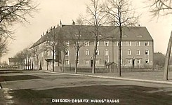Die Straße im Altdobritzer Dorfkern entstand 1899 und war zunächst als Verbindung zwischen Winterberg- und Hertzstraße geplant. Allerdings kamen diese Planungen nie vollständig zur Umsetzung, so dass lediglich der heute vorhandene Abschnitt gebaut wurde und nach 1900 den Namen Residenzstraße erhielt. Zugleich entstanden hier die ersten Wohnhäuser. Die Finanzierung des Straßenbaus übernahmen der Kaufmann Emil Friedländer und der Kommissionsrat Hermann Heinze. Erst 1914 ging sie in den Besitz der Gemeinde Dobritz über.

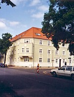Mit der Eingemeindung von Dobritz machte sich eine Umbenennung notwendig. Am 19. Februar 1926 erhielt die Residenzstraße nach dem sozialdemokratischen Reichstagsabgeordneten August Kaden (1850-1913) den Namen Kadenstraße. Kaden war ab 1890 Verleger der Sächsischen Arbeiter-Zeitung und Mitinhaber einer Druckerei. Mit Machtübernahme der Nationalsozialisten wurde diese Bezeichnung als "unzeitgemäß" betrachtet, weshalb man sich 1933 zur Umbenennung in Kuhnstraße entschied. Karl Kuhn kam beim gescheiterten Putschversuch am 9. November 1923 vor der Feldherrenhalle in München ums Leben und galt als "Märtyrer der Bewegung". Bereits im Juli 1945 erfolgte die Rückbenennung in Kadenstraße.

Die Lasallestraße bildet die Zufahrt zum Dobritzer Dorfkern und wurde deshalb bis zur Eingemeindung des Ortes Dorfstraße genannt. 1926 erhielt sie ihren heutigen Namen
nach dem Begründer des Allgemeinen Deutschen Arbeitervereins Ferdinand Lassalle (1825-1864). 1933 ließen die Nazis diese Bezeichnung in Fauststraße ändern. Martin Faust war am Sturm auf die
Feldherrenhalle in München 1923 beteiligt und kam bei diesem nationalsozialistischen Putschversuch ums Leben. Im September 1945 erhielt die Lassallestraße ihren alten Namen zurück.

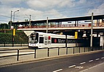Die frühere Reicker Straße, ein alter
Verbindungsweg zwischen Reick und Dobritz, erhielt 1926 den Namen Moränenende, da hier Reste einer eiszeitlichen Gletscher-Endmoräne nachgewiesen
werden konnten. 1936 wurde dieser Weg, der zugleich als Trasse der Straßenbahn diente, in Wilhelm-Gustloff-Straße umbenannt. Wilhelm Gustloff war Führer der nationalsozialistischen
Bewegung in der Schweiz und starb 1936 bei einem Attentat in Davos.

Bereits Ende 1945 hob man diese Namensgebung auf und änderte den Straßennamen in
Ernst-Schneller-Straße. Ernst Schneller (1890-1944) war als Abgeordneter der KPD im Sächsischen Landtag tätig und gehörte ab 1924 dem Reichstag an. 1944 wurde er im KZ Sachsenhausen hingerichtet. 1991 erhielt die Straße ihren alten
Namen Moränenende zurück. Neben gewerblichen Unternehmen prägen heute Kleingartenanlagen das Bild. 2001 wurde die Straße im Zusammenhang mit dem Umbau des Haltepunktes Dobritz durchgängig ausgebaut. Dabei entstand auch ein
moderner Umsteigeknoten zwischen Straßenbahn, Bus und S-Bahn _(Foto)_.

Die Sorbenstraße wurde im Zusammenhang mit dem Bau einiger Arbeiterwohnhäuser an der Breitscheidstraße angelegt und
zunächst Wendenstraße genannt. Beide Bezeichnungen erinnern daran, das Dobritz ein ursprünglich von slawischen Siedlern bewohnter Ort war. Die Wohnhäuser Sorbenstraße 6-14, zwischen 1907 und 1920 als Werkswohnungen der Dresdner
Gardinen- und Spitzenmanufaktur erbaut, stehen unter Denkmalschutz und wurden nach 1990 saniert.

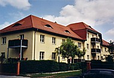

**_Foto:_** _Wohnanlage Sorbenstraße 6 - 14_

Die Suttnerstraße wurde Ende der Zwanziger Jahre angelegt und zunächst Karl-Marx-Straße genannt. 1933 änderten die
Nationalsozialisten diesen Namen nach einem “Vorkämpfer” der nationalsozialistischen Bewegung in Felix-Allfarth-Straße.
1945 erfolgte die erneute Umbenennung in Suttnerstraße. Bertha von Suttner (1843-1914) gehört zu den Begründern des
pazifistischen Gedankens und erhielt für ihren 1889 erschienenen Roman “Die Waffen nieder” und ihr Eintreten für Frieden und Völkerverständigung 1905 den erstmals vergebenen Friedensnobelpreis.

Die ersten Wohnhäuser der Suttnerstraße entstanden 1927 nach Plänen von Max Herfurth für den Dobritzer Spar- und Bauverein und gehören heute zur Wohnungsgenossenschaft Dresden-Ost e.G. Weitere Flächen wurden bis 1961 von der
renommierten Gärtnerei Findeisen (später GPG Floradres) eingenommen, welche vor allem für ihre Azaleenkulturen bekannt
war. Noch heute trägt eine Azaleenzüchtung nach dem Firmengründer Theodor Findeisen den Namen “Theodor” . 2003 wurde
an der Suttnerstraße mit dem Bau einer kleinen Wohnanlage begonnen. Beim Bau entdeckte man einige Keramikfunde aus der Bronzezeit, die auf die frühgeschichtliche Besiedlung dieses Areals hinweisen.

Die Vollmarstraße, eine Parallelstraße der Sorbenstraße, erhielt ihren Namen nach dem sozialdemokratischen Politiker Georg
Heinrich von Vollmar (1850-1922). Vollmar gehörte ab 1883 dem sächsischen Landtag an und war viele Jahre Reichtagsabgeordneter seiner Partei. Zeitweise wirkte er als Redakteur der “Dresdner Volkszeitung”. Die meisten
Wohngebäude der Vollmarstraße entstanden in den Zwanziger Jahren.

Die Wilhelm-Liebknecht-Straße entstand Ende der Zwanziger Jahre im Zusammenhang mit der Erweiterung des Dobritzer
Industriegebietes. Ihren Namen erhielt sie nach dem Arbeiterführer Wilhelm Liebknecht (1826-1900), der zu den Mitbegründern der Sozialdemokratischen Partei gehörte und bis zu seinem Tod Mitglied des Reichstags war. Zwischen
Breitscheid- und Wilhelm-Liebknecht-Straße wurde Ende der Zwanziger Jahre eine kleine Wohnsiedlung errichtet.

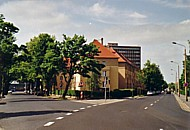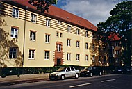

**_Fotos:_** _Wohnhäuser an der Breitscheid- und Wilhelm-Liebknecht-Straße_

[Dobritz auf OpenStreetMap](https://www.openstreetmap.org/search?query=Dresden+Dobritz)

* * *

 \[ [Home](../../../index.html)\] \[ [Nord](../../../nord/)\] \[ [Nordwest](../../../nordwest/)\] \[ [Neustadt](../../../neustadt/)\] \[ [Nordost](../../../nordost/)\] \[ [West](../../../west/)\] \[ [Zentrum](../../../zentrum/)\] \[ [Südwest](../../../sudwest/)\] \[ [Süd](../../../sud/)\] \[ [Südost](../../../sudost/)\] \[ [Ost](../../../ost/)\] \[ [Register](../../../Register/register.html)\] \[ [Kontakt](../../../Kontakt/kontakt.html)\] \[ [Impressum](../../../impressum/)\]
