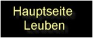
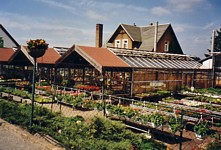
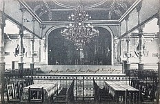
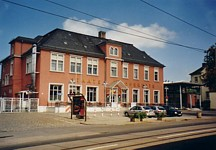
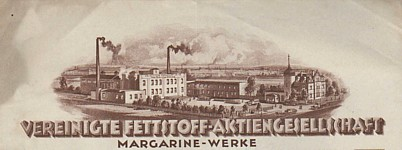
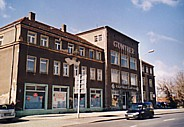
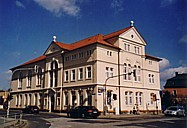

* * *

Die Pirnaer Landstraße ist Teil einer alten Verbindungsstraße zwischen der Dresdner Altstadt und der Burg Dohna. Bereits 1315 wurde sie als “Pirnaische Landstraße” erwähnt und hatte ihren Ausgangspunkt am
Pirnaischen Tor. Von dort führte sie parallel der heutigen Grunaer Straße und durchquerte den Großen Garten. Noch heute erinnert ein altes Sühnekreuz in der Nähe des Palais an den früheren Straßenverlauf. Nach Erreichen
der Grunaer Flur entsprach die Straßenführung weitgehend der jetzigen. Während die Straße in Gruna und Seidnitz [Bodenbacher Straße](../../../../ost/gruna/strassen_gruna/bodenbacher_strasse/) genannt wird, trägt sie nach Überqueren der Ortsgrenze zu Dobritz (Höhe Paracelsusstraße) den Namen Pirnaer Landstraße. Von hier führt sie über Leuben, Großzschachwitz und Sporbitz bis zur Stadtgrenze und von dort weiter nach Heidenau und Pirna.

Nach Zerstörung der Burg Dohna im Zuge der “Dohnaischen Fehde” 1402 wurde diese Straße Hauptverbindung nach Böhmen und entsprechend stark von Kaufleuten genutzt. Rasthäuser befanden sich u. a. in Gruna und Seidnitz. Auch der frühere Leubener Gasthof, welcher später zum Operettentheater umgebaut wurde, profitierte vom Durchgangsverkehr auf der Pirnaer Landstraße. Bis Mitte des 19. Jahrhunderts führte die Straße außerhalb der Dorfkerne meist durch unbebautes Gebiet. Erst im Zusammenhang mit der zunehmenden Industrialisierung entstanden zahlreiche neue Mietshäuser, Gärtnereien und Gewerbebetriebe. Ab 1925 verkehrte die Straßenbahn zwischen Seidnitz und Leuben über die Pirnaer Landstraße, die bis heute eine der wichtigsten Verkehrsadern des Dresdner Ostens geblieben ist.

Dobritz:

Auf Dobritzer Flur wurde die Straße bis zur Eingemeindung Pirnaische bzw. Pirnaer Straße genannt. Um Verwechslungen mit einer gleichnamigen Straße in der Innenstadt zu vermeiden, erfolgte 1926 die Umbenennung in
Pirnaer Landstraße.

Bis heute haben sich hier noch einige Gebäude aus der dörflichen Vergangenheit des Ortes erhalten. Die Häuser Nr.
30-34 entstanden als “Drescherhäuser” zur Unterbringung von Saisonarbeitskräften, die auf den Dobritzer Gütern während der Erntezeit eingesetzt waren. Größtes Anwesen war das ehemalige Vorwerk Pirnaer Landstraße 38,
welches sich später im Besitz des Rates der Stadt Dresden befand und deshalb auch Stadtgut genannt wurde. Nach
1945 übernahm das Volksgut Pillnitz dieses Objekt als Zweigbetrieb. Auf der gegenüberliegenden Straßenseite steht seit 1883 die [Schule](../../../../ost/dobritz/) des Ortes. Nach Verlassen des Dorfkerns wird in der Nähe der Einmündung der
Straßenbahntrasse von Prohlis der Niedersedlitzer Flutgraben auf einer Brücke überquert und wenig später Leubener Flur erreicht.

Leuben:

Die bis ins 19. Jahrhundert Dresden-Pirnaer Staatsstraße bzw. Pirnaische Chaussee genannte Straße erhielt auf Beschluss des Leubener Gemeinderates vom 28. Oktober 1897 offiziell den Namen Dresdner bzw. Pirnaische
Straße. Während die Dresdner Straße den Abschnitt zwischen der Ortsgrenze zu Dobritz bis zum Gasthof Lindengarten umfasste, wechselte nach Durchqueren des Dorfkerns von Altleuben der Name in Pirnaische Straße.
1926 wurden diese beiden Straßen in Pirnaer Landstraße umbenannt.

Auch in Leuben sind noch einige historische Gebäude des früheren Dorfkerns zu sehen. Neben dem alten Dorfgasthof (1947-2016 Operettentheater) zeugen die einstigen Häusleranwesen Pirnaer Landstraße 141, 142 und 146 von der Geschichte des Ortes. Zwischen 1970 und 1974 wurde auf ehemaligen Feldern und Gärtnereiflächen zwischen Pirnaer Landstraße und Breitscheidstraße das Neubaugebiet Leuben errichtet.

Gasthof ”Feenpalast”: Die erste Schänke des Ortes entstand um 1420 und befand sich wahrscheinlich schon damals an Stelle des späteren Dorfgasthofes. Ausgeschenkt wurde ausschließlich Dresdner Bier, da Leuben im Gebiet der Dresdner “Biermeile” lag. Später entwickelte sich diese Schankwirtschaft zum Straßengasthof an der Pirnaer Landstraße.

1899 wurde der alte Gasthof durch einen Neubau im Stil der Gründerzeit ersetzt und nun offiziell als “Gasthof zu Leuben” bezeichnet. Wirtschaftliche Schwierigkeiten führten zu häufigen Besitzerwechseln, bevor der Gasthof schließlich von Alfred Buschbeck übernommen wurde. Der engagierte Wirt ließ das Haus 1925 zum Ball- Etablissement umbauen und nannte seinen Gasthof fortan “Feenpalast”. Schnell entwickelte sich das Haus zu einem der beliebtesten Tanzgasthöfe im Dresdner Osten. Neben dem prunkvollen Saal _(Foto oben)_ gehörten Fremden- und Vereinszimmer sowie eine Kegelbahn dazu. Erst die Einschränkungen der Nazizeit und der Zweite Weltkrieg beendete diese glanzvolle Epoche des Leubener Gasthofes. Ab 1944 befand sich in den Räumen eine Polizeikaserne.

Da das Gebäude von Zerstörungen verschont geblieben war, wurde der Saal bereits im Sommer 1945 als Veranstaltungsort genutzt und war fortan Schauplatz für Kabarett-und Theateraufführungen. Besitzer war bis 1947 Fritz Randow, ehemaliger technischer Direktor des zerstörten Centraltheaters. 1947 wurde der “Feenpalast” zum “Apollo-Theater” umgewandelt und war Spielstätte einer privaten Bühne um den Schauspieler Georg Wörtge. 1953 übernahm die Stadt Dresden das Haus und richtete hier das [Operettentheater](../../../../ost/leuben/operettentheater/) ein _(Foto)_. Die angeschlossene Gaststätte trug den Namen “Fledermaus” nach dem bekannten Stück von Johann Strauss. 2016 schloß das Theater seine Pforten und wurde ins Kulturkraftwerk Mitte in der Innenstadt verlegt.

Dresdner Margarinewerk: Das Unternehmen wurde nach dem Ersten Weltkrieg unter dem Namen "Vereinigte Fettstoff-Aktiengesellschaft" gegründet. Hervorgegangen war diese aus den Firmen "Vereinigte Fettstoffläger Petzoldt & Schliephacke" und der Georg Münch G.m.b.H., die sich 1921 zu einer Import-Handelsgesellschaft zur Einfuhr amerikanischer Schlachthausprodukte zusammenschlossen. 1922 nahm man zudem am Schlachthofring 3 die Fabrikation von Kunstspeisefett- und Margarine auf. Einen Zweigbetrieb errichtete man in Leuben auf der Pirnaischen Straße 64 (heute Pirnaer Landstraße 194). Geschäftsführer waren Friedrich Carl Gatzweiler und Franz Leopold Franke.

Hauptprodukte des Leubener Betriebes waren Margarine und andere Fette sowohl für den privaten als auch gewerblichen Bedarf. Nach 1945 wurde die Firma als VEB Margarinewerk Dresden verstaatlicht und gehörte bis zur Wende zum Volkseigenen Kombinat Öl und Margarine mit Stammsitz in Magdeburg. Leiterin war viele Jahre die Politikerin und Vorsitzende des Bezirksvorstandes des Demokratischen Frauenbundes Deutschlands Gerda Darnstädt. Zu dieser Zeit zählte das Werk ca. 60 Angestellte. 1991 wurde der Betrieb an den belgischen Konzern Vandemoortele verkauft und zu einer der modernsten Margarinefabriken in Europa ausgebaut.

Großzschachwitz:

Wie auch im benachbarten Leuben wurde auch in Großzschachwitz die Staatsstraße zunächst Pirnaische Straße genannt. Am 1. Mai 1928 erfolgte nach der bei Zinnwald auf böhmischer Seite gelegenen Ortschaft Peterswald
(Petrovice) die Umbenennung in Peterswalder Straße. Nach Machtübernahme der Nationalsozialisten wechselte man
diesen Namen in Adolf-Hitler-Straße, eine Benennung die nach Kriegsende sofort wieder rückgängig gemacht wurde.
Am 8. Februar 1956 beschloss der Dresdner Stadtrat, die Peterswalder Straße der Pirnaer Landstraße zuzuordnen.

Kaufhaus Günther: Die bekannte Verkaufseinrichtung wurde 1902 im damals noch selbständigen Vorort Großzschachwitz vom Buchbinder Otto Günther als Haushaltswarengeschäft eröffnet. 1929/30 entstand an der Pirnaer Landstraße 230 das bis 2007 genutzte dreigeschossige Kaufhausgebäude. Im Angebot des zu den wenigen privaten Kaufhäusern der DDR gehörenden Warenhauses waren vor allem Haushaltwaren, aber auch Textilien, Porzellan und Glas, Eisenwaren und Spielzeug sowie Kleinmöbel und elektrische Hausgeräte. Im Hinterhof gab es zudem zeitweise einen Holzverkauf. 1968 diente das Gebäude als Kulisse für die DDR-Fernsehserie "Die roten Bergsteiger".

1992 erfolgte eine Modernisierung des Gebäudes, welches bis zur Schließung am 22. Dezember 2007 in Familienbesitz der Familie Günther/Metzig blieb. Im Anschluss war der Abbruch des Kaufhauses zugunsten eines modernen Einkaufszentrums geplant, der jedoch zunächst nicht zustande kam. Erst 2015 erfolgte der Abriss des Gebäudes. An seiner Stelle entstand der Neubau der Einkaufszentrums "Zschach" mit Supermarkt und verschiedenen Läden. Am 17. Mai 2018 wurde es eröffnet.

Gasthof Großzschachwitz:
Der um 1875 erbaute Gasthof an der Pirnaer Landstraße 239 besaß neben den Gasträumen auch zwei große Ballsäle, in den regelmäßig Tanzveranstaltungen, Konzerte und Theateraufführungen statfanden. 1919 erwarb
die Familie Alschner den Gasthof und bewirtschaftete ihn bis 1947. 1929 erhielt sie die Genehmigung zur Aufführung von Filmen. Das als “Lichtspiele Zschachwitz“
bezeichnete Kino besaß ca. 500 Plätze und blieb bis in die Nachkriegszeit geöffnet. Nach der Enteignung 1951 diente das Gebäude als Lager und wurde nach 1990 zum
Geschäftshaus umgebaut. Den ehemaligen großen Ballsaal nutzt heute die  Baptistengemeinde.

Certo-Kamerawerk:
Die Firma wurde 1902 in der Johannstadt von Alfred Lippert und Karl Peppel als Werkstatt zur Herstellung photographischer Apparate gegründet und hatte ihren Sitz auf der Hertelstraße 35. 1905 wurde sie aus
Platzgründen zur damaligen Pirnaischen Straße 11 nach Großzschachwitz verlegt und erhielt ein Jahr später die neue
Betriebsbezeichnung “Certo Fabrik photographischer  Apparate und Bedarfsartikel GmbH”. Der Firmenname ist vom
lateinischen Wort “certus” = sicher, zuverlässig abgeleitet und sollte den hohen Qualitätsanspruch des jungen Unternehmens verdeutlichen. 1917 übernahm Emil Paul Zimmermann die Fabrik. Obwohl Certo zu den kleineren
Kameraherstellern gehörte, erlaubte der Erfolg 1928/29 einen Neubau für die ca. 150 Angestellten und die Einführung
der Großserienfertigung. Bis zur Einstellung der zivilen Produktion wurden hier neben Zulieferartikeln für andere Dresdner Hersteller Kameras der Marken “Certo” und “Dollina” hergestellt.

Das Werk überstand den Zweiten Weltkrieg unzerstört und konnte trotz russischer Demontage 1946 die Produktion wieder aufnehmen. Werksingenieur Erhard Hempel konstruierte 1948 eine neue Kleinbild-Klappkamera und
entwickelte bestehende Modellreihen weiter. Diese wurden sowohl für den Inlands- wie auch für den ausländischen
Markt gefertigt. Unter der Leitung der Familie von der Gönna blieb das Werk bis 1972 in Privatbesitz und wurde erst
1980 als VEB Certo-Kamerawerk Dresden in das Kombinat Pentacon eingegliedert. Zwei Jahre später endete der Bau eigener Modelle, zuletzt wurden hier Teile verschiedener Pentacon-Fotoapparate hergestellt.

* * *

 \[ [Home](../../../../index.html)\] \[ [Nord](../../../../nord/)\] \[ [Nordwest](../../../../nordwest/)\] \[ [Neustadt](../../../../neustadt/)\] \[ [Nordost](../../../../nordost/)\] \[ [West](../../../../west/)\] \[ [Zentrum](../../../../zentrum/)\] \[ [Südwest](../../../../sudwest/)\] \[ [Süd](../../../../sud/)\] \[ [Südost](../../../../sudost/)\] \[ [Ost](../../../../ost/)\] \[ [Register](../../../../Register/register.html)\] \[ [Kontakt](../../../../Kontakt/kontakt.html)\] \[ [Impressum](../../../../impressum/)\]
