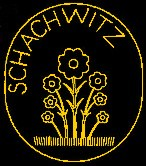
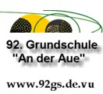
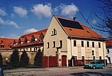
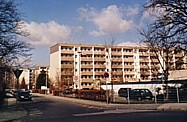
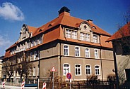

* * *

**Gemeindesiegel von Großzschachwitz**

**Schulen in Großzschachwitz:**

Großzschachwitz entstand als slawische Siedlung und wurde 1350 erstmals als Schachwicz urkundlich erwähnt. Der Ortsname ist von einem slawischen Personennamen (Dorf des Cach) abgeleitet. Erst nach 1791 setzte sich die Bezeichnung Großzschachwitz (zur Unterscheidung vom benachbarten Kleinzschachwitz) durch.

Im Mittelalter besaßen verschiedene Adelsfamilien und Dresdner Bürger Güter in Zschachwitz. 1465 kam das Dorf in den Besitz der Familie Körbitz, die ihre Anteile 1513 an die Grafen von Bünau auf Weesenstein veräußerten. Bis zur Aufhebung der Grundherrschaft im 19. Jahrhundert blieben diese Verhältnisse bestehen. Im Gegensatz zu Kleinzschachwitz blieb Großzschachwitz bis 1890 ein unbedeutendes kleines Bauerndorf, dessen Bewohner neben der Landwirtschaft auch Strohflechterei und Zwirnherstellung betrieben. Außerdem bestand spätestens ab 1547 eine Wassermühle am Lockwitzbach, die 1906 der Straßenverbreiterung der Lockwitztalstraße zum Opfer fiel. Kirchlich unterstand der Ort der Parochie Dohna.

Im Zusammenhang mit der Industrialisierung entlang der 1846 eröffneten Sächsisch-Böhmischen Eisenbahn siedelten sich um 1900 auch in Großzschachwitz Arbeiterfamilien an, für die einige neue Wohnhäuser außerhalb des Dorfkerns entstanden. 1897 schlossen sich Groß- und Kleinzschachwitz zu einer gemeinsamen Kirchgemeinde zusammen, nachdem es 1836 bereits zur Bildung eines Schulverbandes zwischen beiden Gemeinden gekommen war.

Diese Entwicklung setzte sich nach dem Ersten Weltkrieg fort. 1921 wurde der Nachbarort [Meußlitz](../../ost/meusslitz/), ein Jahr später auch [Sporbitz](../../ost/sporbitz/) nach Großzschachwitz eingemeindet. Neue Wohnsiedlungen entstanden u. a. An der Aue, an der Bahnhofstraße und der Schweizstraße. Zu den bedeutendsten Unternehmen auf Großzschachwitzer Flur gehörte die [Firma Seck](../../ost/grosszschachwitz/strassen_grosszschachwitz/), später VEB Mühlenbau Dresden. 1950 wurde zur Verbesserung der örtlichen Verkehrsverhältnisse ein bis heute als S-Bahn-Station genutzter Haltepunkt eingerichtet. Im gleichen Jahr kam der Ort am 1. Juli als Stadtteil zu Dresden. Heute ist Großzschachwitz vor allem als Wohnvorort der Landeshauptstadt von Bedeutung. Eine neue Wohnsiedlung entstand zwischen 1979 und 1981 an der Försterlingstraße/ Rathener Straße _(Foto)_. Heute gehören die 1996/99 sanierten Gebäude zur Wohnungsgenossenschaft “Aufbau” Dresden.

Schulen in Großzschachwitz:

Großzschachwitz gründete 1836 mit dem benachbarten Kleinzschachwitz einen gemeinsamen Schulverband. Fortan besuchten die wenigen Kinder des Dorfes die Schule des Nachbarortes. Erst im Zusammenhang mit dem Zuzug zahlreicher Arbeiterfamilien wurde 1898 an der Großzschachwitzer Straße eine eigene Schule eingerichtet. Die Planungen für das Schulhaus stammen von Ernst Noack. 1905 machte sich eine Erweiterung erforderlich. 1910 folgte die Turnhalle. Das Gebäude wird bis heute von der 92. Grundschule “An der Aue” genutzt.

Christliche Schule Dresden: 1980 entstanden im Zusammenhang mit dem Neubaugebiet Försterlingstraße zwei weitere Schulen, darunter die 114. Polytechnische Oberschule auf der Rathener Straße. Anfang Mai 1985 erhielt diese den Ehrennamen 114. POS "Hermann Eckardt". Namensgeber war Hermann Eckardt (1902-1965), ein Dresdner Buchdrucker, der nach 1945 als Mitarbeiter der Stadtverwaltung zu den sogenannten "Aktivisten der ersten Stunde" gehörte. Eckert baute u.a. Druckerei und Verlag der Sächsischen Zeitung auf und war später verantwortlich für die Zusammenarbeit der großen Zeitungsdruckereien in der DDR.

1990 wurde die 114. POS in eine weiterführende Schule umgewandelt und diente bis zur Schließung 2007 als Gymnasium Großzschachwitz. Danach übernahm der Christliche Schulverein Zschachwitz das Gebäude. Bereits im Schuljahr 2004/2005 hatte der von den beiden Kleinzschachwitzer Kirchgemeinden getragene Verein in der früheren 65. Grundschule eine konfessionsorientierte Grundschule gegründet. Im Zusammenhang mit der Erweiterung dieser Bildungseinrichtung um Mittelschule und Gymnasium erfolgte der Umzug in das größere Gebäude auf der Rathener Straße 78. Im September 2007 entstand zudem auf der Pirnaer Landstraße 191 Dresdens zweite Montessorischule “Kilaloma” mit integriertem Ganztagskonzept.

[_Weiterführende Literatur und Quellen_](../../impressum/quellenverzeichnis/)

 \[ [Home](../../index.html)\] \[ [Nord](../../nord/)\] \[ [Nordwest](../../nordwest/)\] \[ [Neustadt](../../neustadt/)\] \[ [Nordost](../../nordost/)\] \[ [West](../../west/)\] \[ [Zentrum](../../zentrum/)\] \[ [Südwest](../../sudwest/)\] \[ [Süd](../../sud/)\]
 \[ [Südost](../../sudost/)\] \[ [Ost](../../ost/)\] \[ [Register](../../Register/register.html)\] \[ [Kontakt](../../Kontakt/kontakt.html)\] \[ [Impressum](../../impressum/)\]
