

## Alte Straße

Die Alte Straße befindet sich in Großzschachwitz an der Flurgrenze zu Leuben und zweigt als Nebenstraße von der Försterlingstraße ab. Vor der Eingemeindung hieß sie Leubener Straße. Um Verwechslungen mit der bereits vorhandenen Leubener Straße zu vermeiden, erfolgte am 30. September 1953 die Umbenennung in Alte Straße.

## Altsporbitz

Als Altsporbitz wird seit 1956 die kurze Sackgasse im alten Sporbitzer Dorfkern bezeichnet. Zuvor war seit ca. 1900 die
Bezeichnung Dorfplatz üblich. Hier sind noch vier Gehöfte des Ortes erhalten. Am Haus Nr. 5 erinnert eine Inschrift an den
Dorfbrand vom 22. Mai 1763. Die ehemaligen landwirtschaftlichen Anwesen dienen heute Wohn- und Gewerbezwecken.

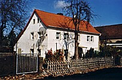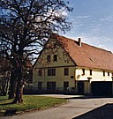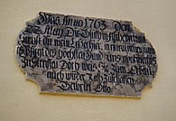

**_Fotos:_** _Dorfkern Altsporbitz - rechts die Gedenktafel am Gut Altsporbitz 5_

_Was Anno 1763 den 22. May_

_Die Gluth in Asche verbrant,_

_siehst du mein Leßer hier in einem neuen Stand, es pflegt des_
_Höchsten Hand uns_

_abermahls zu strafen, doch weis Sie_

_zum Leben auch wieder Rath zu schaffen._

_Gabriel Otto_

## Am Lockwitzbach

Ursprünglich diente der damals noch namenlose Weg als Fußweg der Sporbitzer und Meußlitzer Einwohner zum Bahnhof
Niedersedlitz. Von den Anwohnern wurde er auch „Apothekerweg“ genannt. Ab 1902 nutzte die Niedersedlitzer Firma Kelle
& Hildebrandt diesen Weg als Trasse für eine Werkbahn, welche vom Betriebsgelände bis zur Elbe führte. Da der Weg
entlang den Gleisen nun nur noch als schmaler Pfad begehbar war und die Gemeindeverwaltung darin eine Gefahr für die Nutzer sah, wurde er auf Weisung der Amtshauptmannschaft Pirna im Oktober 1902 als öffentlicher Weg eingezogen.

Die erwähnte Werkbahn führte zunächst in nördlicher Richtung über den [Lockwitzbach](../../../sudost/lockwitz/lockwitzbach/), bog dann nach rechts ab und überquerte den Lockwitzbach auf einer weiteren Brücke. Anschließend verlief die Trasse entlang der Flurgrenze zu Sporbitz, dann über die heutige [Pirnaer Landstraße](../../../ost/dobritz/strassen_dobritz/pirnaer_landstrasse/)
und in östlicher Richtung entlang den Grenzen zu Meußlitz und Zschieren bis zur Elbe. Hier bestand eine Verlademöglichkeit auf Frachtkähne.

Gegen Ende des Zweiten Weltkriegs  wurden in diesem Gebiet einige Behelfsheime für Ausgebombte und Flüchtlinge errichtet. Damit wurde der Weg als Zugang zu den Häusern benötigt und erhielt am 8. Januar 1945 auf Beschluss des
Gemeinderates den Namen Am Lockwitzbach. Die Namensgebung erfolgte wegen seiner Nähe zum Lockwitzbach.

## Am Lugaer Graben

Die erst in den 1990er Jahren angelegte Straße erhielt am 14. März 1996 ihren Namen Am Lugaer Graben. Sie wurde nach
dem hier verlaufenden Lugaer Graben benannt, der in der Nähe in den [Lockwitzbach](../../../sudost/lockwitz/lockwitzbach/) mündet. Hauptsächlich dient die Straße der Erschließung eines geplanten Gewerbegebietes und zugleich als Zufahrt zum Abfallwirtschaftszentrum Dresden-Ost.

## Am Werk

Die Straße Am Werkentstand als Zufahrt zur Dresdner Mühlenfabrik Gebr. Seck und ist 1924 erstmals im Adressbuch
verzeichnet. Markantestes Gebäude ist das frühere Sporbitzer [Schulhaus](../../../ost/sporbitz/), welches bis vor wenigen Jahren als Außenstelle der Berufsschule für Agrarwirtschaft und Ernährung genutzt wurde und unter Denkmalschutz steht.

## Am Wiesenrand

Die kleine Straße Am Wiesenrand, an der früheren Flurgrenze zwischen Großzschachwitz und Sporbitz gelegen, wurde 1898
angelegt und erhielt ein Jahr später zunächst den Namen Moltkestraße. Mit dieser Benennung sollte der preußische Generalfeldmarschall Helmuth Karl Bernhard Graf von Moltke (1800-1891) geehrt werden. 1917 wechselte der Name in
Bachstraße, wohl nach dem hier fließenden Lockwitzbach. Da es in Dresden bereits eine Bachstraße gab, machte sich nach
der Eingemeindung des Ortes eine erneute Umbenennung notwendig. Dabei erhielt die Straße am 30. September 1953 ihren jetzigen Namen nach ihrer Lage am Rande der Auenwiesen.

Nach dem Zweiten Weltkrieg entstanden hier die kleine Wohnsiedlung “Am Lockwitzbach” sowie ein zuletzt bis 2002 als Motel genutztes Arbeiterwohnheim des VEB Elektromaschinenbau. 2008 wurde dieses abgerissen und die Fläche aus
Gründen des Hochwasserschutzes naturiert. Künftig ist die Anlage eines kleinen Parks geplant, welcher zugleich als Flutbecken bei Hochwasser dienen soll.

## An der Aue

Die Straße An der Aue befindet sich am Rande des alten Großzschachwitzer Dorfkerns und verdankt ihren Namen einer
auenartigen Erweiterung des Lockwitztales an dieser Stelle. Ursprünglich wurde sie ab 1895 K-Straße genannt, erhielt jedoch
nach der Jahrhundertwende den 1908 erstmals nachweisbaren Namen Wiesenstraße. 1917 erfolgte die Umbenennung in Auenstraße, bevor im Zuge der Eingemeindung von Großzschachwitz am 30. September 1953 die heute gültige Bezeichnung
eingeführt wurde. 1898 errichtete die Gemeinde zwischen Großzschachwitzer Straße und An der Aue das [Schulhaus](../../../ost/grosszschachwitz/) des Ortes, welches heute von der 92. Grundschule genutzt wird.

## An der Schule

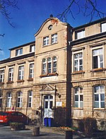
Die heutige Straße An der Schule geht auf einen  alten Fußweg von Sporbitz zur Großzschachwitzer Firma Kelle & Hildebrandt zurück, der in Gemeindeunterlagen von 1904 als
„Ordonanzsteig“ bezeichnet wird. Da dieser Weg an der Schule des Ortes begann, erhielt er wenig später den Namen  Schulstraße.

Mit der Vereinigung der Gemeinden Großzschachwitz und Luga 1922 erfolgte die Umbenennung in
Lugaer Straße. Nach der Eingemeindung zu Dresden wurde sie am 30. September 1953 in An der Schule umbenannt.Das frühere [Schulhaus](../../../ost/sporbitz/) diente zuletzt als Außenstelle des Beruflichen Schulzentrums für Agrarwirtschaft und Ernährung und wurde Ende Juli 2009 geschlossen.

## Bierweg

Der Bierweg ist Teil eines alten Verbindungsweges zwischen Großzschachwitz und dem benachbarten Großluga. Wie fast alle
Dörfer unterlag auch Großzschachwitz einst dem “Bierzwang”, wonach die Einwohner ihr Bier nur von bestimmten Brauereien
der Umgebung beziehen durften. Von dort wurde das Bier dann in den örtlichen Gasthof bzw. in die Bauernhöfe gebracht, die sich am Reiheschank beteiligen durften.

## Bosewitzer Straße

Die heutige Bosewitzer Straße wurde um 1870 zur Erschließung eines neuen Industriegebietes angelegt. Zu den hier ansässigen Betrieben gehörte u.a. die Chemische Fabrik für Schamottewaren und Mosaikplatten des Unternehmers Otto Kauffmann sowie die Eisengießerei [Kelle & Hildebrandt](../../../Sudost/Grossluga/Kelle & Hildebrandt/kelle_hildebrandt.html). Ursprünglich wurde sie deshalb bis zur Einmündung der Werkstraße Otto-Kauffmann-Straße, im Restabschnitt Hildebrandtstraße genannt. Nach der Eingemeindung wechselte der Straßenname in Bosewitzer Straße. Namensgeber ist die kleine Siedlung Bosewitz, welche heute als Ortsteil zu Dohna gehört. Die Villa Bosewitzer Straße 11 steht, einschließlich der zugehörigen Gartenanlage, unter Denkmalschutz.

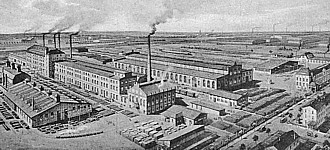

_**Foto:** Blick über das Areal der Firma Kelle & Hildebrandt_

## Försterlingstraße

Die Försterlingstraße entstand 1897 in der Nähe der Flurgrenze zu Niedersedlitz zur Erschließung eines hier gelegenen Industriegebietes. Initiator war der Kaufmann Louis Albin Simon (1843-1930), der sich als Mitglied des Großzschachwitzer Gemeinderates sehr für die Belange seines Heimatortes einsetzte. Ihm zu Ehren erfolgte zwei Jahre später die offizielle Namensgebung Simonstraße für die bisherige Planstraße F. In einem Schreiben vom 11. April 1899 begründet der Rat seine Entscheidung “in Anbetracht der Beitragung großer Opfer, welche Sie der Gemeinde gebracht haben und somit das Aufblühen derselben zu fördern”.

Am 16. Oktober 1945 erfolgte die Umbenennung der Simonstraße in Rudolf-Breitscheid-Straße. Mit dieser Bezeichnung sollte der 1944 im KZ Buchenwald bei einem Luftangriff ums Leben gekommene sozialdemokratische Politiker Rudolf Breitscheid geehrt werden. Da es jedoch in Dresden bereits eine Breitscheidstraße gab, machte sich 1953 eine erneute
Umbenennung in Försterlingstraße erforderlich. Der Name erinnert an den sächsischen Arbeiterführer Emil Försterling (1827-1872). Försterling gründete gemeinsam mit Robert Lässig 1863 den Dresdner Ortsverein des Allgemeinen Deutschen Arbeitervereins, Vorläufer der SPD. Mit Beschluss vom 8. Februar 1956 erfolgte auch die Zuordnung des auf Niedersedlitzer Flur gelegenen Straßenabschnitts. Die nach dem Ersten Weltkrieg ausgebaute frühere Planstraße XXIV hieß bis 1945 Königstraße, danach nach dem früheren Außenminister der Weimarer Republik Rathenaustraße.

Zu den älteren Gebäuden der Försterlingstraße gehören einige Villen und Mietshäuser aus der Zeit vor dem Ersten Weltkrieg. Bemerkenswert ist das unter Denkmalschutz stehende frühere Wohnhaus des Fabrikanten Carl August Postler von 1912 mit Jugendstilelementen sowie Bleiverglasungen (Nr. 24). Postler war Inhaber einer Chemischen Fabrik für Gummi-, Asbest- und Kautschuk-Produkte, die unter dem Markennamen Postlerit verkauft wurden. Zwischen 1978 und 1981 wurde östlich der Försterlingstraße ein Neubaugebiet mit ca. 2100 Wohnungen errichtet. In diesem Zusammenhang entstanden auch einige neue Straßen, die ihre Namen nach Orten der Sächsischen Schweiz erhielten.

## Fritz-Schreiter-Straße

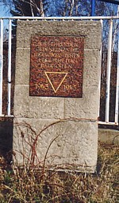Die Fritz-Schreiter-Straße verbindet den alten Sporbitzer Dorfkern mit dem S-Bahn-Haltepunkt Zschachwitz und entstand im Zusammenhang mit der Anlage des Industriegebietes Zschachwitz. Zugleich war sie Teil eines alten Kommunikationsweges nach Gommern (Heidenau) und wurde deshalb Gommernsche Straße genannt. Erstmals ist diese Bezeichnung im Adressbuch 1921 erwähnt. Auf Weisung des Innenministerius und des Bürgermeisters erfolgte am 7. Oktober 1936 die Umbenennung in Killingerstraße. Manfred von Killinger (1886-1944 ) gehörte seit 1919 verschiedenen rechtsradikalen Organisationen an und war ab 1929 Chef der sächsischen SA. 1933 wurde er zum Ministerpräsidenten Sachsen ernannt hatte dieses Amt bis zur Absetzung 1935 nach innerparteilichen Konflikten inne.

Unmittelbar nach Kriegsende wurde die Killingerstraße bereits am 16. Mai 1945 wieder in Gommersche Straße zurück benannt. Am 28. Oktober 1946 erhielt sie auf Beschluss des Gemeindekollegiums ihren Namen nach dem antifaschistischen Widerstandskämpfer Fritz Schreiter (1892-1944), der zwischen 1924 und 1930 Bürgermeister von Zschachwitz war. Als Mitglied der KPD war er später im Kampf gegen das Naziregime aktiv und wurde 1944 wegen Hochverrats hingerichtet. An ihn und weitere ermordete Widerstandskämpfer erinnert ein Gedenkstein _(Foto)._

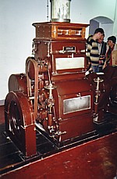Mühlenbau Seck:
Die Firma wurde 1873 von den Brüdern Christian und Emil Seck gegründet, die zunächst als Verkäufer von Mahltechnik tätig waren, sich jedoch schon bald der Entwicklung
eigener Maschinen widmeten. Als Maschinenfabrik für Mühlenbetrieb und Schälmaschinen stellte das Werk u.a. hochmoderne Walzenstühle her, die die Mühlentechnik revolutionierten. Bereits um
1900 waren über 500 Angestellte im Zschachwitzer Werk tätig. Das Foto (links) zeigt einen in der Firma gefertigten Walzenstuhl in der noch heute betriebenen Miltitzer Mühle.

Das international bedeutsame Familienunternehmen wurde nach dem Ersten Weltkrieg mit einigen anderen Herstellern der Branche in eine Aktiengesellschaft umgewandelt und firmierte nun unter
dem Kurznamen MIAG (Mühlenbau- und Industrie AG). Stammsitz war zunächst Frankfurt am Main, ab 1930 Braunschweig. Während des Zweiten Weltkrieges wurden im Zschachwitzer Werk
hunderte jüdische Zwangsarbeiter in der Rüstungsproduktion beschäftigt, an die ein Gedenkstein am Werkseingang erinnert. Der 1946 demontierte und drei Jahre verstaatlichte VEB Mühlenbau
Dresden-Zschachwitz setzte auch zu DDR-Zeiten die Tradition des Betriebes als Hersteller moderner technischer Anlagen für Großmühlen fort. Nach 1990 wurde das Unternehmen als Wirth Mühlenbau GmbH bzw. Dr. Scholz GmbH privatisiert.

Der heute Grasweg genannte Weg bildet die Verlängerung der Großzschachwitzer Straße und verbindet diese mit der Pirnaer Landstraße. 1935 wurde er erstmals benannt. Der gewählte Name Hans-Schemm-Weg erinnerte an den nationalsozialistischen Politiker Hans Schemm, Gauleiter der bayrischen Ostmark. Bereits am 16. Mai 1945 wurde er nach der hier befindlichen alten Großzschachwitzer Mühle in Mühlweg umbenannt. Da es in Dresden bereits einen gleichnamigen Weg gab, erfolgte am 30. September 1953 die Umbenennung in Grasweg.

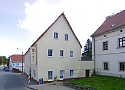Großzschachwitzer Mühle: Die frühere Wassermühle wurde 1547 erstmals als "Mühle am Lockwitzbach" erwähnt und später als "Alte Mühle" bezeichnet. Um 1600 besaß sie ein oberschlächtiges Mühlrad und verfügte über zwei Mahlgänge und einen Schneidegang. Bis 1905 wurde sie noch als Getreidemühle genutzt. Drei Jahre später erfolgte im Zusammenhang mit dem Ausbau der Bahnhofstraße der Abbruch der meisten Nebengebäude und die Verfüllung des Mühlgrabens. Das erhaltene Hauptgebäude Bahnhofstraße 70 wird heute von der nach eigenen Angaben ältesten Dresdner Bäckerei, der "Dresdner Mühlenbäckerei" genutzt.

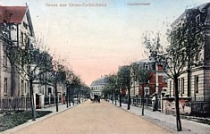Die 1907 erstmals erwähnte heutige Jonsdorfer Straße erhielt zuerst nach der sächsischen Königin Carola den Namen Carolastraße _(Foto)_. 1922 erfolgte die Umbenennung in Reichsstraße. Da dieser Name nach dem Zweiten Weltkrieg als unzeitgemäß galt, beschloss man am 30. September 1953 die Umbenennung in Jonsdorfer Straße. Der Kurort Jonsdorf befindet sich in der Nähe von Zittau im Zittauer Gebirge.

Am 4. Oktober 1983 wurde an der Jonsdorfer Straße 20 das "Feierabend- und Pflegeheim Zschachwitz" eröffnet. Insgesamt standen dort 557 Plätze, davon 300 Pflegeplätze zur Vefügung. Heute wird das Heim als AWO-Seniorenzentrum "Prof. Rainer Fetscher" betrieben.

## Kameradenweg

Der Kameradenweg wurde als Erschließungsstraße im Zusammenhang mit dem Bau einer kleinen Wohnsiedlung für die
Arbeiter der nahegelegenen Industriebetriebe angelegt. Auf Beschluss des Gemeinderates von Zschachwitz erhielt er im Oktober 1935 seinen Namen, um so das Gemeinschaftsgefühl der Arbeiter zu unterstreichen.

## Ludwig-Kugelmann-Straße

Die Straße befindet sich am alten Dorfkern von Großzschachwitz und wurde ab 1899 zunächst Bismarckstraße genannt. 1924 erfolgte die Umbenennung in Karl-Marx-Straße. Mit der Machtübernahme der Nationalsozialisten wurde diese Bezeichnung 1933 jedoch wieder rückgängig gemacht. Erst 1945 entschied man sich, die Bismarckstraße erneut in Karl-Marx-Straße umzubenennen. Da es jedoch bereits in der 1950 eingemeindeten Stadt Klotzsche eine Karl-Marx-Straße gab, erhielt sie 1953 ihren heutigen Namen nach dem Arzt Ludwig Kugelmann (1830-1902), der mit Karl Marx und Friedrich Engels befreundet war und sich unter deren Einfluss der kommunistischen Arbeiterbewegung anschloss. Bereits 1848 hatte er sich an der Bürgerlich-demokratischen Revolution beteiligt und war später Gründer eines sozialdemokratischen Turnvereins.

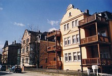

**_Foto:_** _Blick in die Ludwig-Kugelmann-Straße_

__

Die frühere Niedersedlitzer Straße geht auf einen alten, erstmals 1887 benannten Verbindungsweg nach Niedersedlitz zurück.
Zugleich war dieser die Verbindung zum dort gelegenen Bahnhof an der Bahnstrecke Dresden - Pirna. Der nördlich der
Pirnaer Landstraße gelegene Abschnitt im alten Dorfkern wurde dagegen bis 1908 Dorfstraße genannt. Mit Machtergreifung
der Nationalsozialisten erhielt die Niedersedlitzer Straße 1933 den Namen Killingerstraße. Manfred von Killinger war  SA-
Obergruppenführer und Ministerpräsident von Sachsen. Im Zuge innerparteilicher Auseinandersetzung beschloss der Bürgermeister des Ortes am 11. Juli 1936, die Killingerstraße in Rudolf-Heß-Straße umzubenennen. Rudolf Heß gehörte als
Stellvertreter Hitlers zu den einflussreichsten Politikern seiner Zeit. Nachdem Heß 1941 mit einem Flugzeug nach England
geflogen war, um dort hinter dem Rücken Hitlers Friedensverhandlungen zu führen, wurde der Name am 30. Mai 1941 erneut geändert und die Straße der bereits in Niedersedlitz so benannten [Bahnhofstraße](../../../ost/niedersedlitz/strassen_niedersedlitz/) zugeschlagen.

## [Pirnaer Landstraße](../../../ost/dobritz/strassen_dobritz/pirnaer_landstrasse/)

## Rosenthaler Straße

Die heute nach einem kleinen Ort in der Sächsischen Schweiz Rosenthaler Straße genannte Straße im Ortskern von Großzschachwitz
hieß bis 1990 nach einem Revolutionär und Lyriker Eugen-Leviné-Straße. Leviné (1883-1919) nahm 1905 an der russischen Revolution teil und lebte später in Deutschland, wo er sich der linken Arbeiterbewegung anschloss und
Mitglied des Spartakusbundes um Karl Liebknecht wurde. Als Vorsitzender des Exekutivkomitees der Münchner Räterepublik wurde Eugen Leviné 1919 verhaftet und wegen Hochverrats erschossen.

Die Gebäude an der Rosenthaler Straße entstanden kurz vor Beginn des Ersten Weltkrieges im Auftrag der Baugenossenschaft Zschachwitz GmbH. Mit der kleinen Siedlung knüpften die Bauherren an den Gedanken der seinerzeit
populären Gartenstadtbewegung an.

## Rubinsteinstraße

Die Rubinsteinstraße, eine kurze Seitenstraße der Försterlingstraße, verdankt ihren Namen dem russischen Psychologen
Sergej Rubinstein (1889-1960). Rubinstein befasste sich u.a. mit der Psychologie des Denkens, der Sprache und des Gedächtnisses.

## Schweizstraße

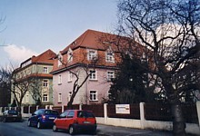Die Schweizstraße wurde nach dem Ersten Weltkrieg im Zusammenhang mit dem Bau neuer Wohnhäuser angelegt. Die Namensgebung erinnert an die im 19. Jahrhundert aufgekommene Bezeichnung “Sächsische Schweiz” für das Elbsandsteingebirge. Der Begriff wurde von den romantischen Malern Anton Graff und Adrian Zingg geprägt, die sich in der Felsenwelt an ihre Schweizer Heimat erinnert fühlten. Einer Tradition folgend erhielten mehrere Großzschachwitzer Straßen später Namen nach Orten in diesem Gebiet. Im Haus Schweizstraße 8 befindet sich seit 1901 die Familiengaststätte “Reichsapfel”.

## Walter-Peters-Straße

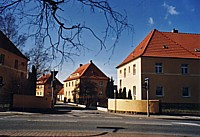Die kleine Straße in der Nähe der alten Sporbitzer Schule erhielt ihren Namen nach dem
Maschinenführer und antifaschistischen Widerstandskämpfer Walter Peters, welcher 1944 von den Nationalsozialisten ermordet wurde. Die Wohnhäuser entstanden in den Zwanziger Jahren.

[Großzschachwitz auf OpenStreetMap](https://www.openstreetmap.org/search?query=Dresden+Gro%C3%9Fzschachwitz)

* * *

 \[ [Home](../../../index.html)\] \[ [Nord](../../../nord/)\] \[ [Nordwest](../../../nordwest/)\] \[ [Neustadt](../../../neustadt/)\] \[ [Nordost](../../../nordost/)\] \[ [West](../../../west/)\] \[ [Zentrum](../../../zentrum/)\] \[ [Südwest](../../../sudwest/)\] \[ [Süd](../../../sud/)\] \[ [Südost](../../../sudost/)\] \[ [Ost](../../../ost/)\] \[ [Register](../../../Register/register.html)\] \[ [Kontakt](../../../Kontakt/kontakt.html)\] \[ [Impressum](../../../impressum/)\]
