* * *

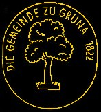

**Gemeindesiegel von Gruna**

* * *

**Bildungseinrichtungen**

**in Gruna:**

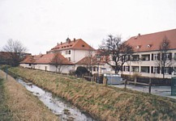Der heutige Stadtteil Gruna wurde im Mittelalter von deutschen Siedlern gegründet und 1370 als Grunow erstmals erwähnt. Der Name bedeutet “Ort in der grünen Aue” und bildete ein Platzdorf mit Block- und Streifenflur. Die ausgedehnte Dorfflur von ca. 175 Hektar Acker- und Wiesenflächen erstreckte sich zwischen der heutigen Winterbergstraße bis zum Striesener Friedhof sowie zwischen Hepkeplatz und Enderstraße. Begrenzt wurde das Gebiet von zwei alten Elbarmen, die später als Gartenland dienten. Ein Teil dieses tiefergelegenen Geländes wird bis heute vom [Landgraben](../../ost/striesen/landgraben/) durchflossen _(Foto)_, der bereits 1309 erwähnt ist und als Entwässerungsgraben, Wasserreservoir und natürlicher Schutz vor feindlichen Übergriffen genutzt wurde.

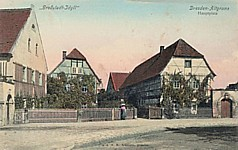Ursprünglich unterstand Gruna dem Domstift zu Meißen, kam jedoch im Zuge der Reformation an das Religionsamt bzw. das kurfürstliche Amt Dresden. Erst im Zuge der Landgemeindeordnung des 19. Jahrhunderts wurde diese Unterstellung zugunsten moderner Verwaltungsformen aufgehoben. Wichtigster Erwerbszweig blieb jahrhundertelang die Landwirtschaft. Später kamen noch Gartenbau und zwei Ziegeleien hinzu. Zudem betrieben einige Einwohner im Nebenerwerb Spinnerei und Strohflechterei. Kirchlich gehörte Gruna zur Dresdner Kreuzkirche. Veränderungen der Dorfflur erfolgten 1547 durch die Einbeziehung der Felder des untergegangenen Dorfes [Praschütz](../../ost/gruna/neugruna/) sowie die 1678 vom Kurfürsten erzwungene Abtretung von Flächen zugunsten des Großen Gartens. 1716 mussten weitere Teile der Fluren zur Anlage der kurfürstlichen Fasanerie aufgegeben werden. 1890 erfolgte die Neugestaltung dieser "Grunaer Anlagen" mit Schaffung des Neuteichs und weiterer Erholungsflächen.

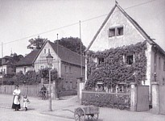Wichtigste Verkehrsverbindung aus der Stadt in Richtung Osten war die Pirnaische Landstraße, deren Verlauf sich noch heute teilweise in der Grunaer Straße und der [Bodenbacher Straße](../../ost/gruna/strassen_gruna/bodenbacher_strasse/) erhalten hat. Ein mittelalterliches Sühnekreuz inmitten des Großen Gartens erinnert noch an die einstige Straßenführung. Gruna war für diesen Verkehrsweg von besonderer Bedeutung, da sich hier eine schon 1439 erwähnte “brucke bie Grunow” befand, die den Landgraben überquerte. Zur Betreuung der Fuhrleute entstand in ihrer Nähe eine Schmiede, die später als Schank- und Beherbergungsstätte diente und noch bis 1945 unter dem Namen [“Grüne Wiese”](../../ost/gruna/strassen_gruna/bodenbacher_strasse/grune_wiese/) bestand.

Schwer betroffen war das Dorf Gruna in den Napoleonischen Kriegen, in deren Folge der Ort am 11. Oktober 1813 niederbrannte. Für den Wiederaufbau der Gehöfte fanden Steine der früheren Umfassungsmauer des Großen Gartens Verwendung. Dennoch blieb Gruna weiterhin ein nur aus wenigen Gebäude rund um den Dorfplatz (Altgruna) und entlang der [Rosenbergstraße](../../ost/gruna/strassen_gruna/rosenbergstrasse/) bestehender Ort. Erst in der zweiten Hälfte des 19. Jahrhunderts entwickelte sich dieser zum beliebten Ausflugsziel der Dresdner Bevölkerung, die gern die hier gelegenen Ausflugsgaststätten besuchten. Zeitweise wurde von der Gemeinde sogar eine Art “Kurtaxe” von 10 Groschen zugunsten der Gemeindearmenkasse erhoben.

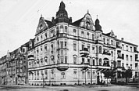Begünstigt wurde diese Entwicklung durch die Aufhebung des Bebauungsverbotes in der Umgebung des Großen Gartens 1871 und die 1873 eröffnete Pferdebahnlinie vom Neumarkt bis zum Dorf. 1878 erließ der Gemeinderat einen später nur teilweise umgesetzten Bebauungsplan, der die Abtragung des Dorfkerns und die Anlage neuer breiter Straßen in weiten Teilen der Ortsflur vorsah. Nicht nur Sommergäste ließen sich nun in Gruna nieder, auch die ständige Einwohnerzahl wuchs innerhalb weniger Jahre deutlich an. Allerdings blieben Villenbauten, wie das [Parkhaus](../../ost/gruna/rothermundpark/) von Julius Rothermundt die Ausnahme. Stattdessen dominierten Mietshäuser **_(Foto:_** _Zwingli- / Leitmeritzer Straße - 1945 zerstört)_ für die Arbeiter der beiden Ziegeleien sowie der in den Nachbarorten entstandenen Industriebetriebe. Abseits des Dorfkerns entstand ab 1876 im ehemaligen Tännicht der Ortsteil [Neugruna](../../ost/gruna/neugruna/) im Anschluss an die Blasewitzer Villenviertel. 1892 wurde an der Bodenbacher Straße die [Thomaskirche](../../ost/gruna/thomaskirche/) eingeweiht.

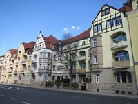

**_Foto:_** _Wohnhäuser an der Schneebergstraße_

Erst nach dem Ersten Weltkrieg verlor der am 1. April 1901 nach Dresden eingemeindete Stadtteil endgültig sein ländliches Bild. Zwar waren bereits 1886 die Lehmgruben der westlich des Dorfkerns gelegenen Ziegelei mit dem Bauschutt der zugunsten der König-Johann-Straße abgebrochenen Badergasse verfüllt worden. Trotzdem wurden noch um 1900 fast 75 % der Ortsflur landwirtschaftlich genutzt.

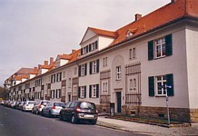1925 begannen der gemeinnützige Bauverein Gartenheim und der Dresdner Spar- und Bauverein auf einer bereits zum Ende des Ersten Weltkrieg erworbenen Fläche zwischen Junghans-, Hepke-, Bärensteiner Straße und Frauensteiner Platz mit der Errichtung von insgesamt 1.400 Wohnungen. Die Pläne für diese Siedlung stammen von Paul Beck und Stadtbaudirektor Max Oertel, die die Häuser im Stile einer Gartenstadt zwischen Junghansstraße _(Foto rechts)_ und Landgraben projektierten. Das in sich geschlossene Wohnviertel besitzt neben einer Mittelachse (Gartenheimallee) drei zentrale Plätze sowie großzügige Gartenanlagen für die Bewohner. Ursprünglich gehörten noch 13 Holzhäuser zur Siedlung, welche jedoch 1945 den Bomben zum Opfer fielen. Seit 1969 steht die gesamte Anlage unter Denkmalschutz. Weitere Wohnviertel entstanden zwischen 1924 und 1928 an der Haenel-Clauß- und der Hepkestraße sowie zwischen 1925 und 1932 rund um den Falkensteinplatz. Trotz dieses Wandels gab es noch bis 1945 drei Bauernhöfe im Dorf.

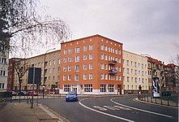Durch die Luftangriffe im Februar 1945 wurde auch Gruna schwer in Mitleidenschaft gezogen. Zu den zerstörten Gebäuden gehörten die meisten Gehöfte im Dorfkern, das Parkhaus Rothermund sowie die Ausflugsgaststätte “Grüne Wiese”. Auch in der Gartenheimsiedlung gab es schwere Schäden. Die ebenfalls schwer beschädigten Wohnhäuser um den Falkensteinplatz _(Foto: Ecke Schneebergstraße)_ wurden bereits ab 1949 wieder aufgebaut. 1975/77 wurde die Umgestaltung des Stadtteils mit einem Neubaugebiet an der Zwinglistraße fortgesetzt. Vorrangig entstanden an Stelle des früheren Dorfkerns und auf ehemaligem Gärtnereigelände an der Bodenbacher Straße fünfgeschossige Plattenbauten, ergänzt um einige Hochhäuser und eine moderne Fußgängerzone mit Läden und Gaststätten. Nach 1990 wurden die verbliebenen Baulücken mit weiteren Wohn- und Geschäftshäusern geschlossen. 1999 folgte der Umbau des wichtigen Verkehrsknotenpunktes Zwinglistraße zum neuen Stadtteilzentrum.

**Schulen in Gruna:**

Dorfschule: Ursprünglich wurden die Kinder des Ortes, wie in den meisten Dörfern, in den Bauernstuben der Einwohner unterrichtet. Ab 1838 besuchten sie die Schule im benachbarten Striesen. Ihr erstes Schulhaus erhielt die Gemeinde 1865, als am 19. Mai an der Bodenbacher Straße 29 ein kleines Schulgebäude übergeben werden konnte. Da dieses bald zu klein wurde, wurde es 1884 um zwei Klassenräume erweitert und nach der Eingemeindung Grunas als 31. Bezirksschule bezeichnet. Zusätzlich mussten um 1900 einige Baracken aufgestellt werden, um die stark angewachsene Schülerzahl bewältigen zu können. Nach der Einweihung der neuen Schule an der Junghansstraße 1914 endete der Schulbetrieb. Das Gebäude diente nun zunächst städtischen Verwaltungszwecken und als Sparkasse, später als kommunales Kinderheim. 1945 fiel das Haus den Bomben zum Opfer.

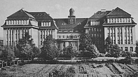Gymnasium Gruna: Da die bisherige Schule durch den starken Anstieg der Bevölkerungszahl nach 1900 nicht mehr den Anforderungen genügte, wurde 1912 der Dresdner Stadtbaurat Hans Erlwein mit dem Entwurf für ein neues Schulhaus beauftragt. Der moderne Bau an der Junghansstraße 15 konnte am 21. April 1914 eingeweiht werden und war letzte architektonische Schöpfung des Stadtbaurates vor seinem Tod _(Foto)_. Ursprünglich war diese Schule in einen Jungen- und einen Mädchentrakt geteilt und bot Platz für bis zu 40 Schulklassen mit ca. 1.500 Kindern. Nutzer waren die 31. Bezirksschule (ab 1919 31. Volksschule), die Knabenklassen der X. Bürgerschule und die 1. Mädchenfortbildungsschule. Während der Weimarer Republik entstanden die ersten gemischten Klassen, außerdem wurden verschiedene Reformschulprojekte erprobt. Neben den Unterrichtsräumen gab es auch zwei Turnhallen, eine Lehrküche und ein Brausebad für die Schüler.

Am 14. Juni 1935 erhielt die bisherige 31. Volksschule den Namen Hans-Schemm-Schule. Schemm gehörte seit 1923 der NSDAP an und gründete 1929 den NS-Lehrerbund. Nach Machtübernahme der Nationalsozialisten wurde er bayrischer Kultusminister und kam 1935 bei einem Flugzeugabsturz ums Leben. Drei Jahre später richtete man im Schulhaus ein “Heimatzimmer” als Schul- und Ortsmuseum ein. Beim Luftangriff entstanden zum Glück nur geringe Schäden, so dass der Unterricht bereits am 1. Oktober 1945 wieder aufgenommen werden konnte.

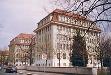 Da die seitdem als 31. Grundschule bezeichnete Schule zu den größten in Dresden gehörte, beschloss der Rat der Stadt Dresden 1956, die Einrichtung in zwei rechtlich selbständige Einheiten zu trennen. Fortan beherbergte der Nordflügel des Gebäudes die 5. POS “Kurt Schlosser”, der Südflügel die 31. POS ”Georgi Dimitroff”. Mit der in den 1960er Jahren eingeführten Namensgebung sollte an den von den Nazis hingerichteten Widerstandskämpfer und “Roten Bergsteiger” Kurt Schlosser und an den durch sein Auftreten beim Reichstagsbrandprozess bekannt gewordenen bulgarischen Kommunisten Georgi Dimitroff erinnert werden. 1986/87 erfolgte eine grundlegende Sanierung des Schulhauses. Seit 1992 befindet sich hier das Gymnasium Dresden-Gruna, welches 2004 den Namen “Hans-Erlwein-Gymnasium” erhielt.

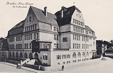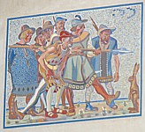Schule Neugruna: Die Kinder des Stadtteils besuchten zunächst die Blasewitzer Schule, bevor 1876 der Unternehmer Joseph Traube auf seinem Grundstück an der Tauscherstraße 21 Räumlichkeiten zur Verfügung stellte. Allerdings bereitete das schnelle Bevölkerungswachstum schon bald Probleme, so dass weitere Räume in verschiedenen Gebäuden angemietet werden mussten. 1907-1909 wurde deshalb von Hans Erlwein ein moderner Schulneubau an der Hofmannstraße 34 errichtet und am 19. April 1909 eingeweiht. Der repräsentative Gebäudekomplex passt sich architektonisch der umgebenden Villenbebauung an und wurde von bekannten Künstlern gestaltet. So stammt der hölzerne Erker des Direktorenzimmers von Karl Groß. Das Glasmosaik "Der Wunderbaum" am Giebel wurde von Paul Rößler gestaltet, die beiden Plastiken des Dudelsackpfeifers und eines Wasserhirschs im Garten von Georg Wrba. Schöpfer des Mosaikbildes an der Fassade mit einer Szene des Märchens "Die sieben Schwaben" war Paul Perks _(Bild rechts)_.

Ab 1919 nutzte die 32. Volksschule das Schulhaus. Nach 1945 wurde diese in die 32. Grundschule, 1958 in eine Polytechnische Oberschule umgewandelt. Seit dem 22. April 1966 trug sie den Namen 32. POS “Paul Gruner”, benannt nach einem antifaschistischen Widerstandskämpfer, der viele Jahre bei der Dresdner Straßenbahn tätig war. 2004 wurde sie wegen des an der Fassade befindlichen Märchenmosaiks in “Sieben-Schwaben-Schule” umbenannt und bis 2016 als Grund- und Oberschule genutzt. Mit Fertigstellung des neuen Tolkewitzer Schulcampus an der Wehlener Straße wird künftig nur noch die 32. Grundschule im Gebäude verbleiben.

[_Weiterführende Literatur und Quellen_](../../impressum/quellenverzeichnis/)

 \[ [Home](../../index.html)\] \[ [Nord](../../nord/)\] \[ [Nordwest](../../nordwest/)\] \[ [Neustadt](../../neustadt/)\] \[ [Nordost](../../nordost/)\] \[ [West](../../west/)\] \[ [Zentrum](../../zentrum/)\] \[ [Südwest](../../sudwest/)\] \[ [Süd](../../sud/)\]
 \[ [Südost](../../sudost/)\] \[ [Ost](../../ost/)\] \[ [Register](../../Register/register.html)\] \[ [Kontakt](../../Kontakt/kontakt.html)\] \[ [Impressum](../../impressum/)\]
