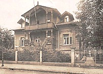
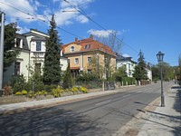

* * *

* * *

An Stelle des heutigen Stadtteils Neugruna lag im Mittelalter das Dorf Praschütz, welches 1307 erstmals als Praschycz urkundlich erwähnt wurde. Der slawische Ortsname bedeutet “Leute eines Pravek” und weist auf den Ortsgründer bzw. Sippenältesten hin. Der kleine Ort, der zum Besitz des Klosters Altzella gehörte, lag vermutlich in der Nähe der Kreuzung Ludwig-Hartmann-/ Schandauer Straße. Unweit davon existierte das Vorwerk Grünpraschütz. Beide Siedlungen sind bereits 1310 nur noch als Wüstungen genannt, wobei die Gründe des Untergangs unklar sind. Möglicherweise waren die ungünstigen Bodenverhältnisse oder die Hochwassergefahr Gründe für die Aufgabe der Dörfer. Andere Quellen berichten von einem räuberischen Überfall auf die Bewohner, welche den Ort niederbrannten. Die Fluren von Praschütz wurden nun von den Bewohnern der umliegenden Orte als Bauernbusch genutzt. 1547 erwarben Grunaer Bauern einen Großteil der Flächen und bezeichneten ihn fortan als Grunaer Tännicht. Zusammen mit dem benachbarten Blasewitzer Tännicht war das ausgedehnte Waldgebiet Jagdrevier der Wettiner.

Erst nach Verlegung des [Landgrabens](../../../ost/striesen/landgraben/) in dieses Gebiet um 1870 begannen sich Bauunternehmer für das Areal zu interessieren. Zu ihnen gehörte der wohlhabende Musikkritiker Ludwig Hartmann, der gemeinsam mit anderen Interessenten das Grunaer Tännicht erwarb und in Waldparzellen aufteilte. 1876 entstand die Baugenossenschaft “Daheim”, die zunächst fünf Erschließungsstraßen anlegte und dann das Areal als Bauland verkaufte. Neben den regelmäßig verlaufenden neuen Straßen wurde 1896 auch der alte Ziegelweg zwischen Blasewitz und Seidnitz ausgebaut und erhielt den Namen [Altenberger Straße](../../../ost/striesen/strassen_striesen/). Zur besseren Vermarktung des Wohngebietes planten die Investoren, dieses "Albertpark" zu nennen, was die Behörden jedoch ablehnten. Auch die Namen "Wilhelmshain" bzw. "Elbau" setzten sich nicht durch, so dass man bei der Bezeichnung Neugruna blieb. Das Bild zeigt eines der für Neugruna typischen Häuser (Gustav-Freytag-Straße 6).

In offener Bauweise entstanden bis zur Jahrhundertwende mehrgeschossige Wohnhäuser, Villen und Landhäuser die im Anschluss an Arbeiterfamilien vermietet wurden _( **Foto rechts**: Ludwig-Hartmann-Straße)_. Bevorzugt waren diese in der Striesener Foto- und Zigarettenindustrie tätig. Die Verwaltung des neuen Stadtviertels übernahm der Altgrunaer Gemeinderat. Die Kinder besuchten zunächst die Blasewitzer Schule bzw. eine Schulstube im Haus Tauscherstraße 21 (heute Nr. 5), bevor 1876 ein eigenes [Schulhaus](../../../ost/gruna/) auf der Hofmannstraße eingeweiht werden konnte. Heute befindet sich auf diesem Grundstück der 1907/09 errichtete Neubau von Hans Erlwein (32. Grundschule).

 \[ [Home](../../../index.html)\] \[ [Nord](../../../nord/)\] \[ [Nordwest](../../../nordwest/)\] \[ [Neustadt](../../../neustadt/)\] \[ [Nordost](../../../nordost/)\] \[ [West](../../../west/)\] \[ [Zentrum](../../../zentrum/)\] \[ [Südwest](../../../sudwest/)\] \[ [Süd](../../../sud/)\] \[ [Südost](../../../sudost/)\] \[ [Ost](../../../ost/)\] \[ [Register](../../../Register/register.html)\] \[ [Kontakt](../../../Kontakt/kontakt.html)\] \[ [Impressum](../../../impressum/)\]
