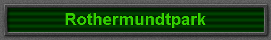
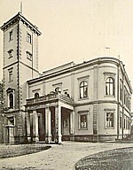
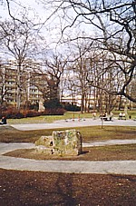
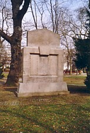

* * *

* * *

* * *

Der Rothermundtpark geht auf das frühere Landhaus des russischen Kaufmannes Julius Ludwig Rothermundt zurück. Rothermundt, gebürtiger Russe und Inhaber mehrerer Fabriken, besaß im benachbarten Blasewitz eine repräsentative Villa und erwarb um 1875 die zuletzt als Gasthaus [“Grüne Wiese”](../../../ost/gruna/strassen_gruna/bodenbacher_strasse/grune_wiese/) genutzte Grunaer Schmiede. Nach Abriss dieses Gebäudes ließ er sich auf dem Grundstück ein auch als “Parkhaus” bezeichnetes schlossartiges Landhaus mit viereckigem Turm errichten _(Foto)_. Um das Haus entstand eine ausgedehnte Parkanlage, die ab 1914 auch der Öffentlichkeit zugänglich war. Rothermundts Landhaus gehörte zu den wenigen Villenbauten in Gruna und fiel am 13. Februar 1945 dem Luftangriff zum Opfer. Zuvor hatte die örtliche NSDAP-Ortsgruppe die Villa ab 1935 als Geschäftsstelle genutzt.

Nach Abtragung der Ruine 1974 blieb der um das Gebäude gelegene Rothermundtpark erhalten und wird von den Anwohnern bis heute als Volkspark genutzt. Im Zusammenhang mit dem Bau des Neubaugebietes Gruna gestaltete man die Parkanlage neu und legte 1982 einen Kinderspielplatz an. Zu den noch erhaltenen Sachzeugen der Entstehungszeit gehört der schmale Fußgängersteg über den Landgraben, der zu einem heute nicht mehr vorhandenen Pavillon an der Parkmauer führte. Pavillon und Steg waren Anfang des 20. Jahrhunderts Motiv eines Gemäldes von Erich Heckel, der der Künstlergemeinschaft “Brücke” angehörte. Unweit davon befindet sich ein Denkmal zur Erinnerung an die Gefallenen des Ersten Weltkriegs.

**_Fotos:_** _Im Rothermundtpark, rechts das Denkmal für die Gefallenen des Ersten Weltkriegs_

* * *

 \[ [Nord](../../../nord/)\] \[ [Nordwest](../../../nordwest/)\] \[ [Neustadt](../../../neustadt/)\] \[ [Nordost](../../../nordost/)\]
 \[ [West](../../../west/)\] \[ [Zentrum](../../../zentrum/)\] \[ [Südwest](../../../sudwest/)\] \[ [Süd](../../../sud/)\] \[ [Südost](../../../sudost/)\] \[ [Ost](../../../ost/)\] \[ [Register](../../../Register/register.html)\] \[ [Kontakt](../../../Kontakt/kontakt.html)\] \[ [Impressum](../../../impressum/)\]
