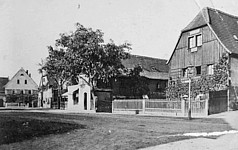Der bis 1974 von der Rosenbergstraße durchschnittene Platz trug vor der Eingemeindung Grunas den Namen Hauptplatz und war Zentrum des kleinen Dorfkerns. Bis 1945 befanden sich hier die Gehöfte des Ortes, von denen bis zur Zerstörung noch drei landwirtschaftlich wurden. Die Gebäude befanden sich ursprünglich im Besitz verschiedener Bauernfamilien und Gärtner, bevor nach 1900 auch kleinere Läden und Handwerksbetriebe einzogen. Läden gab es um 1910 u.a. im Haus Altgruna 4 (Viktualienhandlung) und in Nr. 5 (Bäckerei Zehl). Nr. 7 war bis 1903 Sitz der Gemeindeverwaltung und diente danach als Wohnhaus. Unmittelbar daneben stand das Spritzenhaus des Dorfes. Bereits 1875 hatte man den ursprünglich in der Mitte gelegenen Dorfteich zugeschüttet.

Die meisten Gebäude Altgrunas wurden 1945 beim Luftangriff schwer beschädigt und in der Nachkriegszeit abgebrochen. Letzte Reste verschwanden um 1975 beim Bau des Neubaugebietes. Im Anschluss entstanden hier moderne Wohngebäude, darunter einige Hochhäuser und eine zentrale Fußgängerachse mit Geschäften und Gaststätten.
In Erinnerung an den früheren Dorfkern übernahm der dabei entstandene zentrale Platz den Straßennamen Altgruna.

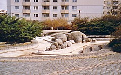Findlingsbrunnen: Im Zusammenhang mit der Neugestaltung des Areals des einstigen Dorfplatzes wurde 1980 eine Brunnenanlage begonnen, die jedoch erst nach 1990 vollendet werden konnte. Der von Eberhard Wolf entworfene Findlingsbrunnen _(Foto)_ ist mit eiszeitlichen Steinen gestaltet, die aus dem Braunkohletagebau Welzow stammen. Beim Bau wurde hier 1987 ein Münzschatz mit 188 Münzen gefunden, der vermutlich während der Napoleonzeit vergraben worden war.

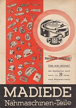Nr. 8 (Firma Madix): Der zu den größeren Grunaer Bauerngütern gehörende Dreiseithof mit großem Obstgarten und Feldern befand sich vor dem Ersten Weltkrieg im Besitz des Guts- und Ziegeleibesitzers Bruno E. Klemm, der an der Bodenbacher Straße die Baum- und Rosenschule [Hoyer & Klemm](../../../ost/gruna/strassen_gruna/bodenbacher_strasse/) mit ausgedehnten Rosenfeldern betrieb. Gegenüber des Gehöfts gab es zu dieser Zeit mit der Schankwirtschaft "Rosenschänke" eine von mehreren Alt-Grunaer Gaststätten. Nach dem Ersten Weltkrieg wurde das Gut verkauft und war nun Sitz der Firma Madix. Das von Max Dietze und Hermann Schäfer gegründete Unternehmen stellte feinmechanische Teile für die Nähmaschinenenindustrie her. Im Zweiten Weltkrieg war hier zudem die Luftschutzschule Dresden-Ost untergebracht.

Nach 1945 wurde der Betrieb enteignet und bis 1990 als VEB Madix weitergeführt. Zu DDR-Zeiten spezialisierte man sich auf die Produktion von hydraulischen Hebegeräten. Nach der Wende wurde der Betrieb zunächst in die Madix-Hydraulik GmbH überführt, wenig später jedoch stillgelegt. Bis zur Insolvenz 2007 führte die Pirnaer Hydraulikfirma WEBER KG Name und Produktion noch weiter. Das Grunaer Betriebsgelände (heute Rosenbergstraße 13) wird jetzt von der Vonovia genutzt.

Die Straße Am Anfang entstand 1920 im Zusammenhang mit dem Bau der Grunaer Gartenheimsiedlung. Die kleine Straße bildet den Auftakt der Wohnanlage und findet ihr Gegenstück mit der zwei Jahre später benannten Straße Am Ende. Die Gebäude entstanden zwischen 1924 und 1928 nach Plänen des Architekten Paul Beck und des Stadtbaudirektors Max Oertel. Zwischen den Doppel- und Reihenhäusern geben Gärten und öffentliche Grünflächen der Siedlung ihr Bild. Als künstlerischer Schmuck wurde 1922 Am Anfang ein Steinblumenbrunnen aufgestellt. Seit 1969 steht die gesamte Siedlungsanlage unter Denkmalschutz und wurde 1996 saniert.

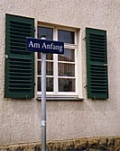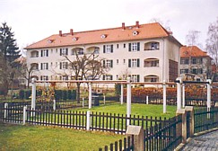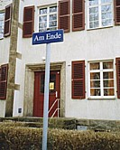

**_Fotos:_** _Die Grunaer Gartenheimsiedlung - in der Mitte ein Blick in die Straße An den Gärten_

Als südlicher Abschluss der Gartenheimsiedlung wurde 1922 unmittelbar am Landgraben die Straße Am Ende angelegt. Wie bei allen Häusern der Siedlung zeichneten auch hier Paul Beck und Max Oertel für die architektonische Gestaltung verantwortlich. In dieser Straße befanden sich früher mit einer Filiale des genossenschaftlichen "Waaren-Einkaufs-Vereins zu Görlitz", einer Bäckereifiliale, der Fleischerei Wiedenmann und einer Kolonialwarenhandlung die wenigen Einkaufsmöglichkeiten des Viertels. Im Haus Nr. 14 hatte der Bauverein Gartenheim seine Geschäftsstelle.

Die heute nicht mehr in den Stadtplänen verzeichnete Straße An der Mimosa entstand 1933 auf dem Areal der zwischen Hepke-, Bärensteiner und Eibenstocker Straße gelegenen Firma Mimosa AG. Das Unternehmen war 1904 gegründet worden und gehörte zu den bekanntesten deutschen Herstellern von Fotopapier. Nach 1945 produzierte der verstaatlichte Betrieb auch Kleinbildkameras, seit 1957 unter dem Namen VEB Fotopapierwerk Dresden wieder ausschließlich Fotopapier. In den 1960er Jahren erfolgte die Aufhebung der Straßenbenennung und die Einbeziehung in die verlängerte Eibenstocker Straße. 2012 begann hier der Bau einer Wohnanlage sowie die Sanierung des denkmalgeschützten früheren Verwaltungsgebäude des Unternehmens an der Hepkestraße.

Die Augustusbergstraße wurde beim Bau der Wohnanlage Rosenhof angelegt. Ihren Namen erhielt sie 1997, in Anlehnung an die Straßennamen der näheren Umgebung, nach dem Augustusberg im Osterzgebirge. Der Berg liegt nahe von Bad Gottleuba und ist ein beliebtes Wander- und Ausflugsziel.

Die Mitte der 1920er Jahre angelegte Straße Baumzeile entstand im Zusammenhang mit dem Bau der Grunaer Siedlung. Wie alle Wohnhäuser der Anlage wurde auch die Häuserzeile Nr 1-19, bestehend aus drei Gebäuden mit zwei eingeschossigen Zwischenbauten, nach Plänen von Paul Beck und Max Oertel erbaut.

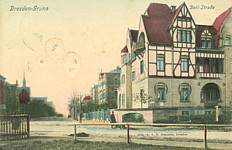 Die Ende des 19. Jahrhunderts angelegte Beilstraße erhielt ihren Namen 1893 nach der Grunaer Gutsbesitzerin Eva Rosine Beil (1822-1897). Gemeinsam mit Julius Rothermundt stiftete sie den Bau der [Thomaskirche](../../../ost/gruna/thomaskirche/) an der Bodenbacher Straße. 1898 wurde dieser Name auf den anschließenden Abschnitt bis zur Herkulesstraße, 1913 auch auf den Strehlener Teil bis zur [Stübelallee](../../../zentrum/johannstadt/strassen_johannstadt/stubelallee/) übertragen.

Hier befinden sich einige interessante Jugendstilvillen, u.a. die 1906 errichtete Villa Beilstraße 21, die sich einst im Besitz des Zimmermeisters Daniel Hermann Garten befand. Im Haus Beilstraße 24 lebte Anfang des 20. Jahrhunderts der dänische Schriftsteller Karl Gjellerup und verfasste sein Buch “Der Pilger Kamanita”. 1917 erhielt er für diesen Roman den Literaturnobelpreis. Nr. 4 war Wohnsitz des Bildhauers Rudolf Wittig, der in der Nachkriegszeit Teile des baukünstlerischen Schmucks für die Neubauten am Altmarkt und der Wilsdruffer Straße schuf.

Der heutige Bertolt-Brecht-Platz entstand Anfang des 20. Jahrhunderts unmittelbar an der Flurgrenze zwischen Striesen und Gruna. Ursprünglich gab es hier eine von zwei Grunaer Ziegeleien, die jedoch 1885 stillgelegt wurde. Die Lehmgrube verfüllte man daraufhin mit dem Abbruchmaterial der Häuser der Badergasse, die dem Durchbruch der König-Johann-Straße (heute Wilsdruffer Straße) im Stadtzentrum weichen mussten. Danach diente sie als Müllkippe, bevor nach dem Ersten Weltkrieg einige Wohnhäuser gebaut wurden. Am 29. Mai 1907 erhielt der neu angelegte Platz den Namen Carlowitzplatz. Christoph von Carlowitz (1507-1578) war kurfürstlicher Rat und Oberhauptmann der Bergstadt Joachimsthal in Böhmen. Am 1. Juni 1963 wurde der Carlowitzplatz nach dem deutschen Dichter Bertolt Brecht in Bertolt-Brecht-Platz umbenannt.

Die Brandstraße wurde Mitte der 1930er Jahre im Zusammenhang mit der Bebauung an der östlichen Comeniusstraße angelegt und am 14. August 1937 benannt. Ihren Namen erhielt sie nach dem Felsmassiv Brand am Rande des Polenztales in der Sächsischen Schweiz. Die Brandbaude ist seit 1830 als Station des sogenannten „Malerwegs“ eine beliebte Einkehrstätte für Wanderer.

Die Calvinstraße ist Teil eines alten Verbindungsweges zwischen dem Grunaer und Striesener Dorfkern. Bis zur Verlegung um 1860 verlief entlang dieses Weges der [Landgraben](../../../ost/striesen/landgraben/). Ihren Namen erhielt die Straße 1929 nach dem Schweizer Reformator Johann Calvin (1509-1564), der Begründer der theologischen Lehre des Kalvinismus ist. Bekanntester sächsischer Vertreter dieser Glaubensrichtung ist der ehemalige kurfürstliche Kanzler Nikolaus Krell, der 1592 auf dem Neumarkt hingerichtet wurde. Zwischen 1954 und 1957 führte eine Trasse der Dresdner Trümmerbahn über die Calvinstraße zur Trümmerkippe in Dobritz.

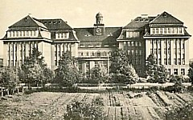Die kurz vor dem Ersten Weltkrieg angelegte Planstraße XIII erhielt mit Beschluss vom 28. Juni 1913 Namen Eibenstocker Straße. Namensgeber war die sächsische Kleinstadt Eibenstock im Westerzgebirge. Ursprünglich begann sie am Hepkeplatz und führte von dort in östlicher Richtung bis zum [Landgraben](../../../ost/striesen/landgraben/). Eine geplante Weiterführung über Seidnitzer Flur bis zur Enderstraße kam nicht zustande. Zudem ist sie bis heute durch die Kleingartenanlage “Laubenheim e.V.” in der Nähe des Striesener Friedhofs unterbrochen. Der östlichste Teilabschnitt an der Bärensteiner Straße wurde vor 1945 nach dem hier befindlichen Fotopapierwerk An der Mimosa genannt. Auf dem ehemaligen Betriebsgelände entstand 2012 eine kleine Wohnanlage. Markantestes Gebäude im westlichen Teil ist das [Hans-Erlwein-Gymnasium](../../../ost/gruna/) an der Ecke Junghansstraße _(Foto)_. Die Wohnhäuser Eibenstocker Straße Nr. 2-14 wurden zwischen 1925 und 1928 von Erich Hempel für die Gemeinnützige Wohnungsbau-AG Gruna errichtet.

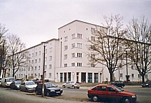Der Falkensteinplatz erhielt seinen Namen 1927 nach dem am 6. März 1864 erstmals bestiegenen Klettergipfel in der Sächsischen Schweiz und knüpft damit an eine Grunaer Tradition an, Straßen nach geografischen Plätzen im Elbsandsteingebirge zu benennen. Die Wohnhäuser rund um den Falkensteinplatz entstanden zwischen 1928 und 1932 nach einem einheitlichen Konzept, wobei in der architektonischen Gestaltung auf Ideen der Bauhausbewegung zurückgegriffen wurde. Bis zum Zweiten Weltkrieg wurden zwischen Gruna und Striesen einige hundert Wohnungen errichtet. Die Entwürfe stammen von Erich Hempel bzw. den Architekten Max Taut und Franz Hoffmann in Zusammenarbeit mit Palm und Schmersahl und sahen vorrangig kleine preiswerte Wohnungen für ärmere Familien vor. Bauherr der L-förmigen Häuserzeile an der Nord- und Westseite (Nr. 5-9) war die gemeinnützige Wohnungsbau AG Gewobag, während sich die Bauten der Südseite (Nr. 1-4) im Besitz des Baumeisters Bruno Max Riedrich befanden.

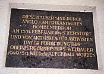1945 wurden Teile dieser Anlage beim Bombenangriff schwer beschädigt. Der optimale Grundriss und der trotz der Schäden noch gute Bauzustand der Häuser ermöglichte jedoch eine schnelle Wiederherstellung. Bereits 1949 konnten die ersten reparierten Wohnungen übergeben werden, bevorzugt an verdienstvolle Aktivisten des Wiederaufbaus. In Erinnerung an diese Zeit trug die 1955 im Eckhaus zur Schneebergstraße in den Räumen einer ehemaligen Drogerie eröffnete Wohngebietsgaststätte noch bis 1990 den Namen “Aktivist”. Später wurden die Räume als China-Restaurant bzw. Fachgeschäft für Bergsportartikel genutzt. Eine Gedenktafel _(Foto)_ am Eckhaus gegenüber trägt die Inschrift:

_“Diese Häuser sind durch anglo-amerikanischen Bombenterror am 13./14. Februar 1945 zerstört und von Aktivisten für Aktivisten unter Förderung des Oberbürgermeisters Weidauer 1949/50 wieder aufgebaut worden”._

Die Wohnsiedlung östlich des Landgrabens entstand 1924 bis 1928 als geschlossene Anlage für den Spar- und Bauverein Dresden-Gruna. Die Straßen wurden meist nach bekannten Gipfeln der Sächsischen Schweiz benannt, eine Tradition, die später auch beim Bau des Grunaer Neubaugebietes fortgesetzt wurde. Ihren Abschluss bildet der am 19. Mai 1927 nach der Silbermannstadt Frauenstein im Erzgebirge benannte Frauensteiner Platz. Jenseits dieses Platzes entstand 1928 die bis zur Enderstraße in Striesen reichende Kleingartenanlage “Alte Elbe” in einem früheren Elbarm. Alte Grunaer Flurbezeichnungen wie Planschfeld und Blanschgraben weisen auf die häufige Hochwassergefahr dieses tief gelegenen Geländes am Landgraben hin. Die zwischen 1924 und 1928 erbauten Häuser entstanden nach Plänen von Paul Beck und Max Oertel und stehen seit 1969 unter Denkmalschutz.

Die Gartenheimallee bildet die Mittelachse der ab 1925 entstandenen Gartenstadt Gruna, einer vom Bauverein Gartenheim initiierten Siedlung mit Mehrfamilien- und Reihenhäusern mit über 800 Wohnungen. Nach Plänen des Architekten Paul Beck entstanden die Gebäude unter Leitung von Max Oertel auf dem Areal zwischen Junghansstraße und Landgraben. Zu jeder Wohnung gehörte zugleich ein kleines Stück Gartenland, was dem Viertel den spöttischen Beinamen “Kohlrabisiedlung” einbrachte. Die Siedlung gilt als ein Musterbeispiel des sozialen Wohnungsbaus in den Jahren nach dem Ersten Weltkrieg und steht seit 1969 unter Denkmalschutz. Straßennamen wie Am Anfang, Baumzeile, Kurzer Schritt, Lange Zeile, Am Grüngürtel und Am Ende verdeutlichen das Konzept einer durchgrünten, abgeschlossenen Wohnanlage. 1945 fielen fast 80% der Häuser dem Luftangriff zum Opfer, konnten jedoch zwischen 1955 und 1960 durch Angehörige des VEB Kraftwerks- und Industriebau Dresden wieder aufgebaut werden. 1996 wurden die Häuser saniert und teilweise an die Mieter verkauft.

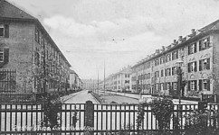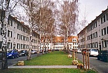

**_Fotos:_** _Die Grunaer Gartenheimsiedlung - Blick in die Gartenheimallee um 1925 und 2010_

Der Gartenheimsteg wurde kurz nach dem Ersten Weltkrieg als Planstraße X in der Grunaer Gartenheimsiedlung angelegt und erhielt am 17. Juni 1920 seinen Namen.Wenig später entstanden hier die ersten Reihenhäuser. Zur künstlerischen Gestaltung wurde 1939 ein Brunnen "Die fleißigen Hausfrauen" aufgestellt. Um die Brunnensäule oberhalb des Beckens standen vier von Rudolf Born gestaltete Bronzefiguren, die Hausfrauen bei der Arbeit darstellten. Bereits 1940 baute man diese jedoch wieder ab und ließ sie zu Rüstungszwecken einschmelzen. Die Wohnhäuser am Gartenheimsteg brannten 1945 aus und wurden in den 1950er Jahren wieder hergestellt.

Die Straße entstand im Zusammenhang mit Erschließung der Wohnanlage des Dresdner Spar- und Bauvereins. Am 15. April erhielt die bisherige Planstraße VIII den Namen Gerader Steg. Neben Wohngebäuden befand sich hier in der Nr. 12 das Gemeinschaftshaus des Bauvereins, in dem verschiedene Veranstaltungen, Versammlungen und Ausstellungen stattfanden.

Auch die Straße Grabenwinkel entstand 1921 im Zusammenhang mit dem Bau der Grunaer Gartenheimsiedlung und erhielt am 14. April 1921 ihren Namen. Dieser wurde nach dem angrenzenden [Landgraben](../../../ost/striesen/landgraben/) gewählt, der hier einen Knick macht. Die seit 1969 unter Denkmalschutz stehenden Doppelhäuser wurden, wie die gesamte Siedlung, nach Plänen von Paul Beck und Max Oertel erbaut.

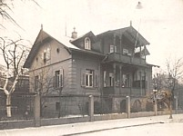Die Gustav-Freytag-Straße entstand im letzten Drittel des 19. Jahrhunderts im östlichen Teil von Blasewitz und führt über [Neugrunaer](../../../ost/gruna/neugruna/) und [Neuseidnitzer](../../../ost/seidnitz/) Flur bis zum Tolkewitzer Friedhof. 1871 erhielt sie nach dem Vorstand der hier tätigen Baugesellschaft den Namen Schubertstraße. 1890 wurde auch der auf Neugrunaer Flur gelegene Straßenabschnitt östlich der Tauscherstraße so benannt. 1897 wechselte die Namensgebung in Blasewitz in Dohnaer Straße, wobei diese Umbenennung jedoch nur den Straßenteil zwischen Altenberger und Tauscherstraße betraf.

Am 1. Januar 1902 wurde der gesamte Straßenzug erneut umbenannt und heißt seitdem Gustav-Freytag-Straße. Gustav Freytag (1816-1895) war ein deutscher Dichter und Journalist und lebte auch einige Jahre in Dresden. Mit seinen Schriften erwarb er sich große Anerkennung und gehörte zwischen 1867-1870 dem Reichstag an, wo er als einer der Wegbereiter der nationalliberalen Bewegung auftrat.

Das Straßenbild prägen bis zur Gegenwart vor allem Villen und Landhäuser _( **Foto:** Gustav-Freytag-Straße 6)_. Markantestes Gebäude ist die von Hans Erlwein errichtete [Neugrunaer Schule](../../../ost/gruna/) an der Ecke zur Hofmannstraße, die heute von der 32. Grund- und der 32. Oberschule "Sieben Schwaben" genutzt wird.

Die als Sackgasse zum Elbufer führende Helfenberger Straße in Neugruna erhielt ihren Namen am 19. September 1900 nach der rechtselbisch gelegenen Gemeinde Helfenberg, die seit 1999 zu Dresden gehört.

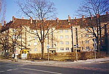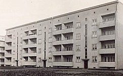 Die Hepkestraße, benannt nach dem Dresdner Kaufmann und Stifter Bernhard Hepke (1837-1916), beginnt im Süden von Striesen, verläuft über Grunaer Flur in west-östlicher Richtung und bildet die Verbindung zum benachbarten Seidnitz. Ihren Namen erhielt die vorherige Planstraße XII auf Beschluss des Dresdner Stadtrates vom 8. September 1919. 1928 wurde sie bis zur Enderstraße in Seidnitz, 1931 bis zur Altenberger Straße verlängert. Zwischen 1924 und 1928 wurden auf Grunaer Flur einige Doppel- und Reihenhäuser der Gartenheimsiedlung des Spar- und Bauvereins Dresden-Gruna errichtet. Wie die gesamte Siedlung sind auch diese Gebäude (Hepkestraße 60-62 und 64-78 sowie 112-134) seit 1969 als Baudenkmale eingetragen.

_**Fotos:** Hepkestraße 53 um 1940 und Hepkestraße / Ecke Enderstraße_

Stadion der DSF: Das Stadion wurde Mitte der Zwanziger Jahre an der Ecke Hepke-/ Bärensteiner Straße für den Dresdner Sportverein (DSV 1910) angelegt. Dieser war durch den Zusammenschluss von vier kleineren Sportvereinen entstanden und nutzte zuvor ein Gelände an der Donathstraße in Laubegast. 1920 gewann der DSV die Mitteldeutsche Fußballmeisterschaft.

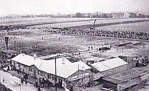Nach dem Erwerb einer zuvor landwirtschaftlich genutzten Fläche wurde mit Hilfe zahlreicher Mitglieder Dresdner Arbeitervereine das "Stadion Dresden-Ost" mit Clubgaststätte und Vereinsheim gebaut. Hier fand am 25. August 1925 das erste Fußballspiel zwischen einer deutschen und einer sowjetischen Mannschaft statt. Mit der Begegnung zwischen dem DSV 1910 und dem sowjetischen Meister Kommando Charkow wollte der KPD-nahe Verein ein Zeichen gegen den Boykott der Sowjetunion setzen. Auch später kam es wiederholt zu internationalen Begegnungen. Zudem fanden gelegentlich politische Großkundgebungen wie das Sachsentreffen des Roten Frontkämpferbundes mit 36.000 Besuchern statt. Bis 1932 gewann der DSV sechsmal die Meisterschaft des Arbeiter- Turn- und Sportbundes ATSB. Außerdem gab es Sektionen für Leichtathletik, Turnen, Raffball, Handball, Schach und einen Chor.

1933 wurde der Arbeitersportverein verboten und das Stadion unter dem Namen "Freiheitskampfbahn" Wettkampf- und Feierstätte der Hitlerjugend. Während des Zweiten Weltkriegs errichtete man auf dem Platz ein Barackenlager für Fremdarbeiter. Nach 1945 entstand die SG Striesen als Nachfolger des DSV. Nach ihrer Übernahme in Trägerschaft der Dresdner Zigarettenfabriken änderte man den Namen 1949 in BSG Empor Tabak um. In Erinnerung an das Fußballspiel von 1925 wurde in den 1950er Jahren das Denkmal “Sportler mit Ball” aufgestellt und das Stadion in "Stadion der Deutsch-Sowjetischen Freundschaft" umbenannt. Nach 1990 kam die Plastik in Privatbesitz. Den Sportplatz nutzen heute die Fußballer der SG Striesen sowie mehrere Sektionen des 1990 wieder gegründeten DSV 1910.

Kleingartensparte "Alte Elbe": Unweit davon befindet sich am Frauensteiner Platz bis zur Ecke zur Enderstraße die Gartensparte "Alte Elbe". Sie entstand zwischen 1926 und 1936 in einem früheren Elbarm und galt mit ihren nach einheitlichem Konzept gestalteten Anlagen, Spielplätzen, einem Festplatz und sogar einem kleinen Schwimmbecken als mustergültig. Da das Gelände zum Teil bis zu zwei Meter tiefer als seine Umgebung liegt und entsprechend hochwassergefährdet war, kam für diese Fläche eine Bebauung mit Wohnhäusern nicht in Frage.

Am 16. Oktober 1928 wurde der Kleingartenverein, zunächst noch unter dem Namen "Birkenwald", ins Vereinsregister eingetragen. 1931 folgte die Umbenennung in "Alte Elbe". Das zugehörige Spartenheim, heute als öffentliche Gaststätte “Alter Striesener Weg” geführt, entstand in der Nachkriegszeit als Verpflegungsstückspunkt für das Personal der Dresdner Trümmerbahn, welche den Schutt der zerstörten Innenstadt zu Deponien am Stadtrand brachte. Für den Bau des Fundaments fanden noch verwendbare Trümmerziegel Verwendung, die das kleine Gebäude zu einem Zeugnis der Wiederaufbaujahre nach 1945 machen.

Mimosa AG: Das Unternehmen entstand Ende des 19. Jahrhunderts in Köln-Ehrenfeld als “Rheinische Emulsions-Papierfabrik A.-G.” und verlegte 1904 seinen Firmensitz nach Dresden-Reick, 1911 in ein auf Grunaer Flur errichtetes Betriebsgebäude an der Bärensteiner Straße 31 / Hepkestraße 115. Ab 1913 firmierte der Betrieb als Mimosa A.G. und gehörte nach dem Zusammenschluss mit weiteren Herstellern um 1920 zu den größten Fotopapier- und Filmherstellern in Deutschland. 1934 wurden die jüdischen Aufsichtsratsmitglieder aus ihrem Amt gedrängt und durch Vertreter der Deutschen Bank ersetzt. Mit Abberufung der kompletten Direktion und Entlassung vieler Mitarbeiter endete 1937 die Arisierung der Firma.

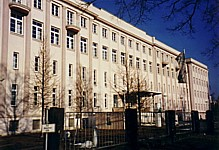1948 wurde der unzerstört gebliebene Betrieb als VEB Mimosa verstaatlicht und begann nun auch mit der Herstellung von Kleinbildkameras und Fotozubehör. Dieser Produktionszweig blieb jedoch ein kurzes Intermezzo, so dass man sich ab 1951 wieder ausschließlich der Fotopapierherstellung widmete, was 1957 zur Umbenennung in VEB Fotopapierwerk Dresden führte. Unter diesem Namen blieb die Firma bis zur Wende bestehen, wurde dann privatisiert und 1991 geschlossen. Nach erfolgter Sanierung beherbergte der markante Gebäudekomplex _(Foto)_ zwischen 1994 bis 2007 die Verwaltung der AOK Sachsen. 2012 begann der Umbau des denkmalgeschützten Gebäudes für Wohnzwecke.

Die Herkulesstraße entstand Ende des 19. Jahrhunderts im Zusammenhang mit einer Ortserweiterung in südwestlicher Richtung. Da die Straße die Verlängerung der Herkulesallee des Großen Gartens bildet, erhielt sie 1897 den Namen Herkulesstraße. Bevorzugt entstanden hier Mietshäuser und Villen in offener Bauweise.

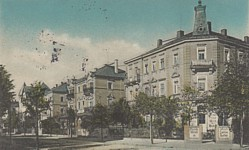

**_Foto:_** _Wohnhäuser an der Herkulesstraße vor 1945_

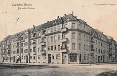Die Heynahtsstraße im Wohngebiet am Falkensteinplatz erhielt ihren Namen 1912 nach dem Wohntäter und Stifter Peter Eduard Heynahts (1818-1892), der der Stadt größere Summen für gemeinnützige Zwecke zur Verfügung gestellt hatte. Die heute unter Denkmalschutz stehenden Wohnhäuser Nr. 9-17 entstanden Ende der Zwanziger Jahre im Auftrag der gemeinnützigen Wohnungsbaugesellschaft Gewobag nach einem einheitlichen Konzept und orientieren sich an der Bauhausbewegung. Im Haus Nr. 9 wohnte nach Zerstörung seiner Wohnung in der Innenstadt der bekannte Architekt Hans Richter, Schöpfer der Trachauer Siedlung und weiterer Bauten der "Neuen Sachlichkeit".

Die Hocksteinstraße wurde Ende der 1920er Jahre im Zusammenhang mit dem Neubaugebiet des Dresdner Spar- und Bauvereins als Planstraße 76 angelegt. Auf Beschluss des Stadtrates vom 19. Mai 1927 erhielt sie nach einem Felsen im Polenztal (Sächsische Schweiz) den Namen Hocksteinstraße. Die zur Grunaer Gartenheimsiedlung gehörenden Häuserzeilen Nr. 1-9 und 2-10 stehen seit 1969 unter Denkmalschutz.

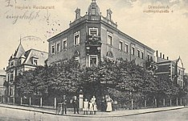Die 1879 erstmals erwähnte Hofmannstraße entstand im Zusamenhang mit der Bebauung des ehemaligen Grunaer Tännichts durch den Bauverein “Daheim”. Ihren Namen erhielt sie nach dessen Geschäftsführer August Hofmann. Zunächst verband sie nur Traube- und Maystraße, wurde jedoch später bis zur Tolkewitzer Straße ausgebaut. In der als Vorstadt Neugruna bezeichneten Siedlung wurden ab 1876 mehrgeschossige Mietshäuser errichtet. Im Haus Hofmannstraße 4 gab es einst "Heyne's Restaurant". In einigen Räumen im Hinterhaus Hofmannstraße 18 befanden sich zeitweise die Klassenräume der ersten Neugrunaer Schule. 1909 wurde diese in den von Hans Erlwein errichteten [Neubau](../../../ost/gruna/) Hofmannstraße 34 verlegt. 1927 entstand an der Ecke zur Traubestraße das Postamt 21.

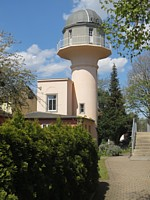Sternwarte Frantz: Das im orientalischen Stil gestaltete Observatorium wurde 1922 von Alexander Frantz als erste private Sternwarte in Dresden errichtet. Frantz hatte in Chemnitz und Mittweida Maschinenbau studiert und besaß in Blasewitz eine Heizungsbaufirma. Nebenbei befasste er sich mit Astronomie und baute selbst eigene Geräte. Die Sternwarte auf der Hofmannstraße 11 wurde am 11. Juni 1922 eröffnet und stand als Volkssternwarte auch der Öffentlichkeit zur Verfügung.

Nach dem Zweiten Weltkrieg beteiligte sich Alexander Frantz an der Einrichtung weiterer Sternwarten, u.a. in Rodewisch, Bautzen, Döbeln und Dresden-Plauen. Nach seinem Tod 1962 übernahm dessen Tochter Charlotte Schimmel-Frantz die Leitung der Sternwarte und führte bis zu ihrem Tod regelmäßig Besucher durch die Einrichtung, die sich hier im Rahmen von Vorträgen über astronomische Gesetzmäßigkeiten informieren konnten. Zur Sternwarte gehören auch eine kleine Bibliothek und eine Sammlung historischer astronomischer Karten und Instrumente. Das Gebäude und die aus der Entstehungszeit stammenden Beobachtungsgeräte stehen als technisches Denkmal unter Schutz.

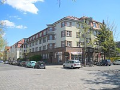Die Junghansstraße verbindet die Stadtteile Striesen und Gruna und wurde Anfang des 20. Jahrhunderts als Planstraße 12 angelegt. Ihren Namen erhielt sie auf Beschluss des Dresdner Stadtrates vom 28. Juni 1913 nach dem 1900 verstorbenen Apotheker und Stifter Eugen Ferdinand Junghans. Ursprünglich führte sie nur bis zur Kipsdorfer Straße, wurde jedoch 1925 durch Einbeziehung eines Teils der Dornblüthstraße bis zur Schandauer Straße verlängert.

Als erstes Gebäude auf Grunaer Flur entstand 1913 der monumentale Bau der 31. Bezirksschule, der heute vom [Grunaer Gymnasium](../../../ost/gruna/) genutzt wird. Das Schulhaus war die letzte Schöpfung des Dresdner Stadtbaurates Hans Erlwein vor seinem Unfalltod 1914. Erst nach dem Ersten Weltkrieg wurden ab 1919 südlich der Hepkestraße zahlreiche Wohnhäuser für den Bauverein Gartenheim gebaut (Nr. 19-65). An die Grundsteinlegung erinnerte seit 1969 eine aus Anlass des 50. Jahrestages des Baubeginns angebrachte Gedenktafel am Haus Hepkestraße 19. Die Metalltafel wurde bei der Sanierung der Häuser entfernt. Die ebenfalls für den Bauverein entstandene Holzhaussiedlung zwischen Schrammstein- und Ostrauer Straße fiel 1945 komplett den Bomben zum Opfer. Hier wohnte auf der Junghansstraße 80 auch der Initiator der Siedlung, Stadtbaudirektor Max Oertel. Auf dem beräumten Areal entstand 1976 eine Kinderkrippe (heute Kindertagesstätte "Musica"). Eine weitere Kita wurde 2013/14 auf dem Nachbargrundstück gebaut (Nr. 52/54).

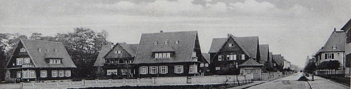

**_Foto:_** _Holzhaussiedlung an der Junghansstraße vor 1945_

Zu den unter Denkmalschutz stehenden Gebäuden auf Striesener Flur gehören neben den 1910/11 für den Kleinwohnungsbauverein Striesen errichteten König-Friedrich-August-Häusern (Nr. 4-18) die markanten Bauten der [Ernemann-Kamerawerke](../../../ost/striesen/strassen_striesen/schandauer_strasse/ernemann-werke/) (Nr. 1/3) und der Zigarettenmaschinenfabrik United AG (Nr. 5). Der zuletzt vom VEB Pentacon genutzte Gebäudekomplex an der Ecke zur Schandauer Straße wurde 1915-18 von Emil Högg und Richard Müller entworfen und 1922/23 nochmals erweitert. Die Bauausführung oblag der Firma Wayß & Freytag. Bemerkenswert ist das an der Fassade befindliche Mosaik "Lichtgöttin" von Hans Unger, das einige Zeit auch Markenzeichen der Firma war.

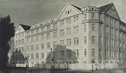United Cigarette Machine Company (Nr. 5): Das Unternehmen wurde am 30. Dezember 1923 als Mitteldeutsche Chemische Fabriken gegründet. Im November 1925 erwarb die amerikanische United Cigarette Machine Company mit Sitz in Lynchburg den Firmenmantel und spezialisierte sich auf die Herstellung und den Vertrieb von Spezialmaschinen für die Tabak- und Zigarettenindustrie. 1930 erfolgte ein Zusammenschluss mit der Zigaretten- und Verpackungsmaschinenfabrik von Otto Bergsträsser und Max Klinge, 1935 mit der Firma “Progreߔ zur [“Universelle”](../../../zentrum/sudvorstadt/strassen_sudvorstadt/zwickauer_strasse/). In diesem Zusammenhang gab man den Striesener Standort auf und verlegte den Betrieb zur Zwickauer Straße 48-54.

Die bisherigen Betriebsgebäude an der Junghansstraße wurden 1932 an die [Cigaretten- und Tabakfabrik Lande](../../../ost/striesen/striesener_zigarettenfabriken/) und die Macedonia Cigaretten Compagnie G.m.b.H. vermietet. Mit Machtantritt der Nazis geriet der jüdische Inhaber Wilhelm Lande unter Druck und wurde boykottiert. Um weiteren Repressionen zu entgehen, verkaufte er seine Firma und emigrierte in die USA. Ab 1942 oblag die Betriebsführung dem NSSK-Führer Karl Geißinger. Nach Ende des Zweiten Weltkrieg wurde der Betrieb von der Sowjetischen Militäradministration zu Reparationsleistungen herangezogen und 1946 enteignet. Ab 1959 gehörte er als Werk II zum VEB Vereinigte Zigarettenfabriken Dresden.

Der Kleinhausweg wurde im Zusammenhang mit der Grunaer Gartenheimsiedlung angelegt und am 14. April 1921 benannt. Die von der Hepkestraße bis zur Uttewalder Straße führende Straße ist nur im westlichen Teil mit Reihenhäusern bebaut und endet an einer Fußgängerbrücke über den Landgraben, wo sie sich als Fußweg fortsetzt.

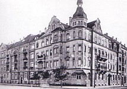Die Leitmeritzer Straße entstand um 1900 als Verlängerung der Stübelallee in Richtung Grunaer Dorfkern und erhielt ihren Namen nach der nordböhmischen Stadt Leitmeritz (Litomerice). Wenig später wurden hier die ersten repräsentativen Mietshäuser gebaut. Ursprünglich sollte sie an einem neu anzulegenden Platz an Stelle des alten Dorfkerns enden. Kriegsbedingt wurden diese Planungen jedoch nicht realisiert. Sämtliche Gebäude wurden 1945 zerstört, die Straße um 1970 im Zusammenhang mit dem Neubaugebiet Altgruna überbaut. Nach 1990 entstand an ihrer Stelle das Wohn- und Geschäftshaus mit der Zwingli-Apotheke. Das Foto zeigt die Einmündung der Leitmeritzer in die Zwinglistraße vor dem Zweiten Weltkrieg.

Die Liebstädter Straße geht in Teilen auf einen alten Verbindungsweg zwischen Gruna und Reick zurück, der in alten Plänen als "Reick-Grunaer Verbindungsweg" verzeichnet ist. Ab 1893 wurde dieser Weg amtlich als Reicker Straße bezeichnet. Der Abschnitt südlich der Winterbergstraße wurde 1897 vom Grundstücks- und Steinbruchbesitzer Bruno Hietzig 1897 ausgebaut und ein Jahr später dem öffentlichen Verkehr übergeben. Im Zusammenhang mit der Eingemeindung Grunas erhielten beide Abschnitte am 11. November 1903 nach der Kleinstadt Liebstadt im Osterzgebirge den Namen Liebstädter Straße. Im Zuge des Baus eines neuen Wohngebietes nördlich der Bodenbacher Straße erfolgte 1974 eine bogenförmige Verlängerung.

Während in diesem Bereich mehrgeschossige Plattenbauten das Straßenbild prägen, siedelten sich im südlichen Teil vorrangig Gewerbebetriebe an. Aus dem VEB Autoreparaturwerk Dresden (Liebstädter Straße 5) ging 1992 das Autohaus "Sachsengarage" hervor. Das Verwaltungs- und Sozialgebäude des Betriebes entstand 1969 nach einem Entwurf von Günther Thiele. In den 1970er Jahren folgten mehrere Kindereinrichtungen, eine Kaufhalle sowie die am 1. September 1975 eröffnete 96. Polytechnische Oberschule.

Uhrenfabrik Költzsch (Nr. 20): Das Unternehmen wurde 1878 von Albrecht Költzsch gegründet und hatte später seinen Sitz auf der damaligen Reicker Straße 4. Ursprünglich arbeitete Költzsch als Handlungsreisender, bevor er 1890 in Gruna seine Uhrenmanufaktur gründete. Hergestellt wurdem Taschenuhren, Wecker und Pendeluhren, wobei der Besitzer sein Geschäft mit dem Verkauf von Schmuck, Gold- und Silberwaren abrundete. 1910 warb der Betrieb mit dem Vertrieb von Uhren mit Schweizer Werken, die unter dem dem Vertriebsnamen SAXONIA angeboten wurden. Nach dem Zweiten Weltkrieg siedelte sich auf dem Grundstück die Kunstlederfabrik Bruno Kretzschmar KG an. Nach ihrer Verstaatlichung 1972 firmierte sie als VEB "brillant" Dresden. Heute befindet sich hier ein Supermarkt.

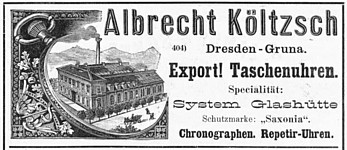

Kinder- und Jugendhaus Schieferburg (Nr. 29): Das Kinder- und Jugendhaus Schieferburg entstand zwischen 1994/96 als Kultur- und Stadtteilzentrum und wurde am 6. Dezember 1996 eröffnet. Die vom Stadtjugendring Dresden betriebene Einrichtung bietet Räume für kulturelle und kreative Betätigung und ist nicht zuletzt wegen ihrer ungewöhnlichen architektonischen Gestaltung sehenswert. Das Haus wurde vom Architektenbüro Weise & Treuner entworfen und zitiert Elemente von Künstlern wie Friedensreich Hundertwasser, Antoni Gaudí und Bruno Taut. In der zentralen Kuppelhalle befindet sich ein Lichtkunstkörper von Arend Zwicker. Hinzu kommen verschiedene aus Keramikscherben zusammengesetzte Mosaike und Verkleidungen aus Naturmaterialien wie Lehm und Holz.

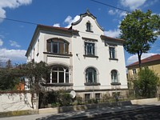Die Ludwig-Hartmann-Straße im Ortsteil [Neugruna](../../../ost/gruna/neugruna/) wurde 1876 im Zusammenhang mit dem Ausbau dieser Vorstadt durch die Baugesellschaft “Daheim” angelegt. Ihren Namen erhielt sie nach dem Musikkritiker Ludwig Hartmann (1836-1910), der maßgeblich an der Erschließung Neugrunas für den Wohnungsbau beteiligt war. Hartmann war ein Schüler von Franz Liszt und wirkte zunächst als Komponist und Pianist, widmete sich später jedoch dem Verfassen von Musikkritiken und Aufsätzen zur Musikgeschichte. Sein früheres Wohnhaus befindet sich auf der Tolkewitzer Straße 59, sein Grab auf dem Tolkewitzer Johannisfriedhof. Das Straßenbild prägen bis heute Villen und Landhäuser aus der Entstehungszeit, im Bild das Haus Ludwig-Hartmann-Straße 26.

Die Maystraße in Neugruna wurde 1876 vom Rechtsanwalt Christian Julius May angelegt und noch zu dessen Lebzeiten nach ihm benannt. May, der dem Vorstand der mit der Erschließung Neugrunas befassten Baugesellschaft "Daheim" angehörte, verstarb am 26. April 1893 in Dresden.

Restaurant "Daheim": Das Wohnhaus Maystraße 12 (heute Nr. 34) an der Ecke May-/Tauscherstraße war erstes Gebäude Neugrunas und beherbergte bis 1945 die Gast- und Gartenwirtschaft "Daheim". Diese war von der gleichnamigen Baugesellschaft ins Leben gerufen worden, um so Ausflügler und potentielle Interessenten für die neu erschlossenen Grundstücke in Neugruna anzulocken. Um 1880 warb das Lokal mit seinem schönen schattigen Garten in ruhiger Waldlage, einem Billardzimmer und einer Asphaltkegelbahn.

Die kleine Verbindungsstraße (Planstraße XI) führt aus der Grunaer Siedlung zur Junghansstraße. Da sie von den Bewohnern früher als Weg zum Briefkasten an der Junghansstraße 31 genutzt wurde, erhielt sie am 17. Juni 1920 den Namen Postgang. Einst gab es hier auch eine Wäschemangel.

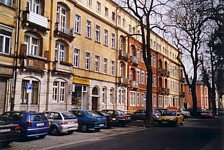Die Rothermundtstraße im alten Grunaer Dorfkern verdankt ihren Namen dem russischen Kaufmann Julius Ludwig Rothermundt (1827-1890). Dieser erwarb 1875 das Grundstück der ehemaligen Schmiede und errichtete hier ein Landhaus inmitten eines reizvollen Parks. Während die Villa 1945 zerstört wurde, blieb der [Rothermundtpark](../../../ost/gruna/rothermundpark/) bis heute erhalten. Rothermundt war auch an der Finanzierung des Kirchenbaus der Thomaskirche beteiligt. An der Straße selbst befinden sich Wohnhäuser aus der Gründerzeit _(Foto)_.

Die als Seitenstraße der Altenberger Straße im Stadtteil Neugruna angelegte Scariastraße erhielt 1892 ihren Namen nach dem Opernsänger Emil Scaria (1840-1886), der ab 1864 an der Königlichen Oper in Dresden engagiert war und in einem Haus (Nr. 11) auf dieser Straße wohnte. Ebenso wie an den übrigen Straßen Neugrunas entstanden auch hier bis zur Jahrhundertwende repräsentative Mietshäuser in offener Bauweise.

Die Schlüterstraße geht auf einen alten Verbindungsweg zwischen dem Grunaer Dorfkern und dem benachbarten Striesen zurück und wurde um 1900 zur Straße ausgebaut. Ihren Namen erhielt sie nach Dr. Franz Schlüter (1833-1901). Schlüter
war Mitglied der Dresdner Sektion des Deutsch-Österreichischen Alpenvereins und ließ 1897 die noch heute bestehende Franz-Schlüter-Hütte in den Dolomiten erbauen. Die einst landwirtschaftlich und von einer Ziegelei genutzten Flächen zu beiden Seiten der Straße wurden nach dem Ersten Weltkrieg mit Wohnhäusern und gewerblichen Einrichtungen bebaut.

Die Schneebergstraße wurde 1904 angelegt und erhielt ihren Namen nach dem Hohen Schneeberg in der Böhmischen Schweiz, dem mit 723 m höchsten Berg im Elbsandsteingebirge. 1905/06 entstanden an der Nordseite einige Mietshäuser in aufwendiger architektonischer Gestaltung, die bis heute erhalten sind.

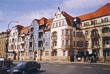

_**Foto:** Blick in die Schneebergstraße_

Die Tauscherstraße im Ortsteil Neugruna wurde 1876 angelegt und nach dem früheren Blasewitzer Gemeindevorstadt Karl Tauscher (1819-1890) benannt. Tauscher, gelernter Uhrmacher, hatte das Amt 1859 übernommen und war Besitzer des Grundstücks, über das die Tauscherstraße verläuft. Zugleich gehörte er der mit der Erschließung des Areals befassten Baugesellschaft "Daheim" an. In diesem Bereich lag auch die Flurgrenze zwischen Blasewitz und Neugruna. Im Haus Tauscherstraße 24 befand sich früher die Gaststätte "Schweizerhaus".

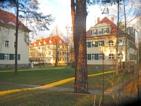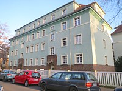

**_Fotos:_** _Wohnhäuser an der Tauscherstraße aus den Zwanziger Jahren_

Die Traubestraße erhielt ihren Namen nach dem Dresdner Unternehmer Joseph Traube, der als Eiergroßhändler tätig war und 1876 auf seinem Grundstück die Eröffnung des ersten Neugrunaer [Schulhauses](../../../ost/gruna/) ermöglichte. Zunächst befanden sich die Klassenräume auf der Traubestraße, bevor später weitere Räumlichkeiten an der Hofmann- und Tauscherstraße hinzukamen. 1909 wurde diese provisorische Schule durch den Neubau von Erlwein ersetzt.

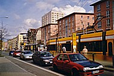Die Zwinglistraße, bis 1901 als Lindenstraße bezeichnet, erhielt ihren Namen nach dem Schweizer Reformator Huldrych Zwingli (1484-1531). Zwingli wirkte seit 1521 in Zürich und ist gemeinsam mit Kalvin Begründer der Reformierten Kirche. Die Zwinglistraße wurde um 1900 mit gutbürgerlichen Wohn- und Geschäftshäusern bebaut, die jedoch 1945 zum Großteil den Bomben zum Opfer fielen. Erhalten blieb hingegen die kleine Wohnanlage Nr. 41-45 auf der gegenüberliegenden Straßenseite aus den Jahren 1934/35. Ursprünglich sollten die Häuser Teil des Neubauviertels der GEWOBAG werden, mussten jedoch auf Weisung der Nazis wieder in traditionellen Bauformen mit Steildächern gestaltet werden. Im heute nicht mehr vorhandenen Eckhaus zur Stübelallee befand sich bis 1945 das Grunaer Postamt.

1975 begann zwischen Zwinglistraße und dem Dorfkern Altgruna der Aufbau des Neubaugebietes Gruna. Weitere Baulücken wurden nach 1990 geschlossen. 1999 entstand an der Zwinglistraße eine zentrale Haltestelle für Bus und Bahn. Ein modernes Einkaufszentrum ist auf dem Areal Zwingli-, Rothermundt- und Bodenbacher Straße geplant (“Zwingli-Passage”).

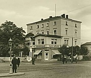Café Maaß: Das traditionsreiche Grunaer Café Maaß mit angeschlossener Konditorei wurde 1908 als Kaffee Müller im Eckhaus Zwingli-/ Ecke Bodenbacher Straße eröffnet ( _Zwinglistraße 29 - Foto_). In den 1930er Jahren übernahm Franz Maaß mit seiner Frau die Bewirtschaftung. 1945 fiel das Gebäude den Bomben zum Opfer. Dennoch gelang es der Familie, schon bald in den notdürftig wieder hergestellten Keller- und Erdgeschossräumen den Betrieb fortzuführen. 1998 konnte an gleicher Stelle ein moderner Neubau übergeben werden, in dem neben dem Café im Erdgeschoss auch einige Wohnungen entstanden.

[Gruna auf OpenStreetMap](https://www.openstreetmap.org/search?query=Dresden+Gruna)

* * *

 \[ [Home](../../../index.html)\] \[ [Nord](../../../nord/)\] \[ [Nordwest](../../../nordwest/)\] \[ [Neustadt](../../../neustadt/)\] \[ [Nordost](../../../nordost/)\] \[ [West](../../../west/)\] \[ [Zentrum](../../../zentrum/)\] \[ [Südwest](../../../sudwest/)\] \[ [Süd](../../../sud/)\] \[ [Südost](../../../sudost/)\] \[ [Ost](../../../ost/)\] \[ [Register](../../../Register/register.html)\] \[ [Kontakt](../../../Kontakt/kontakt.html)\] \[ [Impressum](../../../impressum/)\]
