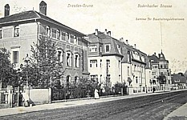
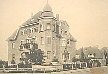
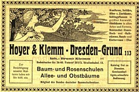
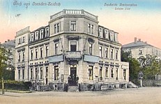
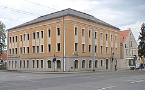

* * *

Die Bodenbacher Straße ist Teil einer alten Verkehrsverbindung zwischen dem Stadtzentrum und der Burg Dohna. Bereits 1315 wurde sie als “Pirnaische Landstraße” erwähnt und nahm ihren Ausgangspunkt am Pirnaischen Tor. Von dort führte sie entlang der heutigen Grunaer Straße, durchquerte den [Großen Garten](../../../../zentrum/grosser_garten/) und erreichte hier die Grunaer Dorfflur. Noch heute erinnert ein altes Sühnekreuz in der Nähe des Palais an den früheren Straßenverlauf. In Gruna entspricht die Straßenführung weitgehend der heutigen Bodenbacher Straße. Amtlich wurde die Straße bis zum 19. Jahrhundert Pirnaische Chaussee genannt, danach ab 1882 Pirnaische Straße. 1899 ist auch die Bezeichnung Pirnaer Landstraße urkundlich nachweisbar. Mit der Eingemeindung von Gruna erließ die Stadt Dresden am 2. August 1901 eine Bekanntmachung, die Straße künftig auf Striesener und Grunaer Flur Pirnaische Straße zu nennen und einheitlich durchzunummerieren. Da dies jedoch zu Verwechslungen mit der bereits vorhandenen Pirnaischen Straße im Zentrum führte, erfolgte schon wenig später eine erneute Änderung. Ihren neuen Namen erhielt sie 1903 nach der böhmischen Stadt Bodenbach, heute Stadtteil von Decin.

Nach Zerstörung der Burg Dohna im Zuge der “Dohnaischen Fehde” 1402 war die heutige Bodenbacher Straße Hauptverbindung nach Böhmen und wurde entsprechend stark von Kaufleuten genutzt. Zur Überquerung des Landgrabens ist bereits 1439 eine “brucke bie Grunow” erwähnt, die ursprünglich sicher eine Holzbrücke war, jedoch schon bald in Stein ausgeführt wurde. In ihrer Nachbarschaft entstand eine Schmiede, um notwendige Reparaturen an den Fuhrwerken vor Ort ausführen zu können. Diese Schmiede erhielt das Schankrecht sowie das Privileg der Gästebeherbergung und entwickelte sich zu einer Ausspanne. Im 19. Jahrhundert ging aus ihr das einst beliebte, 1945 zerstörte Ausflugslokal [“Grüne Wiese”](../../../../ost/gruna/strassen_gruna/bodenbacher_strasse/grune_wiese/) hervor. Hier befand sich auch die Endstelle der am 9. April 1900 eingeweihten elektrischen Straßenbahn.

Ende des 19. Jahrhunderts entstanden an der Bodenbacher Straße auf Grunaer und Seidnitzer Flur einige schlichte Mietshäuser. Der größte Teil der Flächen wurde jedoch von Gärtnereien eingenommen, die die bislang dominierende Landwirtschaft immer mehr verdrängten. Zu diesen gehörte auch der städtische Zentralschulgarten, wo auf einer Fläche von fast 12.000 m² Obst, Gemüse und andere Pflanzen für den naturkundlichen Unterricht der Dresdner Schulen angebaut wurde. Hinzu kamen gewerbliche Anlagen zwischen den Dorfkernen von Gruna, Seidnitz und der Bahnlinie. Auf dem Grundstück Bodenbacher Straße 44 hatte bis in die Dreißiger Jahre der Dresdner Techniker Fritz Pfleumer seine Werkstatt. Pfleumer entwickelte 1928 das erste Magnetband zur Tonaufzeichnung und legte damit den Grundstein für die späteren Tonbandkassetten. Nach dem Ersten Weltkrieg errichteten verschiedene Baugenossenschaften Wohnanlagen auf Seidnitzer und Dobritzer Flur.

1945 fielen einige Gebäude an der Bodenbacher Straße den Bomben zum Opfer. Während die nördliche Straßenseite zunächst unbebaut blieb, entstanden gegenüber Neubauten für die hier ansässigen Betriebe. Bedeutendstes Unternehmen war der VEB Robotron-Elektronik, der nach umfangreichen Erweiterungen zwischen 1969 und 1971 bis zur Wende ungefähr 2500 Beschäftigte hatte. Zwischen 1974 und 1976 folgte an Stelle des früheren Grunaer Dorfkerns und auf einigen Freiflächen ein Neubaugebiet mit ca. 3000 Wohnungen. Erstmals wurden hier in größerem Umfang sechsgeschossige Plattenbauten des Typs WBS 70 errichtet, welcher bis 1989 das Wohnungsbauprogramm der DDR dominierte. 1992/94 kam auf ehemaligem Gärtnereigelände der Wohnpark “Rosenhof” zwischen Bodenbacher und Winterbergstraße hinzu. Außerdem entstand 1998 ein moderner Büroneubau für die Firma Linde-KCA, heute größter Arbeitgeber in Gruna. Im Rahmen eines Modellprojektes zur Förderung des Öffentlichen Personennahverkehrs wurde die Bodenbacher Straße 1999 völlig umgestaltet, wobei vor allem die Beschleunigung der Straßenbahn im Vordergrund stand.

**Einzelne Gebäude:**

“Espitas”: Das architektonisch auffällige Gebäude an der Ecke zur Zwinglistraße entstand 2001 im Stil eines mexikanischen Landhauses und beherbergt das am 1. August 2002 eröffnete mexikanische Restaurant “Espitas”. Der Name geht auf die Kleinstadt Espita in der Nähe von Acapulco zurück. Die zu den beliebtesten internationalen Lokalen in Dresden gehörende Gaststätte bietet vorrangig Gerichte der mexikanischen und lateinamerikanischen Küche an. Im November 2010 wurde das Lokal bei einem Brand schwer beschädigt, konnte jedoch einige Monate später wieder eröffnet werden.

Chemische Fabrik Liersch (Nr. 8-10): Auf diesem Grundstück hatte früher die Chemische Fabrik Bruno Liersch ihren Sitz. Das kleine Unternehmen stellte unter der offiziellen Firmenbezeichnung "Dresdener Cosmet. Laboratorium Liersch" verschiedene Kosmetikprodukte wie Parfüm, Hautcremes und Seifen her. Am 1. April 1933 musste die Firma Konkurs anmelden.

Nr. 14: Das Gebäude an der Ecke zur Tetschener Straße _(Foto rechts)_ war in der Zeit vor dem Ersten Weltkrieg Domizil eines Seminars für Haushaltungslehrerinnen. Hier konnten junge Frauen die Qualifikation als Lehrerinnen für Hauswirtschaft erwerben. Später diente das 1945 zerstörte Haus Wohnzwecken. Bewohner war u.a. der Baumeister Carl Schümichen, der in Dresden 1913 die Erweiterungsbauten der [Bienertmühle](../../../../sud/plauen/bienertmuhle/) in Plauen entwarf.

Baum- und Rosenschulen Hoyer & Klemm (Nr. 36-40): Die Gärtnerei wurde Ende des 19. Jahrhunderts von Hopfer de l´Orme, einem Nachkommen einer Hugenottenfamilie, gegründet und spezialisierte sich ursprünglich auf den Anbau von Nadelgehölzen. Nach dem Tod des Besitzers übernahmen um 1900 Bruno Klemm und Hermann Hoyer den Betrieb. Hoyer gehörte ab 1900 der Königlich-Sächsischen Gesellschaft für Botanik und Gartenbau an, Klemm ab 1907. Durch diese Mitgliedschaft lernten sie vermutlich den Dresdner Fabrikbesitzer und Hobbyzüchter Paul F. Neubert kennen, mit denen sie in der Folgezeit zusammenarbeiteten. Das Unternehmen konzentrierte sich hauptsächlich auf die Zucht von Rosen. Bekannteste war die von Neubert gezüchtete Rose "Sachsengruß", eine stark duftende und rosafarbene Tee-Hybride, die ab 1912 im Angebot von Hoyer & Klemm war.

Nach 1990 entstand auf dem Areal der einstigen Gärtnerei ein kleiner Wohnpark, der in Erinnerung an die Geschichte des Grundstücks den Namen "Rosenhof" trägt. Der Erschließung der Wohnanlage dient die neu angelegte Augustusbergstraße. Bis zur Zerstörung 1945 gab es auf dem Areal gegenüber (Nr. 41) das Restaurant Rosengarten.

Nr. 47: Dieses Grundstück war bis zur Zerstörung 1945 Standort der Villa Rothermundt, einem schloßartigen Bau für den Kommerzienrat Julius Ludwig Rothermundt. Rothermundt ließ um sein Haus einen großzügig gestalteten Garten anlegen, der bis heute als [Rothermundtpark](../../../../ost/gruna/rothermundpark/) erhalten ist. Die Ruine der Villa wurde in den 1970er Jahren abgerissen.

Nr. 60: Das um 1900 errichtete Eckhaus zur Liebstädter Straße dient bereits seiner Bauzeit gastronomischen Zwecken. Um 1910 ist es als "Oswald Haubold´s Restauration" im Adressbuch verzeichnet, wurde später aber auch "Haubolds Gaststube" bzw. "Restaurant Saxonia" genannt. Heute befindet sich hier das indische Restaurant "Kamasutra".

_**Foto:** Oswald Haubold´s Restauration auf einer historischen Ansicht von ca. 1910_

VEB Robotron Elektronik: Das Unternehmen wurde 1969 als Werk II des DDR-Kombinates [Robotron](../../../../Zentrum/Pirnaische_Vorstadt/Robotron/robotron.html) gegründet und gehörte bis 1989 mit ca. 2500 Mitarbeitern zu den größten Dresdner Industriebetrieben. Für dieses Werk entstand bis 1971 ein ausgedehnter Gebäudekomplex an der Bodenbacher Straße. Danach wurden hier zunächst Großrechner, seit den 1980er Jahren vor allem Personalcomputer gebaut. Zwischen 1974 und 1980 firmierte der Betrieb als VEB Robotron-Elektronik Dresden, danach bis 1984 als VEB Robotron Rechen- und Schreibtechnik Dresden. Nach der politischen Wende 1990 wurde das Kombinat Robotron aufgelöst und die Einzelbetriebe durch die Treuhand privatisiert. 1996 übernahm die westdeutsche Firma Schäfer den Betrieb und gliederte ihn in die beiden Tochterfirmen Schäfer Gehäusesysteme und Schäfer IT-Logistik GmbH auf. 2002 wurde die Produktion in neue Gebäude in der Nähe des Elbeparks verlegt. Produktionsschwerpunkt ist die Herstellung von Rechnergehäusen. Die ehemaligen Gebäude an der Bodenbacher Straße werden heute von verschiedenen Firmen genutzt.

Sporthalle (Nr. 154): 1997 wurde an der Bodenbacher Straße mit dem Bau einer modernen Sporthalle begonnen, erster Neubau dieser Art nach 1990. Der als Mehrzweckhalle konzipierte Bau wurde vom Dresdner Architekten Horst Witter entworfen und am 9. Juli 1998 eingeweiht. Die Großarena fasst insgesamt ca. 3000 Zuschauer und wird für sportliche Großveranstaltungen, aber auch für Konzerte genutzt. Hinzu kommen einige Nebenräume, Krafträume sowie eine Caféteria. Hauptnutzer ist die Volleyball-Damenmannschaft des [DSC](../../../../zentrum/friedrichstadt/ostragehege/dsc/).

Steinkreuz: Ein historisches Steinkreuz befindet sich auf Seidnitzer Flur in der Nähe der Einmündung Marienberger Straße. Das bereits im Mittelalter entstandene Kreuz entstand vermutlich als Sühne für eine Bluttat und weist auf der Vorderseite einen eingeritzten Hirschfänger auf, der möglicherweise die Mordwaffe darstellt.

Gasthof Seidnitz (Nr. 97): Der aus einem alten Landgasthof hervorgegangene Seidnitzer Gasthof an der Bodenbacher Straße wurde um 1898 vom damaligen Besitzer Paul Neukirchner umgebaut und erweitert. In diesem Zusammenhang entstand ein Saalanbau, der für verschiedene Veranstaltungen genutzt wurde und sich zum Mittelpunkt des kulturellen Lebens im Ort entwickelte. Nach 1945 schloss das Lokal seine Pforten. In die Räume zogen nun eine Textilwarenfabrik, später ein Betriebsteil des VEB Kamerawerke Niedersedlitz ein. 1996 wurde das Gebäude saniert und diente heute als Büro- und Geschäftshaus.

Nr. 99: Der in unmittelbarer Nachbarschaft des Seidnitzer Gasthofes stehende historische Bauernhof gehörte einst zu den größten Gütern des Ortes. Vor dem Ersten Weltkrieg befand sich hier eine Zweigstelle der Düngerhandelsaktiengesellschaft zu Dresden. Die unter Denkmalschutz stehenden ehemaligen Wohn- und Stallgebäude sowie die frühere Scheune wurden 2011 zu einer Wohnanlage umgebaut.

Philipp-Müller-Stadion: Das Stadion entstand 1953 an der Flurgrenze zwischen Seidnitz und Dobritz und wurde am 8. Juli 1953 mit einem Freundschaftsspiel zwischen der BSG Empor und Rotation Dresden eingeweiht. Die Anlage erhielt zugleich den Namen des ein Jahr zuvor in Essen bei einem Polizeieinsatz erschossenen Gewerkschaftsfunktionärs und Kommunisten Philipp Müller. Zum Stadion gehören ein Rasenplatz mit Tartanbahn, zwei Volleyballfelder und einige Nebenanlagen. Heute wird das Stadion von der SV Sachsenwerk genutzt. In den vergangenen Jahren erfolgte eine umfangreiche Modernisierung der Sportstätte.

* * *

 \[ [Home](../../../../index.html)\] \[ [Nord](../../../../nord/)\] \[ [Nordwest](../../../../nordwest/)\] \[ [Neustadt](../../../../neustadt/)\] \[ [Nordost](../../../../nordost/)\] \[ [West](../../../../west/)\] \[ [Zentrum](../../../../zentrum/)\] \[ [Südwest](../../../../sudwest/)\] \[ [Süd](../../../../sud/)\] \[ [Südost](../../../../sudost/)\] \[ [Ost](../../../../ost/)\] \[ [Register](../../../../Register/register.html)\] \[ [Kontakt](../../../../Kontakt/kontakt.html)\] \[ [Impressum](../../../../impressum/)\]
