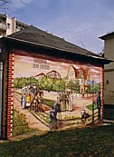
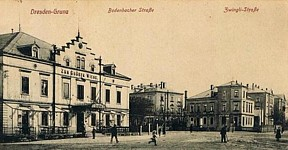

* * *

Die später beliebte Grunaer Ausflugsgaststätte “Grüne Wiese” ging auf eine bereits im 15. Jahrhundert erwähnte Schänke an der Landstraße nach Böhmen, der heutigen [Bodenbacher Straße](../../../../../ost/gruna/strassen_gruna/bodenbacher_strasse/) zurück. In der Nähe einer Brücke über den [Landgraben](../../../../../ost/striesen/landgraben/) entstand damals eine Schmiede, die zugleich das Schankrecht erhielt und Raststation für Fuhrleute war. Außerdem besaß diese Schankwirtschaft ab 1716 das Privileg der Gästebeherbergung, des Schlachtens, Backens und Branntweinbrennens. Wegen ihrer Lage inmitten damals noch unbebauter grüner Fluren wurde das Rasthaus als “Grüne Wiese” bezeichnet. Gleichzeitig diente sie als Dorfgasthof von Gruna.

**_Foto:_** _Ausflugsgaststätte “Grüne Wiese” um 1902_

Wegen ihrer günstigen strategischen Lage spielte die Schänke mehrfach bei kriegerischen Auseinandersetzungen eine Rolle. Während der Schlacht bei Kesselsdorf im Dezember 1745 nutzten die Österreicher das Haus als Hauptquartier.Auch Preußenkönig Friedrich II. wählte bei der Belagerung Dresdens im Juli 1760 die “Grüne Wiese” als Unterkunft und strategische Basisstation. Im August 1813 waren das Gasthaus und das Dorf Gruna heftig umkämpft, wobei schwere Schäden an den Gebäuden entstanden.

Im 19. Jahrhundert entwickelte sich die frühere Schmiede zum Ausflugslokal und wurde nach dem Bau der Straßenbahn 1873 zum beliebten Ziel für Sommergäste und Wochenendbesucher. Besitzer war ab 1820 die Grunaer Bauernfamilie Thiele. Neben dem schattigen Obstgarten gab es verschiedene Belustigungen wie Vogel- und Kränzelschießen, Platzkonzerte und Tanz. Zudem besaß der Wirt das Recht, Kuchen und anderes Backwerk über "fliegende Händlerinnen" an Besucher des Großen Gartens zu verkaufen. Für die Beliebtheit des Lokals spricht, dass die Gemeinde Gruna ab 1862 bei längerem Aufenthalt sogar eine Art Kurtaxe erhob.

1876 wurde die "Grüne Wiese" unter Beibehaltung des alten Namens an die Zwinglistraße verlegt. Initiator des Umzugs war Gastwirt Robert Thiele, der viele Jahre zugleich das Amt des Grunaer Gemeindevorstands inne hatte. Thiele ließ an der Ecke Zwingli-/Rosenbergstraße einen zweistöckigen Neubau errichten, in dem neben Restaurant und Bräustübel auch ein Gesellschaftszimmer und ein Saal für ca. 800 Personen Platz fanden. Das alte Grundstück wurde verkauft. An Stelle des früheren Wirtshauses errichte Julius Rothermund eine prächtige [Villa](../../../../../ost/gruna/rothermundpark/), die jedoch 1945 zerstört wurde.

Bis zum Zweiten Weltkrieg blieb das Gasthaus ein beliebter Veranstaltungsort und war Schauplatz von Vereinsversammlungen, Familienfeiern und offiziellen Festen wie Kirch- und Glockenweihe. Zudem tagte regelmäßig der Grunaer Gemeinderat in der "Grünen Wiese". Auch die Feier zur Eingemeindung Grunas nach Dresden fand am 1. April 1901 hier statt. Während des Ersten Weltkriegs diente der Saal als Unterkunft des Landsturms. Beim Luftangriff 1945 brannte die "Grüne Wiese" aus und wurde wenig später abgerissen. In einem erhaltenen Nebengebäude gab es noch einige Jahre die "Wiesenbaude". Planungen zu einem Wiederaufbau als Gaststätte mit Kinosaal kamen nicht zustande. Heute erinnert nur noch eine mit historischen Grunaer Ansichten bemalte Trafostation der DREWAG _(Foto oben links)_ an die einstige Ausflugsgaststätte.

* * *

 \[ [Home](../../../../../index.html)\] \[ [Nord](../../../../../nord/)\] \[ [Nordwest](../../../../../nordwest/)\] \[ [Neustadt](../../../../../neustadt/)\]
 \[ [Nordost](../../../../../nordost/)\] \[ [West](../../../../../west/)\] \[ [Zentrum](../../../../../zentrum/)\] \[ [Südwest](../../../../../sudwest/)\]
 \[ [Süd](../../../../../sud/)\] \[ [Südost](../../../../../sudost/)\] \[ [Ost](../../../../../ost/)\] \[ [Register](../../../../../Register/register.html)\] \[ [Kontakt](../../../../../Kontakt/kontakt.html)\] \[ [Impressum](../../../../../impressum/)\]
