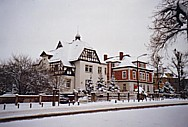

* * *

Die Karcherallee verbindet Strehlen mit dem Nachbarort Gruna und bildet zugleich die östliche Begrenzung des Großen Gartens. Ihren Namen erhielt sie 1893 nach dem Gartenarchitekten und sächsischen Oberlandbaumeister Johann Friedrich Karcher (1650-1726), der maßgeblich an der Gestaltung des Parks beteiligt war. Karcher übernahm 1699 das Amt des kurfürstlich-sächsich-polnischen Oberlandbaumeisters und entwickelte eine der ersten Bauordnungen in Dresden. Zuvor war die Straße ab 1891 zu Ehren König Alberts kurzzeitig Königsallee genannt worden. Ältester Abschnitt ist der Teil zwischen Tiergarten- und Winterbergstraße. 1906 wurde sie bis zum Grunaer Weg und 1907 bis zum damaligen Carlowitzplatz (heute Bertolt-Brecht-Platz) verlängert.

Die Wohnhäuser im Landhausstil an der Ostseite entstanden meist Anfang des 20. Jahrhunderts. In einer diese Villen hat seit 1954 die [Palucca-Hochschule für Tanz](../../../../sudost/strehlen/) ihren Sitz. Die meisten anderen Gebäude werden heute als Bürohäuser bzw. zu Wohnzwecken genutzt. Auf der gegenüberliegenden Straßenseite befindet sich der [Große Garten](../../../../zentrum/grosser_garten/) mit der Station "Karcherallee" der Parkeisenbahn.

_**Foto:** Die Karcherallee im Winter 2006_

Einzelne Gebäude:

Nr. 11: Die Villa Karcherallee 11 in Dresden wurde um 1900 als Wohnhaus für den Stabsarzt a. D. Emil Robert Roesch nach Plänen des Architekten Heino Otto gebaut. Der zunächst im Stil des Neobarocks, später im Jugendstil gestaltende Künstler schuf zu dieser Zeit mehrere architektonisch bemerkenswerte Villenbauten, so auch die Häuser Karcherallee 43 (1899), Stübelallee 21 (1900) und die Villa Caspar-David-Friedrich-Straße 3 (1903/1904). Der plastischen Schmuck der Karcherallee 11 stammte vom Bildhauer Hugo Hahn. 1945 wurde die Villa _(Foto rechts)_ zerstört.

Nr. 13: Die benachbarte Villa Ostheim _(Bild links)_ befand sich um 1912 im Besitz des Unternehmers Karl Dieterich (1869-1920), Sohn von Eugen Dieterich. Eugen Dieterich war Inhaber der 1869 gegründeten [Chemischen Fabrik Helfenberg](../../../../nordost/schonfeld-weissig/helfenberg/helfenberger_grund/). 1885 übernahmen seine Söhne Hans und Karl die Geschäftsleitung und bauten die Firma zu einem international erfolgreichen Hersteller medizinischer Präparate aus.

Nr. 19: Die heute gewerblich genutzte Villa war seit den 1920er Jahren Wohnsitz des Architekten und Baumeisters Hanns Vasak. Im August 1930 erwarb Vasak mehrere unbebaute Grundstücke an der Dohnaer Straße und Rayskistraße und errichtete dort Mietwohnhäuser mit preiswerten Kleinwohnungen. Zuvor war er bereits für die Reichspost als Bauunternehmer tätig gewesen, die auch die Finanzierung seiner Strehlener Wohnanlage übernahm. Da die Kreditgewährung jedoch gegen die verbotene Absprache erfolgte, die Wohnungen bevorzugt an Postangestellte zu vermieten und Vasak zudem in den Verdacht geriet, Bestechungsgelder gezahlt zu haben, wurde er 1935 wegen Beamtenbestechung verurteilt.

Nr. 21: In diesem Haus lebte bis zu seinem Tod der Maler Hans von Loesch, ehemaliger Major. Der 1863 in Oppeln geborene Offizier arbeitete nach seiner militärischen Laufbahn als Kunstmaler und schuf vor allem Landschaftsdarstellungen.

* * *

 \[ [Home](../../../../index.html)\] \[ [Nord](../../../../nord/)\] \[ [Nordwest](../../../../nordwest/)\] \[ [Neustadt](../../../../neustadt/)\] \[ [Nordost](../../../../nordost/)\] \[ [West](../../../../west/)\] \[ [Zentrum](../../../../zentrum/)\] \[ [Südwest](../../../../sudwest/)\] \[ [Süd](../../../../sud/)\] \[ [Südost](../../../../sudost/)\] \[ [Ost](../../../../ost/)\] \[ [Register](../../../../Register/register.html)\] \[ [Kontakt](../../../../Kontakt/kontakt.html)\] \[ [Impressum](../../../../impressum/)\]
