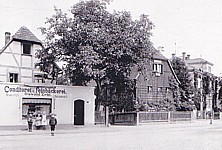
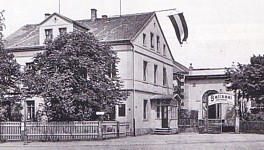
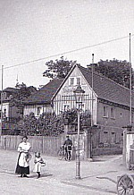
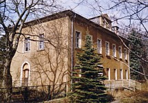

Die ursprünglich von der Rothermundt- bis zur Schlüterstraße führende Rosenbergstraße war einst die Hauptstraße des Dorfes Gruna. Zu beiden Seiten standen die Gehöfte und Bauernhäuser des Ortes, die teilweise auch kleine Läden und Handwerksbetriebe beherbergten. Geteilt wurde die Straße durch eine platzartige Anlage, die zunächst Hauptplatz, später [Altgruna](../../../../ost/gruna/strassen_gruna/) genannt wurde.
Am 11. Februar 1882 beschloss der Grunaer Gemeinderat, diese Straße nach dem Besitzer der hier gelegenen Villa "Akazienhof" Rosenbergstraße zu benennen. Georg Otto Franz Baron von Rosenberg trat auch als Wohltäter in Erscheinung und stiftete der Gemeinde Mittel für die Armenfürsorge. Aus Anlass des "Lutherjahres" 1883 pflanzten Grunaer Kinder am 10. November des Jahres vor dem Haus Nr. 10 eine Lutherlinde.

Beim Luftangriff 1945 fielen die meisten Gebäude des alten Dorfkerns am Hauptplatz und der Rosenbergstraße den Bomben zum Opfer bzw. wurden schwer beschädigt. Die verbliebenen Reste mussten 1973/74 dem Neubaugebiet Gruna weichen, wobei auch die Rosenbergstraße in ihrem Verlauf verändert wurde. Seitdem schwenkt sie in einem Bogen in westliche Richtung ab und mündet in die Schneebergstraße.

Einzelne Gebäude:

Gasthof "Germania" (Nr. 1): Die Gaststätte im Eckhaus Rosenbergstraße 1 / Rothermundstraße entstand 1874 _(Foto rechts)_. 1889 wurde sie im hinteren Bereich um einen Ballsaal und eine Kegelbahn erweitert und warb fortan mit dem Namen "Ballsaal Germania" um Gäste. Am 4. September 1927 eröffnete hier das Kino "Germania-Lichtspiele", auch "Gerli" genannt. 1945 wurden Gasthof und Saal zerstört, die letzten Überreste 1974 beseitigt.

Nr. 2: Als eines der wenigen Gebäude der Rosenbergstraße überstand dieses Wohn- und Geschäftshaus den zweiten Weltkrieg ohne größere Schäden. Bis zuletzt befanden sich hier im Erdgeschoss die Rosenberg-Drogerie von Walter Stolpner und die Fleischerei Wiedenmann. 1974 wurde das Haus im Zuge des Neubaugebietes Altgruna abgerissen.

Rosenbergschänke (Nr. 11): Die Gaststätte an der Rosenbergstraße 11 _(Foto links)_ war eine von mehreren kleinen Schankwirtschaften im Ort. Besitzer war vor dem Ersten Weltkrieg Emil Richter, was dem Lokal im Volksmund den Namen "Schwarzer Emil" einbrachte. Nach einem größeren Umbau und Erweiterung um einen Tanzsaal in den Zwanziger Jahren erhielt sie den Namen "Grunaer Spiegelsäle". Wie viele Gebäude im Ortszentrum fiel auch die Rosenbergschänke 1945 den Bomben zum Opfer. Später nutzte bis zum Abbruch der letzten Reste die Altstoffhandlung Frenzel das Gelände.

Nr. 21: Im Erdgeschoss dieses Hauses befand sich bis 1945 die Musikalienhandlung von Robert Gustav Gnauck (1866-1951). Gnauck hatte das Dresdner Konservatorium besucht und komponierte selbst vorrangig Marschmusik für das Militär und Spielmannszüge, die er bei der Verlagsanstalt Erich Deleiter, später im eigenen Musikverlag mit Sitz in Gruna veröffentlichte. Nach seinem Tod wurde der Verlag zunächst von Paul Woitschach in Berlin weitergeführt und gehört seit 1980 zum Verlag "Melodie der Welt" in Frankfurt/Main.

Nr. 24 (Gutshof Preußer): Dieser zu den größeren Grunaer Gehöften gehörende Dreiseithof befand sich bis Ende des 19. Jahrhunderts im Besitz von Eva Rosine Beil (1822-1897). Da ihre beiden Söhne bei einem tragischen Unglück ertrunken waren, stiftete sie der Gemeinde eine größere Summe für den Bau der [Thomaskirche](../../../../ost/gruna/thomaskirche/). An sie erinnert bis heute die Beilstraße. Nach ihrem Tod übernahm ihr Neffe Max Preußer das Gut und nutzte es bis zur weitgehenden Zerstörung 1945 landwirtschaftlich bzw. als Verleih für landwirtschaftliche Großgeräte. In den ausgebauten Ruinen waren zuletzt bis zum Abbruch 1973 zwei Handwerksbetriebe untergebracht.

Nr. 27: Im heute nicht mehr vorhandenen Wohnhaus Rosenbergstraße 27 verbrachte der berühmte Zauberkünstler Bartolomeo Bosco seine letzte Lebensjahre. Der 1794 in Turin geborene Magier bereiste mit seinen Tricks weite Teile Europas und des Orients und galt zu Lebzeiten als einer der besten Zauberkünstler der Welt. Nach seiner Niederlassung in Dresden heiratete er eine Grunaerin und lebte in deren Elternhaus in Gruna. Sein Grab befindet sich auf dem Alten Katholischen Friedhof an der Friedrichstraße. Zuletzt war das Haus Sitz der Blumenbinderei und Gärtnerei Fleck.

Nr. 32 (Villa Akazienhof): Das Mitte des 19. Jahrhunderts errichtete Landhaus, auch Villa Akazienhof, befand sich im Besitz des Barons Georg Otto Franz von Rosenberg, der zu Lebzeiten als Mäzen und Stifter in Erscheinung trat und die örtlichen Armen unterstützte. Ihm zu Ehren erhielt die Straße 1886 den Namen Rosenbergstraße. Bis 1921 blieb die Villa in Privatbesitz. Danach wurde sie vom Fotopapierproduzenten [Mimosa AG](../../../../ost/gruna/strassen_gruna/) als Verwaltungsgebäude genutzt. Zu DDR-Zeiten befand sich hier ein Kindergarten. Mit Verlegung der Rosenbergstraße wechselte die postalische Bezeichnung in Schneebergstraße 16. Das noch erhaltene Gebäude steht heute in ruinösem Zustand leer.

* * *

 \[ [Home](../../../../index.html)\] \[ [Nord](../../../../nord/)\] \[ [Nordwest](../../../../nordwest/)\] \[ [Neustadt](../../../../neustadt/)\] \[ [Nordost](../../../../nordost/)\] \[ [West](../../../../west/)\] \[ [Zentrum](../../../../zentrum/)\] \[ [Südwest](../../../../sudwest/)\] \[ [Süd](../../../../sud/)\] \[ [Südost](../../../../sudost/)\] \[ [Ost](../../../../ost/)\] \[ [Register](../../../../Register/register.html)\] \[ [Kontakt](../../../../Kontakt/kontakt.html)\] \[ [Impressum](../../../../impressum/)\]
