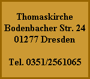
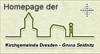
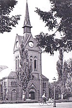
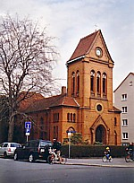

* * *

Das Dorf Gruna unterstand ursprünglich der Dresdner Kreuzkirche und wurde als ehemaliger Stiftsbesitz nach der Reformation vom Religionsamt des Dresdner Rates verwaltet. Als Verbindung zur Innenstadt nutzten die Grunaer Bauern die heutige Comeniusstraße, die deshalb früher als Grunaer Kirchsteig bezeichnet wurde. Ab 1885 fanden gelegentlich auch Gottesdienste in der alten Dorfschule statt. Um den langen Weg zur Kreuzkirche für die Einwohner zu verkürzen, stifteten die Grunaer Gutsbesitzerin Eva Rosine Beil sowie der Kaufmann Julius Rothermund eine Kapelle für den Ort. Diese entstand (Grundsteinlegung am 8. Oktober 1891) an der Bodenbacher Straße 24 und wurde am 31. August 1892 geweiht. Der Entwurf für den im neoromanischen Stil gestaltete Kirchenbau stammt von Christian Gottfried Schramm. Seit 1908, dem Zeitpunkt der Ausgliederung aus der Kreuzkirch-Gemeinde, trägt die Kirche den Namen Thomaskirche _(Foto vor 1945)_.

Da die Zahl der Gemeindemitglieder zwischen 1892 und 1930 von 700 auf über 5400 angewachsen war, machte sich ein Erweiterungsbau erforderlich, dessen Einweihung am 30. Oktober 1932 erfolgte. Beim Luftangriff auf Dresden trafen Bomben die Kirche, die mit Ausnahme des Glockenturmes völlig ausbrannte. Nach Beseitigung der Kriegsschäden konnte die Thomaskirche als erste wiederhergestellte Kirche Dresdens am 29. Oktober 1950 wieder geweiht werden. Für den Innenraum schuf der Künstler Helmar Helas ein neues Altarfenster sowie eine Kanzel und ein Lesepult. Das Fenster zeigt eine Darstellung des auferstandenen Christus und weist auf die Thomas-Geschichte aus dem Neuen Testament hin.

Taufbecken und Teile des Gestühls konnten von der zerstörten Ehrlichschen Gestiftskirche am Stübelplatz übernommen werden. 1952 folgte der Einbau einer Jehmlich-Orgel mit zwei Manualen und 16 Registern. Im Turm läuten drei in Bochum gegossene Stahlglocken aus dem Jahr 1921, die das ursprüngliche, 1892 von der Grunaer Gutsbesitzerwitwe Christiane Kürbis gestiftete Geläut ersetzen. Im Zuge innerkirchlicher Strukturveränderungen wurde die Thomaskirchgemeinde 2006 mit der Nazarethgemeinde Seidnitz vereinigt.

Wertvollstes Ausstattungsstück der Thomaskirche ist der 1932-34 von Edmund Moeller geschaffene Altar mit zwei Marmorreliefs “Die zu bekehrende Gemeinde” und “Die bekehrte Gemeinde”. Streitigkeiten zwischen dem Kirchenvorstand und dem Bildhauer führten zu einer Verzögerung und langwierigen Prozessen, aus denen die Thomaskirchgemeinde letztlich als Sieger hervorging. Moeller fügte daraufhin in eines der beiden Reliefbilder eine Teufelsdarstellung ein, die jedoch kurz nach Übergabe des Kunstwerkes an die Gemeinde entfernt wurde.

* * *

 \[ [Home](../../../index.html)\] \[ [Nord](../../../nord/)\] \[ [Nordwest](../../../nordwest/)\] \[ [Neustadt](../../../neustadt/)\] \[ [Nordost](../../../nordost/)\] \[ [West](../../../west/)\] \[ [Zentrum](../../../zentrum/)\] \[ [Südwest](../../../sudwest/)\] \[ [Süd](../../../sud/)\] \[ [Südost](../../../sudost/)\] \[ [Ost](../../../ost/)\] \[ [Register](../../../Register/register.html)\] \[ [Kontakt](../../../Kontakt/kontakt.html)\] \[ [Impressum](../../../impressum/)\]
