* * *

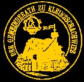

**Gemeindesiegel von Kleinzschachwitz**

* * *

* * *

**Vereine in Kleinzschachwitz:**

[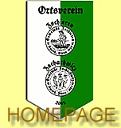](http://www.ortsverein-zschieren-zschachwitz.de)

* * *

**Schulen in Kleinzschachwitz:**

Kleinzschachwitz wurde am 6. Juli 1310 in einer Kaufurkunde des Klosters Altzella erstmals als “villa Schyzewycz” erwähnt. Der Name ist von einem slawischen Personennamen (“Ort des Ciz”) abgeleitet, was auf eine entsprechende Gründung durch sorbische Siedler hindeutet. Allerdings waren die Fluren bereits deutlich früher besiedelt, wie ein 1899 bei Bauarbeiten an der Eichbergstraße entdecktes Urnenfeld aus der Zeit um 900 v. Chr. beweist. Später wurde das Dorf Zscheisewitz genannt, bevor sich Mitte des 19. Jahrhunderts endgültig der heutige Name Kleinzschachwitz in Unterscheidung zum benachbarten Großzschachwitz durchsetzte.

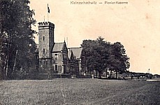Ursprünglich unterstand der Ort dem Leubnitzer Klosterhof, wurde jedoch Anfang des 15. Jahrhunderts von seinen Bewohnern verlassen. Die Gründe dafür sind unklar. 1438 übernahmen die Bauern der benachbarten Dörfer die wüsten Felder von Zscheisewitz zur Bestellung. Lediglich eines der Güter tauchte im Zusammenhang mit Zerstörungen im Dreißigjährigen Krieg 1643 nochmals in den Urkunden auf. Erst in der zweiten Hälfte des 17. Jahrhunderts entstanden erneut Gebäude auf Kleinzschachwitzer Flur, welches 1681 wieder sieben Häuser zählte. 1721 richtete man eine [Fähre](../../nordost/pillnitz/) zum Schloss Pillnitz ein, die 1765 als “Fliegende Fähre” mit Gierseilantrieb ausgestattet wurde, bis 1849 jedoch lediglich von Angehörigen des Hofes benutzt werden konnte. Für die Fährleute, bis 1911 ausschließlich Angehörige der sächsischen Armee, entstand die heute als Gaststätte genutzte burgartige Pontonierkaserne am Elbufer _(Foto rechts)_.

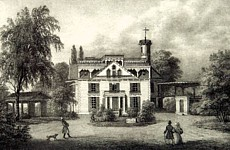Für die weitere Entwicklung war vor allem die Entscheidung des russischen Fürsten Nikolaus Abramowitsch Putjatin von Bedeutung, der 1797 den Petzoldschen Hof in Kleinzschachwitz erwarb. Putjatin galt als skurriles Original, engagierte sich jedoch sehr für seinen neuen Heimatort. Neben einem in ungewöhnlichem Stil gestalteten Wohnhaus _(Bild)_ ließ er 1823 an der heutigen Meußlitzer Straße 83 die erste Schule des Ortes errichten, welche heute als Kulturzentrum [“Putjatinhaus”](../../ost/kleinzschachwitz/strassen_kleinzschachwitz/putjatinhaus/) dient.

Das eigentliche Dorf bestand bis Mitte des 19. Jahrhunderts lediglich aus einigen wenigen Häusern rund um den heutigen Dorfplatz Altkleinzschachwitz. Hinzu kamen eine 1887 zur Brauerei umgewandelte Papiermühle am Lockwitzbach sowie das königliche Jagdhaus am Elbufer. Da das Gemeindegebiet zum Großteil mit Kiefern- und Auwald bedeckt war, konnte nur eingeschränkt Landwirtschaft betrieben werden. Stattdessen verdienten sich die Bewohner ihren Lebensunterhalt als Schiffsknechte sowie mit der Verarbeitung von Stroh und Holz. Nach 1860 gründeten private Unternehmer zwei Ziegeleien, 1877 ein Dampfsägewerk und eine Strohfabrik.

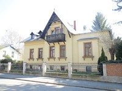1886 erhielt Kleinzschachwitz eine eigene Station der Dampfschifffahrt, womit der ruhig gelegene Ort als Wohnsitz für wohlhabende Dresdner und als Ausflugsziel interessant wurde. Innerhalb weniger Jahre entstanden am Elbufer und an der Königsallee (heute [Berthold-Haupt-Straße](../../ost/leuben/strassen_leuben/berthold-haupt-strasse/)) und ihren Seitenstraßen _(Foto: Kyawstraße 24)_ zahlreiche Villen und Landhäuser sowie mehrere Gaststätten. Hinzu kamen das [Kurhaus](../../ost/kleinzschachwitz/strassen_kleinzschachwitz/kurhaus_kleinzschachwitz/), ein Rathaus mit Postamt, neue Schulen und ein eigenes Wasserwerk an der Keppgrundstraße. Später folgten Eigenheimsiedlungen in Richtung Meußlitz, deren Bewohner meist in den Betrieben von Niedersedlitz, Dobritz und in Laubegast beschäftigt waren. Um diesen den Weg zu ihren Arbeitsstätten zu erleichtern, wurde Kleinzschachwitz 1906 an die [Dresdner Vorortbahn](../../ost/niedersedlitz/dresdner_vorortbahn/) angeschlossen. 1936 erhielt die 1925 in Stadtspur umgebaute Straßenbahn ihre heutige Streckenführung direkt nach Leuben über die Berthold-Haupt-Straße.

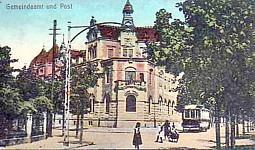

**_Foto:_** _Kleinzschachwitz in den Zwanziger Jahren - links das Rathaus, rechts die Albertstraße_

Kirchlich unterstand der Ort noch bis 1897 der Dohnaer Kirche und bildete dann gemeinsam mit den Nachbarorten Großzschachwitz, Meußlitz, Sporbitz und Zschieren eine eigene Gemeinde, welche 1901 eine ehemalige Turnhalle an der Meußlitzer Straße zur [Stephanuskirche](../../ost/kleinzschachwitz/stephanuskirche/) ausbaute. Eine zweite Kirche [“Heilige Familie”](../../ost/kleinzschachwitz/pfarrei__heilige_familie_/) entstand 1926 für die katholische Bevölkerung des Ortes.

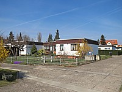Auch nach der Eingemeindung des Ortes nach Dresden am 1. April 1921 blieb Kleinzschachwitz ein ruhiger Wohnvorort. Bedingt durch die Not der Nachkriegszeit und die wirtschaftliche Situation nach der Inflation konnten frühere Bebauungspläne erst Mitte der Dreißiger Jahre weiter umgesetzt werden. Von Kriegsschäden weitgehend verschont, zeigen die meisten Straßen des Stadtteils noch heute ihr ursprüngliche Bild der Entstehungszeit. Einige verbliebene Baulücken wurden nach 1990 mit Wohnhaus-Neubauten geschlossen, u. a. an der Meußlitzer Straße und der Oberonstraße. Zu den Höhepunkten im Ortsleben gehört seit einigen Jahren die alljährlich begangene “Zschachwitzer Dorfmeile” im alten Ortskern.

Rathaus:

Erster Sitz der Gemeindeverwaltung war das 1896/97 als Domizil der Ortsbehörde und Gemeindearmenhaus errichtete Gebäude Carl-Borisch-Straße 6. Hier befanden sich neben den Büros des Ortsvorstehers auch Wohnräume für bedürftige Familien. Allerdings genügten die Räumlichkeiten schon bald nicht mehr den Anforderungen, weshalb man sich wenig später zum Bau eines richtigen Rathauses entschloss. Nach dessen Fertigstellung wurde das Gemeindehaus u.a. als Bibliothek genutzt und später zum Wohnhaus umgebaut.

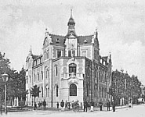Das neue Kleinzschachwitzer Rathaus entstand 1901/02 an der Einmündung Hosterwitzer / Kurhausstraße und wurde am 6. September 1902 eingeweiht. Die Planungen übernahmen der Architekt Robert Wohlfahrt und der Zimmermeister Ernst Noack. Neben den Diensträumen für die Gemeindeverwaltung beherbergte das Rathaus bis 1920 auch das örtliche Standesamt, die Ortssteuereinnahme, eine Sparkassenfiliale und das Postamt. Hinzu kamen Wohnungen für Gemeindebedienstete. Nach Schließung der Postfiliale 1998 wurde das sanierte Gebäude bis 2018 unter dem Namen “Am Fürstenpark” bzw. “Kleines Kulturhaus” als Gesundheitszentrum genutzt. Am Eingang erinnert eine 1910 von Veterinärrat Friedrich Clemens Lungwitz gestiftete Gedenktafel an verdienstvolle Kleinzschachwitzer Bürger und die einstige Nutzung des Hauses.

Schulen in Kleinzschachwitz:

Dorfschule: Ursprünglich besuchten die Kinder der Umgebung die Kirchschule in Dohna, bevor um 1670 in Meußlitz und Zschieren eigene Dorfschulen eingerichtet wurden. Nachdem sich auch auf Kleinzschachwitzer Flur wieder einige Familien angesiedelt hatten, stellte die Gemeinde 1744 einen eigenen Kinderlehrer an. Der Unterricht fand in verschiedenen Wohnhäusern des Ortes statt, die alle heute nicht mehr erhalten sind.

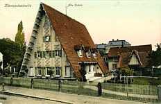Putjatin-Schule: Erst mit Unterstützung des Fürsten Putjatin konnte 1822 ein eigenes [Schulhaus](../../ost/kleinzschachwitz/strassen_kleinzschachwitz/putjatinhaus/) errichtet und am 10. September 1823 eingeweiht werden. Putjatin förderte mittels einer eigens eingerichteten Stiftung und verschiedenen Schenkungen auch die Finanzierung dieser Schule. Das kuriose Gebäude an der Meußlitzer Straße wurde bis 1872 genutzt und dient heute als Stadtteilzentrum. Auch die Kinder aus Großzschachwitz, Meußlitz, Sporbitz und Zschieren, mit denen seit 1835 ein gemeinsamer Schulverband bestand, nutzten dieses Haus. Auf dem Nachbargrundstück gab es einen Spielplatz mit “Spieltempel” und einem Rutschberg, der nach dem Willen des Stifters die Einheit von Spielen und Lernen fördern sollte. Leider wurde die Anlage bereits 1874 wieder abgetragen.

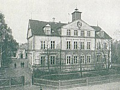Schule Meußlitzer Straße: Im Zusammenhang mit dem Zuzug weiterer Familien machte sich Ende des 19. Jahrhunderts ein Schulneubau erforderlich. Zur Finanzierung der Baukosten verkaufte die Gemeinde das alte von Putjatin gestiftete Schulgebäude und ein daneben gelegenes Grundstück. 1873 entstand an der Meußlitzer Straße 113 ein neues Schulhaus _(Foto)_. Eingeweiht wurde dieses am 13. April 1874. 1880 folgte auf dem gleichen Grundstück der Bau einer Turnhalle mit Betsaal für den örtlichen Kirchlichen Verein. Mit zunehmender Einwohnerzahl genügten jedoch auch diese Gebäude schon bald nicht mehr den Anforderungen. 1886 schied der Nachbarort Zschieren aus dem Schulverband aus, 1898 folgte Großzschachwitz, wenig später auch Meußlitz und Sporbitz. Auch in Kleinzschachwitz selbst musste 1893 ein Erweiterungsbau errichtet werden. 1898 gründete der Lehrer Trömel eine Privatschule, die ab 1903 als Vereinsschule fortgeführt wurde, 1906 jedoch aus wirtschaftlichen Gründen ihre Pforten schloss. Die Schule an der Meußlitzer Straße wurden 1899 an die Kirchgemeinde des Ortes verkauft, die hier Pfarramt und Friedhofsverwaltung unterbrachte. Aus der ehemaligen Turnhalle ging 1901 die heutige [Stephanuskirche](../../ost/kleinzschachwitz/stephanuskirche/) hervor.

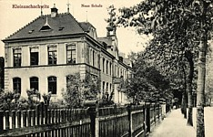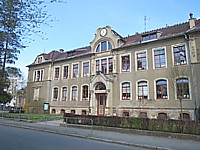65\. Grundschule: Das bis zur Gegenwart von den Kindern des Stadtteils genutzte Schulhaus auf der Zschierener Straße 5 entstand 1900 nach Plänen des Architekten Robert Wohlfahrt unter Mitwirkung des ortsansässigen Zimmermeisters Ernst Noack. Mit Hilfe privater Kreditgeber konnte der Neubau bereits wenige Monate nach Baubeginn am 4. Januar 1902 eröffnet werden, die Schulturnhalle folgte noch im gleichen Jahr. Bereits 1909 machte sich ein Erweiterungsbau erforderlich. Heute befindet sich hier die 65. Grundschule “Am Waldpark”. 2009 war die zu DDR-Zeiten eingeführte  Namensgebung nach dem russischen Dichter Alexander Puschkin aufgehoben worden. In unmittelbarer Nachbarschaft betreibt seit 2005 der Christliche Schulverein Zschachwitz e.V. eine private Schule.

Elbebad:

Das erste Kleinzschachwitzer Elbebad entstand 1878 und hatte seinen Standort gegenüber der Schiffsanlegestelle von Hosterwitz. Nach seinem Besitzer wurde es Huhle´sches Bad genannt und existierte bis 1903. Nach Beschädigung durch Hochwasser und Eisgang musste es jedoch demontiert werden. Als Nachfolgeeinrichtung genehmigte die Gemeinde Kleinzschachwitz 1906 ein neues Bad an anderer Stelle. Die hölzernen Stege und Kabinen errichtete der Baumeister Ernst Noack, das benötigte Ufergrundstück überließ die Firma Spalteholz. Den Betrieb übernahmen Pächter. Mehrfach wechselte dieses Bad seinen Standort, bevor vermutlich in den 1920er Jahren seine Stillegung erfolgte.

Tennisclub Kleinzschachwitz:

Der Tennisclub Kleinzschachwitz wurde kurz nach dem Ersten Weltkrieg als Netzball-Club Kleinzschachwitz gegründet und besaß sein erstes Domizil auf der Keppgrundstraße. 1924 bezog man das bis heute genutzte Gelände an der damaligen Königsallee (Berthold-Haupt-Straße) mit drei Spielfeldern und einem 1926 eingeweihten Vereinshaus. Dieses Jahr gilt auch als Zeitpunkt der offiziellen Vereinsgründung. Bis 1945 war der Club ein reiner Privatclub, wurde dann jedoch dem Deutschen Turn- und Sportbund DTSB zugeordnet und an die BSG Aufbau Ost angeschlossen. 1953 übernahm die BSG Chemie Niedersedlitz die Anlagen.

Im Mai 1990 gründete sich der Verein als Tennisclub Kleinzschachwitz e.V. neu. Heute nutzt der Club mit seinen ca. 130 Mitgliedern die mehrfach modernisierten Anlagen für den Trainingsbetrieb und gelegentliche Turniere. Das in den 1970er Jahren errichtete neue Klubhaus wurde 1994 umfassend saniert.

[_Weiterführende Literatur und Quellen_](../../impressum/quellenverzeichnis/)

 \[ [Home](../../index.html)\] \[ [Nord](../../nord/)\] \[ [Nordwest](../../nordwest/)\] \[ [Neustadt](../../neustadt/)\] \[ [Nordost](../../nordost/)\] \[ [West](../../west/)\] \[ [Zentrum](../../zentrum/)\] \[ [Südwest](../../sudwest/)\] \[ [Süd](../../sud/)\]
 \[ [Südost](../../sudost/)\] \[ [Ost](../../ost/)\] \[ [Register](../../Register/register.html)\] \[ [Kontakt](../../Kontakt/kontakt.html)\] \[ [Impressum](../../impressum/)\]
