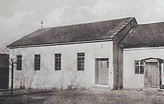
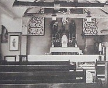
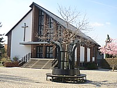

* * *

* * *

* * *

* * *

* * *

* * *

Nachdem die katholischen Christen von Klein- und Großzschachwitz und einigen umliegenden Orten mangels eines eigenen Gotteshauses die Dresdner Hofkirche bzw. die Schlosskapelle Pillnitz besuchten, entschloss man sich nach dem Ersten Weltkrieg zur Bildung einer eigenen Gemeinde. Diese entstand 1924 als Außenstelle der Johannstädter Pfarrei. Am 24. Februar konnte Hermann Mühr als erster Pfarrer im großen Saal des [Kurhauses Kleinzschachwitz](../../../ost/kleinzschachwitz/strassen_kleinzschachwitz/kurhaus_kleinzschachwitz/) in sein Amt eingeführt werden. Neben dem Kurhaus nutzte man zunächst auch Räume im Obergeschoss des Kleinzschachwitzer Gasthofes für die Gemeindearbeit. 1925 erwarb die junge Kirchgemeinde einen alten Holzlagerschuppen an der [Meußlitzer Straße 108](../../../ost/kleinzschachwitz/strassen_kleinzschachwitz/) und richtete dort eine Notkirche ein _(Foto)_. Diese wurde am 17. November 1926 eingeweiht und erhielt dabei den Namen “Heilige Familie”. Für die Ausstattung der Kirche stiftete der frühere sächsische König Friedrich August III. eine Kreuzigungsgruppe aus der Kapelle seines Jagdschlosses Rehefeld. Die 1937 zu einer selbstständigen Pfarrei erhobene Kirche ist seitdem für das gesamte Gebiet zwischen Tolkewitz und Heidenau zuständig.

Während der Nazizeit wirkte zeitweise der französische Priester Pierre de Porcaro in Zschachwitz. Mit Duldung des regimekritischen Pfarrers Dr. Ludwig Baum übernahm Porcaro illegal die seelsorgische Betreuung französischer Zwangsarbeiter und hielt Gottesdienste in französischer Sprache. 1944 wurde er jedoch von der Gestapo entdeckt und verstarb ein Jahr später im KZ Dachau an Typhus. 2001 leitete die Kirche für ihn und einige seiner Mitstreiter das Seligsprechungsverfahren ein.

1953 entstand durch Umbau und Erweiterung der bisherigen Notkirche ein neuer Pfarrsaal mit einigen Nebenräumen. Auch dieses Provisorium war jedoch keine Lösung für die Gemeinde, die deshalb einen Kirchenneubau auf ihrem Grundstück anstrebte. 1978 begann die Realisierung dieser Pläne. Um notwendige Baugenehmigungen zu umgehen, wurden die vorhandenen Räumlichkeiten zunächst etappenweise umgebaut und erweitert. Unter Leitung des Architekten Hubert Paul entstand schließlich ein moderner Zweckbau, der am 27. September 1981 durch Bischof Gerhard Schaffran
geweiht wurde _(Foto)_. Ein Großteil der Arbeiten wurde dabei von den Gemeindemitgliedern selbst übernommen. 1987 erfolgte der Einbau der von Johannes Beeck gestalteten Glasfenster im Altarraum. Neben dem großen Gemeindesaal beherbergt das Gebäude auch die kleinere “Werktagskapelle”, einen Jugendclub und weitere Räume für die kirchliche Arbeit. Die kleine Orgel mit ihren ca. 500 Pfeifen stammt aus dem Jahr 1967 und wurde von der Firma Rühle gebaut. Interessant ist auch ein 2001 angelegtes begehbares Labyrinth im Pfarrgarten.

* * *

 \[ [Home](../../../index.html)\] \[ [Nord](../../../nord/)\] \[ [Nordwest](../../../nordwest/)\] \[ [Neustadt](../../../neustadt/)\] \[ [Nordost](../../../nordost/)\] \[ [West](../../../west/)\] \[ [Zentrum](../../../zentrum/)\] \[ [Südwest](../../../sudwest/)\] \[ [Süd](../../../sud/)\] \[ [Südost](../../../sudost/)\] \[ [Ost](../../../ost/)\] \[ [Register](../../../Register/register.html)\] \[ [Kontakt](../../../Kontakt/kontakt.html)\] \[ [Impressum](../../../impressum/)\]
