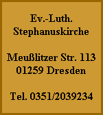
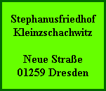
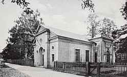
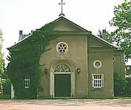

* * *

* * *

* * *

* * *

* * *

* * *

Stephanuskirche:

Ursprünglich gehörte Kleinzschachwitz gemeinsam mit seinen Nachbarorten Großzschachwitz, Meußlitz, Sporbitz und Zschieren zur Dohnaer Parochie. Doch bereits um 1820 setzten sich die Einwohner sowie der in Kleinzschachwitz lebende Fürst Putjatin für die Abtrennung von Dohna und die Gründung einer eigenen Kirchgemeinde ein, zunächst jedoch ohne Erfolg. Putjatin hatte 1823 dem Ort ein Schulhaus gestiftet.

Am 28. Oktober 1879 gründeten interessierte Bürger gemeinsam mit Vertretern der Nachbargemeinden den “Kirchlichen Verein zu Kleinzschachwitz”. Ziel war es, das durch den Verkauf mehrerer Grundstücke der Putjatinschen Stiftung erworbene Geld zweckgebunden für den Bau eines eigenen Gemeindehauses einzusetzen. Da zu dieser Zeit auch der Bau einer Schulturnhalle für die 1874 eröffnete neue Schule des Ortes geplant war, entschloss man sich, auf dem Grundstück Meußlitzer Straße 113 einen Mehrzweckbau zu errichten, der sowohl als Turnhalle als auch für Gottesdienste genutzt werden konnte. Mit Hilfe von privaten Spenden und Zuwendungen der Putjatin-Stiftung entstand 1880 nach Plänen des Zimmermeisters Ernst Noack das noch heute genutzte Gebäude. Eine Inschrift über dem Seiteneingang _“Fürstlich Poutiatinische Stiftung. Gegründet: 1825. Erneuert: 1880”_ erinnert an diese historischen Zusammenhänge. Eingeweiht wurde das neue Haus mit einem Gottesdienst am 24. Oktober 1880.

Zunächst mussten die Kleinzschachwitzer Christen ihren Betsaal mit der örtlichen Schule teilen, was sich jedoch schon bald als nachteilig erwies. Da die Einwohnerzahlen in den Nachbarorten deutlich angestiegen waren, schieden Zschieren Großzschachwitz und Meußlitz aus dem gemeinsamen Schulverband aus. Auch Kleinzschachwitz selbst errichtete 1893 ein neues Schulhaus. Die bisher für Schulzwecke genutzten Gebäude wurden damit frei und standen nun ausschließlich für kirchliche Aufgaben zur Verfügung.

Am 1. August 1897 gelang es nach mehrjährigen Verhandlungen mit der Mutterkirche, Kleinzschachwitz aus der bestehenden Dohnaer Parochie herauszulösen und eine selbstständige Kirchgemeinde zu gründen. Auch die Nachbarorte Großzschachwitz, Meußlitz, Sporbitz und Zschieren schlossen sich dieser neuen Gemeinde an. Zwei Jahre später konnte das frühere Schulgrundstück käuflich erworben werden. Durch Umbau entstanden nun Räumlichkeiten für die Verwaltung und das Pfarramt sowie einige Wohnungen. Aus der ehemaligen Turnhalle wurde 1901 ein Kirchensaal. Dafür schuf man einen Altarraum und baute eine Empore ein. Einen Turm besitzt die Kirche jedoch nicht. Dessen Funktion übernimmt ein auf dem benachbarten Friedhof aufgestellter hölzerner Glockenstuhl. Zunächst als Evangelisch-Lutherische Kirchgemeinde Kleinzschachwitz bezeichnet, erhielt sie auf Beschluss des Landeskirchenamtes 1947 den Namen Stephanusgemeinde.

Trotz der durch die Gebäudeübernahme erzielten Verbesserungen für die kirchliche Arbeit hielt man zunächst am Bau einer eigenen Kirche fest. Die Planungen dafür übernahm der Architekt Karl Emil Scherz, welcher bereits in Leuben und Blasewitz als Kirchenbaumeister in Erscheinung getreten war. Allerdings stoppten 1901 wirtschaftliche Probleme das Projekt. 1913 versuchte die Gemeinde noch einmal, einen Kirchenbau durch den Loschwitzer Architekten Rudolf Kolbe zu realisieren. Der Beginn des Ersten Weltkrieges ließ diese Vision jedoch erneut scheitern, so dass man bis heute die frühere Schulturnhalle nutzt.

Bis 1925 besaß die im Inneren sehr schlichte Kirche keine Orgel, konnte dann jedoch ein Instrument der Bautzner Firma Eule erwerben, wofür sich ein Anbau erforderlich machte. 1974 wurde dieses durch eine Jehmlich-Orgel ersetzt. Eine zweite Erweiterung folgte 1940 mit dem Bau der Sakristei. Für den Altarraum schuf der Meißner Kunstmaler Schiffner ein heute nicht mehr vorhandenes Gemälde mit der Auferstehungsgeschichte. Schiffner ist auch Schöpfer des Mosaikbildes über dem Haupteingang, welches die “Steinigung des Stephanus” darstellt und 1958 aus Meißner
Porzellankacheln angefertigt wurde. Zu den Ausstattungsstücken der Stephanuskirche gehören u. a. ein Osterleuchter des Kreischaer Kunstschmieds Volker Mixsa sowie einige Holzschnitzarbeiten der ortsansässigen Künstlerin Brigitta Großmann-Lauterbach (+ 1965). Bemerkenswert sind auch die von Helmar Helas geschaffenenen Glasfenster sowie ein “Nagelkreuz”aus Coventry, welches als Versöhnungszeichen 1990 aus Dresdens Partnerstadt nach Kleinzschachwitz kam.

Friedhof:

Der Stephanusfriedhof wurde 1893 als gemeinsamer Begräbnisplatz für Groß- und Kleinzschachwitz angelegt. Da der Ort zu diesem Zeitpunkt noch keine eigene Kirche besaß, errichtete man 1894 zunächst eine kleine Aufbahrungshalle. Mit Bildung der Kleinzschachwitzer Kirchgemeinde 1897 wurde auf dem Friedhof ein hölzerner Glockenturm aufgestellt und mit drei Bronzeglocken versehen. Diese werden als Ewigkeits-, Gebets- und Freudenglocke bezeichnet und stammen aus der bekannten Dresdner Glockengießerei Bierling. Gestiftet wurden sie von den Gemeinden Groß- und Kleinzschachwitz und zwei Kleinzschachwitzerinnen. Zwei Glocken mussten im Zweiten Weltkrieg abgegeben werden, kehrten jedoch nach Kriegsende wieder zurück.

1928 entstand für den Friedhof, der mit dem Kirchengrundstück durch eine parkartige Anlage verbunden ist, eine Feierhalle. Die Innenausstattung schufen zum Teil ehemals in Kleinzschachwitz lebende Künstler, darunter ein aus Mooreiche geschnitztes Holzkreuz mit Altar und Sprechpult sowie ein um 1920 entstandenes Gemälde von W. Rehn (1884-1951). Eine Erweiterung des Areals erfolgte Mitte der 1950er Jahre nach Plänen von Oswin Hempel. In diesem Zusammenhang wurde auch die Toranlage an der Neuen Straße angebracht. Die spätbarocken Flügel stammen von der ehemaligen Einfriedung der alten Reformierten Kirche, welche 1905 dem Bau des Neuen Rathauses weichen musste.

Auf dem Friedhof befinden sich u.a. die Gräber des Industriellen Walther Postler, der in den Zwanziger Jahren als Autorennfahrer populär wurde und des früheren Chefdirigenten der Philharmonie Herbert Kegel (+ 1990). Ein Ehrenmal erinnert an die Opfer der beiden Weltkriege. Gegenüber liegt ein Gemeinschaftsgrab für 33 ehemalige Häftlinge des Konzentrationslagers Flossenbürg, die 1944/45 im Zschachwitzer Rüstungsunternehmen MIAG eingesetzt waren und an den Folgen der unmenschlichen Arbeitsbedingungen verstarben. Die zunächst anonym begrabenen Zwangsarbeiter wurden 1951 exhumiert und am 18. Januar 1952 hier beigesetzt.

* * *

 \[ [Home](../../../index.html)\] \[ [Nord](../../../nord/)\] \[ [Nordwest](../../../nordwest/)\] \[ [Neustadt](../../../neustadt/)\] \[ [Nordost](../../../nordost/)\] \[ [West](../../../west/)\] \[ [Zentrum](../../../zentrum/)\] \[ [Südwest](../../../sudwest/)\] \[ [Süd](../../../sud/)\] \[ [Südost](../../../sudost/)\] \[ [Ost](../../../ost/)\] \[ [Register](../../../Register/register.html)\] \[ [Kontakt](../../../Kontakt/kontakt.html)\] \[ [Impressum](../../../impressum/)\]
