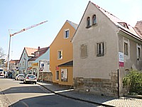Die frühere Hauptstraße von Kleinzschachwitz erhielt in Anlehnung an eine für fast alle
Dresdner Stadtteile angewandte Tradition nach der Eingemeindung am 1. Juli 1926 den Namen Altkleinzschachwitz. Zuvor war sie ab 1878 der Augustinstraße zugeordnet und wurde 1902
nach dem damals regierenden sächsischen König Georgplatz genannt. Da der Ort kein typisches Bauerndorf, sondern eine Handwerker- und Häuslergemeinde war, fehlen größere
Bauerngüter. Rund um die Straße haben sich noch einige Wohngebäude aus dem 18. und 19. Jahrhundert erhalten _(Foto: Nr. 3 und 5)_. Die meisten Wohn- und Geschäftshäuser entstanden
zwischen 1870 und 1910 und beherbergen bis zur Gegenwart Läden und Kleinunternehmen. Zwischen 1906 und 1932 verkehrte die [Dresdner Vorortbahn](../../../ost/niedersedlitz/dresdner_vorortbahn/) durch Altkleinzschachwitz.

Die kleine Straße wurde 1994 im Zusammenhang mit dem Bau eines Wohnparks angelegt und ab 12. Mai 1995 Am Putjatinpark
genannt. Ursprünglich befand sich auf dem Areal der parkartige Garten von Putjatins Villa “Chaumière”. Der Fürst hatte diesen im
Stil der Romantik mit verschiedenen Kleinbauten, künstlichen Ruinen, Wasserläufen und einer Riesenschaukel ausstatten lassen. Leider sind von der einstigen Gestaltung kaum noch Reste erkennbar.

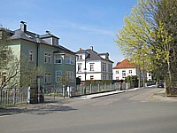
Die heute Am Sandberg genannte Straße im Norden der Kleinzschachwitzer Flur entstand nach 1890 abzweigend von der Meußlitzer Straße und wurde anschließend mit Villen und
Landhäusern bebaut. Zunächst wurde sie Gartenstraße genannt. Am 25. Februar 1902 beschloss der Gemeinderat, die Gartenstraße nach dem früheren sächsischen König künftig
Johannstraße zu nennen. Die benachbarte Wiesenstraße erhielt zeitgleich nach dessen Gemahlin den Namen Amalienstraße. Nach der Eingemeindung von Kleinzschachwitz wurde die
Johannstraße  am  1. Juni 1926 in Am Sandberg umbenannt.

Die aus zwei rechtwinklig verlaufenden Straßenteilen bestehende Straße an der Schiffswerft entstand 2013 zur Erschließung eines neuen Wohngebietes. Die Häuser
wurden auf dem Grundstück des früheren Sägewerkes Spalteholz zwischen Meußlitzer Straße,
Lockwitzbachgweg und Lockwitz errichtet. Ihren Namen erhielt sie nach der nahegelegenen [Laubegaster Werft](../../../ost/laubegast/schiffswerft_laubegast/).

Die Augustinstraße im Zentrum des Ortsteiles wurde Ende des 19. Jahrhunderts angelegt und 1878 nach Karl Gottlob Augustin
(1800-1870) benannt. Augustin war ab 1854 Sparkassenkassierer bei der Dresdner Sparkasse und verfügte 1870 in seinem
Testament drei größere Legate zur Unterstützung sozial bedürftiger Einwohner, zum Ausbau des Gemeindearmenhauses und zur
Unterstützung der Kleinzschachwitzer Schulgemeinde. Ursprünglich führte die Augustinstraße von der Großzschachwitzer
Flurgrenze bis zum Gondelweg, wurde jedoch 1902 im westlichen Teilabschnitt in Bahnhofstraße (ab 1926 Putjatinstraße) umbenannt.

Nr. 1:
Das Gebäude entstand 1871 aus Mitteln der Augustin-Stiftung als Gemeindearmenhaus und wurde bis zum Bau eines
größeren Gebäudes 1896 zur Unterbringung hilfsbedürftiger Familien genutzt. An der Fassade befindet sich eine Erinnerungstafel mit der Inschrift _“Gestiftet von Karl Augustin MDCCCLXXI”_.

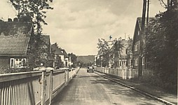
Die August-Röckel-Straße im Villenviertel von Kleinzschachwitz verdankt ihren Namen dem Musikdirektor und Revolutionär August Röckel (1814-1876). Röckel wirkte ab 1843 in Dresden und gehörte gemeinsam mit Richard Wagner zu den
Führern des Maiaufstandes 1849. Später zu lebenslanger Haft verurteilt, wurde er als letzter “Maigefangener” erst 1863 aus dem Zuchthaus entlassen. Die Straße wurde
1935 im Zusammenhang mit dem Bau einer neuen Wohnsiedlung angelegt und trug bis zum 2. Februar 1946 den Namen Baldamusstraße. Namensgeber war der deutsche
Kampfflieger Hartmuth Baldamus (1893-1917). Baldamus stammte aus Dresden, ließ sich 1914 zum Piloten ausbilden und starb am 14. April 1917 bei einem Zusammenstoß mit einer gegnerischen Maschine in Frankreich.

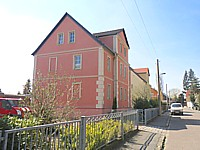Die Carl-Borisch-Straße im Kleinzschachwitzer Ortskern wurde 1894 von Carl Friedrich
August Borisch (1826-1906) angelegt, der hier einige Grundstücke besaß und diese mit Wohnhäusern bebauen ließ. Borisch war viele Jahre im Gemeinderat des Ortes tätig. Nach
Übereignung der Erschließungsstraße an die Gemeinde erhielt sie ihm zu Ehren ihren Namen.

Gemeindehaus: Das Gebäude auf der Carl-Borisch-Straße 6 _(Foto)_ entstand 1896/97 als Sitz
der Ortsbehörde und diente zugleich als Armenhaus des Ortes. Zur Finanzierung des Baus hatte man das frühere Armenhaus der Augustin-Stiftung (Augustinstraße 1) verkauft. Im Neubau befanden sich bis zur Fertigstellung des [Rathauses](../../../ost/kleinzschachwitz/) 1902 die Räume der Gemeindeverwaltung. Später wurde das Haus
u.a. als Bibliothek, für soziale Zwecke und als Mietwohnhaus genutzt. Ein weiteres Armenhaus, gestiftet vom Unternehmer Gustav Heinrich Sackmann, entstand 1913 auf dem Nachbargrundstück Nr. 8.

Die 1898 angelegte Carl-Maria-von-Weber-Straße, im nördlichen Teil von Kleinzschachwitz gelegen, verdankt ihren Namen dem
bekannten deutschen Komponisten Carl Maria von Weber (1786-1826), der viele Jahre seines Lebens in Dresden verbrachte
und hier seine größten Erfolge feierte. Weber besaß ein Sommerhaus in Hosterwitz, in dem er u.a. Teile des “Freischütz”, der “Euryanthe” und des “Oberon” verfasste. Heute dient das Haus als [Gedenkstätte](../../../nordost/hosterwitz/dresdner_strasse/webergedenkstatte/).

Vor der Eingemeindung wurde die Carl-Maria-von-Weber-Straße Germaniastraße bzw. Germania-Allee genannt. Um
Verwechslungen mit gleichnamigen Dresdner Straßen zu vermeiden, erhielt sie am 1. Juni 1926 den Namen Richthofenstraße. Mit
diesem sollte der deutsche Kampfflieger Manfred Freiherr von Richthofen (1892-1918) geehrt werden, der zu den populärsten
Militärfliegern des Ersten Weltkriegs gehörte. Da diese Bezeichnung jedoch als militaristisch galt, erfolgte bereits kurz nach
Kriegsende am 27. September 1945 die Umbenennung in Karl-Maria-von-Weber-Straße. Auch einige weitere Straßen in diesem Stadtviertel erhielten neue Namen mit Bezug zu diesem Komponisten.

Die Eichbergstraße wurde Ende des 19. Jahrhunderts im Norden der Kleinzschachwitzer Flur angelegt. Ursprünglich trug sie den Namen Wiesenstraße.
Am 25. Februar 1902 beschloss der Gemeinderat, die Wiesenstraße künftig nach der Gemahlin König Johanns, Königin Amalie (1801-1877) Amalienstraße zu benennen. Die benachbarte Gartenstraße wurde zugleich in Johannstraße
umbenannt. Um Verwechslungen mit einer gleichnamigen Straße im Stadtzentrum zu vermeiden, erhielt die Amalienstraße am 1.
Juni 1926 den Namen Eichbergstraße, wofür eine alte Flurbezeichnung Pate stand. 1899 wurden hier bei einem Hausbau Überreste acht bronzezeitlicher Urnengräber entdeckt, welche die frühere Besiedlung der Region nachweisen.

Der Euryantheweg entstand erst nach 1990 im Zusammenhang mit dem Bau einer kleinen Wohnsiedlung an der Oberonstraße. Die offizielle Benennung erfolgte am 24. Juni 1994.
In Anlehnung an die Namen Oberon- sowie Freischützstraße soll mit dieser Namensgebung der dritten zu großen Teilen in Dresden entstandenen Weber-Oper gedacht werden. “Euryanthe” wurde am 25.
Oktober 1823 in Wien uraufgeführt und ein halbes Jahr später zum ersten Mal in Dresden gespielt. Bereits 1943 ist an dieser
Stelle ein namenloser Weg als Verbindung zwischen Hosterwitzer Straße und Oberonstraße im Stadtplan verzeichnet. Kriegsbedingt kam der hier vorgesehene Bau von Wohnhäusern jedoch nicht mehr zustande.

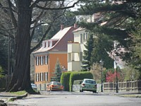Mit der Namensgebung Freischützstraße soll an die wohl bekannteste Nationaloper Carl Maria von Webers “Der Freischütz” erinnert werden. Das Werk entstand zu großen Teilen in Hosterwitz und wurde am 8. Juni 1821 in Berlin uraufgeführt. Verfasser des Librettos war Friedrich Kind, dem in der Nachbarschaft ebenfalls mit einem Straßennamen gedacht wird. Bis zur Eingemeindung von Kleinzschachwitz nach Dresden wurde die Straße Kaiser-Wilhelm-Straße genannt. Danach trug sie ab 1. Juni 1926 bis 1946 den Namen Boelckestraße. Oswald Boelcke (1891-1916) war ein deutscher Jagdflieger und begründete die Grundlagen des modernen Luftkriegs, indem er als erster gezielte Angriffe gegen gegnerische Flugzeuge flog. 1916 kam er bei einem Einsatz in Frankreich ums Leben. Da diese Namensgebung als militaristisch galt, erfolgte am 16. Februar 1946 die Umbenennung in Freischützstraße.

Das Straßenbild prägen vorrangig Villen, von denen die ältesten kurz nach Anlage der Straße 1898 errichtet wurden. Bemerkenswert sind u.a. die Häuser Nr. 9 und Nr. 13 “Villa Theresia”, die als Kulturdenkmale auf der Denkmalliste stehen. 1940 entstanden zudem einige Holzhäuser in Blockständerbauweise (Nr. 6 bis 12). Unterhalb der Freischützstraße führt ein schmaler Pfad zum Elbufer und zu einer dort befindlichen Ruhebank. Hier erinnert ein Mahndepot im Boden an den Liegeplatz des Dampfers "Leipzig", der im Zweiten Weltkrieg als Lazarettschiff genutzt wurde und im März 1945 bei einem Luftangriff sank.

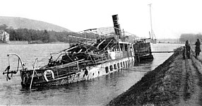

_**Foto:** Der beschädigte Dampfer "Leipzig" unterhalb der Freischützstraße im Sommer 1945_

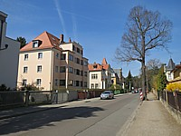Die Freystraße im Kleinzschachwitzer Villenviertel entstand
1895 und verdankt ihren Namen dem früheren Revierförster Carl Friedrich August Frey (1816-1883). Frey hatte sich für den Erhalt des reichen Baumbestandes des Tännichts eingesetzt und gilt als Gründes des
Kleinzschachwitzer Waldparks. Zur Finanzierung des Vorhabens hinterließ er der Gemeinde ein Legat von 1500 Mark zum Ankauf des benötigten Waldgrundstückes.

Zu den früheren Bewohnern der Straße gehörte der deutsch-jüdische Kaufmann Fritz Aron Meinhardt (1899-1943), der sich in der KPD engagierte und nach 1933 im Widerstand gegen
das NS- Regime aktiv war. Am 23. April 1943 wurde er in Dresden hingerichtet. Meinhardt lebte 1828/29 im Haus Freystraße 1, später in Nickern, wo noch heute die [Fritz-Meinhardt-Straß](../../../sudost/nickern/strassen_nickern/) e an ihn erinnert.

Die Friedrich-Kind-Straße enstand 1898 und wurde zunächst nach dem sächsischen Fürstenhaus Wettiner Straße genannt. Nachdem Kleinzschachwitz 1921 Stadtteil von Dresden geworden war, erfolgte am 1. Juni 1926 die Umbenennung in Weddigenstraße. Kapitänleutnant Otto von Weddigen (1882-1915) war im Ersten Weltkrieg Kommandant des Unterseebootes
U9 und versenkte im Herbst 1914 vor der niederländischen Küste vier englische Panzerkreuzer.

Am 16. Februar 1946 erhielt die Straße in Anlehnung an die in der Nachbarschaft befindlichen Carl-Maria-von-Weber- und
Freischützstraße ihren neuen Namen zu Ehren des Dichters und Dramatikers Friedrich Kind (1768-1843). Kind wurde vor allem
als Textdichter für Weber bekannt und verfasste das Libretto des “Freischütz”. Außerdem gehörte er dem romantischen “Dresdner Liederkreis” an und war Mitherausgeber der “Abendzeitung”.

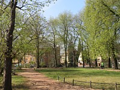Der Goetzplatz im Kleinzschachwitzer Zentrum wurde 1897 im Zuge der planmäßigen Umgestaltung des Ortes angelegt, wobei das dafür erforderliche Grundstück von einem
Bauunternehmer kostenlos zur Verfügung gestellt wurde. Konzipiert wurde er als kleine Parkanlage, die von der Parkstraße (Storchenneststraße), der Friedrich-August-Straße (Zschierener Straße) und der Hosterwitzer Straße begrenzt ist. Bis zur Eingemeindung des Ortes trug er zu Ehren des deutschen Reichskanzlers Otto von Bismarck den Namen Bismarckplatz.

Die am 1. Juni 1926 amtlich eingeführte heutige Namensgebung erinnert an den deutschen Arzt Ferdinand Goetz (1826-1915). Goetz betätigte sich auch als Politiker und gehörte einige Jahre dem Deutschen Reichstag an. Außerdem war er Geschäftsführer der Deutschen Turnerschaft.

Der Straßenname Gondelweg steht im Zusammenhang mit der nahegelegenen [Pillnitzer Elbfähre](../../../nordost/pillnitz/). Neben der großen Wagenfähre standen einst für den Transport der Mitglieder des Hofstaates drei Gondeln zur Verfügung, welche von in Kleinzschachwitz stationierten Soldaten bewegt wurden. Die letzte erhaltene Gondel ist noch heute im [Pillnitzer Schloßpark](../../../nordost/pillnitz/schloss_pillnitz/) zu sehen. Offiziell ist der Name Gondelweg seit 1901 in den Adressbüchern zu finden.

Die Hartungstraße im Kleinzschachwitzer Ortszentrum erhielt ihren heutigen Namen am 1. Juni 1926 und hieß zuvor ab 1895 Margarethenstraße. Dr. med. Ernst Leberecht Hartung (1851-1914) wohnte ab 1880 als erster Arzt im Ort und wurde als engagierter Bezirksanstalts-, Polizei- und Schularzt 1909 mit dem Titel Sanitätsrat geehrt. Außerdem gehörte er dem Gemeinderat an und hatte zeitweise das Amt des Gemeindeältesten inne. Nach dem Ausbau des Verbindungsstücks zwischen Kleinzschachwitz und Meußlitz wurde der Name Hartungstraße auch auf die Kirchstraße im benachbarten Meußlitz übertragen.

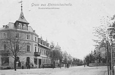Die Hosterwitzer Straße verläuft vom Waldpark Kleinzschachwitz ausgehend bis zum Elbufer und erhielt ihren Namen 1899 nach dem auf der anderen Elbseite gelegenen einstigen Fischerdorf [Hosterwitz](../../../nordost/hosterwitz/). Ende des 19. Jahrhunderts entstanden hier einige Villenbauten sowie das 1902 eingeweihte Kleinzschachwitzer [Rathaus](../../../ost/kleinzschachwitz/) mit Postamt (Nr. 2). Von 1998 bis 2018 nutzte ein Zentrum für ganzheitliche Medizin das auch als “Kleines Kurhaus” bezeichnete Gebäude.

Architektonisch interessant ist das 1935 vom Architekten Oswin Hempel für den Arzt Dr. Gerhard Barthel errichtete Landhaus Hosterwitzer Straße 8, welches unter Denkmalschutz steht. Zum Eckgrundstück Nr. 42 (Kleinzschachwitzer Ufer 78) gehört ein als "Denksteinhalle" errichteter turmartiger Pavillon im neogotischen Stil.

Die Inselstraße wurde um 1900 angelegt und ist ab 1902 als Planstraße mit dem Namen Sachsenallee in den Unterlagen verzeichnet. 1908 wird sie dann erstmals im Adressbuch genannt. Mit der Eingemeindung von Kleinzschachwitz wurde diese Namensgebung zur Vermeidung von Dopplungen ab 1. Juni 1926 in Inselstraße geändert. Der neue Name nimmt Bezug auf die Pillnitzer Elbinsel.

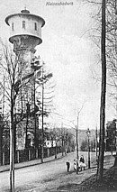Die im Zusammenhang mit der Bebauung des Kleinzschachwitzer Villenviertels 1898 angelegte Keppgrundstraße erhielt ihren Namen am 1. Juni 1926 nach dem gegenüberliegenden romantischen [Keppgrund](../../../nordost/hosterwitz/keppgrund/) auf der anderen Elbseite. Zuvor trug sie zu Ehren des preußischen Generalfeldmarschalls Helmuth Karl Bernhard Graf von Moltke (1800-1891) den Namen Moltkestraße. Die Umbenennung war erforderlich, da es damals bereits in Pieschen eine Moltkestraße gab.

Am 15. August 1962 wurde sie in Max-Kayser-Straße umbenannt. Max Kayser (1853-1888) war ein sozialdemokratischer Politiker und gehörte zwischen 1878 und 1887 dem deutschen Reichstag an. Außerdem arbeitete er als Redakteur des "Volksboten" in Dresden. Am 18. November 1991 wurde diese Namensgebung auf Beschluss des Stadtrates wieder rückgängig gemacht.

1899 begann an der Keppgrundstraße der Bau eines gemeindeeigenen Wasserwerkes mit einem 35 hohen Wasserturm _(Foto)_. Dieser ist heute nicht mehr erhalten und wurde nach einem Luftangriff am 2. März 1945 aus Sicherheitsgründen abgerissen.Auf dem Areal hatte ab 1903 bis zur Auflösung 1931 auch die Freiwillige Feuerwehr des Ortes ihr Spritzenhaus. Zwischen 1898 und 1906 gab es auf der Moltkestraße eine private höhere Schule, welche von Friedrich Max Trömel betrieben wurde.

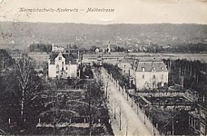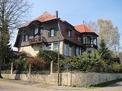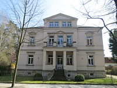

**_Fotos:_** _Blick in die ehemalige Moltkestraße um 1910._

_Die Bilder in der Mitte und rechts zeigen die unter Denkmalschutz stehenden Villen Keppgrundstraße 17 und 18._

Der König-Albert-Platz wurde 1902 im Zusammenhang mit dem Ausbau des Villenviertels an der Kreuzung der Königs-Allee (heute Berthold-Haupt-Straße) mit der Kurhaus- bzw. der Freystraße angelegt und nach dem sächsischen König Albert (1828-1902) benannt. Zwischen 1906 und 1925 befand sich hier die Endstelle der [Dresdner Vorortbahn](../../../ost/niedersedlitz/dresdner_vorortbahn/). 1936 legte man an Stelle des König-Albert-Platzes die noch heute vorhandene Gleisschleife an. Der Platz selbst wurde daraufhin als Grünanlage neu gestaltet und die Bezeichnung aufgehoben.

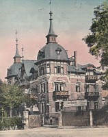Die seit 1. Juni 1926 nach dem Kleinzschachwitzer [Kurhaus](../../../ost/kleinzschachwitz/strassen_kleinzschachwitz/kurhaus_kleinzschachwitz/) _(Foto rechts)_ benannte Straße trug ursprünglich den Namen Albertstraße. Mit der Namensgebung für die 1895 angelegte Straße sollte an den sächsischen König Albert (1828-1902), der bis 1902 regierte, erinnert werden. Ursprünglich begann sie am heute nicht mehr benannten König-Albert-Platz (Gleisschleife) und führte von dort in Richtung Ortskern. 1899 wurde sie bis zum Georgplatz (Altkleinzschachwitz) verlängert.

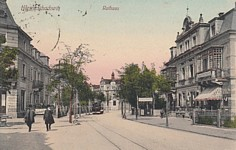Bis heute prägen landhausartige Villen und Mietshäuser das Straßenbild. Vier dieser Gebäude ließ der ehemalige Chefarzt des Johannstädter Stadtkrankenhauses Dr. Carl Benno Credé zwischen 1911 und 1913 errichten. Nach seiner Pensionierung lebte er bis zu seinem Tod 1929 in einem der Häuser. Credé engagierte sich auch auf sozialem Gebiet und stiftete 1920 eine Mütter- und Säuglingsberatungsstelle für Kleinzschachwitz. Zu den markantesten Gebäuden gehört das 1907 an der Ecke Hosterwitzer-/Kurhausstraße eingeweihte frühere Rathaus des Ortes.

Ab 1906 verkehrte die [Dresdner Vorortbahn](../../../ost/niedersedlitz/dresdner_vorortbahn/) über die Kurhausstraße bis zum König-Albert-Platz. Die schmalspurige Strecke begann am Niedersedlitzer Bahnhof und wurde am 17. Oktober 1906 offiziell eingeweiht. 1925 erfolgte die Umstellung auf Normalspur und eine Verlängerung bis zur Fähre nach Pillnitz. Mit Fertigstellung der neuen Bahntrasse über die Königs-Allee (Berthold-Haupt-Straße) endete der Betrieb.

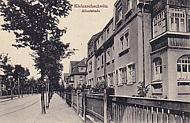

_Foto: Blick in die damalige Albertstraße um 1920_

Der Lockwitzbachweg beginnt am Kleinzschachwitzer Ufer und führt von dort in Richtung Laubegast / Großzschachwitz. Seinen
Namen erhielt er nach dem Lockwitzbach, welcher unweit dieses Weges in die Elbe mündet. Um 1900 wurde der nördliche Abschnitt des Weges Spalteholzstraße genannt. Namensgeber war der Kleinzschachwitzer Unternehmer Oswald Spalteholz.
Dieser hatte um 1875 eine ehemalige Ziegelei erworben und zum [Dampfsägewerk](../../../ost/kleinzschachwitz/strassen_kleinzschachwitz/kleinzschachwitzer_ufer/) ausgebaut. Der Betrieb gehörte zu den
bedeutendsten Sägewerken in Sachsen und blieb bis 1906 in seinem Besitz. Noch bis in die 1960er Jahre wurde das Gelände
zwischen Lockwitzbachweg, Kleinzschachwitzer Ufer und dem Wohngebiet an der Eichbergstraße von einem holzverarbeitenden Betrieb genutzt. 2013 entstand hier ein Wohnpark mit der neu angelegten Straße “An der Schiffswerft”.

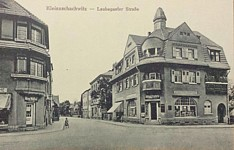
Die Meußlitzer Straße verläuft über Meußlitzer und Kleinzschachwitzer Flur und ist heute eigentliche Hauptstraße des Ortes. Bis zur Eingemeindung wurde sie Laubegaster Straße
genannt. Zu den ältesten Gebäuden gehört das Fachwerkhaus Nr. 94, welches noch aus der Zeit der Wiederbesiedlung des Ortes im 18. Jahrhundert stammt. Weitere Wohnhäuser entstanden
nach 1850, darunter auch mehrere Villen. Bis 2003 befand sich in einer dieser Villen (Nr. 41) der Kleinzschachwitzer Kindergarten. Da das Haus nicht mehr modernen Anforderungen entsprach, wurde 2003 auf dem Grundstück ein
moderner, nach ökologischen Gesichtspunkten gestalteter Neubau errichtet. Die Pläne stammen vom Architektenbüro Reiter und Rentzsch. Betreiber ist die Stadt Dresden.

Auch einige öffentliche Gebäude sind auf der Meußlitzer Straße zu finden. Bekanntestes ist das 1823 errichtete [Putjatinhaus](../../../ost/kleinzschachwitz/strassen_kleinzschachwitz/putjatinhaus/),
welches heute als Stadtteilkulturzentrum genutzt wird (Nr. 83). Aus einer 1880 errichteten Turnhalle mit Betsaal ging das Gemeindehaus der evangelischen [Stephanusgemeinde](../../../ost/kleinzschachwitz/stephanuskirche/) (Nr. 113) hervor. In den 1920er Jahren folgte auf dem Gelände eines
früheren Sägewerkes die 1978 durch einen modernen Neubau ersetzte katholische Kirche [“Zur heiligen Familie”](../../../ost/kleinzschachwitz/pfarrei__heilige_familie_/) (Nr. 108).

Nr. 67: Die Villa Meußlitzer Straße entstand 1877 für den Zimmermeister Ernst Noack, welcher maßgeblich am Bau wichtiger
öffentlicher Gebäude in Kleinzschachwitz beteiligt war. U.a. wirkte er bei der Errichtung der Schulen in Klein- und
Großzschachwitz, Sporbitz und Niedersedlitz sowie beim Bau des Kleinzschachwitzer Rathauses mit. Sein Bauhof befand sich auf
dem heute von der katholischen Kirche genutzten Grundstück Meußlitzer Straße 108, wo Noack um 1903 auch sein neues
Wohnhaus bezog. Nach seinem Tod wurde der Betrieb von Alfred Jährig fortgeführt, welcher das Areal 1925 an die kurz zuvor entstandene katholische Kirchgemeinde verkaufte.

Die Oberonstraße wurde als kurze Seitenstraße des Kleinzschachwitzer Ufers angelegt und erhielt ihren Namen nach der 1826 in
London uraufgeführten Oper “Oberon” von Carl Maria von Weber. 1993 entstand auf einer Freifläche zwischen Oberon- und
Carl-Maria-von-Weber-Straße eine kleine Wohnsiedlung mit Reihen- und Doppelhäusern. In diesem Zusammenhang wurde die Straße verlängert.

Die Straße im Kleinzschachwitzer “Opernviertel” erhielt ihren Namen nach der komischen Oper “Peter Schmoll und seine Nachbarn” von Carl Maria von Weber. Das zu den unbekannteren Weber-Opern gehörende Werk um einen verarmten Bankier wurde 1803 in Augsburg uraufgeführt und 1944 auch in der Semperoper gespielt. Bis 1926 trug die Straße nach der sächsischen Königin den Namen Carolastraße. Danach wurde sie bis 1945 Pionierstraße genannt.

Historisch und architektonisch interessant ist das Landhaus Nr. 9. Das Gebäude entstand 1906 im Jugendstil für den Tier- und Landschaftsmaler Franz Hochmann (1861-1935) und steht unter Denkmalschutz. Blickfang ist eine barocke Haustür von 1711, die Hochmann beim Abbruch eines Hauses in Lüdingworth in der Nähe von Cuxhaven erworben hatte und nach Dresden verbringen ließ. Der Architekt des Hauses C. G. Schramm ließ sich deshalb von norddeutschen Stilelementen leiten, die in die Gestaltung der Villa einflossen. Das Gebäude befindet sich bis heute in Familienbesitz. An Hochmann erinnert der [Hochmannweg](../../../sudost/leubnitz-neuostra/page14822/) im Dresdner Stadtteil Leubnitz-Neuostra.

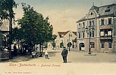
Die Putjatinstraße sowie der angrenzende Putjatinplatz im Kleinzschachwitzer Ortskern verdanken ihren Namen dem russischen Fürsten und Stifter Nikolaus Abramowitsch
Putjatin (1749-1830). Putjatin, ein im Dienst Zarin Katharinas stehender Landadliger, kam 1793 mit seiner Familie nach Dresden und erwarb1797 ein Landgut in Kleinzschachwitz. Hier ließ er sich die [Villa Chaumiére](../../../ost/kleinzschachwitz/strassen_kleinzschachwitz/putjatinhaus/) (Putjatinstraße 26) errichten. Putjatin galt als
“Original”, pflegte einen exzentrischen Lebensstil und war Anhänger eines naturnahen, gesundheitsfördernden Lebensstils. Bis 1902 trug die Putjatinstraße den Namen Augustinstraße, danach bis 1926 Bahnhofstraße _(Foto um 1905)_.

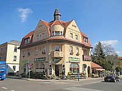
Putjatins Wohnhaus war bis zu seinem Tod Treffpunkt zahlreicher Persönlichkeiten der Dresdner Gesellschaft, die ihn als geistreichen und gebildeten Gesprächspartner schätzten. Für
die Kinder seines Heimatortes ließ er 1823 das [“Putjatinhaus”](../../../ost/kleinzschachwitz/strassen_kleinzschachwitz/putjatinhaus/) als Schule erbauen. Außerdem
stiftete er seinem Heimatort einen kleinen Marktplatz, welcher heute den Namen Putjatinplatz trägt. Seit 1997 erinnert hier ein von Detlef Herrmann gestaltetes Denkmal an den Fürsten. Es
zeigt Putjatin auf einer Schaukel sitzend in Anspielung auf die von ihm entworfene Riesenschaukel, die sich einst im Garten der Villa Chaumiére befand. Bemerkenswert ist auch
das Wohnhaus Putjatinstraße 20, welches noch aus der Zeit der Wiederbesiedlung von Kleinzschachwitz im 17. Jahrhundert stammt. Weitere Gebäude wurden im 19. Jahrhundert an
Stelle älterer Vorgängerbauten errichten und beherbergen bis zur Gegenwart Läden und kleine Handwerksbetriebe. Das Foto (rechts) zeigt das Wohn- und Geschäftshaus Putjatinstraße 14 an der Ecke zur Meußlitzer Straße.

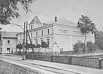Goldene Krone: Der traditionsreiche Kleinzschachwitzer Gasthof entstand im letzten Drittel des 19. Jahrhunderts als Fleischerei mit angeschlossener Schankwirtschaft. Wegen seiner günstigen Lage im Zentrum des Ortes und der Nähe zur Pillnitzer Elbfähre entwickelte sich das Lokal zur beliebten Ausflugsgaststätte. 1875 erhielt Selma Berger, Besitzerin der Fleischerei, die Konzession zur Verabreichung von Speisen, zwei Jahre später auch das Recht zum Branntweinausschank. 1893 ließ ihr Nachfolger, der Gastwirt Josef Walter, das Gebäude umbauen und um einen Saal mit 800 Plätzen erweitern. Regelmäßig fanden hier Tanz-, Theater- und andere Veranstaltungen statt. Hinzu kamen einige Pensionszimmer und eine Kegelbahn. Aus dieser Zeit stammt auch der Name “Goldene Krone”.

Nach dem Ersten Weltkrieg gingen die Gästezahlen zunächst zurück, erlebten jedoch in den Dreißiger Jahren und kurz nach dem Zweiten Weltkrieg noch einmal einen Aufschwung. Zwischen Juli 1945 und 1947 diente die “Goldene Krone” als Quartier des Dresdner Operettentheaters, bevor die Bühne nach Leuben verlegt wurde. 1955 wurde der Saal geschlossen und an einen Tischlermeister verkauft, der hier Lagerräume und seine Werkstatt einrichtete. 1967 endete auch der Schankbetrieb. Heute werden die Räume gewerblich genutzt. Reste der einstigen Ausstattung sind noch erhalten.

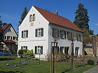Der kuriose Name Storchenneststraße hat nichts mit Störchen zu tun, sondern erinnert an die
frühere volkstümliche Bezeichnung der [Putjatin-Villa “Chaumiére”](../../../ost/kleinzschachwitz/strassen_kleinzschachwitz/putjatinhaus/). Das Haus besaß zu dessen
Lebzeit einen Turm mit einer aufgesetzten Dachterrasse, der wegen seines Aussehens an ein Storchennest erinnerte. Vor dem Ersten Weltkrieg wurde diese Straße Lutherstraße genannt.

Ab 1873 besaß der Kunstmaler Otto Försterling (1843-1904) sein Wohn- und Atelierhaus an der Storchenneststraße. Försterling schuf vor allem Landschaftsbilder und Radierungen, u.a. die
Illustrationen zum Liederzyklus “Die schöne Müllerin” von Wilhelm Müller (“Das Wandern ist des Müllers Lust...”). Das Gebäude wurde nach 1990 für den Bau einer Neubausiedlung
abgerissen. Zu den erhaltenen älteren Gebäuden gehört das unter Denkmalschutz stehende Haus Storchenneststraße 5 _(Foto)_.

Die Thömelstraße entstand 1995 im Zusammenhang mit dem Bau einiger neuer Wohngebäude am Sportplatz. Ihren Namen erhielt
sie nach dem ersten hauptberuflichen Kleinzschachwitzer Gemeindevorstand Emil Bernhard Thömel (1858-1941). Dieser hatte
das Amt 1897 übernommen und übte es bis zu seiner Pensionierung 1920 aus. Unter seiner Führung entstanden u. a. das
Kleinzschachwitzer Rathaus, das Wasserwerk und eine moderne Gasstraßenbeleuchtung  für den aufstrebenden Villenvorort. Bis zum Bezug seiner Dienstwohnung im Rathaus wohnte Thömel in der noch erhaltenen Villa Kyawstraße 9.

[Kleinzschachwitz auf OpenStreetMap](https://www.openstreetmap.org/search?query=Dresden+Kleinzschachwitz)

* * *

 \[ [Home](../../../index.html)\] \[ [Nord](../../../nord/)\] \[ [Nordwest](../../../nordwest/)\] \[ [Neustadt](../../../neustadt/)\] \[ [Nordost](../../../nordost/)\] \[ [West](../../../west/)\] \[ [Zentrum](../../../zentrum/)\] \[ [Südwest](../../../sudwest/)\] \[ [Süd](../../../sud/)\] \[ [Südost](../../../sudost/)\] \[ [Ost](../../../ost/)\] \[ [Register](../../../Register/register.html)\] \[ [Kontakt](../../../Kontakt/kontakt.html)\] \[ [Impressum](../../../impressum/)\]
