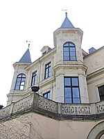
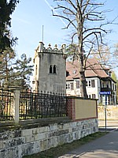
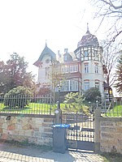
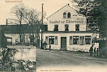
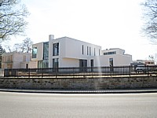
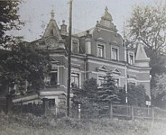
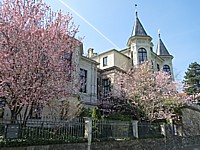
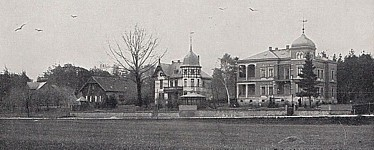
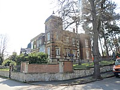

* * *

* * *

Als Kleinzschachwitzer Ufer wird die Verlängerung der Österreicher Straße von der früheren Ortsgrenze zu Laubegast bis zur Pillnitzer Elbfähre bezeichnet. Noch in der Mitte des 19. Jahrhunderts standen hier, abseits des Dorfkerns, lediglich das Kleinzschachwitzer Forsthaus sowie das benachbarte [Fährhaus](../../../../ost/leuben/strassen_leuben/berthold-haupt-strasse/) als Unterkunft der königlichen Fährleute. Erst nach 1860 begann die Bebauung der Uferstraße mit Villen und Landhäusern. Bei der ersten offiziellen Benennung von Straßen in Kleinzschachwitz erhielt dieser Weg am 12. Juni 1878 den Namen Elbstraße. Da es jedoch bereits in Gruna eine Elbstraße (heute Spohrstraße) gab, erfolgte im Zuge der Eingemeindung von Kleinzschachwitz am 1. Juni 1926 die Umbenennung in Kleinzschachwitzer Ufer.

_**Fotos:** Villen am Kleinzschachwitzer Ufer: Nr. 70 (links) - Nr. 78 (Mitte) - Nr. 84 (rechts)_

Einzelne Gebäude:

Nr. 1: Das Grundstück an der Flurgrenze zu Laubegast wurde 2017 mit einem Mehrfamilienhaus bebaut. Ungefähr zeitgleich entstanden in der Nachbarschaft die beiden Mehrfamilienhäuser "Pillnitz" (Nr. 2) und "Lockwitz" (Nr. 4) sowie ein Supermarkt (Nr. 3).

Elbterrasse Laubegast (Nr. 7): Das unmittelbar an der Flurgrenze zwischen Laubegast und Kleinzschachwitz gelegene Lokal wurde 1897 als "Gasthof zur Elbterrasse" _(Foto rechts)_ eröffnet und befand sich im Besitz der Familie Gäbler, später Grosse. 1944 gehörte es Anna May und wurde 1958 HO-Vertragsgaststätte. Im Inneren gab es um 1940 ca. 60 Plätze, hinzu kamen 185 Gartenplätze sowie ein Kiosk zur Selbstbedienung. Nach 1990 wurde die Gaststätte saniert und ist bis heute in Betrieb.

Dampfsägewerk Spalteholz (Nr. 10): Das Sägewerk Spalteholz wurde 1867 als Dampfschneidemühle auf dem Areal der früheren Ziegelei Heidenreich durch den Hallenser Unternehmer Triest errichtet. 1875 verkaufte er seinen Betrieb an den Pirnaer Kaufmann August Oswald Spalteholz. Dieser ließ den Betrieb von einem Techniker der [König-Friedrich-August-Hütte](../../../../sud/plauen/plauenscher_grund/eisenhammerwerk/) umbauen und mit einer Dampfmaschine ausstatten. Weitere Modernisierungen erfolgten 1892.

Wirtschaftliche Probleme zwangen Spalteholz 1896 zum Verkauf seines Sägewerks an die Sächsisch-Böhmische Dampfschiffahrts-Gesellschaft. Diese verlegte daraufhin ihre [Schiffswerft](../../../../ost/laubegast/schiffswerft_laubegast/) aus Blasewitz nach Laubegast. Die letzten Gebäude der ehemaligen Sägemühle wurden erst 1996 abgerissen. Heute befindet sich das Grundstück nach Insolvenz der Werft im Besitz eines privaten Investors, der die Tradition des Schiffsbaus mit einem „maritimen Handwerkerhof“ und einem Liegeplatz für Privatboote fortsetzt.

Bereits zwei Jahre vor dem Verkauf seines Betriebsgeländes beantragte August Oswald Spalteholz bei der Gemeinde Kleinzschachwitz die Genehmigung für den Bau eines neuen Sägewerkes auf Kleinzschachwitzer Flur. 1895 wurde ihm diese auch gewährt und wenig später am Lockwitzbach (Kleinzschachwitzer Ufer) eine Lager- und Maschinenhalle mit zwei dampfmaschinenbetriebenen Sägegattern errichtet. Zeitweise wurde hier in einem firmeneigenen Kraftwerk sogar Strom für den Eigenbedarf und einige Nachbarfirmen erzeugt.

Im April 1906 musste das Unternehmen Konkurs anmelden und wurde daraufhin an Max Fischer verkauft. Dieser richtete hier die “Kistenfabrik und Sägewerk Max Fischer“ ein. 1913 erwarb die Firma Mitzscherling den Betrieb. Nach Umstellung des gesamten Maschinenparks auf elektrischen Antrieb wurde die Dampfmaschine stillgelegt. Das bei einem Brand 1942 schwer beschädigte Unternehmen blieb nach seinem Wiederaufbau noch bis Anfang der 1960er Jahre als Sägewerk Mitzscherling & Co. in Betrieb. 2013 begann auf dem zuletzt als Lagerplatz genutzten Gelände der Bau eines kleinen Wohnpark, für den eine neue Erschließungsstraße mit Namen „An der Schiffswerft“ angelegt wurde.

Villa Reich: Das Gebäude entstand 1862 als erstes Villengrundstück am Kleinzschachwitzer Elbufer und gehörte dem Kaufmann Theodor Heinrich Reich. Reich war als Besitzer einer Porzellan- und Steinguthandlung am Altmarkt zu Wohlstand gekommen und hatte sich das architektonisch interessante Haus unmittelbar am Uferweg errichten lassen. Zu diesem gehörte auch ein parkartiger Garten, welcher sich ursprünglich bis zur Berthold-Haupt-Straße erstreckte, heute jedoch nur noch in Fragmenten erhalten ist.

Villa Trauteck: Das Grundstück am Elbufer wurde 1874 vom Bildhauer Theodor Kirchhoff erworben und 1883 mit einer Villa bebaut. Kirchhoff gehörte seit 1856 der Dresdner Kunstakademie an und arbeitete zeitweise im Atelier Ernst Rietschels. U.a. schuf er das Bismarckdenkmal in Pirna sowie zahlreiche Grabplastiken auf Dresdner Friedhöfen.

Landhaus Lungwitz (Nr. 32): Die Villa wurde Ende des 19. Jahrhunderts für den Kommerzien- und Veterinärrat Anton Lungwitz errichtet. Lungwitz arbeitete zeitweise als Privatdozent und war zudem Gemeindeältester von Kleinzschachwitz. Später wohnte in diesem Haus bis zu seinem Tod 1935 der Dresdner Stadtbaudirektor Carl Hirschmann (1875-1935). Von ihm stammten die Entwürfe für das im Zweiten Weltkrieg zerstörte Kunstausstellungsgebäude an der Lennéstraße sowie für das "Basteischlösschen" am Elbufer hinter dem Italienischen Dörfchen.

Nr. 36: Wie das benachbarte Haus Nr. 34 steht auch diese Villa, in den Akten als "Villa Waldhaus" bezeichnet, unter Denkmalschutz. Besitzer des mit einer großen Gartenanlage umgebenen Hauses war um 1930 der Unternehmer Mitzscherling, Inhaber des Sägewerkes Mitzscherling & Co. am Kleinzschachwitzer Ufer 10.

Nr. 58: In diesem Haus lebte viele Jahre der Maschinenbauingenieur Kurt Paul Pommer (1904-1993). Pommer lehrte an der Technischen Hochschule Dresden und war 1956-58 deren Rektor.

Nr. 66: Das Haus im Bauhausstil war nach 1945 Wohnsitz und Atelier des Bildhauers Paul Berger (1889-1949). Berger studierte ab 1905 an der Kunstgewerbeschule und der Kunstakademie und war Meisterschüler von Georg Wrba und Georg Türke. Ab 1919 lebte er freischaffend in Dresden und wirkte von 1922 bis 1945 als Professor an der Dresdner Kunstakademie. Nach Verlust seines Ateliers auf der Marschallstraße 1945 verzog er nach Kleinzschachwitz. Von ihm stammen verschiedene Plastiken in Dresdner Parkanlagen, u.a. die Bronzefigur "Die Überraschte" im Lingnerpark und ein "Stehender Bergmann" am Transformatoren- und Röntgenwerk. Bergers Haus übernahm nach dessen Tod der Bildhauer Johannes Friedrich Rogge.

Nr. 68: In dieser Villa wohnte bis 1943 das jüdisch-deutsche Ehepaar Emil und Martha Hochberg. Emil Hochberg (1874-1943) wurde 1943 wegen angeblichen "Verdeckens des Judensterns" von der Gestapo verhaftet und nach Auschwitz deportiert und wurde dort am 26. August 1943 ein Opfer des Holocoust. Seit dem 5. Dezember 2013 erinnert vor dem Haus ein Stolperstein an Emil Hochberg.

Nr. 70/70a: Die beiden Gebäude wurden 1862 und 1870 ursprünglich als Einzelhäuser erbaut, später jedoch zu einer Doppelvilla verbunden. Beim Umbau erhielt das Haus seine heutige Fassade im Stil der Neorenaissance mit Ecktürmen und Terrasse (Foto links). Besitzer war zunächst ein Tabakfabrikant, ab 1930 das Autohaus Georg Weidlich & Co. Heute wird der Komplex, zu dem einst auch mehrere Nebengebäude, Gewächshäuser und ein parkartiger Garten gehörten, als Wohnanlage "Fürstenhof" bezeichnet.

_**Foto:** Blick auf die Villen Kleinzschachwitzer Ufer 82, 84 und 86 um 1910_

Nr. 82: In der unter Denkmalschutz stehenden Villa Kleinzschachwitzer Ufer Nr. 82 befand sich zu DDR-Zeiten ein Betriebsteil des VEB Holzkunst Dresden. Nach 1990 bezog der Filmemacher Ernst Hirsch das Haus. Mit seiner "Hirsch Film Filmproduktion" wurde er vor allem durch Dokumentarfilme bekannt, u.a. durch "Die steinerne Glocke" zum Wiederaufbau der Frauenkirche. Die auf dem Grundstück stehende Schwarz-Kiefer ist als Naturdenkmal ausgewiesen.

Forsthaus (Nr. 86): In dem auch Heger- bzw. Hegereiterhaus genannten Gebäude hatte bis 1833 der Revierförster des Kleinzschachwitzer Tännichts seinen Dienstsitz. Das von Matthäus Daniel Pöppelmann entworfene Jagdhaus entstand 1717 im Auftrag August des Starken und diente dem Aufenthalt kurfürstlicher Jagdgesellschaften sowie zugleich als Wohnsitz des Hegereiters. Zum Anwesen gehörten auch einige Nebengebäude und Stallungen. Hier wurden zeitweise Kutschen und Pferde untergestellt, wenn die nahegelegene Pillnitzer Wagenfähre wegen Hoch- oder Niedrigwassers nicht einsatzfähig war.

Mit Neugliederung der sächsischen Forstreviere wechselte der Sitz des Revierförsters nach Graupa, so dass das Forsthaus nun nicht mehr benötigt wurde. Daraufhin baute man es 1834 zur Kaserne für die mit dem Fährbetrieb beauftragten Pioniersoldaten der sächsischen Armee und die Pillnitzer Schloßwache um. Zugleich wohnte hier der mit der Beaufsichtigung des königlichen Jagdgeheges beauftragter Hofjäger. 1865 brannte das alte Forsthaus ab und wurde erst 1883 durch einen Neubau ersetzt. 1992 erfolgte eine umfassende Sanierung des historischen Hauses. Zum Areal gehört auch ein Nebengebäude aus dem 18. Jahrhundert, ältestes Bauwerk in Kleinzschachwitz.

* * *

 \[ [Home](../../../../index.html)\] \[ [Nord](../../../../nord/)\] \[ [Nordwest](../../../../nordwest/)\] \[ [Neustadt](../../../../neustadt/)\] \[ [Nordost](../../../../nordost/)\] \[ [West](../../../../west/)\] \[ [Zentrum](../../../../zentrum/)\] \[ [Südwest](../../../../sudwest/)\] \[ [Süd](../../../../sud/)\] \[ [Südost](../../../../sudost/)\] \[ [Ost](../../../../ost/)\] \[ [Register](../../../../Register/register.html)\] \[ [Kontakt](../../../../Kontakt/kontakt.html)\] \[ [Impressum](../../../../impressum/)\]
