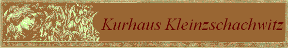
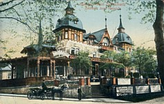
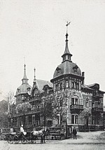
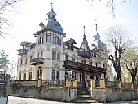

* * *

* * *

* * *

* * *

* * *

* * *

Das Kurhaus Kleinzschachwitz entstand 1892 als Ausflugsgaststätte auf Neuzschierener Flur. Das im altdeutschen Fachwerkstil gestaltete Gebäude _(Fotos)_ soll der Überlieferung nach auf einer ehemaligen Schanze aus den Napoleonischen Kriegen errichtet worden sein, was jedoch historisch nicht belegbar ist. Erster Besitzer war der Gastwirt Oswald Hänsel, der die Innenräume mit Jagdgemälden und dazu passendem Inventar ausgestalten ließ. Im Obergeschoss des Hauptgebäudes waren einige Fremdenzimmer für Übernachtungsgäste untergebracht. Außerdem gab es einen Ballsaal für 300 Personen im Nebengebäude sowie einen großen Gästegarten.

Hauptsächlich wurde die in günstiger Lage zur Pillnitzer Elbfähre befindliche Gaststätte von Ausflüglern genutzt. Um zusätzliche Gäste anzulocken, ließ Hänsel auf seinem Grundstück auch eine Konzertmuschel und ein Badehaus errichten und nannte sein Etablissement “Kurhaus Kleinzschachwitz”, obwohl der Ort selbst nie den Status eines Kurbades besaß. Später wechselten mehrfach die Besitzer, ohne jedoch am grundsätzlichen Konzept des Hauses etwas zu verändern.

Nach dem Ersten Weltkrieg sank, bedingt durch die Not der Nachkriegszeit und der Inflationsjahre, die Bedeutung des Kurhauses als gastronomisches Zentrum im Osten Dresdens. Auch die Verlängerung der Straßenbahn bis zur Elbfähre 1925 konnte den Niedergang nicht aufhalten. 1936 übernahm Emil Huhn die Leitung des Kurhauses und führte dieses noch bis in die Nachkriegszeit als Ausflugsgaststätte. Der ehemalige Ballsaal wurde 1940 an die Druckerei Max Dünki verkauft, die hier ihre Produktionsräume einrichtete. Mitte der 1950er Jahren schloss dann auch die Gaststätte ihre Pforten.

Fortan nutzte die aus dem seit Kriegsende zwangsverwalteten Unternehmen Max Dünkis hervorgegangene Druckerei der Deutschen Werbe-Agentur (Dewag) das Areal, ohne jedoch erforderliche Werterhaltungsmaßnahmen durchzuführen. Nachdem auch der 1989 geplante Umbau des Hauses zum Arbeiterwohnheim gescheitert war, stand zeitweise sogar die Sprengung des Gebäudes zur Debatte. Erst der Verkauf des mittlerweile stark sanierungsbedürftigen Kurhauses an die Dresdner Firma LTH Maschinenfabrik und Anlagenbau ermöglichte die dringend notwendige Sanierung. Nach der originalgetreuen Wiederherstellung des historischen Äußeren und einem kompletten Umbau im Inneren gab es hier ab 1999 wieder eine öffentliche Gaststätte, die besonders in den Sommermonaten gern besucht war. Im ersten Stock wurden Seminarräume und ein Bankettsaal untergebracht. Der ehemalige Ballsaal im Nebengebäude fiel im Jahr 2000 einem Brand zum Opfer und wurde wenig später abgerissen. Nach Schließung des Restaurants wird das Haus heute nur noch zu Wohnzwecken genutzt.

* * *

 \[ [Home](../../../../index.html)\] \[ [Nord](../../../../nord/)\] \[ [Nordwest](../../../../nordwest/)\] \[ [Neustadt](../../../../neustadt/)\] \[ [Nordost](../../../../nordost/)\] \[ [West](../../../../west/)\] \[ [Zentrum](../../../../zentrum/)\] \[ [Südwest](../../../../sudwest/)\] \[ [Süd](../../../../sud/)\] \[ [Südost](../../../../sudost/)\] \[ [Ost](../../../../ost/)\] \[ [Register](../../../../Register/register.html)\] \[ [Kontakt](../../../../Kontakt/kontakt.html)\] \[ [Impressum](../../../../impressum/)\]
