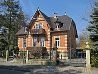
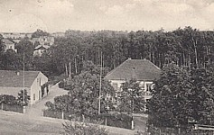
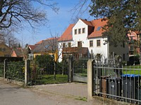

* * *

* * *

Die Kyawstraße erinnert an den Dresdner Kommunalpolitiker Heinrich Rudolph von Kyaw (1809-1885), der ab 1863 in Kleinzschachwitz lebte. Kyaw war ein Großonkel des sächsischen Generalleutnants Friedrich Wilhelm von Kyaw (1654-1733), welcher ab 1715 das Amt des Festungskommandanten des Königsteins innehatte, vor allem jedoch als Satiriker und schlagfertiger Gesprächspartner bei Hofe bekannt wurde. Aktiv setzte sich Heinrich Rudolph von Kyaw als Vorsitzender des Kirchlichen Vereins für die Bildung einer eigenen Kirchgemeinde und die weitere Entwicklung seines Heimatortes ein. Bis zu seinem Tod 1885 lebte er in der noch heute erhaltenen Villa Kyawstraße 8. Ihm zu Ehren erhielt die am Haus vorbeiführende Straße am 1. Juni 1926 ihren Namen. Zuvor ist sie ab 1878 als Pillnitzer Weg, ab 1905 als Pillnitzer Straße in den Stadtplänen verzeichnet.

Einzelne Gebäude:

Sächsischer Hof (Nr. 2): Das Lokal wurde 1874 von Oscar Ferdinand Gebler unter dem Namen “Geblers Restauration” gegründet. Ein Jahr zuvor hatte Ernst Friedrich Kretzschmer das Gebäude errichtet. Unter ihm und seinem Nachfolger Curt Steinhäuser entwickelte sich die Gaststätte zum beliebten Ausflugslokal mit Gästegarten, Logierzimmern und einem Billardraum. Zeitweise existierte sogar eine Pferdeomnibusverbindung zum Niedersedlitzer Bahnhof, um die Ausflügler in “Steinhäuser´s Gasthof” zu transportieren.

1974 übernahm Ulrich Schiebel das Haus. Der Gastwirt richtete die Räume ganz im sächsischen Stil ein und machte das Haus als Kleinkunstbühne stadtweit bekannt. Regelmäßig traten hier bekannte Dresdner Künstler wie der Rundfunkmoderator Rolf Garmhausen, der Zirkusfachmann Ernst Günther sowie der Conférencé Günthi Krause auf. 1994 musste die Traditionsgaststätte nach Rückübertragungsansprüchen der Alteigentümer geschlossen werden und fiel zwei Jahre später dem Bau einer Wohnsiedlung zum Opfer.

Nr. 4: Die Villa war bis 1936 Wohnsitz des Unternehmers Marceli Komendzinski, Inhaber einer Zigarettenfabrik ("Vulkan").

Villa Kyaw (Nr. 8): Das Haus entstand 1863 als Wohnsitz für den Rechtsanwalt Baron Heinrich Rudolph von Kyaw. Neben seiner beruflichen Tätigkeit befasste er sich mit Geschichte und verfasste u.a. die erste Biografie des Fürsten Putjatin. Außerdem setzte er sich für die Einrichtung einer evangelischen Kirche im Ort ein. Nach seinem Tod 1885 wohnte hier seine Tochter Elisabeth, mit ihrem Ehemann, dem Kunstmaler Carl von Ledebur. Später lebte der Bildhauer, Maler und Grafiker Walter Rehn (1884-1951) im Haus. Rehn hatte nach seiner Lehre als Porzellanmaler an der Kunstgewerbeschule studiert und war dann freischaffend tätig.

Landhaus Daheim (Nr. 9): Das villenartige Gebäude _(Foto)_ entstand nach 1890. Hier lebte von 1897 bis zu seinem Umzug in das neu errichtete Rathaus 1902 der Kleinzschachwitzer Gemeindevorstand Emil Bernhard Thömel. Unter seiner Regie entwickelte sich Kleinzschachwitz zum beliebten Wohnvorort Dresdens mit moderner Infrastruktur und zahlreichen Villenbauten.

Villa Germania (Nr. 15): Die Villa wurde 1892 für den Arzt Dr. Scheffler erbaut und bis 1936 von der Familie bewohnt. Ab 1937 diente sie bis zum Ende des Zweiten Weltkriegs als Zweitwohnsitz des sächsischen NS-Gauleiters Mutschmann. Danach nutzte man das Haus ab 1946 als Mietshaus. 2006 wurde die Villa saniert

Villa Sackmann (Nr. 37): Das Haus entstand um 1890 für den Kommerzienrat Gustav Heinrich Sackmann und ist im Stil der Neorenaissance gestaltet. Sackmann, der durch den Betrieb eines Schmuckgeschäftes in Stockholm zu Wohlstand gekommen war, engagierte sich sehr für seinen neuen Wohnort und stiftete u.a. ein Armenhaus auf der Carl-Borisch-Straße 8 sowie ein 1906 eingeweihtes Elbebad. Gemeinsam mit seiner Frau gründete er 1919 die Helene-Sackmann- Stiftung, welche auf der Zschierener Straße eine vom evangelischen Frauenverein betriebene Kindertagesstätte finanzierte.
