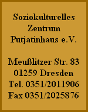
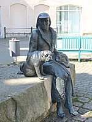
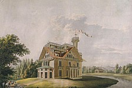
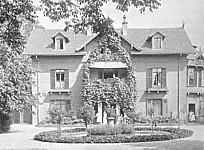
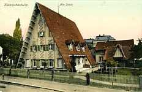
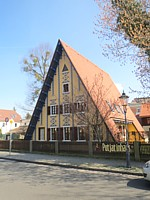

* * *

* * *

* * *

* * *

* * *

* * *

* * *

Das Putjatinhaus, heute Wahrzeichen von Kleinzschachwitz, geht auf den russischen Adligen
Fürst Nikolaus Abramowitsch Putjatin (1749-1830) zurück. Putjatin, ursprünglich Offizier und Oberbauintendant am Hofe Katharina der Großen, verließ Ende des 18. Jahrhunderts
seine Heimat und lebte ab 1793 mit seiner Frau, der deutschen Gräfin Elisabeth von Sievers und deren Tochter Elisabeth Benedikta, in Dresden. Der sowohl als aufgeklärter Mann
(Putjatin hatte bei seiner Abreise den Bauern seines Distriktes seinen Besitz übereignet) als auch als skurriles Original geltende Fürst erwarb 1797 ein Landgut in Kleinzschachwitz, um
sich hier ein Wohnhaus zu errichten. Außerdem besaß er eine Stadtwohnung am Neumarkt. Grund für seine Übersiedlung ins ländliche Dresdner Umland war eine Lungenerkrankung der
Stieftochter, welche er hier besser auszukurieren erhoffte. Allerdings verstarb die junge Frau bereits 1799. Putjatin blieb seinem Landsitz jedoch treu und bewohnte das Haus bis zu
seinem Tod 1830. Zu seinen Verdiensten gehört eine großzügige Stiftung für die Kinder des Ortes (Schulhaus) sowie die
Überlassung eines Grundstücks zur Anlage eines kleinen Marktplatzes. Dieser Platz trägt heute seinen Namen. Außerdem erinnert ein 1997 geschaffenes Denkmal an ihn _(Foto)_.

Villa Chaumiére:

Das originelle Landhaus an der heutigen Putjatinstraße 26 entstand 1798 als
Wohnsitz des Fürsten. Dessen Frau hatte ein Jahr zuvor das Petzoldsche Gut gekauft, welches bereits 1659 erwähnt ist. Ursprünglich gehörte das Areal
verschiedenen adligen und bürgerlichen Besitzern und entwickelte sich bis Ende des 18. Jahrhunderts zum Bauerngut. Das Gebäude entwarf  Putjatin nach
eigenen Vorstellungen und nannte es “Villa Chaumiére” (“Hütte”). Das Haus besaß sechzehn Balkons sowie einen minarettartigen Turm mit Dachterrasse, weshalb es im Volksmund auch “Storchennest” genannt wurde. Grund war
Putjatins Vorliebe für Sonnenbäder und Bewegung an frischer Luft, die er so ungestört von neugierigen Blicken ausleben konnte. Im Inneren befand sich ein runder Speisesaal mit einem als Palme
gestalteten Ofen, dessen Palmwedel bei Hitze zitterten. Außerdem gab es mehrere Aufzüge sowie eine Seilbahn, die vom Obergeschoss direkt in den Garten führte.

Hier versammelte der gebildete und finanziell gut ausgestattete Adlige einen Kreis von Künstlern, Gelehrten und
Politikern und machte sein Wohnhaus zu einem Zentrum des kulturellen Lebens im Dresdner Umland. Der im Stil der Romantik mit künstlichen Ruinen, Statuen und einem Tempel ausgestattete Park des Anwesens stand auch der
Öffentlichkeit zur Erholung zur Verfügung. Besondere Attraktion war eine Riesenschaukel für bis zu 30 Personen.
Außerdem gehörten eine Orangerie, eine Ziegelei und weitere Nebengebäude zum Anwesen. Hinzu kamen Besitzungen im benachbarten Großzschachwitz.

1870 kaufte Generalmajor Leopold von Boddien das verfallende Gebäude und ließ es umbauen und rekonstruieren _(Foto)_. Leider verschwanden beim Umbau viele der
einst prägenden Architekturelemente, die hölzernen Dachaufbauten und der markante “Storchennest”-Turm. Sein Sohn Georg von Boddien richtete in der Villa ein Atelier
ein. Bekannt wurde er als Porträtmaler des sächsischen Königshauses. Bis heute dient das durch die Umbauten stark veränderte Haus Wohnzwecken und wurde nach
1990 saniert. Die unter maßgeblicher Mitwirkung des Kunstgärtners Friedrich Graul gestaltete Gartenanlage verfiel nach Putjatins Tod, wurde mehrfach umgestaltet und
schließlich 1994 /95 mit einem Wohnpark bebaut. Eine dabei neu angelegte Straße trägt zur Erinnerung den Namen “Am Putjatinpark”.

_“Sei weise im Denken, edel in Deiner Gesinnung, und handle gerecht im Kreise Deines Wirkens, für alle Anderen, so wie für Dich selbst; und wenn Du_
_Nützliches hervorbringst,_

_so denke nie an Dich allein._

_**Aus N. A. Putjatin “Worte aus dem Buch der Bücher oder über Welt und Menschenleben” (1824)**_

Putjatinhaus:

1822 rief Putjatin eine Stiftung zum Bau eines Schulhauses für die Kinder seines
Heimatortes sowie der benachbarten Gemeinden Meußlitz, Sporbitz, Großzschachwitz und Zschieren ins Leben. 1822/23 entstand auf einem Grundstück an der Meußlitzer Straße 83 das kuriose Putjatinhaus mit einem fast
bis zur Erde reichenden Spitzdach und einer Fassadengestaltung im altrussischen Stil. Das Gebäude besaß im Erdgeschoss einen Schulsaal mit Bänken,
Schultafeln und einer kleinen Orgel, im Obergeschoss eine Wohnung für den Lehrer. Die Eröffnung erfolgte am 10. September 1823. Während der Fürst für
die Bau- und Ausstattungskosten aufkam, mussten sich die Gemeinden zum Erhalt der Schule verpflichten. 1835 bildeten sie dafür einen Schulverband und setzten einen aus Vertretern aller fünf
Orte bestehenden Schulvorstand ein. Bis 1871 übte der 1804 in Langebrück geborene Carl Christoph Lange das Amt des einzigen Schullehrers aus. Die Schülerzahl stieg bis 1869 auf 184 Kinder an.

Mit wachsender Bevölkerungszahl genügte die Kleinzschachwitzer Schule nicht mehr den Anforderungen und wurde 1874 durch einen [Neubau](../../../../ost/kleinzschachwitz/) an der Meußlitzer Straße ersetzt. Das Putjatinhaus diente fortan als Wohnhaus und wurde 1875 an den Sohn Lockes verkauft, der
auf dem Grundstück seine Tischlerwerkstatt einrichtete. Das Gebäude selbst wurde wenig später umgebaut und erhielt Gauben im Dachgeschoss sowie einen später wieder entfernten
Balkon an der Straßenfassade. Erst 1914 gelang es der Gemeinde, das historische Gebäude zurückzukaufen. Ursprünglich plante man, hier einen Kindergarten und ein Ortsmuseum
einzurichten. Da sich diese Pläne jedoch zerschlugen, blieb das Putjatinhaus bis 1959 Wohnhaus. 1961 wurde es zum Kulturzentrum des Stadtteils umgewandelt. 1993 übernahm
der Förderverein “Putjatinhaus e.V.” das Gebäude als soziokulturelles Zentrum und ließ es denkmalgerecht sanieren. Regelmäßig finden hier Ausstellungen, Vorträge, Konzerte und andere kulturelle Veranstaltungen statt.

* * *

 \[ [Home](../../../../index.html)\] \[ [Nord](../../../../nord/)\] \[ [Nordwest](../../../../nordwest/)\] \[ [Neustadt](../../../../neustadt/)\] \[ [Nordost](../../../../nordost/)\] \[ [West](../../../../west/)\] \[ [Zentrum](../../../../zentrum/)\] \[ [Südwest](../../../../sudwest/)\] \[ [Süd](../../../../sud/)\] \[ [Südost](../../../../sudost/)\] \[ [Ost](../../../../ost/)\] \[ [Register](../../../../Register/register.html)\] \[ [Kontakt](../../../../Kontakt/kontakt.html)\] \[ [Impressum](../../../../impressum/)\]
