* * *

**Gemeindesiegel von Laubegast**

* * *

**Laubegaster Stadtteilseiten:**

[Www.laubegast.net  das laubegaster internet-portal](http://www.laubegast.net)

* * *

**Bildungseinrichtungen in Laubegast:**

****

[Bibliothek laubegast österreicher str. 61 01279 dresden tel. 0351/2522273](http://www.bibo-dresden.de)

* * *

**Laubegaster Vereine:**

[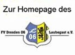](http://www.fv06-laubegast.de)

* * *

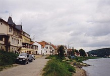Laubegast entstand als slawische Fischersiedlung am Elbufer und wurde 1408 erstmals als Lubegast urkundlich erwähnt. Der Ortsname ist vom Gründer der Siedlung, einem Lubogost abgeleitet. In diesem Jahr erhielten die Brüder Hertel Zinsrechte und Gefälle für das Dorf zu Lehen. 1529 kam Laubegast in den Besitz der Herren von Bünau. Obwohl auch etwas Landwirtschaft betrieben wurde, lebten die Bewohner vorrangig vom Fischfang, wie eine hier erwähnte “Fach” (Fischfangstätte) beweist. 1501 ist ein Vorwerk Dürrhof erwähnt. Zum selben Zeitpunkt ist auch erstmals von einem Fährmann die Rede, der im noch heute erhaltenen Fährgut Fährstraße 30 wohnte. Zwischen 1613 und 1765 existierte unweit der Fähre die Laubegaster Schiffsmühle, deren Mahlzwang alle Dörfer der Umgebung unterworfen waren. Verwaltungsmäßig unterstand Laubegast dem Amt Pirna, kirchlich gehörte es seit 1539 zur Leubener Kirche, zeitweise auch zur Dresdner Frauenkirche. Im August 1747 zerstörte ein Großbrand zahlreiche Gebäude des Ortes.

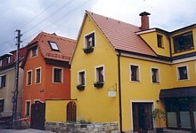Zu den bekanntesten Bewohner des kleinen Elbdorfes gehörte die als “Mutter der deutschen Schauspielkunst” berühmt gewordene Friederike Caroline Neuber, die 1760 in einem Laubegaster Anwesen verstarb und auf dem Leubener Friedhof beigesetzt wurde. An die “Neuberin” erinnert seit 1776 ein [Denkmal](../../ost/laubegast/strassen_laubegast/neuberindenkmal/) im Ortskern. Im 18. und 19. Jahrhundert wandelte sich die Wirtschafts- und Sozialstruktur des Ortes allmählich. Neben der nach wie vor wichtigen Elbfischerei verdingten sich die Einwohner auch als Bomätscher (Schiffszieher), Strohflechter und in der einst bedeutenden Zwirnerei. Laubegaster Zwirn galt als der Beste in ganz Sachsen und wurde nicht nur auf den Dresdner Märkten, sondern sogar zur Leipziger Messe angeboten. Noch bis 1926 war in [Altlaubegast](../../ost/laubegast/strassen_laubegast/) _(Foto)_ die Familie Wolf ansässig, die das in Heimarbeit gesponnene Garn aufkaufte und zur Bleiche an den Elbwiesen brachte.

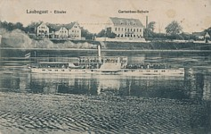Ab 1893 siedelten sich auf zuvor landwirtschaftlich genutzten Flächen große Handelsgärtnereien an, die ihre bisherigen Standorte in Striesen wegen der fortschreitenden Bebauung aufgeben mussten. Bis zur Gegenwart bestimmten einige dieser Gartenbaubetriebe das Ortsbild von Laubegast. Bedeutendstes Unternehmen im Ort war jedoch die 1898 nach Laubegast verlegte Blasewitzer [Schiffswerft](../../ost/laubegast/schiffswerft_laubegast/). Begünstigt durch bessere Verkehrsverbindungen (1893 Eröffnung der Straßenbahn nach Blasewitz, 1899 nach Niedersedlitz) entstanden um die Jahrhundertwende zunehmend Villen und Landhäuser sowie ein kleines Geschäftszentrum an der [Österreicher Straße](../../ost/laubegast/strassen_laubegast/osterreicher_strasse/). Ziele von Ausflüglern waren auch der auf Tolkewitzer Flur gelegene Tanzgasthof [“Donaths Neue Welt”](../../ost/tolkewitz/strassen_tolkewitz/alttolkewitz/donaths_neue_welt/) sowie das Ballhaus “Stadt Amsterdam” am [Laubegaster Ufer](../../ost/laubegast/strassen_laubegast/laubegaster_ufer/).

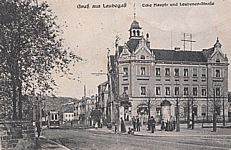

**_Foto:_** _Ecke Leubener/Österreicher Straße um 1910_

Auch nach dem Ersten Weltkrieg setzte sich die Bautätigkeit in und um Laubegast fort. Nachdem der Ort am 1. April 1921 nach Dresden eingemeindet worden war, errichtete 1925 eine Baugenossenschaft ein Reihenhausviertel rund um den Kirchplatz, welches zum Zuzug von Arbeiterfamilien führte. Drei Jahre später folgte die Villacher Siedlung zwischen Leubener und Tauernstraße. Weitere Gebäude entstanden an der Flurgrenze zu Leuben.

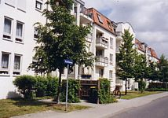Von den Zerstörungen des Zweiten Weltkrieges blieb Laubegast weitgehend verschont. Auch in der Nachkriegszeit behielt der Stadtteil weitgehend sein Flair als ländlich-ruhiger Wohnvorort. 1972/73 entstand im Bereich Berchtesgadener Straße ein Wohngebiet mit ca. 750 Wohnungen. Die in den 180er Jahren begonnene Sanierung des historischen Dorfkerns sowie die Anlage des Elberadweges machten Laubegast in jüngster Zeit wieder zunehmend zum Ausflugsziel. Gegenwärtig setzt sich eine Bürgerinitiative für die Wiederinbetriebnahme der Anlegestelle der Weißen Flotte ein, die 1992 aus Kostengründen stillgelegt worden war. Zu den jüngsten größeren Bauvorhaben gehörte die Anlage des Wohnparkes “Solitude” 1992 an der Steirischen/ Salzburger Straße _(Foto)_ sowie der Bau der Wohnanlage “Laubegaster Rain” 2002 an der Leubener Straße.

Schulen in Laubegast:

Alte Schule: Die erste Laubegaster Schule wurde 1836 im ehemaligen Hegereiterhaus an der Leubener Straße 1 eingerichtet. Stifter waren der Laubegaster Gutsbesitzer Friedrich Emanuel Schober sowie Bischof Mauermann, der das Grundstück für den Neubau unentgeltlich zur Verfügung stellte. Das Gebäude war zuvor Sitz des Revierförsters, dem die Verwaltung des heute bis auf wenige Reste vorhandenen Tännichts unterlag. Bereits Mitte des 19. Jahrhunderts genügte diese Schule nicht mehr den Anforderungen, so dass sich 1863 ein Neubau erforderlich machte. Das frühere Schulgebäude ist bis heute erhalten geblieben und wird jetzt als Gaststätte “Forsthaus” genutzt.

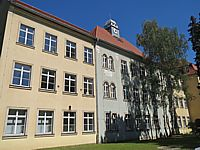 Volksschule: Das Schulhaus der Laubegaster Volksschule entstand 1883 an der Linzer Straße 1, wo sich auch der gemeindeeigene Wirtschaftshof mit Feuerwehr und Polizeiwache befand _(Foto)_. 1896 und 1934 wurde das Gebäude um Anbauten erweitert, um der wachsenden Einwohnerzahl Rechnung zu tragen. Das nach der Eingemeindung als 64. Volksschule bezeichnete Schulhaus war noch bis zum Sommer 2003 Standort einer Grund- und Mittelschule. Heute werden hier die Klassen der 64. Mittelschule “Hans Grundig” unterrichtet. Die 1904 entstandene Turnhalle ersetzt seit 2006 ein moderner Neubau.

Villacher Siedlung:

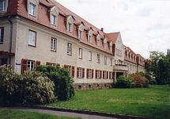 Die Villacher Siedlung wurde 1926-28 als Wohnkolonie Laubegast auf dem Gelände einer früheren Gärtnerei an der Leubener Straße angelegt. Insgesamt entstanden hier im Auftrag der 1918 gegründeten Siedelungsgesellschaft Dresden Stadt und Land GmbH 51 Mehrfamilienhäuser mit Wohnungen und Läden. Die Entwürfe für die Gebäude, die bevorzugt an Kriegsteilnehmer des Ersten Weltkriegs bzw. deren Hinterbliebene vermietet werden sollten, stammen von den Architekten Umlauf und Wolf.

Die Häuser wurden mit für die damalige Zeit modernen Ausstattungen wie Innen-WC, Bädern und Gemeinschaftsräumen ausgestattet. Außerdem gehörte zu jeder Wohnung ein kleiner Garten. Fassaden, Hofdurchgänge und Treppenhäuser wurden mit expressionistischen Architekturelementen geschmückt. Schöpfer des bildkünstlerischen Schmucks war der Bildhauer Hans Tröger. Die neu angelegten Straßen rund um die Villacher Straße erhielten ihre Namen, einer 1926 begründeten Tradition folgend, nach Orten im ehemaligen Österreich-Ungarn. Trotz einiger Schäden durch den Luftangriff von 1945 gehört die Villacher Siedlung zu den bedeutendsten Anlagen des sozialen Wohnungsbaus in Dresden und steht unter Denkmalschutz. Zwischen 1994 und 1997 wurden die Häuser saniert.

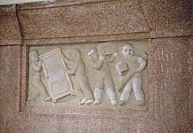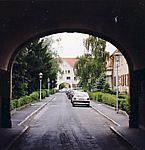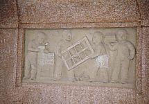

**_Fotos:_** _Villacher Siedlung - Relieftafeln am Tordurchgang Krainer Straße_

Elbfähre:

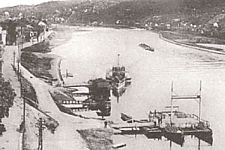Die Laubegaster Elbfähre wurde 1501 erstmals erwähnt, bestand jedoch vermutlich bereits länger. Zunächst zu den Besitzungen der Adelsfamilie von Carlowitz gehörig, übertrugen diese 1578 die Fährgerechtigkeit auf das Laubegaster Grundstück Fährstraße 30. Die Fährmannsfamilie lebte im bis heute erhaltenen Fährgut und besaß das Privileg, Anwohner und Durchreisende mit Ausnahme gewerblicher Fuhrwerke auf die andere Elbseite zu befördern. Erst ab 1739 durften neben Personen auch Wagen übergesetzt werden. 1856 wurde die bisherige Kahnfähre durch eine Gierfähre ersetzt, die später als sogenannte “fliegende Fähre” betrieben und 1969 von einem motorbetriebenen Fährschiff abgelöst wurde. 1959 übernahmen die Dresdner Verkehrsbetriebe den Betrieb, der 1992 trotz Protesten der Anwohner aus wirtschaftlichen Gründen eingestellt wurde.

Elbebad:

1915 wurde auf Initiative des Laubegaster Gemeinderates  zwischen der Fährstelle nach Niederpoyritz und der
Mündung des Dobritzer Abwasserkanals ein Elbebad eingerichtet. Zuvor hatte es solche Bäder bereits im benachbarten
Kleinzschachwitz und in Hosterwitz gegeben. Das Laubegaster Bad wurde vom Fährmeister Schöps betrieben und erfreute sich vor allem bei Schulkindern großer Beliebtheit. Noch vor dem Zweiten Weltkrieg wurde das Bad wieder
geschlossen.

Sportverein FV Laubegast 06:

Der FV Laubegast 06 wurde im Jahr 1906 als Fußballverein gegründet. Zu den größten Erfolgen der ersten Jahre
gehörte der Gewinn der Ostsachsen-Meisterschaft 1920. 1939 verboten die Nazis die weitere Betätigung und lösten
den Verein auf. Der von diesem genutzte Sportplatz an der Steirischen Straße wurde noch in den letzten Kriegstagen beim Anlegen von Schützengräben schwer in Mitleidenschaft gezogen.

Ab 1947 konnten die Laubegaster Fußballer wieder an die Tradition der Vorkriegszeit anknüpfen und als BSG Motor Dresden-Ost am Spielbetrieb teilnehmen. 1964 erfolgte die Umbenennung in Chemie Niedersedlitz, nach einem
Wechsel der Trägerschaft in BSG Pentacon. Als sich dieses Unternehmen nach 1990 auflöste, erhielt der Sportverein seinen ursprünglichen Namen FV Dresden 06 Laubegast zurück. Nach Beseitigung der Hochwasserschäden konnte
2005 ein neues Vereinsheim in Besitz genommen werden.

## [Laubegaster Straßen](../../ost/laubegast/strassen_laubegast/)

[_Weiterführende Literatur und Quellen_](../../impressum/quellenverzeichnis/)

 \[ [Home](../../index.html)\] \[ [Nord](../../nord/)\] \[ [Nordwest](../../nordwest/)\] \[ [Neustadt](../../neustadt/)\] \[ [Nordost](../../nordost/)\] \[ [West](../../west/)\] \[ [Zentrum](../../zentrum/)\] \[ [Südwest](../../sudwest/)\] \[ [Süd](../../sud/)\]
 \[ [Südost](../../sudost/)\] \[ [Ost](../../ost/)\] \[ [Register](../../Register/register.html)\] \[ [Kontakt](../../Kontakt/kontakt.html)\] \[ [Impressum](../../impressum/)\]
