## Altlaubegast

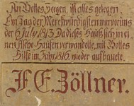Altlaubegast bildet zusammen mit der Fährstraße den Kern des früheren Fischerdorfes. Vor der Eingemeindung wurde diese Straße bis zum 31. Mai 1926 Elbstraße genannt. Hier sind bis heute einige Fachwerkhäuser erhalten geblieben, darunter das Wohnhaus Altlaubegast 17 mit einer historischen Inschrift _(Foto links)_, die an einen früheren Dorfbrand erinnert:

_"An Gottes Segen ist alles gelegen._

_Ein Tag der Merckwürdigsten war vor uns der 6. July 1813._

_Da dieses Hauß sich in einen Asche Haufen verwandelte,_

_mit Gottes Hilfe im Jahr 1816 wieder aufbauete."_

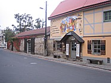Bemerkenswert ist auch das ehemals im Besitz der Familie Wolf befindliche Gebäude Nr. 5 mit Schlussstein von 1795. Als “Zwirnwölfe” waren die 1738 aus Westfalen zugewanderten Familienmitglieder im Zwirnhandel tätig und trugen zum guten Ruf dieses Produktes weit über die Grenzen Dresdens hinaus bei. Die Zwirnerei erfolgte in Laubegast und einigen Nachbargemeinden in Heimarbeit, wobei die Wolfs das fertige Garn aufkaufte und dann weiter veräußerte. Erst 1926 wurde dieses Handwerk aufgegeben. In den Räumen befindet sich seit 1992 die rustikale Kneipe “Zum Gerücht” _(Foto rechts)_.

## Azaleenweg

Der Azaleenweg wurde 1992 zur Erschließung des Wohnparks Solitude angelegt und am 10. Dezember 1992 benannt. Die Namenswahl erfolgte, ebenso wie beim benachbarten Kamelienweg, nach der einst bedeutenden [Azaleen- und Kameliengärtnerei Seidel](../../../ost/striesen/strassen_striesen/seidelsche_gartnerei/).

## Berchtesgadener Straße

Die Berchtesgadener Straße wurde Anfang der 1930er Jahre als Planstraße A am Rande der Laubegaster Ortsflur angelegt. Wie auch einige benachbarte Straßen erhielt sie ihren Namen 1932 nach einem Ort in der Alpenregion. Wenig später entstanden die Wohnblocks Nr. 51-59 (1932) und Nr. 61-67 (1937). Gegenüber der Einmündung der Hallstädter Straße befindet sich eine einst zur Abgrenzung der Reviere dienende Jagdsäule von 1779.

## Brünner Straße

Die Brünner Straße wurde 1902 fertig gestellt und zunächst Tolkewitzer Straße genannt. Zuvor hatten die Gemeinderäte von Laubegast und Tolkewitz eine wechselseitige Straßenbenennung in ihren Orten vereinbart. Da es nach der Eingemeindung von Laubegast zu Namensdoppelungen gekommen war, erfolgte am 31. Mai 1926 die Umbenennung in Brünner Straße. Namensgeber war die tschechische Stadt Brünn (Brno).

## Burgenlandstraße

Die Burgenlandstraße wurde 1899 angelegt und auf Beschluss des Gemeinderats zunächst Wettinerstraße genannt. Namensgeber war das sächsische Königshaus. Zum 31. Mai 1926 erfolgte im Zuge der Eingemeindung von Laubegast die Umbenennung in Burgenlandstraße. Das Burgenland ist ein Bundesland im Osten von Österreich.

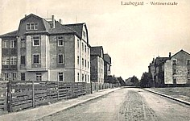

**_Foto:_** _Die Burgenlandstraße um 1910_

## Coselgasse

Als Coselgasse wird seit 2009 der Abschnitt des Elberadwegs zwischen Laubegaster Ufer und Österreicher Straße bezeichnet. Mit der Namensgebung soll an die Mätresse August des Starken, Anna Constantia Gräfin von Cosel (1680-1765) erinnert werden, welche einst ein Grundstück in Laubegast besaß.

Der Dachsteinweg wurde 1929 im Zusammenhang mit einer neuen Wohnsiedlung angelegt. Seinen Namen erhielt er nach dem Hochgebirgsstock Dachstein in den nördlichen Kalkalpen im Salzkammergut. Die Wohnhäuser entstanden ab 1930 für den Spar- und Bauverein Laubegast und Umgebung.

## Edmund-Leistner-Weg

Der erst 2012 benannte, zuvor namenlose Verbindungsweg zwischen dem früheren Rathaus an der Österreicher Straße und einem ca. 250 Meter entfernten Dreiseitenhof erinnert an den früheren Laubegaster Gemeindevorstand Edmund Leistner (1864-1921). Leistner war Ende des 19. Jahrhunderts maßgeblich am wirtschaftlichen Aufschwung des Ortes beteiligt, ließ u.a. eine moderne Straßenbeleuchtung errichten und setzte sich für den Anschluss seiner Gemeinde an die [Dresdner Vorortbahn](../../../ost/niedersedlitz/dresdner_vorortbahn/) ein.

## Eisenstädter Weg

Der Eisenstädter Weg entstand Anfang der 1930er Jahre und erhielt seinen Namen am 2. September 1932. Ebenso wie bei
vielen benachbarten Straßen wählte man die Bezeichnung nach einem Ort in Österreich, dem 35 km südlich von Wien gelegenen Eisenstadt im Burgenland.

## Fährstraße

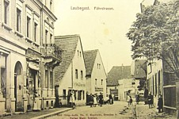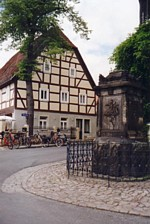Die von Altlaubegast zum Elbufer führende Fährstraße verdankt ihren Namen der bereits im 16. Jahrhundert erwähnten und bis 1992 betriebenen Laubegaster [Elbfähre](../../../ost/laubegast/), die den Ort jahrhundertelang mit dem gegenüberliegenden Hosterwitz verband. Die meisten Gebäude entstanden ursprünglich als Wohnhäuser von Elbfischern und -schiffern, bevor im 19. Jahrhundert zahlreiche kleine Handwerksbetriebe einzogen. Offiziell benannt wurde die Straße bei der Einführung von Straßennamen in Laubegast 1888.

Bedeutendstes Haus ist das 1733 in heutiger Form erbaute Fährgut (Nr. 30), einst Wohnsitz der Fährmannsfamilie Hesse _(Foto rechts)_. Später befand sich hier ab 1910 u.a. eine Schnapsbrennerei, deren Brennhaus im Hof noch erhalten ist. Heute gibt es im Haus eine kleine Gaststätte mit Biergarten. Das historische Nebengebäude fiel 2002 dem Elbehochwasser zum Opfer und wurde durch ein baulich angeglichenes Gästehaus ersetzt. Gegenüber des Fährhauses steht seit 1776 ein [Denkmal](../../../ost/laubegast/strassen_laubegast/neuberindenkmal/) für die “Mutter der deutschen Schauspielkunst” Caroline Neuber, die ihre letzten Lebensjahre in Laubegast verbrachte und hier 1760 verstarb.

Der Feldkirchner Weg wurde nach 1990 zur Erschließung einer kleinen Eigenheimsiedlung südlich der Klagenfurter Straße angelegt. Seinen Namen erhielt er nach der Stadt Feldkirch in Vorarlberg/Österreich.

## Gasteiner Straße

Die Gasteiner Straße entstand Ende der 1920er Jahre und wurde 1929 nach dem Gasteinertal in den Hohen Tauern in Österreich benannt. 1932 wurde sie bis zur Marburger Straße verlängert.

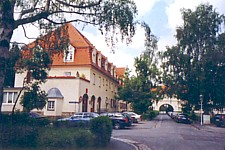Die Gmünder Straße entstand gemäß des Laubegaster Bebauungsplanes 1897 als Planstraße X und sollte ursprünglich von der Tauernstraße bis zur Leubener Straße durchführen. Allerdings blieb der letzte Abschnitt unvollendet. Am 6. Oktober 1927 erhielt sie ihren heutigen Namen nach dem in Kärnten (Österreich) gelegenen Ort Gmünd am Rand der Niederen Tauern. Zu dieser Zeit wurde hier auf dem Gelände der früheren Gärtnerei Weißbach eine Wohnsiedlung für die "Siedelungsgesellschaft Dresden Stadt und Land GmbH" angelegt. Die Planungen für die heute unter Denkmalschutz stehende "Villacher Siedlung" stammten von den Architekten Umlauf und Wolf. Neben den Wohngebäuden Gmünder Straße 1-7 und 2-8 _(Foto)_ gehören weitere Häuser an der Villacher, Großglockner- und Tauernstraße dazu.

## Grazer Straße

Die Grazer Straße wurde als Querstraße der Gustav-Hartmann-Straße 1897/98 angelegt und am 23. Mai 1900 auf Beschluss des Laubegaster Gemeinderates Sedanstraße benannt. Der kleine Ort in Frankreich war 1870 Schauplatz einer Schlacht des Deutsch-Französischen Krieges. Bis 1918 wurde der Jahrestag dieser Schlacht (2. September) alljährlich als "Sedantag" begangen, womit an den Sieg der deutschen über die französische Armee erinnert werden sollte.

Da es in Dresden jedoch bereits in der Südvorstadt eine Sedanstraße gab (heute Hochschulstraße), machte sich nach der Eingemeindung von Laubegast 1926 eine Umbenennung erforderlich. Analog zu einigen benachbarten Straßen entschied man sich auch hier mit Graz für einen Ort in Österreich, die Hauptstadt der Steiermark. Entgegen ursprünglichen PLanungen ist die Grazer Straße bis heute nicht durchführend, sondern besteht aus zwei Abschnitten zwischen Leubener und Schoberstraße sowie Gustav-Hartmann- und Richard-Clauß-Straße. Das dazwischen liegende Areal wird von der 1924 gegründeten Kleingartensparte "Flora II" in Anspruch genommen.

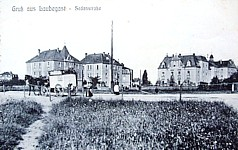

**_Foto:_** _Blick in die frühere Sedanstraße (Grazer Straße) vor dem Ersten Weltkrieg_

## Großglocknerstraße

Die Großglocknerstraße entstand Mitte der 1920er Jahre als südlicher Abschluss der sogenannten "Villacher Siedlung" des "Siedelungsgesellschaft Dresden Stadt und Land GmbH". Am 6. Oktober 1927 erhielt die bisherige Planstraße XI ihren Namen nach dem Großglockner, höchster Berg Österreichs.

## Gustav-Hartmann-Straße

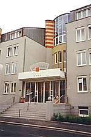Die Gustav-Hartmann-Straße wurde Ende des 19. Jahrhunderts als Seitenstraße des Kronstädter Platzes angelegt. Ihren Namen erhielt sie 1899 nach dem Industriellen und sächsischen Kommerzienrat Gustav Hartmann (1842-1910), der zeitweise in Dresden lebte. Hartmann war Teilhaber, Direktor und Aufsichtsratsvorsitzender der von seinem Vater Richard gegründeten Sächsischen Maschinenfabrik Chemnitz, die vor allem im Lokomotivbau erfolgreich war. Außerdem gehörte er mehreren Aufsichtsräten an und setzte sich zugleich für kommunale Vorhaben seiner Heimatgemeinde ein. Nach 1990 entstanden an der Gustav-Hartmann-Straße einige Neubauten, darunter das Hotel “Prinz Eugen” _(Foto)_. 2015 sorgten Planungen der Stadt, hier ein Asylbewerberheim einzurichten, für heftige Diskussionen und Proteste einiger Anwohner. Künftig soll das frühere Hotel zum Wohnhaus umgebaut werden. Unter Denkmalschutz stehen die Gebäude Nr. 1 und 16 sowie die 2007 sanierte Wohnanlage Gustav-Hartmann-Straße 18-20.

Die Hallstätter Straße entstand Anfang der 1930er Jahre als Planstraße VII und wurde am 10. August 1932 amtlich Hallstätter Straße benannt. Namensgeber ist der Markt Hallstatt in Oberösterreich am gleichnamigen See. Die Wohnhäuser wurden zwischen 1935 und 1938 gebaut.

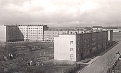

**_Foto:_** _Die Wohnanlage Hallstätter Straße um 1930_

## Havemannstraße

Die Havemannstraße wurde am 10. Dezember 1992 im Zusammenhang mit dem Wohnpark Solitude angelegt und nach dem Physiker, Chemiker und Philosophen Robert Havemann (1910-1982) benannt. Havemann gehörte seit den Zwanziger Jahren der KPD an, war im Widerstand gegen die NS-Herrschaft aktiv und lebte ab 1950 in der DDR. Wegen seiner kritischen Schriften zur politischen Entwicklung im Land wurde er aus der SED ausgeschlossen und ständig überwacht. Havemann gilt als einer der Begründer der DDR-Bürgerrechtsbewegung, für die er sich bis zu seinem Tod engagierte. Bebaut wurde die ringförmig angelegte Havemannstraße erst ab 2017 mit einigen Einfamilien- und Stadthäusern (Wohnanlage "Orchidee").

## Hermann-Krone-Straße

Die 2002 benannte Hermann-Krone-Straße erinnert an den Fotografen und Universitätsprofessor Hermann Krone (1827-1916), der seine letzten Lebensjahre in Laubegast verbrachte. Krone gilt als einer der Pioniere der Fotografie und gründete 1853 in Dresden seine Photographische Lehr- und Portraitanstalt. 1895 erhielt er einen Lehrstuhl an der Technischen Hochschule. Außerdem ist Krone Schöpfer zahlreicher Landschafts- und Städteaufnahmen, die ihn zum wichtigen Chronisten seiner Zeit machten. Bereits in älteren Bauplänen ist die Straße als Planstraße E eingezeichnet und wurde der verlängerten Hermann-Seidel-Straße zugerechnet. Erst mit der Bebauung nach 1990 wurde sie ausgebaut und neu benannt.

## Hermann-Seidel-Straße

Die Hermann-Seidel-Straße wurde 1897 angelegt und erhielt ihren Namen 1898 nach dem Gärtnereibesitzer Traugott Jacob Herrmann Seidel (1833-1896). Seidel entstammte einer weitverzweigten Gärtnerfamilie und gründete 1865 in Striesen sein erstes [Gartenbauunternehmen](../../../ost/striesen/strassen_striesen/seidelsche_gartnerei/). Nachdem dieses dort der Bebauung weichen musste, wurde der Betrieb ab 1894 in Laubegast von seinen Söhnen weitergeführt. Seidel wurde vor allem durch seine Zuchterfolge winterharter Azaleen und Rhododendren bekannt. Außerdem war er Stifter des Grundstücks für einen nie realisierten Kirchbau (Kirchplatz).

Die ältesten Gebäude der Hermann-Seidel-Straße stammen aus der Zeit um 1900. Nach dem Ersten Weltkrieg errichtete die Heimstätten A.G. Groß-Dresden hier einige Wohnhäuser. Im Haus Nr. 16 gab es viele Jahre eine Lebensmittelverkaufsstelle des "Waaren-Einkaufs-Verein zu Görlitz". Später dienten die Räume als Lehrverkaufsstelle des Konsum, zuletzt als Textiliengeschäft.

Auf dem Gelände der nach 1945 als VEG betriebenen Gärtnerei am Ende der Hermann-Seidel-Straße entstand ab 1992 der Wohnpark “Solitude”. Zwei neu angelegte Straßen erhielten 1992 die Namen Azaleen- bzw. Kamelienweg und halten so die Erinnerung an die Gärtnerei wach. Erhalten blieb auch das ehemalige Wohnhaus der Familie an der Salzburger Straße.

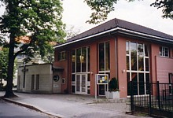Christophoruskirche: Die evangelisch-lutherische Christophorusgemeinde entstand als Filialgemeinde der Leubener Kirche und nutzte zunächst einen Gemeindesaal in einer Tischlerei auf der Leubener Straße. Nach Erlangung der Eigenständigkeit erhielt sie ab 1994 ein eigenes Kirchgebäude an der Hermann-Seidel-Straße _(Foto)_. Nach Plänen der Architekten Jörg und Horst Engert wurde ein moderner Neubau mit Kirchsaal, Gartensaal, Gemeinschafts- und Verwaltungsräumen errichtet und am 7. Mai 1996 eingeweiht. Die Ausstattung konnte zum Teil aus der Interimskirche übernommen werden und besteht u.a. aus einer 1970 gebauten Jehmlich- Orgel, Altartisch, Lesepult und einem von Eberhard von der Erde gemalten Christophorus-Gemälde. Seit 1. Januar 2006 gehört die Christophorusgemeinde wieder zur einstigen “Mutterkirche” in Leuben.

[Ev.-luth. christophoruskirche der kirchgemeinde dresden-leuben hermann-seidel-straße 3, 01279 dresden, tel. 0351/251 53 32](http://www.himmelfahrtskirche-dresden.de)

## Hermannstädter Straße

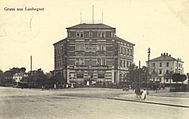Die Hermannstädter Straße wurde bereits Ende des 19. Jahrhunderts angelegt und ab 1895 Bismarckstraße genannt. Erbauer war der Grundstücksbesitzer Gustav Lehmann, der auch die Namensgebung nach dem deutschen Reichskanzler Otto von Bismarck anregte. Gleichzeitig ließ er den benachbarten Bismarckplatz anlegen (heute Kronstädter Platz). Um Verwechslungen mit gleichnamigen Straßen in anderen Stadtteilen zu vermeiden, trug sie ab 19. Februar 1926 den Namen Hermannstädter Straße nach einer Stadt in Siebenbürgen (Rumänien). Am 27. September 1945 wechselte die Bezeichnung in Richard-Clauß-Straße. Der 1907 geborene Clauß gehörte zu den aktivsten KPD-Funktionären in Laubegast und musste nach dem Machtantritt Hitlers 1934 emigrieren. Bei einem Besuch in Leipzig wurde er 1936 verhaftet und verstarb wenig später an den Mißhandlungen durch die Gestapo. Auf Beschluss des Dresdner Stadtrates vom 25. Februar 1993 erhielt die Richard-Clauß-Straße ihren früheren Namen Hermannstädter Straße zurück.

Zu den markantesten Gebäuden gehört das Eckhaus zur Österreicher Straße _(Hermannstädter Straße 1 - Foto)_. Hier befand sich vor dem Ersten Weltkrieg das Restaurant Bismarckhaus, später auch als "Bismarck-Hotel" bezeichnet. Die Wohnanlage Hermannstädter Straße Nr. 7 - 21 wurde 1912 nach modernen städtebaulichen Konzepten gebaut.

## Iglauer Straße

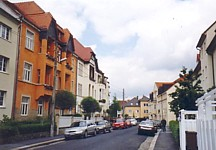Die Iglauer Straße, seit dem 31. Mai 1926 nach der mährischen Stadt Iglau (Jihlava) benannt, trug vor der Eingemeindung den Namen Mittelweg bzw. Mittelstraße. Sie ging aus einem Fußweg hervor, der um 1900 als durchführende Straße zwischen Gartenstraße (Zur Bleiche) und Elbstraße (Altlaubegast) geplant war, letztlich aber nur in heutiger Länge ausgebaut wurde. Die meisten Gebäude entstanden in den Jahren kurz vor dem Ersten Weltkrieg in geschlossener Bauweise. Bauherr der Häuser Nr. 4 und 6 war der Gastwirt Berthold Wolff, Besitzer des Stadtwaldschlößchens am Postplatz, der mit der Ausführung den Architekten Friedrich Linke beauftragte. Das benachbarte Wohnhaus Iglauer Straße 10 baute 1912 O. Menzel im sogenannten “Heimatstil”. Nach 1990 wurde die unter Denkmalschutz stehende Häusergruppe saniert.

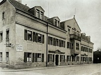Nr. 1: Das zu den ältesten Laubegaster Häusern gehörende Gebäude Iglauer Straße 1 geht im Kern auf das Jahr 1690 zurück. Aus dieser Zeit blieben die Haupttreppe, einige Kreuzgewölbe im Erdgeschoss und die Gewölbetonnen des Kellers erhalten. 1838 erwarb der Zwirnfabrikant Friedrich Gottlieb Schreger das Haus, ließ es weitgehend abreißen und zu einer Zwirnfabrik umbauen. Die Keller und Erdgeschossräume dienten dabei als Lager und Produktionsstätte, im Obergeschoss befanden sich Wohnungen.

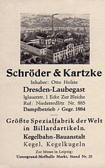Ende des 19. Jahrhunderts bezog die "Dampf-Chocoladen- & Zuckerwaarenfabrik von Johann Scholz das Gebäude und nutzte es für die Süßwarenherstellung. Zwischen 1906 und 1910 firmierte der Betrieb als Schokoladen- und Zuckerwarenfabrik Paul Momber. Ein Jahr später übernahmen neue Besitzer die Räume und richteten hier die Firma "Schröder & Kartzke" ein. Nach eigenen Angaben war dieser Betrieb größte Spezialfabrik der Welt für Billardkugeln und entsprechendes Zubehör. Gefertigt wurden aber auch Kegelbahnen und andere Sportgeräte. Zu DDR-Zeiten produzierte hier der VEB Dresdner Sportgeräte, nach 1990 die Ruffani GmbH. Außerdem gibt es im Haus eine kleine Gaststätte.

Zu den bemerkenswertesten Villenbauten in Laubegast gehört der 1894 für den Kunst- und Handelsgärtner Ernst Heinrich Lehmann errichtete Marienhof (Iglauer Str. 17). Das mit einer Klinkerfassade verkleidete Haus weist auch im Inneren noch verschiedene Details der Entstehungszeit auf. Nach 1945 kam die Villa in Besitz der Kommunalen Wohnungsverwaltung und wurde als Mietshaus genutzt. In einem Nebengebäude hatte bis Ende 2008 der Dresdner Kanu-Club Elbe 46 e.V. sein Domizil. 2009 begann die Sanierung und der Umbau zu Eigentumswohnungen. Auf dem Nachbargrundstück entstand 2004/05 eine Kindertagesstätte der Johanniter.

Die Ischler Straße wurde Ende der 1920er Jahre im Zusammenhang mit einem neuen Wohngebiet als Planstraße R angelegt. Ihren Namen erhielt sie am 12. September 1929 nach dem Ort Bad Ischl im Salzkammergut in Österreich.

Der Kamelienweg wurde im Zusammenhang mit dem Bau des Laubegaster Wohnparks Solitude auf früherem Gärtnereigelände angelegt und erhielt am 10. Dezember 1992 seinen Namen. Wie auch beim benachbarten Azaleenweg soll an die frühere [Gärtnerei Hermann Seidels](../../../ost/striesen/strassen_striesen/seidelsche_gartnerei/) erinnert werden, die durch ihre Azaleen- und Kamelienzucht bekannt wurde.

Ebenso wie viele andere Straßen in Laubegast verdankt auch der Kärntner Weg seinen Namen einem geografischen Bezug zu Österreich. Am 24. Juni 1925 erhielt er seinen Namen nach dem Bundesland Kärnten.

## Kirchplatz

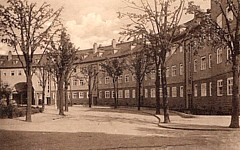Der Kirchplatz wurde in den 1920er Jahren als Mittelpunkt einer genossenschaftlichen Wohnanlage angelegt und gärtnerisch gestaltet. Ursprünglich war die von der Gärtnereibesitzerfamilie Seidel gestiftete Fläche für den Bau einer Kirche vorgesehen, der jedoch nicht verwirklicht wurde. Stattdessen entstand 1925 ein als Säulenhalle gestaltetes Ehrenmal für die Gefallenen des Ersten Weltkrieges. An den Wänden sind Namenstafeln der Soldaten sowie Reliefdarstellungen angebracht. Einige dieser Tafeln wurden 1947 wegen ihres “militaristischen” Charakters entfernt. Die Platzanlage mit dem Denkmal zeigt heute nach einer gründlichen Erneuerung 1994 wieder fast den Ursprungszustand von 1928.

Die Gebäude um den Kirchplatz wurden 1927/28 für die “Heimstätten A.G. Groß-Dresden” errichtet. Architekt war Friedrich Bergmann. Dabei nahm man die kreisförmige Platzanlage für die architektonische Gestaltung auf. Torhäuser ermöglichen den Zugang zu den angrenzenden Straßen. Die unter Denkmalschutz stehende Siedlung erfuhr ab 1994 eine grundlegende Sanierung.

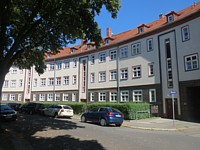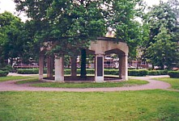

**_Fotos:_** _Der Laubegaster Kirchplatz mit dem Kriegerdenkmal (rechts)_

Die Klagenfurter Straße entstand 1895 auf Initiative des Handelsgärtners Robert Weißbach, der sie als Zufahrt zu seiner Gärtnerei benötigte. Am 7. Oktober 1895 beschloss der Laubegaster Gemeinderat, die Straße in öffentlichen Besitz zu übernehmen und künftig als Moltkestraße zu bezeichnen. Helmuth Graf von Moltke (1800-1891) war Generalfeldmarschall der preußischen Armee und ab 1871 Ehrenbürger der Stadt Dresden. Nach der Eingemeindung gab es in Pieschen bereits eine weitere Moltkestraße (heute Robert-Matzke-Straße). Aus diesem Grund erfolgte 1926 die Umbenennung in Klagenfurter Straße nach der Landeshauptstadt von Kärnten in Österreich.

An der Straße hatten früher einige gewerbliche Unternehmen ihren Sitz. Bekanntestes war das zur Kamerafabrik von Max Baldeweg gehörende Belca-Werk (später Betriebsteil des VEB Pentacon (Nr. 52). Auf dem Grundstück Klagenfurter Straße 53 produzierte die Firma von Manfred Käubler Technische Federn, Nr. 58 war Sitz einer Krepp-Papierwaren-Fabrik. Die ehemalige Villa des Gärtnereibesitzers Robert Weißbach (Nr. 60) steht als Baudenknal unter Schutz.

## Klausenburger Straße

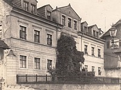Die bis 1926 Dampfschiffstraße genannte heutige Klausenburger Straße verbindet die Österreicher Straße mit dem Laubegaster Ufer und endet in der Nähe der früheren Dampfschiffanlagestelle. Aus diesem Grund erhielt sie 1888 bei der offiziellen Einführung von Straßennamen im Ort ihren Namen. Ihren heutigen, am 19. Februar 1926 eingeführten Namen verdankt sie der in Rumänien gelegenen Stadt Klausenburg (Cluj-Napoca).

Im Haus Nr. 1 befand sich die erste Laubegaster Poststelle _(Foto)_. Das heute als Wohnhaus genutzte Gebäude steht unter Denkmalschutz. Ehemalige Besitzerin war die Zigarrenhändlerin Ernestine Busse, die ihr Ladenlokal in der Weißen Gasse 1 in der Innenstadt hatte.

Die Krainer Straße entstand Ende des 19. Jahrhunderts als Planstraße P und war als Verbindung zwischen Moltkestraße (Klagenfurter Straße) und dem Nachbarort Leuben vorgesehen. Das Gelände gehörte zur Handelsgärtnerei von Robert Weißbach und sollte der Erschließung für die hier geplanter Bebauung dienen. Der Ausbau erfolgte später jedoch nur auf dem heutigen Abschnitt zwischen Villacher und Großglocknerstraße. Auf Beschluss des Stadtrates erhielt dieser am 6. Oktober 1927 den Namen Krainer Straße. Namensgeber war die Region in Slowenien, ein Gebiet, welches bis 1919 zu Österreich-Ungarn gehörte.

Die nur durch zwei Hausdurchfahrten erreichbare Krainer Straße wurde zwischen 1926 und 1928 mit Wohnhäusern bebaut. Bauherr war die "Siedelungsgesellschaft Dresden Stadt und Land G.m.b.H.", die Planungen stammen vom Architekten Paul Beck.

## Kronstädter Platz

Der Kronstädter Platz wurde Ende des 19. Jahrhunderts gemeinsam mit der angrenzenden Bismarckstraße (Hermannstädter Straße) als Bismarckplatz angelegt und am 19. Februar 1926 nach der im heutigen Rumänien gelegenen Stadt Kronstadt (Brasov) benannt. Um die gärtnerisch gestaltete Platzanlage mit einem kleinen Brunnenbecken entstanden repräsentative Wohnhäuser im Stil des Historismus. An der Fassade des Eckhauses zur Österreicher Straße befindet sich eine Büste des 1896 verstorbenen Reichsgründers Otto von Bismarck.

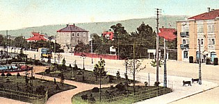

**_Foto:_** _Der heutige Kronstädter Platz kurz nach der Jahrhundertwende_

Im Mittelpunkt des Platzes entstand 1903 eine kleine Grünanlage mit einem Springbrunnen. Die Finanzierung des vom Baumeister Münziger geschaffenenen Brunnens übernahmen Laubegaster Bürger. Nach 1945 verfiel der Brunnen und wurde später als Sandspielkasten zweckentfremdet. Erst 2005 konnte die rekonstruierte Anlage nach historischem Vorbild wieder hergestellt werden.

## Laibacher Straße

Die ehemalige Florastraße, welche auf die einst hier ansässigen Gärtnereien hinwies, erhielt nach der Eingemeindung von
Laubegast den Namen Laibacher Straße. Die Stadt Laibach ist heute unter dem Namen Ljubljana Hauptstadt Sloweniens. Trotz
Bebauung blieben hier noch bis nach 1990 größere Freiflächen bestehen. 1994 entstand auf ehemaligem Gärtnereigelände die Wohnanlage “Lindenpark” mit insgesamt 14 Mehrfamilienhäusern und 5 Eigenheimen.

## [Laubegaster Ufer](../../../ost/laubegast/strassen_laubegast/laubegaster_ufer/)

## Leubener Straße

Die Leubener Straße verbindet die Orte Laubegast und Leuben und war bereits im 19. Jh. als Fahrweg vorhanden. Ab 1899 verkehrte hier die private [“Dresdner Vorortbahn”](../../../ost/niedersedlitz/dresdner_vorortbahn/), die jedoch bereits ein Jahr nach ihrer Eröffnung Konkurs anmelden musste
und später von der Dresdner Straßenbahn AG übernommen wurde. Im ehemaligen Hegereiterhaus (Nr 1.) entstand 1836 die erste [Schule](../../../ost/laubegast/)
von Laubegast. Heute befindet sich hier die Gaststätte “Forsthaus”.

Die zunächst meist gartenbaulich genutzten Freiflächen zu beiden Seiten der Leubener Straße wurden seit den Zwanziger Jahren
mit Siedlungshäusern bebaut. So entstand 1928 die heute unter Denkmalschutz stehende [“Villacher Siedlung”](../../../ost/laubegast/) im Bereich
Leubener/ Villacher Straße. Letztes größeres Bauvorhaben war der 2002 fertiggestellte Wohnpark “Laubegaster Rain”.

## Liehrstraße

Die Liehrstraße in der Nähe des alten Ortskerns erinnert an den Stifter und Wohltäter Carl Stephan Liehr (1827-1892), der sich
für verschiedene soziale Projekte in Laubegast einsetzte und diese finanziell unterstützte. Aus Anlass des 600. Ortsjubiläums
wurde an der Ecke Österreicher Straße 2008 ein Mosaikbild angebracht. Das Bild wurde vom Laubegaster Mosaiksetzer Torsten Sändig nach einem Entwurf von Christa und Siegfried Sack gestaltet und besteht aus 40.000 Mosaiksteinchen.

## Linzer Straße

Die 1926 nach der österreichischen Stadt Linz benannte frühere Schulstraße war ab 1883 Standort des zweiten Laubegaster
Schulhauses, welches bis zum Sommer 2003 als Grund- und Mittelschule genutzt wurde. Das Nachbargebäude Nr. 2 diente ab
1888 als Wirtschaftshof der Gemeinde mit Polizei- und Feuerwehrstation und wurde vom Baumeister Frauenlob im Landhausstil errichtet. 2014 entstand auf diesem Grundstück die Wohnanlage “Laubegaster Gärten” mit fünf Wohnhäusern.

## Marie-Hankel-Straße

Die Marie-Hankel-Straße wurde 2003 als Nebenstraße der Großglocknerstraße angelegt und nach der deutschen Esperanto-
Dichterin Marie Hankel (1844-1929) benannt. Marie Hankel, die viele Jahre in Dresden lebte, verfasste zahlreiche Gedichte und Erzählungen in der Kunstsprache und wurde nach ihrem Tod auf dem Tolkewitzer Johannisfriedhof beigesetzt.

## Melli-Beese-Straße

Die Melli-Beese-Straße wurde 1994 beim Bau der Wohnanlage “Lindenpark” angelegt und nach der am 18. September 1886
in Laubegast geborenen Flugpionierin Melli Beese benannt. Nach einem Besuch der Kunstakademie von Stockholm widmete
sie sich ganz der aufkommenden Fliegerei und erhielt an ihrem 25. Geburtstag als erste Frau Deutschlands eine Pilotenlizenz. Mit
der von ihr selbst entwickelten “Beese-Taube” nahm sie an verschiedenen Wettkämpfen teil. Persönliche und wirtschaftliche
Probleme nach dem Konkurs ihrer gemeinsam mit ihrem Mann Charles Boutard betriebenen Flugschule führten 1925 zum Freitod von Melli Beese.

## Neuberinstraße

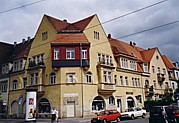
Die Neuberinstraße wurde um 1900 als Poststraße angelegt und erhielt 1926 ihren heutigen Namen nach der wohl bekanntesten Laubegaster Einwohnerin Friederike Caroline Neuber
(1697-1760). Als Prinzipalin einer Wanderbühne verbannte sie den Hanswurst von der Bühne und gilt damit als Begründerin der modernen Schauspielkunst. 1730 trat die “Neuberin” erstmals
in Dresden auf und verbrachte ihre letzten Lebensjahre in Laubegast. Ihr Grab befindet sich auf dem Leubener Friedhof.

Nach der Jahrhundertwende wurden an der Neuberinstraße mehrgeschossige Wohn- und Geschäftshäuser nach Plänen von Oscar Menzel errichtet, die z. T. Jugendstilelemente aufweisen. Im Eckhaus Nr. 1 _(Foto)_
befand sich viele Jahre eine Drogerie, worauf ein origineller Fries über der Eingangstür hinweist. In der Nähe befindet sich der nach 1990 errichtete Neubau des Laubegaster Kindergartens.

Im Wohnhaus Neuberinstraße 15 richtete die Stadtverwaltung nach dem Luftangriff im Februar 1945 eine Dienststelle ein, in
welcher alle eingehenden Suchanfragen nach vermissten Personen erfasst und bearbeitet wurden. Hier führte man auch die
Totenlisten und die zentrale Vermisstenkartei, um Angehörigen von ausgebombten Einwohnern bei der Suche nach ihren Familien zu helfen. Bis zum Kriegsende wurden hier über 60.000 Anfragen beantwortet.

## [Österreicher Straße](../../../ost/laubegast/strassen_laubegast/osterreicher_strasse/)

## Rudolf-Zwintscher-Straße

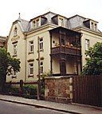Die frühere Nehrhoffstraße trägt heute den Namen Rudolf-Zwintscher-Straße und erinnert an den
Dresdner Musikpädagogen und Pianisten Rudolf Zwintscher (1871-1946), der auch einige Kompositionen hinterließ. Die kurze Straße verbindet den Kronstädter Platz mit dem Elbufer und wird
von Villen und Landhäusern geprägt. Das Foto zeigt die unter Denkmalschutz stehende Villa “Hedwig” auf der Rudolf-Zwintscher-Straße 3.

## Salzburger Straße

Die Salzburger Straße bildet die Verbindung zwischen Laubegast und Dobritz und hieß vor der Eingemeindung Dobritzer
Straße. Während der südliche Teil in der Nähe der Leubener Kiesgrube bis heute unbebaut blieb und zum Teil gärtnerisch
genutzt wird, entstanden auf Laubegaster Flur seit dem Ersten Weltkrieg zu beiden Seiten der Straße Wohnsiedlungen. Auch hier wurden die meisten Straßen nach Orten im Alpenraum bzw. in Österreich benannt.

## Schoberstraße

Die Schoberstraße wurde Ende des 19. Jahrhunderts angelegt und nach Friedrich Emanuel Schober (1760-1849) benannt. Schober, Gutsbesitzer in Laubegast stiftete 1835 die erste [Schule](../../../ost/laubegast/) des Ortes und beteiligte sich bis zu seinem Tod an deren Finanzierung. Sein Grab befindet sich auf dem Leubener Friedhof.

Der heute nicht mehr benannte Semmeringweg in Laubegast entstand Ende der 1920er Jahre parallel zur Ischler und zur Gasteiner Straße. Seinen Namen erhielt er am 12. September 1929 nach der Ortschaft Semmering in Niederösterreich. Eine Bebauung erfolgte jedoch nicht. Das war vermutlich der Grund, weshalb der noch 1953 im Stadtplan eingezeichnete Weg eingezogen wurde.

## Steirische Straße

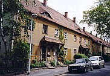
Die Steirische Straße wurde bereits um 1900 als Carolastraße angelegt, jedoch erst in den Jahren nach dem Ersten Weltkrieg durchgängig bebaut. Die unter Denkmalschutz stehenden
Gebäude gehören heute zur Gemeinnützigen Genossenschaft Dresden-Ost _(Foto)_. Im Zusammenhang mit der Eingemeindung Laubegasts wurde sie so wie die meisten Laubegaster
Straßen nach einem geografischen Begriff der Region Österreich-Ungarn benannt. Die Steiermark gehört heute als Bundesland zur Republik Österreich. Auf dem Gelände zwischen Steirischer, Salzburger und Tauernstraße lagen noch bis
1990 die ausgedehnten Anlagen der früheren [Gärtnerei Seidel](../../../ost/striesen/strassen_striesen/seidelsche_gartnerei/), die zu den renommiertesten und größten Dresdner
Gartenbaubetrieben gehörte. 1992/93 wurde hier eine der ersten Wohnanlagen der Nachwendezeit angelegt. Zum Wohnpark “Solitude” gehören neben verschiedenen Stadtvillen und Appartementshäusern auch ein Hotel und einige Reihenhäuser .

## Tauernstraße

Die bis 1926 als Albertstraße bezeichnete Tauernstraße verbindet parallel zur Salzburger Straße Laubegast mit dem benachbarten Leuben
. Die ersten Gebäude auf Laubegaster Flur entstanden bereits um 1900. Hier befindet sich u. a. das Postamt des Stadtteils. Im Haus Tauernstraße 11 wurde 1926 eine Filiale des Dresdner Konsumvereins eröffnet.
Bemerkenswert ist auch die 1909 von Hugo Kaul errichtete Villa Nr. 28 mit klassizistischen und Jugendstil-Elementen. Der Name der Tauernstraße stammt von einem Gebirgszug in Österreich.

## Zur Bleiche

Die von der Österreicher Straße zur Elbe führende Straße Zur Bleiche erinnert an die einst bedeutende Herstellung von
Zwirngarn in Laubegast. Das in Heimarbeit gesponnene Garn wurde im Anschluss zum Bleichen auf die Elbwiesen gelegt. Bis
1926 wurde die Straße Gartenstraße genannt und nach 1900 mit Mietshäusern bebaut. Im Haus Nr. 5 verstarb 1916 der
Fotograf Hermann Krone. Hier wohnte später auch der Musikpädagoge und Pianist Rudolf Zwintscher, der in seiner Wohnung während der Nazizeit ein jüdisches Ehepaar versteckte.

[Laubegast auf OpenStreetMap](https://www.openstreetmap.org/search?query=Dresden+Laubegast)

* * *

 \[ [Home](../../../index.html)\] \[ [Nord](../../../nord/)\] \[ [Nordwest](../../../nordwest/)\] \[ [Neustadt](../../../neustadt/)\] \[ [Nordost](../../../nordost/)\] \[ [West](../../../west/)\] \[ [Zentrum](../../../zentrum/)\] \[ [Südwest](../../../sudwest/)\] \[ [Süd](../../../sud/)\] \[ [Südost](../../../sudost/)\] \[ [Ost](../../../ost/)\] \[ [Register](../../../Register/register.html)\] \[ [Kontakt](../../../Kontakt/kontakt.html)\] \[ [Impressum](../../../impressum/)\]
