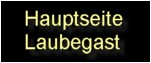
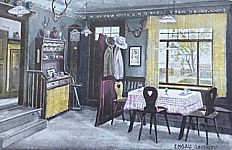
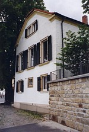
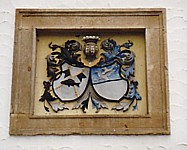
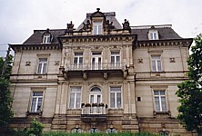

* * *

* * *

Die ehemalige Uferstraße wird seit 1926 offiziell als Laubegaster Ufer bezeichnet und ist Teil des Elberadweges. Neben den bereits vorhandenen Wohngebäuden des Dorfkerns und dem früheren [Gasthof “Stadt Amsterdam”](../../../../ost/laubegast/strassen_laubegast/laubegaster_ufer/volkshaus_laubegast/) entstanden hier gegen Ende des 19. Jahrhunderts auch einige repräsentative Villen im Stil des Historismus. Die nach 1990 zum Großteil sanierten Häuser unterschiedlichster Stilformen prägen bis heute das Ortsbild.

Seit 2009 erinnert die von Wieland Förster geschaffene Bronzeplastik “Die Elbe” am Laubegaster Ufer an das Leben der Ortsbewohner vom und mit dem Fluss. Die Figur wurde 2002 von dem in Laubegast aufgewachsenen Künstler ursprünglich für Hamburg geschaffen, wo sich ein weiterer Abguss befindet. Finanziert wurde das Vorhaben von Laubegaster Einwohnern und vom Künstler selbst, der auf einen Großteil seines Honorars verzichtete. Das Kunstwerk stellt eine auf einer Welle schwebende weibliche Figur dar, die sich leicht aufrichtet und so das bedächtige Strömen als auch das Aufbäumen gegen die Naturgewalt deswassers symbolisiert.

Einzelne Gebäude:

Engaus Kaffee- und Weinstuben: Das Gartenlokal entstand Ende des 19. Jahrhundert unmittelbar am Laubegaster Elbufer (Ecke Zur Bleiche) und war nicht zuletzt wegen des reizvollen Ausblicks auf die gegenüberliegenden Elbhänge beliebtes Ausflugsziel. Besitzer war der glühende Bismarck-Verehrer Otto Engau, der aus Anlass des 10. Todestages Otto von Bismarcks 1908 an seiner Wirtschaft einen “Bismarck-Ehrengarten” anlegen ließ. In dem heute nicht mehr vorhandenen privaten Ehrenhain fanden über 1000 Steine und Metallplatten von verschiedenen Wirkungsstätten des “Eisernen Kanzlers” Aufstellung, die sich Engau aus ganz Deutschland zusenden ließ.

Nach 1945 schloss das Restaurant, der Bismarck-Garten wurde beseitigt und die meisten Steine gingen verloren. In der Nachkriegszeit diente das Gebäude als Jugendheim. Reste der Anlage, darunter eine Metalltafel, konnten in den letzten Jahren aufgespürt werden und sind seit 2008 in einer neugestalteten kleinen Parkanlage an dieser Stelle zu sehen sein.Eine Stele erläutert die Geschichte des Grundstücks.

Nr. 17:
Das Haus entstand 1879 für den sächsischen Hofmarschall von Mangold-Reibold. An der Fassade erinnert ein Doppelwappen an den früheren Besitzer. Im Garten des Grundstückes ist eine ca. 300 Jahre alte Linde erhalten, die seit 1999 unter Naturschutz steht.

**_Fotos:_** _Laubegaster Ufer 17 mit Wappentafel_

Nr. 24:
Das Wohnhaus am Laubegaster Ufer war nach 1945 für einige Zeit Treffpunkt der Glaubensgemeinschaft “Christi Wissenschafter”, die ihre Dresdner Hauptniederlassung in der früheren “Tonhalle” (später Kleines Haus der
Staatstheater) hatte. Mit dem Verbot der vor allem in der USA aktiven Kirche musste auch die Laubegaster Filiale aufgegeben werden. Heute befindet sich hier eine Bäckerei.

Nr. 29:
In einer zum Grundstück gehörenden Halle finden sich noch Fragmente einer früheren Ausmalung durch den avantgardistischen deutschen Maler und Architekten Paul Goesch (1885-1940). Goesch schuf die Bilder 1908
während seines Architekturstudiums als eines seiner ersten größeren Werke. Die Reste der Bemalung wurden 2002 bei Bauarbeiten entdeckt und die Halle deshalb unter Denkmalschutz gestellt. Eine Restaurierung ist geplant.

Villa Roland (Nr. 30): Das Haus entstand um 1880 als Fabrikantenvilla, wurde nach 1945 jedoch enteignet. Am
Eingang des Grundstücks erinnerte einst ein steinerner Hund an die glückliche Rettung eines Kindes aus den Elbfluten.
Leider ist die Plastik seit einigen Jahren verschollen. Ab 1962 befanden sich hier die Räumlichkeiten des Klubs der
Volkssolidarität, der die Villa noch bis 1998 nutzte. Zunächst Veteranenklub Dresden A 44 genannt, erhielt die
Einrichtung später den Namen des Dichters Martin Andersen-Nexö. Heute hat sie ihr Domizil im sanierten Volkshaus Laubegast.

Hartmann-Villa (Nr. 33): Die 1874-77 von Max Hübner und Rudolph Baron erbaute Villa am Laubegaster Ufer gehört zu den qualitätvollsten Villenbauten dieser Zeit in Dresden. Besitzer war der Lokomotivfabrikant Richard Hartmann, der sich sein Haus im französischen Renaissancestil gestalten ließ. Im Inneren befindet sich eine bemerkenswerte Ausstattung im Jugendstil mit farbigen Glasfenstern. Die Wand- und Deckenmalereien wurden von A. Schaberschul geschaffen, der auch an der Ausmalung der Semperoper beteiligt war. Jüngere Forschungen ergaben, dass sich an dieser Stelle im 18. Jahrhundert das Landhaus des Grafen Hoym befand, der hier von 1702 bis 1705 mit seiner Frau Anna Constantia, der späteren Gräfin Cosel lebte.

Ab 1917 hatte in der Villa die Filmproduktionsfirma “Creutz-Film-Gesellschaft” ihren Sitz, die einem Enkel Hartmanns gehörte. Später in “Saxonia-Film” umbenannt, entstanden hier einige Stumm- und Kurzfilme, darunter der Streifen “Der Geiger von Meißen” mit Erich Ponto in der Hauptrolle. Zuletzt wurden bis 1924 noch Werbefilme für verschiedene Unternehmen gedreht. Nach 1945 nutzte bis 2005 ein Kindergarten das Haus.

* * *

 \[ [Home](../../../../index.html)\] \[ [Nord](../../../../nord/)\] \[ [Nordwest](../../../../nordwest/)\] \[ [Neustadt](../../../../neustadt/)\] \[ [Nordost](../../../../nordost/)\] \[ [West](../../../../west/)\] \[ [Zentrum](../../../../zentrum/)\] \[ [Südwest](../../../../sudwest/)\] \[ [Süd](../../../../sud/)\] \[ [Südost](../../../../sudost/)\] \[ [Ost](../../../../ost/)\] \[ [Register](../../../../Register/register.html)\] \[ [Kontakt](../../../../Kontakt/kontakt.html)\] \[ [Impressum](../../../../impressum/)\]
