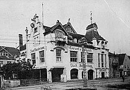
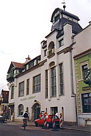

* * *

Das Volkshaus Laubegast entstand ursprünglich als Bauernhof der Familie Möhle und war später Gasthof des Dorfes. In einem heute nicht mehr erhaltenen Nebengebäude verbrachte die Neuberin ihre letzten Lebensmonate und verstarb hier am 29. oder 30. November 1760. Seit 1967 befindet sich dort eine Gedenktafel. Nach Diebstahl wurde diese im Jahr 2013 durch eine neue Sandsteintafel ersetzt.

Nachdem die alte Dorfschänke nicht mehr den Anforderungen genügte, wurde an ihrer Stelle 1889 ein repräsentatives Ballhaus errichtet, welches den Namen “Stadt Amsterdam” erhielt, zeitweise jedoch auch “Weihenstephan” genannt wurde. Architekt des Gebäudes war Richard Uebe, Besitzer der Gastwirt Christian Koch. Wegen des zunehmenden Besucherstromes machte sich um 1900 nochmals eine Erweiterung erforderlich. Bis 1945 fanden hier regelmäßig Konzerte und Tanzvergnügungen statt. Ab 1927 gab es zudem unter der Bezeichnung “Amsterdam-Lichtspiele” regelmäßige Kinovorstellungen. Während des Zweiten Weltkriegs waren im Saal Kriegsgefangene einquartiert, die in Laubegaster Gärtnereien als Zwangsarbeiter eingesetzt waren.

Nach dem Zweiten Weltkrieg übernahm die HO den Gebäudekomplex, der bereits ab 1947, noch unter einem privaten Inhaber, unter dem Namen Volkshaus Laubegast betrieben wurde. Der frühere Ballsaal wurde in den 1970er
Jahren umgebaut, wobei ein Großteil der historischen Ausstattung verloren ging. Ab 1978 gab es hier neben Kinovorführungen regelmäßige Diskotheken, die zu einem Anziehungspunkt der Dresdner Jugend wurden. Aus baupolizeilichen Gründen musste das Volkshaus kurz nach der Wende geschlossen werden. Nach einigen Jahren Leerstand und
Verfall begann 1997 die Sanierung des Gebäudes, bevor es 1998 als sozio-kulturelles Zentrum des Stadtteils wieder eröffnet werden konnte. Neben einer öffentlichen Gaststätte hat hier auch der 1962 gegründete Klub der Volkssolidarität “Martin Andersen-Nexö” sein Domizil und nutzt den ehemaligen Saal als Begegnungsstätte. Außerdem gibt es einige Büros und Wohnungen im Haus.

Vor dem Volkshaus Laubegast wurde 2009 eine Plastik des in Laubegast geborenen Bildhauers Wieland Förster aufgestellt. Die Plastik mit dem Titel “Die Elbe” entstand nach dem Hochwasser 2002 und ist als Abguss bereits am Hamburger Fährterminal zu sehen.

* * *

 \[ [Home](../../../../../index.html)\] \[ [Nord](../../../../../nord/)\] \[ [Nordwest](../../../../../nordwest/)\] \[ [Neustadt](../../../../../neustadt/)\]
 \[ [Nordost](../../../../../nordost/)\] \[ [West](../../../../../west/)\] \[ [Zentrum](../../../../../zentrum/)\] \[ [Südwest](../../../../../sudwest/)\]
 \[ [Süd](../../../../../sud/)\] \[ [Südost](../../../../../sudost/)\] \[ [Ost](../../../../../ost/)\] \[ [Register](../../../../../Register/register.html)\] \[ [Kontakt](../../../../../Kontakt/kontakt.html)\] \[ [Impressum](../../../../../impressum/)\]
