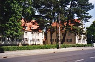
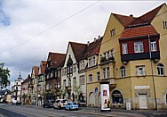
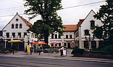
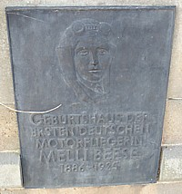
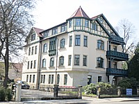

Die Österreicher Straße, bis 1926 Hauptstraße genannt, ist bis heute wichtigste Geschäftsstraße des Stadtteils Laubegast geblieben. Mit der Namensgebung wurde eine Tradition eingeführt, Straßen nach Städten
und geografischen Punkten im ehemaligen Österreich-Ungarn zu benennen. Die Wohnhäuser zwischen Österreicher, Neuberin-, und Iglauer Straße entstanden kurz nach 1900 und bilden das Zentrum von Laubegast. Zuvor befanden
sich hier einige Handelsgärtnereien und Baumschulen, von denen die [Baumschule Poscharsky](../../../../ost/laubegast/strassen_laubegast/osterreicher_strasse/baumschule_poscharsky/) die bedeutendste war.

Einzelne Gebäude:

Nr. 1-1e: Die kleine Wohnanlage an der Flurgrenze zwischen Alttolkewitz und Laubegast entstand 1937/38 als letzes Bauvorhaben des Dresdner Spar- und
Bauvereins. Die drei Gebäude gruppieren sich um einen begrünten Innenhof und wurden 1937 als bester Wohnungsbau der Stadt Dresden ausgezeichnet _(Foto)_.

Nr. 5:
In diesem Haus wohnte früher der Gastwirt und Unternehmer Hermann Donath, Inhaber des bekannten Tolkewitzer Vergnügungslokals [“Donaths Neue Welt”](../../../../ost/tolkewitz/strassen_tolkewitz/alttolkewitz/donaths_neue_welt/) und der [Fruchtsaftkelterei](../../../../sudost/lockwitz/strassen_lockwitz/kelterei_lockwitzgrund/) im Lockwitzgrund. 1948 wurde in dem Gebäude eine
Zweigstelle der Stadtbibliothek eingerichtet.

Ein interessantes Mosaik befindet sich an der Ecke Österreicher Straße / Liehrstraße. Es wurde aus Anlass der
800-Jahr-Feier des Ortes 2008 von Torsten Sändig geschaffen und entstand nach einem Entwurf des Künstlerehepaares Christa und Siegfried Sack.

Nr. 21/23:
Das Wohn- und Geschäftshaus Österreicher Straße 21/23 wurde 1908 an Stelle einer früheren Gärtnerei von A. Rümmler erbaut. Im Erdgeschoss hatte ab 1909 die Konditorei Förster ihr Ladengeschäft. 1957 wurde in den Räumen
eine HO-Lebensmittelkaufhalle eröffnet, welche ab 30. März 1958 als erstes Lebensmittelgeschäft in Dresden in Selbstbedienung betrieben wurde (“HOL-fix”).

Nr. 25:
Das Haus entstand 1909 im Heimatstil für den Gastronomen Berthold Wolff, der als Besitzer des bekannten “Stadtwaldschlösschens” am Postplatz zu Wohlstand gekommen war und sein Geld u. a. in Mietshäusern im Dresdner
Osten anlegte. Zuvor hatte er das Gelände der ehemaligen Gärtnerei Klare erworben, um hier eine repräsentative Gebäudegruppe errichten zu können. Die Entwürfe stammen von den Baumeistern Hermann und Paul Jäckel. Heute
befindet sich hier die Anker-Apotheke.

Nr. 29: Das als Auftakt zum neuen Laubegaster Zentrum 1904 entstandene Mietshaus mit Ladenlokalen im Erdgeschoss befand sich einst im Besitz des Wachwitzer
Steinmetzes August Pötzschke, der gemeinsam mit anderen zu Wohlstand gekommenen Unternehmern bis zum Ersten Weltkrieg die Gebäude zwischen Österreicher Straße,
Iglauer Straße, Neuberinstraße und Zur Bleiche errichten ließ. Architekt war Oscar Menzel. Obwohl die Wohnhäuser von unterschiedlichen Baumeistern entworfen und zu
verschiedenen Zeitpunkten fertig gestellt wurden, weisen sie dennoch einheitliche Formen auf und vermitteln so ein geschlossenes Bild _(Foto)_.

Nr. 39:
Das schlossartige Anwesen entstand vermutlich im 18/19. Jahrhundert aus einem ehemaligen Drei-Seiten-Hof und
erhielt 1843 sein bis heute erhaltenes Hauptgebäude im neogotischen Stil. Der Vorgängerbau gilt als einer der möglichen
Wohnsitze der Gräfin Cosel, die im Raum Laubegast/ Tolkewitz gemeinsam mit ihrem Ehemann Graf Hoym ein Sommerhaus besessen haben soll. Das in den Romanen Kraszewskis erwähnte Gebäude konnte jedoch bis heute nicht
eindeutig lokalisiert werden. In Frage kommen auch Grundstücke unmittelbar im Dorfkern oder am Laubegaster Ufer.

Ab 1866 besaß die russische Fürstin Urusoff das Gut. Später übernahmen die im Zwirnhandel tätigen “Zwirnwölfe”, eine seit dem 18. Jh.
in Laubegast ansässige Familie, den Gebäudekomplex und nutzte ihn bis 1926 als Wohnsitz und Produktionsstätte. Das nach dem Zweiten Weltkrieg nur noch Wohnzwecken dienende historische Gebäude wurde 1996 saniert _(Foto)_. Seit 2009 befindet sich hier auch ein kleines Café.

Nr. 54: Das neue Laubegaster Jugendhaus entstand 2005/06 nach Plänen des Architektenbüros Morgenstern & Partner.
Die Einrichtung dient als Ersatz für ein beim Hochwasser 2002 schwer beschädigtes Vorgängergebäude und war während ihrer Bauzeit unter der Bevölkerung des Stadtteils heftig umstritten.

Nr. 65:
Das 1910 fertiggestellte Doppelhaus mit mehreren Mietswohnungen ist ein typisches Beispiel für die Wandlung des
Bauern- und Fischerdorf zum Dresdner Wohnvorort. Architektonisch orientieren sich die meisten der damals neuen Wohngebäude an ländlichen Villen mit malerischen Giebeln, Dachgauben, Zwerchhäusern und Balkons.

Nr. 76:
Auf diesem Grundstück stand einst das Laubegaster Armenhaus. Teile des Gebäudes sind noch erhalten.

Nr. 84: In diesem von der Straße etwas zurückgesetzten Haus wurde am 13.
September 1886 Melli Beese als Tochter eines Laubegaster Architekten geboren. Nach ihrem Kunststudium widmete sie sich der Fliegerei und erwarb als erste Frau in
Deutschland 1911 den Pilotenschein. Nach mehreren Rückschlägen und gescheiterten Plänen, gemeinsam mit ihrem Mann Charles Boutard eine Flugschule zu eröffnen, nahm
sie sich am 22. Dezember 1925 das Leben. Seit 1986 befindet sich an der Einfriedung des Grundstücks eine Gedenktafel _(Foto)_.

Nr. 86:
Das im Landhausstil gestaltete Mietshaus entstand Ende des 19. Jahrhunderts und befand sich im Besitz des Sägewerksbesitzers Oswald Spalteholz, dessen Betrieb
in unmittelbarer Nachbarschaft am Lockwitzbachweg lag. Ursprünglich diente das Haus als sogenannte “Einarmer-Schule” der Ausbildung von Behinderten. Später war
hier ein Invalidenheim der Arbeiterpensionskasse der Sächsischen Staatseisenbahnen untergebracht. Heute befinden sich in dem unter Denkmalschutz stehenden Gebäude Wohnungen.

* * *

 \[ [Home](../../../../index.html)\] \[ [Nord](../../../../nord/)\] \[ [Nordwest](../../../../nordwest/)\] \[ [Neustadt](../../../../neustadt/)\] \[ [Nordost](../../../../nordost/)\] \[ [West](../../../../west/)\] \[ [Zentrum](../../../../zentrum/)\] \[ [Südwest](../../../../sudwest/)\] \[ [Süd](../../../../sud/)\] \[ [Südost](../../../../sudost/)\] \[ [Ost](../../../../ost/)\] \[ [Register](../../../../Register/register.html)\] \[ [Kontakt](../../../../Kontakt/kontakt.html)\] \[ [Impressum](../../../../impressum/)\]
