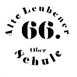
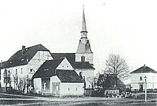
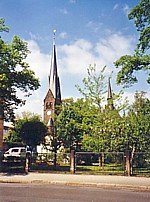
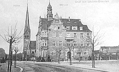
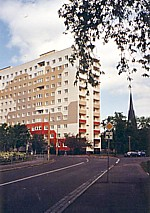
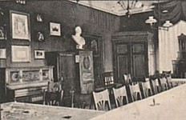
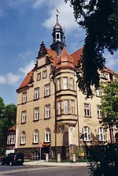
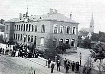
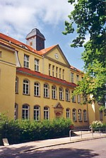

* * *

**Gemeindesiegel von Leuben**

* * *

**Leubener Vereine:**

**FSG Wacker 90 Leuben e.V.**

[**zur Homepage**](http://www.wacker90leuben.de)

* * *

**Schulen in Leuben:**

Das Gebiet des heutigen Dresdner Stadtteils war bereits vor über 3000 Jahren besiedelt, da an verschiedenen Stellen Überreste von Häusern und Hütten, Keramikscherben und bronzezeitliche Gefäße gefunden wurden. Leuben selbst entstand als sorbisches Platzdorf und wurde 1349 erstmals als Sitz eines Vorwerkes urkundlich erwähnt. Der Name Luben geht auf einen slawischen Personennamen (“Ort des Luban”) zurück. Schon frühzeitig besaß der Ort eine [Kirche](../../ost/leuben/himmelfahrtskirche/) und war deshalb religiöses Zentrum für die umliegenden Dörfer. Im 14. und 15. Jahrhundert gehörte Leuben verschiedenen, häufig wechselnden adligen und bürgerlichen Lehnsherren. 1408 erhielt der Dresdner Bürgermeister Lorenz Busmann Teile der Flur als Lehen. Noch um 1800 unterstand das Dorf vier unterschiedlichen Gerichtsbarkeiten: dem Religionsamt sowie dem Leubnitzer Amt des Dresdner Rates, den Grundherren von Weesenstein sowie den Herren des Rittergutes Lockwitz. Erst im Zuge der bürgerlichen Reformen nach 1830 wurde diese Zersplitterung aufgehoben und Leuben zu einer einheitlichen Landgemeinde mit eigenem Gemeinderat.

Schwer betroffen war Leuben von den Wirren des Dreißigjährigen Krieges, in dem das Dorf fast völlig zerstört wurde und einige Jahre wüst lag. Größere Dorfbrände sind für die Jahre 1728 und 1760 verzeichnet. Auch während des Nordischen und des Siebenjährigen Krieges sowie in den Napoleonischen Kriegen fielen Bauerngüter, Scheunen und Felder Kampfhandlungen und Plünderungen zum Opfer. 1859 brannte erneut ein Gut durch Blitzschlag ab. Zwei Soldaten einer durchmarschierenden Infanterieeinheit, die im Dorf vor dem Unwetter Schutz gesucht hatte, kamen dabei ums Leben, sieben weitere wurden verletzt. Bedingt durch diese häufigen Rückschläge blieb Leuben bis zum 19. Jahrhundert ein relativ armes und unbedeutendes Bauerndorf.

Nach 1870 trat die bis dahin dominierende Landwirtschaft in den Hintergrund, so dass es 1898 nur noch vier Bauernhöfe in Leuben gab. Die restlichen Flächen waren zum Teil durch die Bebauung von Seidnitz und Tolkewitz her in Anspruch genommen worden. Außerdem siedelten sich im Gebiet zwischen Leuben und Niedersedlitz verschiedene Industrieunternehmen an. Auf Leubener Flur existierten u. a. Fabriken für Asbest, Fettstoffe und Möbel, Firmen der metallverarbeitenden Industrie sowie Betriebe zur Herstellung von Stroh- und Filzhüten. Im Laufe der Zeit verschmolzen diese mit der Niedersedlitzer Industrie, wodurch Leuben auch zum Wohnort der dort beschäftigten Arbeiter wurde. Um diese schneller zu ihren Arbeitsplätzen befördern zu können, richtete die Firma Kummer & Co. 1899 eine [Straßenbahn](../../ost/niedersedlitz/dresdner_vorortbahn/) zwischen Leuben und Niedersedlitz ein, die 1925 mit dem Dresdner Streckennetz verbunden wurde. Unter Regie des engagierten Gemeindevorstehers Dittrich erhielt Leuben ein repräsentatives Rathaus _(Foto)_ und ab 1901 auch ein öffentliches Trink- und Abwassernetz.

Bis zum Ersten Weltkrieg entstanden rund um den alten Dorfkern zahlreiche neue Wohngebäude, vor allem an der Stephensonstraße, ab 1925 auch an der Königsallee (Berthold-Haupt-Straße). Trotz dieser Entwicklung blieben noch bis nach dem Zweiten Weltkrieg größere Freiflächen erhalten, die von mehreren Gärtnereien bewirtschaftet wurden. Angebaut wurden vor allem Zierpflanzen und andere Spezialkulturen. Zu den größten gehörte die durch ihre Dahlienzucht bekannte [Gärtnerei Engelhardt](../../ost/leuben/strassen_leuben/gartnerei_engelhardt/), die heute in Heidenau die Traditionen des Leubener Gartenbaus fortsetzt. Am 1. April 1921 wurde Leuben nach Dresden eingemeindet.

Im Gegensatz zu vielen anderen Stadtteilen richteten die Luftangriffe auf Dresden 1945 in Leuben nur geringe Schäden an. Aus diesem Grund wurde der Stadtteil in der Nachkriegszeit zu einem wichtigen Zentrum des wiederentstehenden kulturellen Lebens in der Stadt. Bereits im Herbst 1945 fanden im umgebauten Tanzsaal des früheren Dorfgasthofes erste Theateraufführungen statt. Das 1947 zunächst Apollo-Theater genannte Haus ist seit 1954 Domizil der [Staatsoperette](../../ost/leuben/operettentheater/). Bereits drei Jahre zuvor war an der Stephensonstraße ein Kulturhaus des VEB Elektromaschinenbau [Sachsenwerk](../../ost/niedersedlitz/sachsenwerk/) eröffnet worden, eines der ersten seiner Art in der DDR.

Die größten Veränderungen für Leuben brachte jedoch der Beschluss zum Aufbau eines Neubaugebietes zwischen Breitscheidstraße und [Pirnaer Landstraße](../../ost/dobritz/strassen_dobritz/pirnaer_landstrasse/). Für den ersten
Wohnungsbaustandort dieser Größe außerhalb des Stadtzentrums mussten fast alle noch bestehenden Gärtnereien weichen und einige Gebäude im Dorfkern abgerissen werden.
Zwischen 1970 und 1974 entstanden zu beiden Seiten der als zentrale Achse ausgebildeten Zamenhofstraße _(Foto)_ mehrgeschossige Plattenbauten. Hinzu kamen fünf Wohnhochhäuser sowie die erforderlichen gesellschaftlichen Einrichtungen mit der später stadtweit bekannten Wohngebietsgaststätte “Freundschaft”. Nach 1990 folgte eine Rekonstruktion des historischen Dorfkerns und weiterer Wohngebäude, wobei auch ein modernes Stadtteilzentrum errichtet wurde. Weitere Häuser entstanden auf ehemaligem Gärtnereigebiet an der Berthold-Haupt-Straße. Zu den jüngeren Attraktionen des Stadtteils gehört die im Sommer 2005 in Betrieb genommene Wasserskianlage auf dem Gelände der früheren Kiesgrube an der Pirnaer Landstraße.

Rathaus Leuben:

Das Leubener Rathaus entstand 1900/01 nach Plänen des Architekten Gustav Hänichen und des Baumeisters Otto Beeger. Zuvor traf sich der Gemeinderat in den Stuben verschiedener Bauernhäuser, zuletzt im Haus Altleuben Nr. 12. Für den Bau hatte die Gemeinde 1898 das benötigte Grundstück erworben und 1899 den Auftrag erteilt. Das Rathaus wurde unter Verwendung verschiedener historischer Stile mit Anklängen an den Jugendstil gestaltet und am 28. Februar 1901 eingeweiht. Im Erdgeschoss befand sich der über einen Nebeneingang erreichbare prachtvoll ausgestaltete Ratskeller mit Bierstube und Restaurant _(Foto)_, in den Obergeschossen die Diensträume sowie die Wohnungen des Gemeindevorstandes und weiterer Bediensteter. Auch die Direktion der Leuben-Niedersedlitzer Vorortbahn war hier untergebracht. Weitere Räumlichkeiten nutzten die Ortskrankenkasse, Polizei und Sparkasse.

Trotz aller Bemühungen erwies sich die Bewirtschaftung der Gaststätte “Ratskeller” nicht als finanzieller Erfolg. Nach mehrfachem Pächterwechsel musste das Lokal deshalb am 11. März 1921 geschlossen werden. 1925 wurde in den Räumen ein Volksbad mit vier Wannen und vier Brausekabinen eingerichtet. Das Rathaus selbst blieb auch nach der Eingemeindung Leubens Sitz verschiedener Behörden der Dresdner Stadtverwaltung. Ab 1933 war im ersten Obergeschoss die Gestapo-Zentrale Dresden-Ost untergebracht. 1945 befand sich hier zeitweise die zentrale Vermisstenzentrale, in der die Opfer des Bombenangriffs auf Dresden registriert wurden. Zu DDR-Zeiten zog die Kommunale Wohnungsverwaltung ein. Heute nutzt das Ortsamt Leuben die Räume. Der frühere Ratskeller wurde 1999 nach historischem Vorbild saniert und dient heute als Bürgersaal öffentlichen Veranstaltungen. 2014 wurde das Ortsamt Dresden-Leuben als erste kommunale Behörde des Landes für sein Engagement gegen rechtsextreme Aktivititäten mit dem Sächsischen Förderpreis für Demokratie ausgezeichnet.

Schulen in Leuben:

Erste Berichte über das Leubener Schulwesen stammen aus dem 16. Jahrhundert. Bereits 1555 wurde die Dorfjugend vom Küster zum Sonntagsunterricht versammelt. 1598 ist mit Johannes Syderus zum ersten Mal ein Schulmeister erwähnt. Diese Leubener Kirchschule, die mehrfach ihren Standort wechselte, besuchten später auch die Kinder der Nachbarorte Laubegast und Tolkewitz. 1782 konnte eine neue Schulstube bezogen werden. Zeitweise wurden hier über 150 Kinder, aufgeteilt in zwei Klassen, unterrichtet. 1862 entstand schließlich am Dorfplatz ein richtiges Schulgebäude mit vier Klassenzimmern.

Nachdem diese alte Schule nicht mehr den Anforderungen genügte, wurde 1894 ein Neubau an der Dieselstraße eingeweiht _(Foto oben links)_. Das nach modernen Kriterien ausgestattete Schulhaus besaß u. a. eine eigene Schulbibliothek, die auch der übrigen Bevölkerung offen stand. 1898 folgte eine Turnhalle. 1907 und 1925 wurde das Gebäude erweitert und diente nach dem Angriff auf Dresden 1945 zeitweise als Notquartier und Auffanglager. Die zu DDR-Zeiten als 66. POS bezeichnete Schule wird heute von der 66. Grund- und Mittelschule genutzt _(Foto rechts)_. Eine umfassende Sanierung erfolgte 2005. In diesem Zusammenhang entstand ein moderner Ergänzungsbau, welcher Schulhaus und Turnhalle miteinander verbindet.

Weitere Schulneubauten wurden nach 1970 im Zusammenhang mit dem Bau des Neubaugebietes errichtet. Diese dienen heute als 93. Grundschule (Moränenende 3) bzw. als Mittelschule und allgemeinbildendes Gymnasium der privaten Schule für das Hotel- und Gaststättengewerbe HOGA (Zamenhofstraße 61/63). Letztgenannte Schule trug als 73. Polytechnische Oberschule vor 1990 den Namen des Antifaschisten Hanns Rothbarth, an den ein noch erhaltenes Denkmal auf dem Schulgelände erinnert. Außerdem gab es auf dem Gelände die 78. Polytechnische Oberschule.

[_Weiterführende Literatur und Quellen_](../../impressum/quellenverzeichnis/)

 \[ [Home](../../index.html)\] \[ [Nord](../../nord/)\] \[ [Nordwest](../../nordwest/)\] \[ [Neustadt](../../neustadt/)\] \[ [Nordost](../../nordost/)\] \[ [West](../../west/)\] \[ [Zentrum](../../zentrum/)\] \[ [Südwest](../../sudwest/)\] \[ [Süd](../../sud/)\]
 \[ [Südost](../../sudost/)\] \[ [Ost](../../ost/)\] \[ [Register](../../Register/register.html)\] \[ [Kontakt](../../Kontakt/kontakt.html)\] \[ [Impressum](../../impressum/)\]
