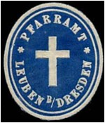
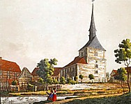
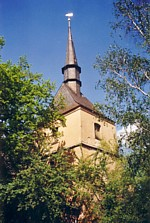
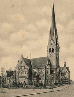
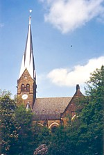
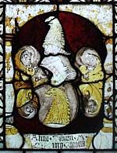
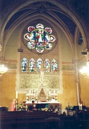
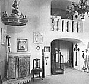
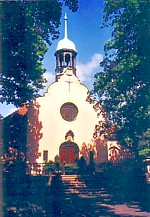

* * *

* * *

Himmelfahrtskirche:

 Leuben war bereits früh als Kirchdorf für die umliegenden Ortschaften von Bedeutung und Mittelpunkt des religiösen Lebens im Osten Dresdens. Bereits 1362 ist die hiesige Kirche in den Akten erwähnt. Die alte Dorfkirche _(Bild rechts)_ entstand 1512 im gotischen Stil, möglicherweise durch Umbau des älteren Vorgängerbaus. Ab 1674 gehörten die Dörfer Laubegast, Tolkewitz und Seidnitz zum Leubener Kirchspiel, später auch Niedersedlitz, Dobritz und Reick. Umbauarbeiten erfolgten 1610 und 1704. 1858 erhielt sie eine Orgel des Pirnaer Orgelbauers Schröder. 1879 wurden im Turm drei neue Glocken der Dresdner Glockengießerei Große aufgehängt. Bereits zu dieser Zeit erwies sich der Bauzustand des Gebäudes jedoch als so schlecht, das man den Neubau einer Kirche erwog. 1892 beschloss der Kirchenvorstand, die bisherige Dorfkirche durch eine neue und größere zu ersetzen Mit Ausnahme des Turmes _(Foto links)_ wurde die alte Dorfkirche deshalb um 1900 zugunsten der heutigen Himmelfahrtskirche abgerissen. Die erhaltene Wetterfahne zeigt die Initialien I H G V O H (= Johann Georg von Osterhausen) und erinnert daran, dass Leuben einst der Gerichtsbarkeit des Rittergutes Lockwitz unterstand. Einige Jahreszahlen weisen auf Umbauten und Erneuerungen hin.

 Der Neubau entstand ab 1899 (Grundsteinlegung am 8. Mai) nach Plänen des Blasewitzer Architekten Karl Emil Scherz im neogotischen Stil und wurde am 16. Mai 1901 geweiht. Zuvor hatte sich der Gemeindevorstand gegen einen Umbau der alten Kirche ausgesprochen und einen Architektenwettbewerb durchgeführt. Für den Kirchenneubau verschwanden auch die beiden Leubener Dorfteiche sowie Teile des alten Kirchhofes. Scherz hatte bereits Erfahrungen mit ähnlichen Projekten gesammelt, weshalb man ihm zugleich die Oberbauleitung übertrug. Die Ausführung erfolgte mit modernen technischen Mitteln. So wurden die Fundamente bereits in Beton gegossen, Teile der Gewölbe in einem Leichtbausystem errichtet und der Dachstuhl als Stahlkonstruktion gestaltet. Da die Weihe der Kirche auf den Himmelfahrtstag fiel, erhielt sie den Namen Himmelfahrtskirche.

Die Außenfassade der Kirche ist mit Postelwitzer und Postaer Sandstein verkleidet. Typische Gestaltungsmerkmale sind die hohen gotischen Spitzbogenfenster mit darüber liegenden Kleebattbogenfenstern an der Empore. Zahlreiche Ornamente und Verzierungen geben dem Bau ein repräsentatives Aussehen. Markantes Wahrzeichen ist der 75 Meter hohe Kirchturm mit seinen vier Glocken. Die beiden größten, ein Geschenk der Stadt Dresden, zeigten neben anderen Darstellungen u. a. das Dresdner Stadtwappen. Leider fielen diese sowie zwei weitere kleine Exemplare dem Rüstungswahn des Ersten Weltkrieges zum Opfer, ein Schicksal, welches auch einige Pfeifen der Eule-Orgel traf. Erst 1922 konnten vier neue Stahlglocken angeschafft werden. Die Orgel war bis 1935 wieder hergestellt. Auf dem Vorplatz der Kirche mahnt ein Denkmal an die im Ersten Weltkrieg gefallenen Leubener Soldaten.

Nach 1945 war die Leubener Kirche ein Zentrum des kirchenmusikalischen Lebens in der zerstörten Stadt. U. a. traten hier der Kreuzchor sowie Studenten der Staatlichen Akademie für Musik auf. Größere Reparaturarbeiten an Turm und Kirchenschiff erfolgten zwischen 1963 und 1974. Der Innenraum konnte bis 1989 originalgetreu restauriert werden. Zuvor war auch ein umfangreicher Umbau der Kirche im Gespräch, welche durch eine Innenwand geteilt werden sollte, um so einen zusätzlichen Gemeindesaal zu erhalten. Fehlende Baukapazitäten verhinderten diesen Eingriff. Nach 1990 erfolgten weitere Sanierungsmaßnahmen. Heute betreut die Himmelfahrtsgemeinde nur noch Christen aus Leuben und Niedersedlitz, nachdem in der Nachkriegszeit in Tolkewitz und Seidnitz eigene Gemeinden entstanden waren. 2006 erfolgte eine Vereinigung mit der erst 1994 entstandenen Christophorusgemeinde Laubegast. Als Gemeindesaal wird seit 2012 eine umgebaute Scheune (Altleuben 13) genutzt. Hier befindet sich auch das Pfarrhaus.

Im Inneren sind noch einige historische Ausstattungsstücke aus der alten Kirche, so ein Taufstein von 1610 sowie ein Glasfenster mit dem Wappen der Familie von Alnpeck zu sehen _(Bild links)_. Diese war Besitzer des Rittergutes Lockwitz, mit welchem Leuben bis ins 19. Jahrhundert verbunden war. Bemerkenswertestes Denkmal ist der Epitaph des kurfürstlichen Oberforstmeisters Hans von Dehn-Rothfelser (1500-1561), welcher sich bis zu deren Abbruch 1722 in der alten Frauenkirche befand. Später fand das von Christoph Walther II. geschaffene Grabmal auf dem Leubener Friedhof Aufstellung, wo es 1876 wieder entdeckt und aus Witterungsgründen in die Kirche verbracht wurde. Einige Glasfenster mit biblischen Themen stammen aus der Zeit um 1900 und wurden von den Gemeinden der Umgebung und privaten Spendern gestiftet. Das Altarbild schuf der Hofmaler Julius Schultz. Es zeigt eine Darstellung von Jesus Christus in einem Triumphbogen. Schultz übernahm auch die farbige Ausmalung des Innenraums in Jugendstilformen.

Ortsmuseum:

Nach Abbruch der alten Dorfkirche wurde im erhalten gebliebenen Turm ein kleines Ortsmuseum eingerichtet _(Foto)_. Die Sanierung des Gebäudes übernahm der Sächsische Altertumsverein in Zusammenarbeit mit dem Verein zur Erhaltung von Kunstdenkmalen. Im Inneren fanden historische Bibeln und andere Gegenstände aus kirchlichem Besitz Aufnahme. Hinzu kamen ortsgeschichtliche Sachzeugen wie Spieß und Horn des Leubener Nachtwächters, Kanonenkugeln aus der Zeit der Befreiungskriege, Hausrat und Gemälde sowie Dokumente zur Geschichte des Dorfes. Dieses “kleinste Museum” Dresdens wurde mit der Eingemeindung Leubens 1921 vom Stadtmuseum als Außenstelle übernommen, später jedoch geschlossen. Das Schicksal der Ausstellungsstücke ist ungeklärt. Seit 1951 nutzt die Junge Gemeinde die Räume des alten Kirchturms.

Luthereiche:

Die Luthereiche neben der Kirche wurde 1883 auf Anregung des Gemeinderates aus Anlass des 400. Geburtstages Martin Luthers gepflanzt. Für die Gedenkeiche hatte der Gemeinderat zuvor am 22. September 1883 ein kleines Stück Gemeindeland gegenüber der alten Dorfschule an die Kirchgemeinde abgetreten. Ein Blechschild mit der Inschrift "L. E. 1883" weist auf die historischen Zusammenhänge hin. Bereits 1815 hatte die Leubener Kirchgemeinde am 31. Oktober zum 300. Jahrestag der Reformation eine Reformationseiche gepflanzt.

Leubener Friedhof:

Bereits mit Entstehung der ersten Dorfkirche wurde in deren unmittelbarem Umfeld ein Begräbnisplatz für die Verstorbenen des Kirchspiels angelegt. Dieser Kirchhof, der seit Ende des 19. Jahrhunderts nicht mehr genutzt wird, ist noch erhalten und weist einige alte Grabsteine auf. Bemerkenswert sind die Gräber einiger Leubener und Laubegaster Gutsbesitzer sowie die Grabstätte der Familie Wolf, die in Laubegast als Zwirnhändler tätig war.

1675 entstand außerhalb des Dorfes auf einem Feld an der Pirnaer Landstraße ein neuer, größerer Friedhof. Anlass war die Einbeziehung der Dörfer Tolkewitz, Laubegast und Seidnitz in die Leubener Parochie. Die erste Beisetzung erfolgte am 8. Januar 1675, als hier der aus Tolkewitz stammende erst achtjährige Knabe Jacob Ranitzsch seine letzte Ruhe fand. 1722 wurde an der straßenseitigen Mauer neben dem Haupteingang das beim Abbruch der alten Frauenkirche geborgene Grabmal des kurfürstlichen Forstmeisters und Amtshauptmannes von Radeberg Hans von Dehn-Rothfelser (1500-1561) aufgestellt. Aus Witterungsgründen befindet sich der wertvolle Grabstein heute in der Himmelfahrtskirche.

Nach mehrfachen Erweiterungen weist der Friedhof heute eine Fläche von ca. 2,5 Hektar auf und bietet Platz für über 5000 Gräber. 1891 wurde vom Architektenbüro Reuter & Fischer eine Feierhalle im Neorenaissancestil errichtet _(Foto)_. 1907 kam eine separate Leichenhalle hinzu. Zahlreiche, zum Teil prunkvolle Gräber wohlhabender Fabrikanten und Gärtnereibesitzer stammen ebenfalls aus dieser Zeit. Vor der Kapelle erinnert ein Grabstein an den Gründer der Laubegaster Schule Friedrich Imanuel Schober (1760-1849). Auch einige Ortspfarrer sowie der frühere Gemeindevorstand Otto Herrmann Dietrich (+ 1929) fanden hier ihre letzte Ruhestätte. Ein schlichtes Holzkreuz erinnert an die Opfer der beiden Weltkriege.

Bekanntestes Grab ist jedoch jenes der Friederike Caroline Neuber. Die als “Mutter der deutschen Schauspielkunst” berühmte Schauspielerin verstarb 1760 im benachbarten Laubegast und wurde zunächst in einem Armengrab in einer Ecke des Friedhofes beigesetzt. Der Legende nach sollen Freunde der völlig verarmten Künstlerin den Sarg heimlich über die Friedhofsmauer transportiert haben, da der Leubener Pfarrer eine ordentliche Beerdigung verweigert hatte. Erst 1852 legten Theaterfreunde das heutige Grab an und pflanzten an dieser Stelle einen Lindenbaum.

Weniger bekannt als die Neuberin, jedoch ebenfalls für die Dresdner Geschichte bedeutsam, ist der Tolkewitzer Christian Gärtner (1705-1782), der ebenfalls auf dem Neuen Leubener Friedhof beigesetzt wurde. Gärtner, der sich seinen Lebensunterhalt als Garnbleicher und Zwirnhändler verdiente, befasste sich in seiner knappen Freizeit mit Astronomie. Ebenso wie Georg Palitzsch in Prohlis ging auch Gärtner als “Bauernastronom” in die Wissenschaftsgeschichte ein. Die Grabstelle ist nicht mehr erhalten.

* * *

 \[ [Home](../../../index.html)\] \[ [Nord](../../../nord/)\] \[ [Nordwest](../../../nordwest/)\] \[ [Neustadt](../../../neustadt/)\] \[ [Nordost](../../../nordost/)\] \[ [West](../../../west/)\] \[ [Zentrum](../../../zentrum/)\] \[ [Südwest](../../../sudwest/)\] \[ [Süd](../../../sud/)\] \[ [Südost](../../../sudost/)\] \[ [Ost](../../../ost/)\] \[ [Register](../../../Register/register.html)\] \[ [Kontakt](../../../Kontakt/kontakt.html)\] \[ [Impressum](../../../impressum/)\]
