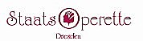
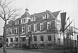
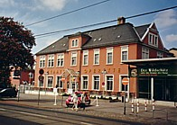

* * *

* * *

* * *

* * *

* * *

* * *

**Homepage der Staatsoperette:**

* * *

Obwohl die Geschichte des Dresdner Operettentheaters eigentlich erst nach dem Zweiten Weltkrieg beginnt, gab es in Dresden bereits zuvor musikalische Theateraufführungen, zunächst in Form von Singspielen, nach 1800 zunehmend im Stil der damals richtungsweisenden “Wiener Operette”. Die Veranstaltungen fanden auf verschiedenen Bühnen der Innenstadt statt, vor allem im Zentraltheater auf der Waisenhausstraße sowie im Alberttheater in der Neustadt. Spätestens mit der Verkündung des “totalen Krieges” 1944 endeten diese Aufführungen; wenige Monate später versanken die Spielstätten des Stadtzentrums in Schutt und Asche.

Nach Zerstörung fast aller Theater und Säle in der Innenstadt bemühten sich Dresdner Künstler bereits kurz nach Kriegsende um entsprechende Ausweichquartiere. Ins Blickfeld geriet dabei auch der einstige Leubener [Dorfgasthof](../../../ost/dobritz/strassen_dobritz/pirnaer_landstrasse/) an der Pirnaer Landstraße 131 _(Foto)_, der seit 1925 unter dem Namen “Feenpalast” ein beliebtes Tanz- und Vergnügungsetablissement war. Da dieser über einen geeigneten großen Saal verfügte und zudem mit der Straßenbahn gut erreichbar war, begann im Herbst 1945 der Umbau zum Theater. Für die Bühnentechnik verwendete man geborgene Teile der Maschinerie des zerstörten Zentraltheaters. Der Saal erhielt eine vergrößerte Bühne und einen Orchestergraben und bot Platz für ca. 800 Besucher.

Zu den “Aktivisten” des wiederentstehenden Kulturlebens gehörte der ehemalige Technische Direktor des Zentraltheaters Fritz Randow, der frühere Mitglieder des Ensembles um sich versammelte und ein privates Theater gründete. Randow war zugleich Gründer des Aeros-Varietes. Fast zeitgleich waren im Januar 1946 die “Vereinigten Volksbühnen”, ein Zusammenschluss des Cottaer “Theater des Westens” und der “Kammerspiele Johannstadt, entstanden. Am 22. August 1947 trat diese Gruppe mit Shakespeares “Ein Sommernachtstraum” erstmals in Leuben auf. Vier Tage zuvor war das Leubener Theater offiziell seiner Bestimmung übergeben worden. Weitere Spielstätten waren der Gasthof “Goldene Krone” in Kleinzschachwitz sowie der ehemalige Tanzgasthof “Constantia” in Cotta (später [Theater Junge Generation](../../../west/cotta/strassen_cotta/meissner_landstrasse/theater_junge_generation/)).

Noch im gleichen Jahr wurde das Leubener Haus in “Apollo-Theater” umbenannt und fortan als ständige Spielstätte für Operettenaufführungen genutzt. Randow wurde gegen eine Abfindung dazu bewegt, sein Privattheater aufzugeben und erhielt die Stelle eines beratenden Direktors. Mit der Premiere von Lehars “Die lustige Witwe” am 2. Oktober 1947 begann der regelmäßige Spielbetrieb. 1950 wurde die Volksbühne jedoch aufgelöst und die Dresdner Theaterlandschaft neu strukturiert. Das Leubener Theater übernahm 1953 die Stadt Dresden in ihren Besitz. Am 2. Oktober 1954 erhielt es offiziell den Namen Staatliches Operettentheater und widmete sich fortan mit eigenem Ensemble vorrangig der Pflege des heiteren Musiktheaters.

In den Folgejahren war die Staatsoperette Schauplatz zahlreicher Ur- und Erstaufführungen sowie Auftrittsort bekannter Künstler. Dazu gehörten u. a. die Intendanten Otto Bochmann und Fritz Steiner, die Mitglieder des Quartetts “Vier Brummers”, der Komponist Peter Bejach sowie eine Reihe von jungen Schauspielern, die ihre Karriere in Leuben begannen. 1978 debütierte hier der spätere weltbekannte Kammersänger Peter Schreier. Zu den Höhepunkten im Theaterbetrieb gehörte die DDR-Erstaufführung des Musicals “My Fair Lady” 1965 sowie die Uraufführung der Operette “Mein Freund Bunbury” im gleichen Jahr. 1978 übernahm Reinhold Stövesand die nach dem Tod Steiners frei gewordene Intendantenstelle.

Trotz baulicher Mängel blieb das Operettentheater bis 2016 in seinem Domizil. Mehrfach erfolgten Umbauten und Rekonstruktionen, ohne jedoch die Probleme der zunächst nur als provisorischen Spielstätte gedachten Bühne vollständig beseitigen zu können. Nachdem zeitweise sogar eine Schließung des einzigen eigenständigen Operettentheaters in Deutschland erwogen wurde, konzentrierten sich die Bemühungen später auf einen Neubau im Stadtzentrum. Die Wahl des geeigneten Standortes sorgte dabei für heftige Diskussionen. Favorisiert wurden der Ferdinandplatz, der Wiener Platz, der Postplatz bzw. das ehemalige Kraftwerk Mitte. Letztlich entschied sich der Stadtrat für einen Umzug auf das Gelände des früheren Kraftwerks Mitte. Unter dem Namen "Kulturkraftwerk" sollen dort verschiedene kulturelle Einrichtungen einen neuen Platz finden. Für das Operettentheater entstand dabei ein Neubau. Als Foyer dient einer der ehemaligen Kraftwerksbauten, der gemeinsam mit dem Theater Junge Generation genutzt wird. Die letzte Vorstellung in Leuben fand am 31. Oktober 2016 statt, die Einweihung der neuen Spielstätte erfolgte im Dezember 2016.

* * *

 \[ [Home](../../../index.html)\] \[ [Nord](../../../nord/)\] \[ [Nordwest](../../../nordwest/)\] \[ [Neustadt](../../../neustadt/)\] \[ [Nordost](../../../nordost/)\] \[ [West](../../../west/)\] \[ [Zentrum](../../../zentrum/)\] \[ [Südwest](../../../sudwest/)\] \[ [Süd](../../../sud/)\] \[ [Südost](../../../sudost/)\] \[ [Ost](../../../ost/)\] \[ [Register](../../../Register/register.html)\] \[ [Kontakt](../../../Kontakt/kontakt.html)\] \[ [Impressum](../../../impressum/)\]
