* * *

 l

## Altleuben

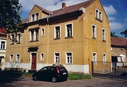Als Altleuben wird der frühere Dorfplatz an der [Leubener Kirche](../../../ost/leuben/himmelfahrtskirche/) bezeichnet. Ursprünglich befanden sich hier zwei Teiche, die erst im Zusammenhang mit dem Kirchenneubau um 1900 zugeschüttet wurden. Nach der Neugestaltung der entstandenen Fläche erhielt der Dorfplatz zunächst den Namen Marktplatz. Am 1. Juni 1926 erfolgte die Umbenennung in Altleuben.

1912 entstanden an Stelle einer früheren Kiesgrube Kleingärten, die nach 1990 dem Neubau des Leubener Stadtteilzentrums weichen mussten. Trotz Abbrüchen in der Nachkriegszeit, vor allem um 1970, sind in Altleuben _(Foto: Altleuben Nr. 12)_ noch einige historische Bauernhäuser erhalten; weitere Gebäude aus der dörflichen Vergangenheit des Ortes stehen an der Pirnaer Landstraße.

Gasthof “Zum Lindengarten”: Die Gaststätte _(Foto unten)_ entstand Ende des 19. Jahrhunderts am Rande des Dorfplatzes (Nr. 1) und war beliebte Einkehrstätte der Dorfbevölkerung. Bis zum Bau des Rathauses traf sich hier zu bestimmten Anlässen der Leubener Gemeinderat. Die auch nach 1945 noch bewirtschaftete Einkehrstätte schloss 1969 ihre Pforten und wurde im Zusammenhang mit dem Bau des Neubaugebietes abgerissen.

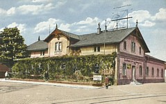

Pflegeheim Altleuben:

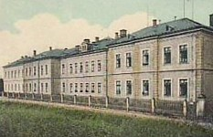Das heutige Pflegeheim Leuben wurde am 1. April 1883 als “Bezirks-Anstalt für Sieche, Versorgte, geistig Minderwertige und Korrektionäre” gegründet und im früheren Stadtgut Altleuben Nr. 10 untergebracht. Die zunächst ca. 50 hier lebenden behinderten Männer und Frauen wurden von Fachpersonal betreut und gepflegt. Zehn Jahre nach Eröffnung entstand auf dem Gelände ein Erweiterungsbau, der als “Siechenhaus” bezeichnet und für schwerkranke Pflegebedürftige gedacht war _(Foto links)_. Die arbeitsfähigen Patienten wurden mit verschiedenen leichten Tätigkeiten, wie dem Knüpfen von Kokosmatten, Waschen, Nähen und Stricken beschäftigt, wobei der Erlös zur Finanzierung der Einrichtung diente.

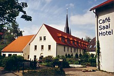 Trotz der Bemühungen des Personals gerieten die Lebensverhältnisse der Heimbewohner immer wieder in die Kritik. 1929 kam es sogar zu einer Meuterei, nachdem mehrfach Brände ausgebrochen und die Lebensmittelrationen gekürzt worden waren. Die Rädelsführer wurden vom Dresdner Landgericht zu Zuchthausstrafen verurteilt, die Leitung des Hauses von jeder Schuld freigesprochen. Gegen dieses Urteil formierte sich Protest durch die proletarische “Internationale Arbeiterhilfe”, jedoch ohne Erfolg. Sogar ein Theaterstück mit dem Titel “Revolte im Erziehungshaus” widmete sich den Vorkommnissen in Leuben.

Nach 1945 wurde die Anstalt zunächst als Heim für schwererziehbare Jugendliche, später als Pflegeheim und Rehabilitations-Einrichtung für geistig Behinderte weitergeführt. In den 1990er Jahren entstand durch Um- und Neubau eine moderne Wohnanlage, in der heute ein Großteil der ca. 170 Patienten lebt. Seit 1999 trägt die Einrichtung offiziell den Namen “Altleuben 10 - Wohnstätte für Menschen mit geistiger Behinderung” _(Foto rechts)_.

## Am Dahlienheim

Die kurze Straße am Südrand des ehemaligen Dorfkerns verdankt ihren Namen der bis 1969 hier beheimateten [Dahlienzucht Engelhardt](../../../ost/leuben/strassen_leuben/gartnerei_engelhardt/). Das 1914 gegründete und auf die Züchtung dieser Zierpflanzen spezialisierte Unternehmen gehörte zu den
bekanntesten Leubener Gärtnereien, musste jedoch später dem Neubaugebiet weichen. Heute führt die Familie ihre Gärtnerei in Heidenau weiter. Am Dahlienheim entstanden zwischen 1970 und 1974 Neubauten.

Erste Planungen für diese Straße reichen bis 1898 zurück. Allerdings blieb es bis zum Zweiten Weltkrieg bei einem kurzen
Abschnitt westlich der Lilienthalstraße, welcher der Klettestraße zugeordnet war. Durch die Errichtung einiger Neubauten der
AWG des Sachsenwerkes Mitte der 1950er Jahre, wurde die Klettestraße jedoch unterbrochen, was eine Neubenennung des abgetrennten Straßenteils erforderlich machte. Diese erfolgte mit Ratsbeschluss vom 15. August 1962.

## [Berthold-Haupt-Straße](../../../ost/leuben/strassen_leuben/berthold-haupt-strasse/)

## Dieselstraße

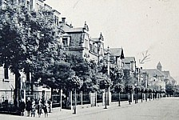Die Dieselstraße verbindet Leuben mit seinen Nachbarorten Niedersedlitz und Laubegast und wurde bereits Ende des 19. Jahrhunderts durch einen privaten Grundstücksbesitzer ausgebaut. Auf Beschluss des Gemeinderates vom 20. Mai 1896 erhielt sie zunächst den Namen Schulstraße. Grund war, das hier 1894 das bis heute noch genutzte Leubener [Schulhaus](../../../ost/leuben/) entstanden war.

1905 wurde in Verlängerung der Schulstraße auf Niedersedlitzer Flur die Röntgenstraße angelegt. Namenspatron war der Physiker Wilhelm Conrad Röntgen. Nachdem Leuben 1921 zu Dresden eingemeindet worden war, machte sich eine Umbenennung der Schulstraße erforderlich. 1926 erhielt sie zu Ehren des deutschen Technikers Rudolf Diesel (1858-1913), der 1897 den nach ihm benannten Dieselmotor erfunden hatte, den Namen Dieselstraße. Diese Bezeichnung übertrug man nach der Eingemeindung von Niedersedlitz ab 30. September 1953 auch auf die frühere Röntgenstraße.

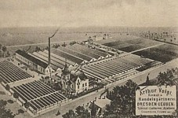Das Straßenbild der Dieselstraße prägen bis zur Gegenwart überwiegend Wohnhäuser aus dem ersten Drittel des 20. Jahrhunderts. Im Eckhaus Nr. 7 zur Fabrikstraße (Sachsenwerkstraße) befand sich ab 1909 das Kino "Leubener Lichtspiele-Volkstheater" mit 200 Plätzen von Ernst Schicktansky. In der Nr. 9/11 hatte die 1922 gegründete Dresdner Keramische Industrie AG ihren Sitz. Das Unternehmen produzierte hauptsächlich Kachelöfen und Küchenherde. Das Grundstück Schulstraße 46 (heute Nr. 52) wurde von der Kunst- und Handelsgärtnerei Arthur Voigt genutzt. Voigt (1867–1940) gründete 1895 eine Azaleengärtnerei und wurde durch zahlreiche Neuzüchtungen, u.a. die Azaleensorten „Schneewittchen“ und „Schneeweißchen“, bekannt _(Foto)_. 1973 erfolgte die Verstaatlichung des Unternehmens, welches noch bis ca. 1990 existierte.

## Franz-Latzel-Straße

Die heutige Franz-Latzel-Straße im östlichen Teil Leubens wurde 1897 angelegt und bis 1926 Lindenstraße genannt. Zuvor hatte der Baumeister L. A. Schreiber zahlreiche Grundstücke in diesem Gebiet erworben und die Namensgebung angeregt. Um Verwechslungen zu vermeiden, erhielt die Lindenstraße nach der Eingemeindung von Leuben 1926 den Namen Akazienstraße. Am 17. Juli 1936 wurde sie jedoch erneut umbenannt in Dürrstraße. Dr. Ludwig Dürr (1878-1956) war als Konstrukteur maßgeblich am Bau der Zeppelin-Luftschiffe in Friedrichshafen beteiligt. Zunächst hatte man den Rosenschulweg für eine Neubenennung vorgesehen, entschied sich jedoch schon einen Monat später für die bedeutendere Akazienstraße.

Da man Dürrs Arbeit als Luftschiffkonstrukteur mit dem Rüstungsprogramm des Deutschen Reiches in Verbindung brachte, erfolgte bereits am 24. Juli 1945 eine erneute Namensänderung in Latzelstraße. Seit 1962 ist der Name Franz-Latzel-Straße amtlich. Franz Latzel (1880–1941) war ein Dresdner Antifaschist und wurde am 29. August 1941 in Dresden ermordet.

## Großsedlitzer Weg

Der Großsedlitzer Weg, eine Seitenstraße der Zamenhofstraße, entstand beim Bau des Leubener Neubaugebietes Anfang der 1970er Jahre. Benannt ist er nach dem kleinen Ort Großsedlitz, einem Ortsteil von Heidenau. Wegen seines Barockgartens ist Großsedlitz ein beliebtes Ausflugsziel.

## Großzschachwitzer Straße

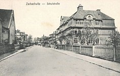Die Großzschachwitzer Straße entstand 1899 als Planstraße M und verbindet seitdem Leuben mit seinem Nachbarort Großzschachwitz. Auf Leubener Flur wurde sie am 1. November 1899 offiziell benannt, während der Großzschachwitzer Abschnitt zunächst den Namen Schulstraße erhielt. Wenig später begann die Bebauung mit Wohnhäusern. 1933 erfolgte im damals noch selbständigen Großzschachwitz die Umbenennung der Schulstraße in Mutschmannstraße. Namensgeber war der NSDAP-Gauleiter von Sachsen, Martin Mutschmann. Bereits kurz nach Kriegsende machte man am 16. Mai 1945 diese Benennung rückgängig. Nachdem Großzschachwitz nach Dresden eingemeindet worden war, beschloss der Stadtrat zum 30. September 1953 die durchgängige Namensgebung Großzschachwitzer Straße. Markantestes Gebäude ist das unter Denkmalschutz stehende Großzschachwitzer [Schulhaus](../../../ost/grosszschachwitz/), das heute Sitz der 92. Grundschule "An der Aue" ist _(Foto)_.

## Guerickestraße

Die Guerickestraße wurde im Zusammenhang mit dem Bau neuer Mietshäuser um die Jahrhundertwende angelegt und erhielt auf Beschluss des Leubener Gemeinderats am 20. Juli 1898 nach Helmuth Karl Bernhard Graf von Moltke den Namen Moltkestraße. Schon damals war eine Verlängerung bis zur heutigen Robert-Berndt-Straße geplant, die jedoch erst 1927 erfolgte. Stattdessen nutzte man die Flächen als Gartenland sowie ab 1919 im Rahmen sogenannter "Notstandsarbeiten" für den Kartoffel- und Gemüseanbau der örtlichen Bevölkerung.

Da es in Dresden bereits weitere Moltkestraßen gab, machte sich nach der Eingemeindung von Leuben eine Namensänderung erforderlich. Diese erfolgte am 1. Juni 1926, wie auch bei einigen Nebenstraßen, nach einem bedeutenden Physiker. Otto von Guericke (1602-1686), der zugleich Bürgermeister Magdeburgs war, führte in seiner Heimatstadt erste Vakuumversuche mit den legendären “Magdeburger Halbkugeln” aus und gilt als Erfinder der Kolbenluftpumpe.

## Heckenweg

Der Heckenweg entstand 1929 im Zusammenhang mit der Bebauung im östlichen Teil Leubens und erhielt auf Beschluss des Stadtrats am 28. März 1929 seinen Namen. Zunächst verlief er nur zwischen der Königs-Allee (heute Berthold-Haupt-Straße) und der Kleinzschachwitzer Straße, wurde jedoch bereits 1930 bis zur Weißdornstraße verlängert. Im Haus Nr. 15 hatte bis in die 1940er Jahre der Verlag von Edwin Schreyer für Foto-, Kunst- und Lichtdruck seinen Sitz, der u.a. zahlreiche Ansichtskarten herausgab.

## Hertzstraße

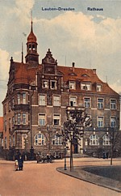Die Ende des 19. Jahrhunderts angelegte Hertzstraße ist Teil einer geplanten Entlastungsstraße, die ursprünglich von Dobritz aus in Verlängerung der Winterbergstraße bis zur Stephensonstraße führen und dann wieder in die Pirnaer Landstraße einmünden sollte. Diese Planungen von 1897 wurden jedoch nicht vollständig realisiert. Lediglich in Leuben begann 1898 der Bau des Abschnitts zwischen Diesel- und Zamenhofstraße, der am 20. Juli 1898 auf Beschluss des Gemeinderates die Benennung Residenzstraße bekam. Wenig später wurde diese bis zur Stephensonstraße verlängert. 1900/01 errichtete die damals noch selbstständige Gemeinde an der Residenzstraße/Ecke Lilienthalstraße ihr [Rathaus](../../../ost/leuben/), welches heute als Ortsamt dient _(Foto)_.

Nach der Eingemeindung des Ortes erfolgte am 1. Juni 1926 zur Vermeidung von Verwechslungen die Umbenennung in Hertzstraße. Namensgeber war der deutsche Physiker Heinrich Hertz (1857-1894), der als erster das Vorhandensein elektromagnetischer Wellen nachwies und damit zum Begründer der Hochfrequenztechnik wurde. Ihm zu Ehren trägt die Maßeinheit der Frequenz ihren Namen.

Zwischen 1939 und 1945 trug die Hertzstraße den Namen Knirschstraße. Hans Knirsch (1877-1933) gehörte zu den Gründern der deutschvölkischen Arbeiterbewegung in Österreich und war ab 1912 Vorsitzender der Deutschen Arbeiterpartei. 1919 erhielt er im Parlament der Tschechoslowakei ein Mandat der Deutschen Nationalsozialistischen Arbeiterpartei und galt in der Nazizeit als einer wichtigsten Vorkämpfer für den Anschluss des Sudetenlandes an das Deutsche Reich. Am 30. Juli 1945 erfolgte die Rückbenennung in Hertzstraße.

## Jessener Straße

Die eigentlich noch auf Dobritzer Flur gelegene Jessener Straße entstand in den 1970er Jahren im Zuge des Neubaugebietes Leuben und bildet zugleich dessen westlichen Abschluss. Ihren Namen erhielt sie nach dem kleinen Ort Jessen, einem Stadtteil von Pirna.

## Kastanienstraße

Die kurze Kastanienstraße verbindet die Pirnaer Landstraße mit der Berthold-Haupt-Straße und wurde 1899 angelegt. Am 1. November 1899 erhielt sie ihren Namen und wurde entsprechend mit Kastanienbäumen bepflanzt. Allerdings blieb sie lange Zeit unbebaut. 1934 entstanden auf einer zuvor landwirtschaftlich genutzten Fläche erste Kleingärten. Nach 1945 nutzten vor allem Kleintierzüchter die Parzellen, die sich 1990 zum Kleingartenverein “Sonnenblume” zusammenschlossen. Mit 21 Gärten gehört dieser zu den kleinsten in Dresden.

## Kleinzschachwitzer Straße

Die Kleinzschachwitzer Straße entstand 1899 als Planstraße L und erhielt auf Beschluss des Gemeinderates am 1. November 1899 nach dem Leubener Nachbarort ihren Namen. Lange Zeit blieb sie jedoch unbebaut. Erst kurz nach dem Ersten Weltkrieg entstanden hier ab 1920 einige Wohnhäuser für die Baugenossenschaft zu Leuben e.G.m.b.H., die heute unter Denkmalschutz stehen. Im Haus Nr. 2 gab es damals eine kleine Verkaufsstelle. 1974 folgte an der Ecke zur Ulmenstraße eine 2009 abgerissene Konsum-Kaufhalle (Nr. 28).

## Klettestraße

Die Klettestraße entstand 1898 als kurze Stichstraße zwischen Stephenson- und Dieselstraße und wurde auf Beschluss des Gemeinderates vom 20. Juli 1898 zunächst Bismarckstraße genannt. Erst 1919 erfolgte im Rahmen von sogenannten Notstandsarbeiten der Ausbau bis zur Reisstraße. Eine geplante durchgehende Straßenführung bis zur Lilienthalstraße kam jedoch nicht zustande. Der bis 1962 ebenfalls als Klettestraße bezeichnte kurze Abschnitt westlich dieser Straße trägt heute den Namen Am Dahlienheim.

Da es mit der Eingemeindung Leubens und weiterer Gemeinden 1921 mehrere Bismarckstraßen in Dresden gab, machte sich eine Umbenennung erforderlich. Dabei erhielt die Klettestraße ihren heutigen Namen nach dem Architekten und Dresdner Stadtbaurat Hermann Klette (1847-1909). Klette war maßgeblich am Ausbau des Dresdner Kanalisationsnetzes und der Verlegung der Weißeritzmündung beteiligt und wurde 1889 zum Dresdner Stadtbaurat berufen. Zu seinen wichtigsten Arbeiten gehören die Entwürfe für die Carolabrücke und den Umbau der Augustusbrücke 1907.

Zu den Bewohnern der Klettestraße (Nr. 51) gehörte in den 1930er Jahren der Monteur Franz Latzel (1880–1941), der wegen seines Eintretens gegen den Nationalsozialismus verhaftet und am 29. August 1941 in Dresden ermordet wurde. An ihn erinnert die nahegelegene Franz-Latzel-Straße

## Köttewitzer Weg

Der Köttewitzer Weg entstand Anfang der 1970er Jahre mit der Bebauung südlich der Zamenhofstraße. Zwischen 1970 und 1974 entstanden hier auf ehemaligem Gärtnereigelände fünfgeschossige Plattenbauten. Seinen Namen erhielt der Weg nach der kleinen Ortschaft Köttewitz, die heute zu Dohna gehört.

## Lilienthalstraße

Die Lilienthalstraße erhielt ihren Namen zu Ehren des deutschen Flugpioniers Otto Lilienthal (1848-1896). Lilienthal, der
zeitweise in Döhlen (heute Stadtteil von Freital) lebte und als Ingenieur im Zauckeroder Bergbau tätig war, unternahm 1891 bei
Berlin seine ersten Flugversuche mit selbstkonstruierten Gleitfliegern. 1896 kam er bei einem Testflug ums Leben. Die ersten
Wohnhäuser an der Lilienthalstraße entstanden um 1900 für die Arbeiter der Leubener und Niedersedlitzer Industriebetriebe.
Weitere Gebäude folgten nach dem Ersten Weltkrieg sowie zwischen 1970 und 1974. Das Areal der 1995 in Insolvenz gegangenen Firma Kautasit- Dichtungstechnik wurde 2009 beräumt und soll künftig wieder als Gewerbestandort genutzt
werden.

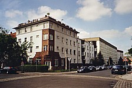

**_Foto:_** _Wohnhäuser an der Lilienthalstraße_

## [Pirnaer Landstraße](../../../ost/dobritz/strassen_dobritz/pirnaer_landstrasse/)

## Reisstraße

Die Reisstraße wurde nach 1900 am Rande des Dorfkerns angelegt und ist wie auch zahlreiche weitere Leubener Straßen nach einem bedeutenden Physiker benannt. Johann Philipp Reis (1834-1874) erfand 1861 das Telefon. Die Wohngebäude entstanden in den Jahren bis zum Ersten Weltkrieg bzw. in den 1950er und 60er Jahren des 20. Jahrhunderts.

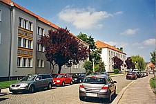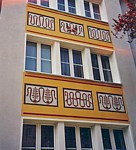

**_Fotos:_** _Die Wohnanlage an der Reisstraße mit Details der Fassadengestaltung_

Firma Kerb-Konus Dr. Eibes & Co:
Das Unternehmen wurde am 1. April 1925 vom Dresdner Rechtsanwalt Dr. Eibes, dem Apotheker Schäfer und Kapitän a. D. Reichardt gegründet und stellte speziell patentierte Kerbstifte her. Die ursprünglich im
Industriegelände ansässige Firma verlegte 1928 ihren Sitz in die ehemalige Leubener Ofenfabrik Reisstraße 6. Dr. Bernhard
Eibes hatte als Rechtsanwalt 1923/24 die Interessen der Wettiner bei der Vermögensauseinandersetzung mit dem Freistaat
Sachsen vertreten und übergab die Geschäftsleitung wenig später an seinen Sohn. Nach 1945 produzierte der Betrieb als VEB
Kerb-Konus Wälzlager und andere Normteile für den Maschinenbau. Der Sitz des Unternehmens befand sich zuletzt auf der Dieselstraße 9/11.

## Rosenschulweg

Der Rosenschulweg, in Verlängerung der Stephensonstraße an der Pirnaer Landstraße gelegen, erinnert an die einstige Gartenbautradition Leubens. Zu den ersten Gärtnereien gehörte die Firma Münch & Haufe, die 1892 einige Hektar Land in Leuben erwarb und hier mit dem Anbau von Rosen begann.

Auf dem Gelände der nach 1990 stillgelegten Gärtnerei wurde 2010 mit dem Bau einer kleinen Wohnsiedlung begonnen. Insgesamt entstanden 24 Einfamilienhäuser. Bei den Erschließungsarbeiten wurden Überreste einer bronzezeitlichen Pfahlbausiedlung und zahlreiche Keramikscherben entdeckt.

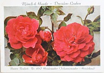Gärtnerei Münch & Haufe: Die Geschichte der Firma reicht bis ins Jahr 1886 zurück, als der aus Elberfeld stammende Heinrich Münch in Bad Nauheim eine Baumschule gründete. Zwei Jahre später trat Julius Haufe in das Unternehmen ein, das 1892 seinen Firmensitz nach Leuben verlegte. Hier spezialisierte man sich auf die Zucht von Rosen und lieferte bereits zwei Jahre später seine Pflanzen in mehrere europäische Länder. Nach Haufes Tod 1896 führten die Brüder Münch die Gärtnerei unter dem Namen Münch & Haufe weiter.

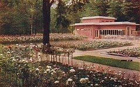Die von den Inhabern 1912 erstmals vorgestellte Rosenzüchtung “Heinrich Münch” erhielt im gleichen Jahr auf einer internationalen Ausstellung in London eine Silbermedaille. Zu den mit der Gärtnerei verbundenen Rosensorten gehörten auch "Frau Elisabeth Münch" und "Frau Ida Münch". Nach dem Ersten Weltkrieg widmete man sich stärker dem Vertrieb und hatte zeitweise ein Sortiment von über 1000 Sorten im Angebot. Zur Jubiläums-Gartenschau 1926 in Dresden gestaltete die Großgärtnerei einen Rosen-Sondergarten mit Teehaus, der zu den Höhepunkten der Schau gehörte _(Foto rechts)_. Die Gärtnerei blieb auch nach dem Zweiten Weltkrieg in Betrieb und existierte bis 1990.

## Rottwerndorfer Straße

Die Rottwerndorfer Straße wurde im Zusammenhang mit dem Bau des Neubauviertels Leuben im westlichen Teil der Ortsflur
angelegt. Ihren Namen erhielt sie nach dem heutigen Pirnaer Stadtteil Rottwerndorf. Mitte der 1970er Jahre entstanden hier
fünfgeschossige Wohnblocks in Plattenbauweise. Zur künstlerischen Aufwertung wurde im Wohngebiet die Bronzeplastik „Ballspielerin“ aufgestellt. Schöpfer war der Dresdner Bildhauer Wilhelm Landgraf.

## Stephensonstraße

Die Stephensonstraße im Osten der Leubener Flur, bis zur Eingemeindung Bahnhofstraße genannt, erhielt ihren Namen nach
dem englischen Ingenieur George Stephenson (1781-1848), der 1814 seine erste Lokomotive vorstellte und als Pionier der Eisenbahn gilt. 1895 entstanden hier die ersten Mietshäuser, wenig später die [Straßenbahnstrecke](../../../ost/niedersedlitz/dresdner_vorortbahn/) zum Niedersedlitzer
Bahnhof. Bis zum Ersten Weltkrieg errichtete die Baugenossenschaft zu Leuben zwischen Klette-, Stephenson- und
Hertzstraße weitere Arbeiterwohnhäuser für Angestellte der Niedersedlitzer Industriebetriebe. 1952 wurde auf Niedersedlitzer Flur das [Kulturhaus des “Sachsenwerkes”](../../../ost/niedersedlitz/sachsenwerk/) eröffnet, welches zu den ersten seiner Art in der DDR gehörte.

Straßenbahnhof: Die Gebäude entstanden 1903 als Betriebshof der Dresdner Vorortbahn, welche ab 1899 zwischen
Laubegast und Niedersedlitz verkehrte. Ursprünglich bestand dieser aus einer zweigleisigen Wagenhalle und einem kleinen Werkstattanbau in Fachwerkbauweise. 1910 wurde das noch heute vorhandene Gebäude gebaut. Mit der Umspurung der
Strecke und Übernahme durch die Dresdner Straßenbahn AG wurde dieser Straßenbahnhof überflüssig und 1933 zu gewerblichen Zwecken vermietet. 1938 erwarb eine Chemiefabrik den Gebäudekomplex an der Stephensonstraße 12. Nach
1945 befand sich hier viele Jahre das Depot der Betriebsfeuerwehr des Sachsenwerkes. Heute nutzt die Johanniter-Unfallhilfe die Hallen als Rettungswache

Stephenson-Lichtspiele:
Das kleine Leubener Kino wurde bereits 1909 vom Ladenbesitzer Armin Schicktansky gegründet und trug ursprünglich den Namen “Dodrophon-Lichtspiele”. Schicktansky plante später den Bau eines modernen Tonfilmkinos,
welcher jedoch in den wirtschaftlich schwierigen Jahren nach dem Ersten Weltkrieg nicht zustande kam. Nach dem Tod des
Besitzers 1927 verlegte man das Kino zur Stephensonstraße 46, wo es als Stephenson-Lichtspiele noch bis 1990 in Betrieb war. Heute werden die Räume von einer Videothek genutzt.

## Zamenhofstraße

Die Zamenhofstraße geht auf einen alten Verbindungsweg zwischen Leuben und Dobritz zurück. Nach der Eingemeindung des
Ortes erhielt sie den Namen des polnischen Augenarztes Ludwig Zamenhof (1859-1917). Zamenhof wurde als Erfinder der
Kunstsprache Esperanto bekannt, die er 1887 erstmals der Öffentlichkeit vorstellte. Ab 1970 entstanden auf den zuvor
landwirtschaftlich genutzten Freiflächen zu beiden Seiten der Zamenhofstraße die Wohnblöcke des Neubaugebietes Leuben,
dominiert von einem 2009 abgerissenen 14-stöckigen Hochhaus (Nr. 2). Die dabei angelegten Erschließungsstraßen wurden nach Orten der Pirnaer Umgebung benannt.

[Leuben auf OpenStreetMap](https://www.openstreetmap.org/search?query=Dresden+Leuben)

* * *

 \[ [Home](../../../index.html)\] \[ [Nord](../../../nord/)\] \[ [Nordwest](../../../nordwest/)\] \[ [Neustadt](../../../neustadt/)\] \[ [Nordost](../../../nordost/)\] \[ [West](../../../west/)\] \[ [Zentrum](../../../zentrum/)\] \[ [Südwest](../../../sudwest/)\] \[ [Süd](../../../sud/)\] \[ [Südost](../../../sudost/)\] \[ [Ost](../../../ost/)\] \[ [Register](../../../Register/register.html)\] \[ [Kontakt](../../../Kontakt/kontakt.html)\] \[ [Impressum](../../../impressum/)\]
