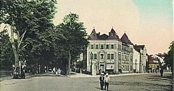
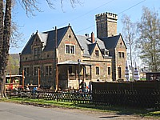

Die heutige Berthold-Haupt-Straße geht auf einen ehemaligen Feldweg nach Kleinzschachwitz zurück, der 1897 unter Regie des Leubener Gemeindevorstands Dittrich zur Straße ausgebaut und zunächst Königs-Allee genannt wurde. Bereits 1840 hatte man diesen Weg als Dresden - Pillnitzer Chaussee verbreitert und als Zufahrt zur Elbfähre genutzt. 1925 errichtete die Baugenossenschaft zu Leuben zwischen Königsallee und Pirnaer Landstraße mehrere Wohnhäuser mit über 1500 Wohnungen, welche heute zur Gemeinnützigen Wohnungsbaugenossenschaft Dresden-Ost gehören. Die Straßenbahnstrecke nach Kleinzschachwitz ging 1936 in Betrieb.

**_Foto:_** _Die frühere Königs-Allee um 1920_

Am 27. September 1945 wurde die Königs-Allee in Berthold-Haupt-Straße umbenannt. Berthold Haupt (1905-1933), gelernter Buchdrucker, engagierte sich in den Zwanziger Jahren in der Arbeiterbewegung und gehörte der Leubener Ortsgruppe der SPD an. Am 26. Februar 1933 wurde er bei einer Protestdemonstration gegen die Machtübernahme der Nazis in der Nähe des Postplatzes von SA-Leuten erschossen. An ihn erinnert ein Gedenkstein in der Nähe der Einmündung der Freischützstraße.

Einzelne Gebäude:

Papiermühle (Nr. 87/89): Die frühere Kleinzschachwitzer Papiermühle wurde 1854 unmittelbar an dem von Leuben nach Kleinzschachwitz führenden Weg errichtet. Erster Besitzer war August Friedrich Baumann. Der Gebäudekomplex bestand neben dem eigentlichen Mühlengebäude aus einem Wohnhaus und einem Schuppen. Der für den Antrieb des Wasserrades notwendige Mühlgraben zweigte in der Nähe des Putjatinhauses vom Lockwitzbach ab und führte von dort durch den heutigen Putjatinpark. 1870 verkaufte Baumann sein Unternehmen an den Papierfabrikanten Johann Dziuba. Dem Unternehmen war jedoch kein großer Erfolg vergönnt, so dass die Produktion bereits wenige Jahre später endete.

1887 übernahm Ernst Julius Büttner die leer stehenden Gebäude und richtete hier eine Brauerei ein. Für die Energieversorgung des Betriebes diente noch viele Jahre eine Wasserturbine, so dass der alte Mühlgraben auch weiterhin seine Funktion behielt. Um 1900 wurde die Brauerei Kleinzschachwitz zu einer Malzfabrik umgestaltet und auf Dampfmaschinenbetrieb umgestellt. Ab 1936 befand sie sich im Besitz des Braumeisters Alfred Kretschmer, dessen Familie das Unternehmen noch bis 1981 weiterführte. Danach nutzten einige Handwerksbetriebe die Räume. Seit 2004 befindet sich in den unter Denkmalschutz stehenden Gebäuden das Altenpflegeheim "In der Alten Mälzerei".

Nr. 91: Das Ende des 19. Jahrhunderts errichtete Eckhaus beherbergte um die Jahrhundertwende das Restaurant "Waldpark" des Gastwirts Oskar Scharfe. Seit 2009 lädt in den Räumen Sachsens erstes Dunkelrestaurant mit dem Namen “Sinneswandel” zum Besuch ein. Speisen und Getränke werden in absoluter Dunkelheit serviert, um sich so voll auf Geruch und Geschmack konzentrieren zu können.

Nr. 109: Dieses Grundstück auf Kleinzschachwitzer Flur befand sich ab 1864 im Besitz des Königlich-Sächsischen Geheimrates Hans Ludwig von Oppell. Oppell übte zwischen 1831 und 1853 das Amt des Dresdner Polizeidirektors aus
und war durch Grundstücksgeschäfte in der Äußeren Neustadt zu Wohlstand gekommen. Auf ihn geht die Bezeichnung “Oppellvorstadt” für das heutige [Hechtviertel](../../../../neustadt/leipziger_vorstadt/hechtviertel/) zurück. Das ursprünglich vorhandene bescheidene Sommerhaus in Kleinzschachwitz wurde durch mehrfache Anbauten und Erweiterungen zum repräsentativen Landsitz und blieb über 100 Jahre in Familienbesitz. Nach 1990 wuren die Gebäude liebevoll saniert.

Nr. 114: Auch in diesem Gebäude an der Ecke zur Hosterwitzer Straße gab es einst ein Restaurant. 1906 ist es unter dem Namen "Zur Königsallee" erwähnt und befand sich im Besitz des Gastwirts Ernst Fischer. Das Lokal blieb auch nach dem Zweiten Weltkrieg bestehen. Heute befindet sich hier unter dem Namen "Augustus Rex" eine Bar.

Fährhaus (Nr. 130): Bemerkenswert ist die 1860 im Stil eines englischen Kastells errichtete Pontonierkaserne, die nach ihrer Fertigstellung bis 1911 Unterkunft der zur Bedienung der [Pillnitzer Fähre](../../../../nordost/pillnitz/) eingesetzten Armeeeinheit war. Auch nach dem Betreiberwechsel der Elbfähre zur Sächsisch-Böhmischen Dampfschifffahrt blieb das Haus Aufenthaltsort der Fährleute. Später diente die einstige Kaserne viele Jahre als
Verwaltungsgebäude der Dresdner Verkehrsbetriebe und beherbergt seit 2004 im Erdgeschoss eine Gaststätte _(Foto)_. Ein weiteres Lokal befindet sich unmittelbar an der Fähre. Die kleine Schankwirtschaft mit Biergarten entstand 1949 und wurde im Volksmund auch “Holzoper” genannt.

* * *

 \[ [Home](../../../../index.html)\] \[ [Nord](../../../../nord/)\] \[ [Nordwest](../../../../nordwest/)\] \[ [Neustadt](../../../../neustadt/)\] \[ [Nordost](../../../../nordost/)\] \[ [West](../../../../west/)\] \[ [Zentrum](../../../../zentrum/)\] \[ [Südwest](../../../../sudwest/)\] \[ [Süd](../../../../sud/)\] \[ [Südost](../../../../sudost/)\] \[ [Ost](../../../../ost/)\] \[ [Register](../../../../Register/register.html)\] \[ [Kontakt](../../../../Kontakt/kontakt.html)\] \[ [Impressum](../../../../impressum/)\]
