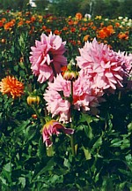
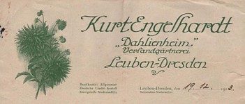
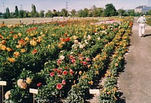

* * *

Die 1914 in Leuben gegründete Gärtnerei Engelhardt gehört zu den bekanntesten Dresdner Gartenbauunternehmen. Die Geschichte des Leubener Gartenbaus begann jedoch bereits 1892, als die Firma [Münch & Haufe](../../../../ost/leuben/strassen_leuben/) ein ehemaliges Bauerngut erwarb und dieses zur Rosengärtnerei umwandelte. Begünstigt durch das milde Klima und die hier im Gegensatz zu Striesen und Blasewitz noch reichlich vorhandenen Freiflächen siedelten sich bald weitere Betriebe der Branche an. Zeitweise existierten über 20 Gärtnereien rund um den Ort. Zu den größten gehörten die auf Azaleenzucht spezialisierten Gärtnereien Ziegenbalg und Voigt. Neben Zierpflanzen wurden in Leuben auch Moorbeetkulturen und sogar Palmen angebaut.

Hauptanziehungspunkt war jedoch die 1914 in der Nähe des Rathauses entstandene Gärtnerei von Kurt Engelhardt. Engelhardt (1875-1958) stammte ursprünglich aus Österreich und widmete sich speziell dem Anbau von Dahlien, wobei er durch gezielte Züchtung neue Sorten erzeugte. Weltberühmt wurde seine Dahlie “Kalif”, die mit bis zu 26 cm Blütendurchmesser als größte Dahlienart der Welt galt und in verschiedene Länder exportiert wurde. Zwischen 1907 und 1924 war Kurt Engelhardt zugleich Geschäftsführer der Deutschen Dahliengesellschaft. Regelmäßig fanden Blumenschauen auf dem Rathausvorplatz statt, die zahlreiche Besucher aus Dresden und Umgebung nach Leuben lockten.

Während die meisten Leubener Gärtnereien nach 1945 verstaatlicht und zum volkseigenen Betrieb “Saatgut/ Zierpflanzen” vereinigt wurden, behielt die Familie Engelhardt ihr “Dahlienheim” in privatem Besitz. Wegen der Inanspruchnahme der Fläche für das Neubaugebiet Leuben musste der Betrieb jedoch 1969 geschlossen werden. Heute hat das Unternehmen seinen Sitz an der Stadtgrenze zwischen Dresden und Heidenau an der Bundesstraße 172. Mit der alljährlichen Dahlienschau und dem Verkauf der Pflanzen wird die Tradition des Leubener Gartenbaus somit an anderer Stelle fortgesetzt. In Leuben erinnert heute die Straße Am Dahlienheim an die frühere Gärtnerei.

**_Foto:_** _Die Dahlienschau Engelhardt an der Dohnaer Straße in Heidenau_
