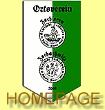
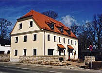
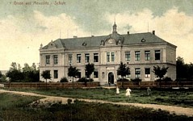
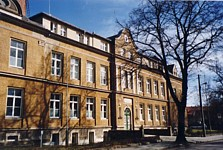
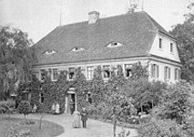
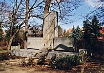

* * *

* * *

* * *

**Schulen in Meußlitz:**

* * *

**Vereine in Meußlitz:**

* * *

Meußlitz entstand als slawischer Rundweiler mit Blockflur und wurde 1350 erstmals urkundlich erwähnt. Der Ortsname “Miselicz” stammt aus dem slawischen und bedeutet “Ort des Mysl”. 1445 gab es hier lediglich vier erwachsene Bewohner. Bis 1559 gehörte das Dorf der Familie von Korbitz, 1661 dem Zehistaer Rittergutsbesitzer Johann Sigmund von Liebenau. Erst 1832 endete im Zusammenhang mit den politischen Reformen in Sachsen die Zugehörigkeit zu dieser Grundherrschaft.

Da Meußlitz unweit der wichtigen Fernstraßen nach Böhmen lag, hatte der Ort wiederholt unter Truppendurchzügen zu leiden, so im Dreißigjährigen Krieg und während der Napoleonzeit. Von wirtschaftlicher Bedeutung war der Anbau von Getreide und Kartoffeln, während die Viehzucht mangels geeigneten Weidelandes nur eingeschränkt möglich war. Kirchlich unterstand das Dorf der Dohnaer Kirche und kam erst 1897 zur Kirchgemeinde Kleinzschachwitz.

Ende des 19. Jahrhunderts wuchs die zuvor nur ca. 100 Bewohner zählende Gemeinde über ihre alten Grenzen hinaus. In den Jahren vor und nach dem Ersten Weltkrieg folgten in Richtung Zschieren und Großzschachwitz einige Wohnsiedlungen für die Angestellten der Niedersedlitzer und Zschachwitzer Industriebetriebe. 1922 wurde Meußlitz in das benachbarte Großzschachwitz eingemeindet und gehört seit 1950 als Stadtteil zu Dresden. 1992 entstand an der Hartungstraße eine kleine Wohnanlage nach Plänen der Architekten Blattmann & Ostwald. Weitere Neubauten wurden an der Diesterwegstraße, an der Struppener Straße und ab 2009 an der neu angelegten Straße Elbhangblick errichtet.

Meußlitzer Schule:

Ursprünglich besuchten die Kinder des Ortes die Kleinzschachwitzer Schule. Mit dem Einwohnerzuwachs machte sich jedoch ein Schulneubau erforderlich. Bereits zwei Wochen nach Erteilung der Baugenehmigung am 19. April 1900 konnte dafür der Grundstein gelegt werden. Die feierliche Einweihung erfolgte am 8. Oktober des gleichen Jahres. Bereits wenige Jahre später entstanden durch Anbau zusätzliche Klassenräume. Ein weiterer Ergänzungsbau mit Aula, zwei Lehrerwohnungen und einer Lehrküche folgte 1912.

Nach dem Zusammenschluss der Gemeinde Meußlitz mit seinen Nachbarorten wurde Ende der Zwanziger Jahre die Schließung der Schule erwogen, die jedoch durch das Engagement der Lehrer und Eltern verhindert werden konnte. Zeitweise besaß die Meußlitzer Schule sogar eine eigene Seidenraupenzucht, an die noch ein Maulbeerbaum im Schulgarten erinnert. Das Schulhaus an der Bernhard-Shaw-Straße, welches in den 1980er Jahren rekonstruiert und um eine Turnhalle ergänzt wurde, wird heute von der 91. Grundschule “Am Sand” genutzt.

Volkspark Zschachwitz:

 Der auf Meußlitzer Flur gelegene Volkspark geht auf ein 1828 von Ferdinand Wilhelm Bach angelegtes Gartengrundstück zurück. Der aus dem erzgebirgischen Buchholz (Annaberg) stammende Seidenwarenhändler ließ sich hier ein Landgut errichten und das Gelände mit exotischen Gehölzen, Plastiken und einem Brunnen parkartig gestalten. U.a. gibt es im Park eine von nur zwei in Dresden wachsenden Gurkenmagnolien sowie die seltene Hagebuttenbirne. Außerdem entstanden ein Gärtnerwohnhaus sowie das Herrenhaus _(Foto um 1900)_. Letzteres nutzte bis 1892 der Dresdner Schokoladenfabrikant Timaeus als Sommersitz. Hinzu kamen ein “Lusthaus”, die laubenartige “Aurorahalle” und ein zur Überwinterung tropischer Gehölze dienendes Gewächshaus.

1928 erwarb die Gemeinde das Areal von den Erben Timaeus´ und wandelte es in einen öffentlichen Volkspark um. Dafür wurde der Park 1934 in südwestlicher Richtung erweitert und erhielt einen kleinen Sportplatz, welcher im Winter zum Eislaufen genutzt wurde. Leider ging in der Nachkriegszeit viel vom ursprünglichen Flair des Parks verloren. So verschwanden die meisten der einst vorhandenen Steinvasen und Sitzbänke. Erst nach 1990 begann die schrittweise Wiederherstellung. Bemerkenswert ist ein kleiner Brunnen, der einst eine heute verschollene Plastik “Knabe mit Schwan” trug. Ein monumentales Kriegerdenkmal erinnert an die Gefallenen des Ersten Weltkrieges _(Foto)_. Dieses entstand Mitte der 1930er Jahre und wurde von Prof. Otto Schubert entworfen.

[_Weiterführende Literatur und Quellen_](../../impressum/quellenverzeichnis/)

 \[ [Home](../../index.html)\] \[ [Nord](../../nord/)\] \[ [Nordwest](../../nordwest/)\] \[ [Neustadt](../../neustadt/)\] \[ [Nordost](../../nordost/)\] \[ [West](../../west/)\] \[ [Zentrum](../../zentrum/)\] \[ [Südwest](../../sudwest/)\] \[ [Süd](../../sud/)\]
 \[ [Südost](../../sudost/)\] \[ [Ost](../../ost/)\] \[ [Register](../../Register/register.html)\] \[ [Kontakt](../../Kontakt/kontakt.html)\] \[ [Impressum](../../impressum/)\]
