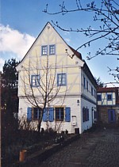
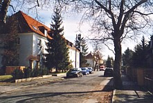
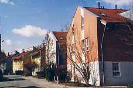
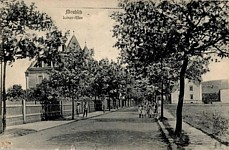
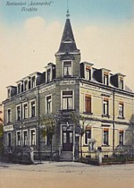
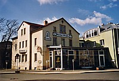

## Am Brüchigt

Die Straße Am Brüchigt wurde 1933 westlich des alten Meußlitzer Dorfkerns angelegt. Die am 18. Juli 1933 beschlossene Namensgebung erfolgte nach einer Flurbezeichnung. Historisch nachweisbar sind die Flurnamen Brüchig, Brüchigwiesen und Brüchiggraben. Als Brüchigtgraben wird heute der vom Lockwitzbach durchflossene alte Elbarm zwischen Meußlitz und Sporbitz bezeichnet.

## Am Gärtchen

Die Straße Am Gärtchen wurde um 1890 angelegt und 1894 Gartenstraße benannt. Der Name erinnert an die beiden alten Meußlitzer Flurnamen  "Garten" und "hinterm Garten". Auf Beschluss des Dresdner Stadrates vom 30. September 1953 erfolgte die Umbenennung in Am Gärtchen.

## Am Sand

Die Straße Am Sand in der Nähe des alten Meußlitzer Dorfkerns erhielt ihren Namen nach der örtlichen Bodenbeschaffenheit. Noch bis zur Gegenwart wird zwischen Meußlitz und Sporbitz Sand bzw. Kies abgebaut. 1900 entstand Am Sand das Meußlitzer [Schulhaus](../../../ost/meusslitz/). Das war der Grund, die neu angelegte Straße auf Beschluss des Gemeinderates ab 1901 Schulstraße zu nennen. Im Zusammenhang mit der Vereinigung von Meußlitz mit Zschachwitz erfolgte die Umbenennung in Am Sand. Nach dem Ersten Weltkrieg entstand hier eine kleine Wohnsiedlung.

## Am Teich

Der frühere Dorfplatz von Meußlitz wird seit der Eingemeindung des Ortes Am Teich genannt. Am Ende der kurzen Sackgasse befindet sich der Dorfteich, welcher früher als Wasserstelle für das Geflügel der Bauern, teilweise auch zur Karpfenzucht diente. Nach 1945 verlandete er und wurde als Müllabladeplatz missbraucht. Erst 1996 konnte der Dorfteich von ABM-Kräften beräumt und renaturiert werden. Die in unmittelbarer Nachbarschaft stehende Bismarckeiche wurde 1895 aus Anlass des 80. Geburtstages des früheren Reichskanzlers gepflanzt.

Um den Platz haben sich noch einige historische Bauerngüter und Häusleranwesen erhalten. Zum größten Gut, dessen Besitzer früher mehrere Pferde besaßen, gehörte ein Beigut, in welchem die “Schweizer” lebten. Diese Knechte waren mit der Versorgung der Tiere beauftragt. Heute wird das Anwesen gewerblich genutzt. Bemerkenswert ist das unter Denkmalschutz stehende Fachwerkgebäude Am Teich Nr. 4 _(Foto)_.

## Am Zaukenfeld

Die um 1930 angelegte Straße Am Zaukenfeld verläuft über Meußlitzer und Zschierener Flur und entstand im Zusammenhang mit einer kleinen Wohnsiedlung. Zunächst wurde sie ab dem 2. November 1932 auf Beschluss des Zschachwitzer Gemeinderates Straße der Werktätigen genannt. Bereits im August 1933 erfolgte die Umbenennung in Am Zaukenfeld. Grund waren die hier befindlichen Felder einer Gärtnerei, welche im Frühjahr mit Maiglöckchen bepflanzt wurden. Im Volksmund wird diese Blume auch Zauke genannt.

## An der Telle

Die Straße An der Telle wurde um 1910 gebaut und ab 1914 offiziell Weinbergstraße genannt. Namensgeber war die alte Flurbezeichnung "der Weinberg" für das Areal. Im Zuge der Eingemeindung des Ortsteils nach Dresden erhielt sie am 30. September 1953 ihren jetzigen Namen. Das Wort Telle stammt aus dem Mittelhochdeutschen und bezeichnet eine Vertiefung.

## Andreas-Hofer-Straße

Die Andreas-Hofer-Straße wurde Anfang der Dreißiger Jahre im Zusammenhang mit dem Bau einer neuen Wohnsiedlung in der Nähe der Flurgrenze zu Zschieren angelegt und am 15. Dezember 1933 nach dem Tiroler Freiheitskämpfer Andreas Hofer (1767-1810) benannt. Hofer war Anführer des Aufstandes von 1809 gegen die bayrische und französische Besetzung seiner Heimat und wurde nach Verrat 1810 festgenommen und erschossen.

## Bernhard-Shaw-Straße

Die Bernhard-Shaw-Straße, eine nach 1900 angelegte Straße in der Nähe des alten Dorfkerns, trug ursprünglich nach ihrer Lage den Namen Mittelstraße. Auf Bitten der Lehrerschaft der Meußlitzer Schule beschloss der Gemeinderat, die Mittelstraße aus Anlass des 100. Todestages des Pädagogen Johann Heinrich Pestalozzi am 1. Mai 1928 in Pestalozzistraße umzubenennen. Nach der Eingemeindung von Zschachwitz erfolgte 1953 die bis heute gültige Namensgebung Bernhard-Shaw-Straße. Der britische Dramatiker Bernhard Shaw (1856-1950) wurde durch seine satirischen gesellschaftskritischen Werke international bekannt wurde und erhielt den Literaturnobelpreis.

**_Foto:_** _Blick in die Bernhard-Shaw-Straße_

## Damaschkestraße

Die Damaschkestraße wurde 1932 nach dem Lehrer und Sozialreformer Adolf Wilhelm Ferdinand Damaschke (1865-1935) benannt. Damaschke war Redakteur der lebensreformerischen Zeitschrift „Der Naturarzt“ und einer der Mitbegründer der Bodenreformbewegung, welche sich gegen Bodenspekulation und für die Gründung von Mietergenossenschaften einsetzte. Die Gebäude entstanden um 1930 für die „Gemeinnützige Siedlung Zschachwitz e.G.m.b.H.“. Da die Wohnungen vorrangig an Veteranen des Ersten Weltkriegs vergeben wurden, war im Volksmund auch der Name Kriegersiedlung gebräuchlich. Das Wohnhaus Damaschkestraße 1 im Bauhausstil steht unter Denkmalschutz.

## Diesterwegstraße

Die heutige Diesterwegstraße wurde Anfang der 1930er Jahre angelegt und mit Siedlungshäusern bebaut. Auf Beschluss des Gemeinderats erhielt sie am 23. August 1933 zunächst den Namen Fichtestraße, wahrscheinlich nach dem deutschen Philosophen Johann Gottlieb Fichte. Durch die Eingemeindung von Zschachwitz machte sich 1953 eine Umbenennung erforderlich. Der neue Straßenname erinnert an den Pädagogen Adolph Diesterweg (1790-1866), der sich für demokratische Reformen im Schulwesen einsetzte. Mitte der 1990er Jahre folgte eine moderne farbenfroh gestaltete Wohnsiedlung.

**_Foto:_** _Wohnsiedlung “Diesterwegstraße”_

## Elbhangblick

Die Straße Elbhangblick wurde 2008 im Zusammenhang mit der Erschließung eines neuen Wohngebietes an der Struppener Straße angelegt. Im Herbst 2008 wurde mit dem Bau der ersten Einfamilienhäuser begonnen. Zuvor befand sich auf diesem Areal die Gärtnerei “Flora”.

## Fanny-Lewald-Straße

Die heutige Fanny-Lewald-Straße wurde ursprünglich ab 1898 als Albertstraße, benannt nach dem sächsischen König Albert, bezeichnet. In ihrem Verlauf geht sie auf einen alten Kommunikationsweges von Zschieren nach Laubegast zurück, der zugleich die Gemarkungsgrenze zwischen Meußliz und Zschieren bildet. Dieser ist in alten Plänen auch als Neu-Meußlitz-Zschierener Communicationsweg bezeichnet. Zu DDR-Zeiten erhielt sie den Namen Wilhelm-Pieck-Straße. Wilhelm Pieck (1876-1960) gehörte der KPD, später der SED an und war bis zu seinem Tod erster Präsident der DDR.

Am 25. Februar 1993 erfolgte eine erneute Umbennung zu Ehren der deutschen Schriftstellerin und Frauenrechtlerin Fanny Lewald (1811-1889). Fanny Lewald gehörte im 19. Jahrhundert zu den bekanntesten Frauenschriftstellerinnen und rief gemeinsam mit ihrem Mann Adolf Stahr einen literarischen Salon in Berlin ins Leben. Zu ihrem Freundeskreis gehörten u.a. der italienische Freiheitsheld Garibaldi sowie die Dresdner Künstler Carl Gustav Carus und Ernst Rietschel. Außerdem setzte sie sich aktiv für die Gleichberechtigung zwischen Mann und Frau ein und schloss als eine der ersten Frauen in Deutschland einen Ehevertrag ab. 1889 verstarb Fanny Lewald bei einem Besuch in Dresden im Hotel Bellevue.

## Ganghoferstraße

Die Ganghoferstraße, eine Seitenstraße der Meußlitzer Straße, erhielt ihren Namen am 15. Dezember 1933 nach dem deutschen Schriftsteller Ludwig Ganghofer (1855-1920), der vor allem im Gebirgsmilieu angesiedelte Unterhaltungsromane verfasste. In unmittelbarer Nachbarschaft befinden sich der Friedhof und die Kirche des Ortes. 1897 hatten sich Meußlitz, Sporbitz und Kleinzschachwitz zu einer gemeinsamen Kirchgemeinde zusammengeschlossen, die eine frühere Schulturnhalle zum Gemeindesaal umbauten. Seit 1947 trägt dieser den Namen [Stephanuskirche](../../../ost/kleinzschachwitz/stephanuskirche/).

Die kleine Straße im Dorfkern von Meußlitz erhielt zunächst auf Beschluss des Gemeinderates am 7. Februar 1901 den Namen Wiesenstraße. Bereits zuvor war ein hier gelegenes Flurstück Wiesenfeld genannt worden. Da es in Gruna bereits eine Wiesenstraße gab, machte sich nach der Eingemeindung von Zschachwitz, zu dem Meußlitz ab 1922 gehörte, eine Umbenennung erforderlich. Am 30. September 1953 wurde die Meußlitzer Wiesenstraße in Grüner Steig umbenannt.

Die kleine Straße Grünwinkel geht als Sackgasse von der Neuen Straße ab und entstand in den 1930er Jahren als Planstraße 13a. Am 17. Februar 1937 erhielt sie den Namen Grünwinkel.

Die heutige Heimstraße wurde 1932 angelegt und zunächst nach dem früheren sozialdemokratischen Reichspräsidenten Ebertstraße genannt. Da dieser Name von den Nationalsozialisten als unangemessen betrachtet wurde, wechselte bereits ein Jahr später die Straßenbezeichnung in Schlageterstraße. Leo Schlageter (1894-1923)war ein nationalsozialistischer Freicorps-Kämpfer und wurde wegen Spionage und mehrerer Sprengstoffanschläge im französisch besetzten Ruhrgebiet hingerichtet. Unmittelbar nach Ende des Zweiten Weltkriegs erhielt die Straße am 16. Mai 1945 ihren jetzigen Namen Heimstraße.

## Heinrich-Bauer-Straße

Die Heinrich-Bauer-Straße wurde Mitte der 1930er Jahre zur Erschließung eines neuen Wohngebietes angelegt und erhielt 1937 zunächst den Namen Tangastraße. Die Benennung erfolgte in Erinnerung an die Schlacht bei Tanga am 4./5. November 1914 zwischen der deutschen Schutztruppe und Einheimischen in Deutsch-Ostafrika. Tanga ist eine Hafenstadt im Norden des heutigen Tansania.

Da der Bezug zur deutschen Kolonialgeschichte nach 1945 als unzeitgemäß galt, wurde die Tangastraße 1946 in Feuerbachstraße umbenannt. Anselm Feuerbach (1829-1880) gehört zu den bedeutendsten deutschen Malern des 19. Jahrhunderts. Mit der Eingemeindung von Zschachwitz nach Dresden machte sich 1953 eine erneute Umbenennung erforderlich. Der Name Heinrich-Bauer-Straße erinnert an den Schuhmacher Heinrich Bauer (geb. 1814), der zu den Führern des “Bundes der Gerechten” gehörte. Aus dieser Organisation ging 1847 der “Bund der Kommunisten” hervor, dessen Zentralvorstand Bauer zeitweise angehörte. 1851 verließ er Deutschland und wanderte nach Australien aus.

Der Hüfnerweg entstand beim Bau einer kleinen Wohnsiedlung an der Struppener Straße. 1932 wurde er zunächst Straße der Siedler genannt und war das Gegenstück zur Siedlerstraße auf der anderen Seite des Wohngebietes. Bereits am 23. August 1933 beschloss der Gemeinderat die Umbenennung in Hüfnerweg. Als Hüfner wurden früher die Besitzer einer Hufe (Landstück) bezeichnet, die zu den Großbauern gehörten. Halbhüfner waren Kleinbauern mit einem Besitz einer halben Hufe. Die Namensgebung sollte somit einen heimatgeschichtlichen Bezug herstellen.

## Johannes-Brahms-Straße

Die Johannes-Brahms-Straße geht auf einen alten Verbindungsweg zwischen Meußlitz und dem Elbufer zurück. 1894 stellten die beiden Besitzer einiger Parzellen den Antrag zum Ausbau dieses Weges zur Straße. Nach Genehmigung dieses Antrages und Fertigstellung des Baus erhielt die neue Straße 1901 den Namen Louisenallee, vermutlich nach der Gemahlin des sächsischen Kronprinzen Louise von Toscana.

Mit Wirkung zum 1. Mai 1928 beschloss der Zschachwitzer Gemeinderat die Umbenennung der Louisenallee in August-Bebel-Straße. Da der sozialdemokratische Arbeiterführer den Nationalsozialisten als unpassend erschien, wurde diese Namensänderung jedoch bereits am 11. März 1933 wieder rückgängig gemacht. Am 16. Oktober 1945 wechselte der Straßenname erneut, nun wieder in August-Bebel-Straße. Da es jedoch bereits in Strehlen eine gleichnamige Straße gab, erfolgte nach der Eingemeindung von Zschachwitz am 30. September 1953 die Umbenennung in Johannes-Brahms-Straße. Diese erfolgte nach dem Komponisten Johannes Brahms (1833-1897), der vor allem durch seine Klavier- und Violinenstücke bekannt ist. Brahms gehört zu den bedeutendsten Musikern des 19. Jahrhunderts.

Neben Siedlungshäusern aus der Zeit nach dem Ersten Weltkrieg sind an der Johannes-Brahms-Straße auch noch einige Häuser aus der dörflichen Vergangenheit des Ortes erhalten geblieben. Im Haus Nr. 23 befand sich einst das Rathaus der Gemeinde. Das Eckhaus zur Fanny-Lewald-Straße (Nr. 52 - _Foto links_) diente viele Jahre als Gaststätte "Louisenhof" und besaß einen großen Gästegarten. Heute nutzt der vom privaten Verein "Kilaloma" betriebene Kinderladen "Lotte und Max" die früheren Gasträume. Im südlichen Teil grenzt die Johannes-Brahms-Straße an den kleinen Meußlitzer [Volkspark](../../../ost/meusslitz/).

## Lönsstraße

Die kurze Lönsstraße erinnert an den volkstümlichen Schriftsteller Hermann Löns (1866-1914), der durch seine Tier- und
Jagdgeschichten zeitweise zu den beliebtesten Autoren in Deutschland gehörte. Löns ging als “Dichter der Lüneburger Heide”
in die Literaturgeschichte ein, ist wegen seiner teilweise nationalistischen Werke jedoch bis heute umstritten.

## Struppener Straße

Die Struppener Straße verbindet Meußlitz mit dem benachbarten Zschieren und erhielt ihren Namen nach dem kleinen Ort Struppen in der Sächsischen Schweiz. Hier befindet sich auch der alte Meußlitzer Gasthof _(Foto)_
, von den Einheimischen früher spöttisch als “Plumpe” bezeichnet. In den Zwanziger Jahren war der Gasthof u.a. Treffpunkt der Freiwilligen Feuerwehr des Ortes, die hier ihre für jeden bekämpften Brand erhaltenen
“Löschprämien” umsetzte. Nach einer Häufung von Bränden innerhalb kurzer Zeit wurde der Sohn des Feuerwehrhauptmannes als Brandstifter überführt. Unweit des Gasthofes sind
auch noch einige Häuser aus der Vergangenheit des Ortes sowie die früher beliebte “Wiesenschänke” erhalten geblieben.

[Meußlitz auf OpenStreetMap](https://www.openstreetmap.org/search?query=Dresden+Meu%C3%9Flitz)

* * *

 \[ [Home](../../../index.html)\] \[ [Nord](../../../nord/)\] \[ [Nordwest](../../../nordwest/)\] \[ [Neustadt](../../../neustadt/)\] \[ [Nordost](../../../nordost/)\] \[ [West](../../../west/)\] \[ [Zentrum](../../../zentrum/)\] \[ [Südwest](../../../sudwest/)\] \[ [Süd](../../../sud/)\] \[ [Südost](../../../sudost/)\] \[ [Ost](../../../ost/)\] \[ [Register](../../../Register/register.html)\] \[ [Kontakt](../../../Kontakt/kontakt.html)\] \[ [Impressum](../../../impressum/)\]
