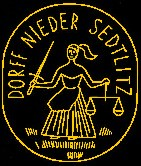
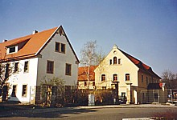
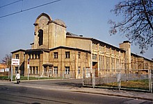
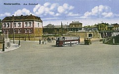
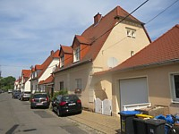
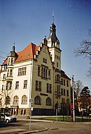
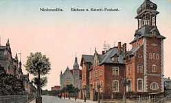
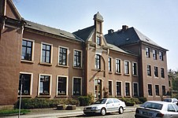
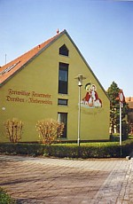
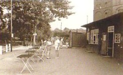

* * *

**Gemeindesiegel von Niedersedlitz**

* * *

**Schulen in Niedersedlitz:**

Niedersedlitz entstand vermutlich im 11./12. Jahrhundert als slawische Siedlung am Lockwitzbach und wurde 1350 erstmals als Sedelicz erwähnt. Der Name stammt vom Altsorbischen “sedlica” und bedeutet übersetzt "Sitz, Grund" bzw. “Siedlung”. Im Laufe der Zeit wechselte die Schreibweise über Zcedelicz (1378), Sedelwitz (1555) und Sedelicz in der Aue (1657) bis zum seit dem 18. Jahrhundert gebräuchlichen Niedersedlitz. Ursprünglich gehörte Niedersedlitz zu den Besitzungen der Meißner Bischöfe, die es als Lehen den Burggrafen von Dohna überließen. Nach deren Entmachtung 1402 übertrug der Markgraf zu Meißen den Ort verschiedenen Lehnsherren, so den Familien Körbitz und Bußmann. Noch bis ins 19. Jahrhundert besaßen Adlige, aber auch Dresdner Bürger Anteile am Dorf, ebenso das Rittergut Gamig in der Nähe von Pirna. Die Gerichtsbarkeit lag zunächst beim Amt Briesnitz, später bei den Rittergütern Lockwitz und Gamig.

Bis 1539 war Niedersedlitz kirchlich der Parochie Dohna zugeordnet, kam jedoch mit Einführung der Reformation zur [Leubener Kirche](../../ost/leuben/himmelfahrtskirche/), wo später ein Glasbild mit einer Madonnenfigur und der Inschrift "Sedelitz" an diese Beziehung erinnerte. Im Dreißigjährigen Krieg brannte der Ort fast vollständig nieder, wurde jedoch schon bald wieder aufgebaut. Auch die Belagerung Dresdens während der Schlacht von 1813 brachte der Bevölkerung große Nöte und richtete erhebliche Schäden an den Gebäuden an. 1818 brannten zudem mehrere Güter ab, erneut im Jahr 1827. 1865 wurde eine neue Brücke über den Lockwitzbach errichtet.

Niedersedlitz blieb bis um 1870 ein unbedeutendes Bauerndorf, dessen Bewohner vorrangig von der Landwirtschaft, dem Gartenbau und örtlichem Kleingewerbe lebten. Zu diesem Zeitpunkt gab es im Ort 17 Bauerngüter und ungefähr 500 Einwohner. 1871 gründete Otto Kauffmann eine Chemische Fabrik für Schamottewaren und Mosaikplatten und legte damit den Grundstein für die spätere Entwicklung zur Industriegemeinde. Begünstigt durch die seit 1848 über Niedersedlitzer Flur führende Bahnlinie nach Pirna siedelten sich bald weitere Unternehmen an. 1871 erhielt der Ort einen eigenen Güterbahnhof, ein Jahr später das erste Postamt. Niedersedlitzer Betriebe stellten u. a. Düngemittel, Schulmöbel, Lebensmittelgrundstoffe, Buntpapier, Süßwaren und Kartonnagen her. In diesem Zusammenhang entstanden auch die ersten Fabrikantenvillen außerhalb des alten Dorfkerns.

Zu den bekanntesten Niedersedlitzer Fabriken gehörte die 1887 eröffnete Elektromaschinenfabrik Kummer, die ab 1894 als Aktiengesellschaft firmierte und maßgeblich am Bau der ersten elektrischen Straßenbahnen Dresdens beteiligt war. 1899 entstand auf Inititative des Werkes die schmalspurige [Straßenbahnlinie](../../ost/niedersedlitz/dresdner_vorortbahn/) ins benachbarte Laubegast _(Foto)_. Nach Konkurs 1903 ging aus dieser Firma das [Sachsenwerk](../../ost/niedersedlitz/sachsenwerk/) hervor. Andere wichtige Unternehmen waren die Niedersedlitzer Kamerawerke und die [Firma Höntsch & Co.](../../ost/niedersedlitz/strassen_niedersedlitz/), die Gewächshäuser, Wintergärten, Heizungsanlagen u.ä. produzierte. Weitere Großbetriebe siedelten sich nach der Jahrhundertwende entlang der Bahnlinie und im benachbarten Leuben, Großzschachwitz und Heidenau an, womit Niedersedlitz zum Zentrum eines großen Industrieareals im Dresdner Osten wurde. Im Zuge dieser Entwicklung entstanden nun auch neue Wohnhäuser, ohne den alten Dorfkern jedoch völlig zu verdrängen. Bis zum Ersten Weltkrieg war der Ort mit den Nachbargemeinden Leuben und Dobritz zusammen gewachsen. Im Jahr 1900 schloss sich Niedersedlitz mit Lockwitz und Leuben zu einem Wasserwerksverband zusammen. Zuvor war bereits 1876 eine öffentliche Straßenbeleuchtung eingeführt worden. Für die auswärts wohnenden Arbeiter verkehrte ab 1906 eine weitere Straßenbahnlinie nach Lockwitz und von dort weiter nach Kreischa, die bis 1977 als [Lockwitztalbahn](../../sudost/lockwitz/lockwitztalbahn/) letzte schmalspurige Dresdner Straßenbahn war.

Nach dem Ersten Weltkrieg entstanden auf Niedersedlitzer Flur weitere Wohnsiedlungen, wobei die Bauherren meist Baugenossenschaften waren. So wurden zwischen 1920 und 1930 die Freiflächen an der Windmühlenstraße mit Arbeiterwohnhäusern bebaut, denen nach 1935 eine weitere Großsiedlung in diesem Bereich folgte. Bereits 1922 waren die Nachbarorte [Groß-](../../sudost/grossluga/) und [Kleinluga](../../sudost/kleinluga/) nach Niedersedlitz eingemeindet worden. Obwohl die Industriegemeinde bereits 1930 fast völlig vom Dresdner Stadtgebiet umschlossen war, konnte sie ihre Selbstständigkeit noch bis nach dem Zweiten Weltkrieg behaupten. Bereits im Juli 1945 regte der damalige Dresdner Oberbürgermeister Dr. Rudolf Friedrichs den Anschluss des Ortes an Dresden an. Dieser kam dann jedoch erst am 1. Juli 1950 zustande.

Nach 1945 setzte in der Industrie des Ortes ein grundlegender Wandel ein. Fast alle bestehenden Unternehmen wurden
zwangsweise enteignet und in volkseigene Betriebe umgewandelt. Das ab 1946 als sowjetische Aktiengesellschaft geführte Sachsenwerk kam erst 1954 wieder in Besitz der DDR und gehörte bis zur Wende dem Kombinat
Elektromaschinenbau an. Neben zahlreichen Neubauten im Betriebsgelände entstand in den 1970er Jahren eine
Plattenbausiedlung an der Försterlingstraße. Ein neues Ortszentrum wurde 1992/93 im Bereich Lugaer Straße errichtet.

Rathaus Niedersedlitz:

Die ersten Vorbereitungen für den Rathausbau begannen 1899 mit dem Ankauf von
Grundstücken an der damaligen Schulstraße (heute Sosaer Straße). Für die Entwurfsplanung konnte der Architekt Gustav Hänichen gewonnen werden, der bereits für die neuen
Rathäuser von Leuben und Potschappel (heute Stadtteil von Freital) verantwortlich zeichnete. Am 24. Juni 1901 erfolgte die Grundsteinlegung für den repräsentativen Neubau,
der bereits ein Jahr später, am 10. Juli 1902 feierlich eingeweiht werden konnte. Das Niedersedlitzer Rathaus wurde im Stil der damaligen Zeit mit baukünstlerischem Schmuck
gestaltet und weist neben Jugendstil- auch gotische und Renaissanceformen auf. Für den Turm schuf Bernhard Zachariä aus Altenburg eine Turmuhr.

Zunächst diente das Gebäude als Sitz der Gemeindeverwaltung. Später zogen hier u.a. Dienststellen der Polizei, der
Ortskrankenkasse, der örtlichen Spar- und Girokasse und des Konsumvereins ein. Der Ratskeller musste bereits nach
dem Ersten Weltkrieg mangels Resonanz wieder geschlossen werden. Zu DDR-Zeiten diente das ehemalige Rathaus als
Lager und Wohnheim für ungarische Gastarbeiter.  Heute wird das nach 1990 umfassend sanierte Gebäude als Weiterbildungszentrum der Stadtsparkasse genutzt.

Postwesen:

Niedersedlitz gehörte ursprünglich zum Postzustellbezirk Lockwitz und erhielt erst 1872 ein eigenes Postamt. Dafür hatte sich vor allem der Unternehmer Otto Kauffmann eingesetzt, um der örtlichen Industrie bessere Kommunikationsmöglichkeiten zu verschaffen. Die neue Postexpedition öffnete am 1. Juli 1872 als Postamt III. Klasse in einem Haus in der Nähe des Bahnhofes. Zum Postbezirk gehörten auch die Orte Leuben, Großdobritz, Prohlis, Torna und Großzschachwitz. Zudem war das Amt Speditionsanstalt für die Lockwitzer Post. Bereits wenige Jahre später verlegte man den Sitz zur Gartenstraße (heute Ecke Heidenauer / Lungkwitzer Straße).

Das hohe Postaufkommen der aufstrebenden Industriegemeinde führte 1897 zur Umwandlung in ein Postamt II. Klasse, 1902 in ein Amt I. Klasse. Dafür entstand 1901/02 an der damaligen Wilhelmstraße (An der Post) ein Neubau nach Plänen des Baumeisters Otto Beeger (Eröffnung am 1. April 1902 - _Foto_). Hier fand auch das 1878 gegründete Telegraphenamt sein neues Domizil. 1910 galt das Niedersedlitzer Postamt, bezogen auf die Einwohnerzahl, als verkehrsstärkstes im Deutschen Reich. Dieses blieb bis zur endgültigen Schließung am 9. Oktober 2000 in Betrieb. Heute dient das Gebäude als Wohnhaus.

Schulen in Niedersedlitz:

Bis 1875 wurden die wenigen Kinder des Dorfes im benachbarten Leuben unterrichtet. Danach schied Niedersedlitz am 1. Oktober 1875 aus dem Schulverband aus und richtete im Gut des Gemeindevorstandes Arnold eine eigene Schulstube ein. Durch den Zuzug von Arbeiterfamilien machte sich jedoch bald der Neubau eines Schulhauses erforderlich, welches am 29. Mai 1876 an der Schulstraße (heute Sosaer Straße) eingeweiht werden konnte. Die Planung oblag dem Architektenbüro Kirsten & Kreyßig. Zunächst gab es hier nur einen Klassenraum im Erdgeschoss, im Obergeschoss befand sich die Lehrerwohnung.

Da die Räumlichkeiten jedoch schon bald erneut zu klein waren, entstand 1887/88 in unmittelbarer Nachbarschaft ein Neubau. 1895, 1904 und 1908-10 folgten weitere Um- und Ausbauten an diesem Gebäude. 1901 wurde zudem eine Schulturnhalle eingeweiht. Nach der Eingemeindung des Ortes nach Dresden wurde das Schulhaus bis zur Wende von der 89. POS genutzt. Heute dient es als 89. Grundschule.

Freiwillige Feuerwehr:

Ursprünglich oblag auch in Niedersedlitz wie in den meisten Landgemeinden die Brandbekämpfung der gesamten Bevölkerung. Dafür standen zunächst nur eine einfache Faßspritze sowie einige Eimer zur Verfügung. Mit der Industrialisierung machte sich eine Neuorganisation des Brandschutzes erforderlich. Anlass war vor allem der Großbrand der Danckelmannschen Mühle im August 1892. Am 31. März 1894 wurde deshalb im Ort eine freiwillige Feuerwehr gegründet. Ab 1904 gab es zudem eine Fabrikfeuerwehr des Sachsenwerkes. 1924 erhielt die Niedersedlitzer Feuerwehr als eine der ersten in der Umgebung eine moderne Motorspritze, vier Jahre später sogar eine Autodrehleiter. Nach 1945 wurde die technische Austattung weiter modernisiert. Ihr Domizil befindet sich bis heute im Feuerwehrhaus auf der Dorfstraße 7 _(Foto)_.

Gaswerk:

Das Gaswerk Niedersedlitz entstand auf einem 1893 von der Gemeinde erworbenen Grundstück und wurde 1902 in Betrieb genommen. Die Gasproduktion, die ausschließlich der Versorgung des Ortes und der ansässigen Industrie diente, oblag der Thüringer Gasgesellschaft. 1913 übernahm die Stadt Dresden das Werk und ließ es mit dem städtischen Gaswerk in Reick verbinden. Nach dem Ersten Weltkrieg erwies sich das technisch veraltete Werk als überflüssig und wurde 1924 stillgelegt. Die Gebäude selbst fielen 1945 einem Luftangriff auf das Niedersedlitzer Industriegebiet zum Opfer.

Freibad Niedersedlitz

Das Freibad wurde 1925 von der Gemeinde Niedersedlitz an der Mühlenstraße angelegt und Anfang Juni eröffnet. Zum Bad gehörten neben einem 18 x 20 Meter großen Schwimmbecken ein Sprungbrett, Umkleidekabinen sowie Luft- und Sonnenbäder.Wegen der sehr geringen Größe kamen schon wenig später Forderungen auf, das Bad zu vergrößern,was jedoch an den begrenzten finanziellen Mitteln des Ortes scheiterte.

Mit der Eingemeindung 1950 übernahm die Stadt Dresden das Bad und veranlasste erneut Planungen für einen Ausbau der Anlage. Letztlich beschränkte man sich jedoch auf verschiedene Modernisierungs- und Sanierungsarbeiten wie den Bau eines neuen Toilettengebäudes und die Instandsetzung des Mühlbachbettes. 1999 erfolgte die Schließung des Freibades, welches 2002 offiziell aus dem Bereich Sportstätten und Bäder herausgelöst wurde. Das Areal dient heute gewerblichen Zwecken.

## [Niedersedlitzer Straßen](../../ost/niedersedlitz/strassen_niedersedlitz/)

[_Weiterführende Literatur und Quellen_](../../impressum/quellenverzeichnis/)

 \[ [Home](../../index.html)\] \[ [Nord](../../nord/)\] \[ [Nordwest](../../nordwest/)\] \[ [Neustadt](../../neustadt/)\] \[ [Nordost](../../nordost/)\] \[ [West](../../west/)\] \[ [Zentrum](../../zentrum/)\] \[ [Südwest](../../sudwest/)\] \[ [Süd](../../sud/)\]
 \[ [Südost](../../sudost/)\] \[ [Ost](../../ost/)\] \[ [Register](../../Register/register.html)\] \[ [Kontakt](../../Kontakt/kontakt.html)\] \[ [Impressum](../../impressum/)\]
