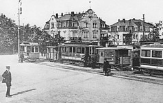
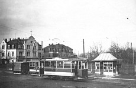
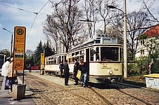

* * *

Die Dresdner Vorortbahn wurde 1899 vom Besitzer der Niedersedlitzer [Kummer-Werke](../../../ost/niedersedlitz/sachsenwerk/) erbaut, die zu den größten Firmen des Elektromaschinenbaus in Sachsen gehörten. Um seine Angestellten schneller zu ihren Arbeitsplätzen zu bringen, ließ Kummer auf eigene Kosten eine Straßenbahnlinie mit 1000 mm Spurweite erbauen, die Niedersedlitz mit den Nachbarorten Leuben und Laubegast verband. Am 30. Dezember 1899 verkehrten die ersten Bahnen, die wegen ihrer grün-weißen Farbgebung im Volksmund “Laubfrosch” genannt wurden.

Bereits wenige Monate nach Betriebseröffnung mussten die Kummer-Werke jedoch Konkurs anmelden, womit auch die Zukunft der Vorortbahn in Frage gestellt war. Am 1. Juli 1902 übernahm ein eigens gegründeter Gemeindeverband der Anliegerorte die Bahn. Am 17. Oktober 1906 später konnte eine weitere Strecke zwischen Niedersedlitz und Kleinzschachwitz eingeweiht werden. Ein wichtiger Knotenpunkt entwickelte sich am Niedersedlitzer Bahnhof, wo die Fahrgäste auch in die [Lockwitztalbahn](../../../sudost/lockwitz/lockwitztalbahn/) in Richtung Kreischa umsteigen konnten. Deutlich gestiegene Fahrgastzahlen machten die Anschaffung weiterer Triebwagen erforderlich, deren Zahl bis 1921 auf insgesamt zehn anstieg. Zeitweise war auch an den Betrieb einer Güterstraßenbahn gedacht, die jedoch über erste Studien nicht hinauskam. Dafür war ein Rollbockbetrieb zwischen dem Niedersedlitzer Bahnhof und verschiedenen Industrieunternehmen vorgesehen. Mit Beginn des Ersten Weltkriegs wurden alle diesbezüglichen Pläne zu den Akten gelegt.

Mit der Eingemeindung von Leuben, Laubegast und Kleinzschachwitz im Jahr 1921 übernahm die Stadt Dresden den Betrieb der Straßenbahn. Da sich die unterschiedlichen Spurweiten von Dresdner Straßenbahn und Vorortbahn als ungünstig erwiesen, wurde die Bahn jedoch am 24. November 1924 stillgelegt. Ein knappes Jahr später war der Umbau in Stadtspur abgeschlossen, so dass am 1. Oktober 1925 erstmals wieder Straßenbahnen zwischen den Orten verkehrten, womit die einstige Vorortbahn ins Dresdner Netz integriert war. Während die neue Trasse zwischen Niedersedlitz, Leuben und Laubegast weitgehend der alten Strecke folgte, entstand die neue Verbindungslinie nach Kleinzschachwitz über die heutige Berthold-Haupt-Straße erst 1936. Dabei verschwand auch der bisherige Endpunkt direkt an der Fähre, der durch eine Gleisschleife an der Kurhaustraße ersetzt wurde. Das Foto zeigt einen historischen Triebwagen vor dem Niedersedlitzer Bahnhof, wo einst auch die Vorortbahn ihren Endpunkt hatte.

* * *

 \[ [Nord](../../../nord/)\] \[ [Nordwest](../../../nordwest/)\] \[ [Neustadt](../../../neustadt/)\] \[ [Nordost](../../../nordost/)\]
 \[ [West](../../../west/)\] \[ [Zentrum](../../../zentrum/)\] \[ [Südwest](../../../sudwest/)\] \[ [Süd](../../../sud/)\] \[ [Südost](../../../sudost/)\] \[ [Ost](../../../ost/)\] \[ [Register](../../../Register/register.html)\] \[ [Kontakt](../../../Kontakt/kontakt.html)\] \[ [Impressum](../../../impressum/)\]
