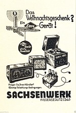
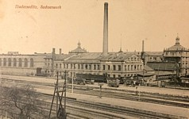
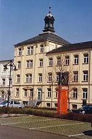
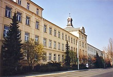
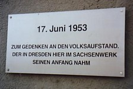
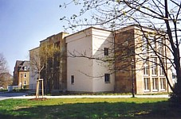

Das Niedersedlitzer Sachsenwerk geht auf ein 1881 von Oskar Ludwig Kummer in der Waisenhausstraße 3 gegründetes “Technisches Büro für Maschinenbau” zurück. Vier Jahre später verlegte Kummer seinen Betrieb nach Niedersedlitz und eröffnete hier auf einem verkehrsgünstig direkt an der Bahnlinie gelegenem Areal eine Fabrik für Elektromaschinen _(Foto)_. Als früherer kaiserlicher Marine-Ingenieur verfügte er nicht nur über großes technisches Wissen, sondern sah auch den bevorstehenden Aufschwung der elektrotechnischen Industrie voraus. Innerhalb weniger Jahre gelang es ihm, die Belegschaft der “Elektrizitätswerke O. L. Kummer & Co. “von anfangs zwölf auf über 500 Mitarbeiter zu vergrößern. Für die Produktion und Verwaltung entstand 1894 ein noch heute erhaltenes großes Gebäude an der damaligen Güterbahnhofstraße (heute Straße des 17. Juni).

Im gleichen Jahr wurde das Unternehmen in eine Aktiengesellschaft mit Zweigbetrieben in mehreren Städten umgewandelt. Hergestellt wurden verschiedene elektrische Antriebsmaschinen und Anlagen, u .a. Motoren für Straßenbahnen und Lokomotiven. Die Firma Kummer war auch am Bau der ersten elektrischen Straßenbahn Dresdens (1893) beteiligt und übernahm den Umbau der Pferdebahnwagen zu elektrischen Triebwagen. Zur Verbesserung derVerkehrsverhältnisse im Niedersedlitzer Raum entstand auf Kummers Initiative 1899 die [Leubener Vorortbahn](../../../ost/niedersedlitz/dresdner_vorortbahn/), die Niedersedlitz mit seinem Nachbarort Leuben und später auch mit Kleinzschachwitz verband. Auch die [Straßenbahnlinie Loschwitz - Pillnitz](../../../nordost/loschwitz/strassen_loschwitz/pillnitzer_landstrasse/) (1901 eröffnet) wurde von den Kummer-Werken errichtet. Weitere Straßen- und Bergbahnprojekte realisierte Kummer u.a. in Aachen, Bad Aibling, Berlin, Breslau, Helsinki, Leipzig, Magdeburg, Murnau, Saarbrücken und Stettin.

Bereits zur Jahrhundertwende beschäftigte der Betrieb über 2000 Arbeiter, die meist in Niedersedlitz und den benachbarten Gemeinden wohnten. Für diese entstanden neue Wohnhäuser im Raum Leuben/Dobritz und an der Bahnlinie. Trotz dieser positiven Entwicklung geriet Kummer in finanzielle Schwierigkeiten und musste 1901 Konkurs anmelden. Nach Übernahme des Unternehmens durch neue Anteilseigner wurde die Firma ab 1903 als “Sachsenwerk Licht und Kraft AG” weiterbetrieben. Die Angestellten produzierten in Niedersedlitz und einem Zweigwerk in Radeberg verschiedenste elektrische Geräte vom Elektromotor bis hin zu Spezialausrüstungen für Kraftwerke. Zeitweise gehörten sogar Kühlschränke und Rundfunkgeräte zum Produktionsprogramm.

Zu den wichtigsten Auftraggebern des Sachsenwerkes gehörte vor und nach dem Ersten Weltkrieg die öffentliche Hand. Zahlreiche Städte und Gemeindeverbände ließen von der Firma ihre Elektrizitätswerke errichten bzw. erweitern. 1930 wurde der Betrieb vom AEG-Konzern übernommen und blieb bis 1945 einer der wichtigsten Hersteller der Branche in Deutschland, nicht zuletzt durch Großaufträge für die Rüstungsindustrie während des Zweiten Weltkrieges. 1936 hatte das Unternehmen den weltweit ersten Einheitsmotor auf den Markt gebracht.

1945 wurde die Firma von der sowjetischen Militärverwaltung beschlagnahmt. Noch im gleichen Jahr begann die Demontage des Betriebes, ein Jahr später die förmliche Enteignung und Umwandlung in eine SAG (Sowjetische Aktiengesellschaft) mit Zuordnung zur SAG “Kabel” unter Leitung des sowjetischen Generaldirektors Fomenko. 1953 entstanden noch einige neue Werkshallen, bevor der Betrieb an die DDR zurückgegeben und in den VVB Elektromaschinenbau (VEM) eingegliedert wurde. Am 17. Juni 1953 gehörte das Sachsenwerk Niedersedlitz zu den Zentren des Aufstandes gegen die herrschenden politischen Verhältnisse. Gemeinsam mit Angehörigen benachbarter Betriebe legten die Angestellten ihre Arbeit nieder und bildeten einen Protestzug zum Postplatz, wo der Aufstand von sowjetischen Panzern gewaltsam niedergeschlagen wurde. An diese Ereignisse erinnert heute eine Gedenktafel am Haupteingang _(Foto)._

In den 1960er und 70er Jahren spezialisierte sich das Sachsenwerk auf die Produktion von Bahnmotoren, Isolatoren, Turbogeneratoren und anderen elektrischen Großanlagen, während die Konsumgüterproduktion eingestellt wurde. Ab 1974 gehörte es zum Kombinat VEB Elektromaschinenbau (VEM) und war mit über 5000 Beschäftigten einer der größten Arbeitgeber Dresdens. Auch das 1946 aus der Sächsischen Stahl- und Windmotorenfabrik Arthur Weber, der Firma G. und R. Herzog und der Emil Klemm & Dreßler GmbH hervorgegangene Elektromotorenwerk Dresden wurde diesem Kombinat angegliedert. Dank enger Zusammenarbeit mit der Technischen Universität und verschiedenen Forschungsinstituten gehörten die Erzeugnisse des Betriebes zu den Spitzenprodukten der Branche und wurden weltweit exportiert.

Die Wendejahre 1989/90 brachten jedoch auch hier erhebliche Einschnitte mit Massenentlassungen, Um- und Neugründungen usw. Als Nachfolgebetrieb entstand die VEM Sachsenwerk GmbH. Weitere Hallen und Büros sind an andere Betriebe vermietet. Die ehemalige, 1895 errichtete Transformatorenhalle wurde zum WIM Sport- und Freizeitzentrum mit Dresdens größter Badmintonhalle umgebaut.

Kulturhaus Sachsenwerk:

1951/52 entstand an der Stephensonstraße mit Unterstützung der SDAG ein Kulturhaus für die Angestellten des Sachsenwerkes. Unter Leitung des Architekten Fritz August Franz wurde ein modernes Mehrzweckgebäude _(Foto)_ mit Versammlungsräumen und mehreren Sälen errichtet, welches am 12. Februar 1952 als erstes Betriebskulturhaus in Sachsen eröffnet werden konnte. Bis 1989 fanden hier regelmäßig Theateraufführungen, Tanzveranstaltungen und Versammlungen statt. Außerdem konnten die Räume durch Arbeitsgruppen des Kulturbundes und anderer gesellschaftlicher Vereinigungen genutzt werden.

Mit Privatisierung des volkseigenen Sachsenwerkes wurde das Kulturhaus 1990 geschlossen und in eine Diskothek umgebaut. Unter dem Namen “Sachs” öffnete hier 1991 eine der ersten Großraumdiskotheken im Dresdner Raum, die zunächst gut besucht war. In einem Seitenflügel entstand das Chinarestaurant “Pavillon”. Mit der Eröffnung weiterer Tanzhäuser ähnlichem Konzepts geriet das “Sachs” jedoch schon bald in wirtschaftliche Schwierigkeiten. 1995 brannte das Gebäude aus, vermutlich durch Brandstiftung, wobei die genauen Umstände ungeklärt blieben. Die Ruine steht seitdem leer. Nach Abbruch eines Großteils des Komplexes soll im denkmalgeschützten Foyergebäude künftig ein Museum zur Geschichte des Sachsenwerkes untergebracht werden.

* * *

 \[ [Home](../../../index.html)\] \[ [Nord](../../../nord/)\] \[ [Nordwest](../../../nordwest/)\] \[ [Neustadt](../../../neustadt/)\] \[ [Nordost](../../../nordost/)\] \[ [West](../../../west/)\] \[ [Zentrum](../../../zentrum/)\] \[ [Südwest](../../../sudwest/)\] \[ [Süd](../../../sud/)\] \[ [Südost](../../../sudost/)\] \[ [Ost](../../../ost/)\] \[ [Register](../../../Register/register.html)\] \[ [Kontakt](../../../Kontakt/kontakt.html)\] \[ [Impressum](../../../impressum/)\]
